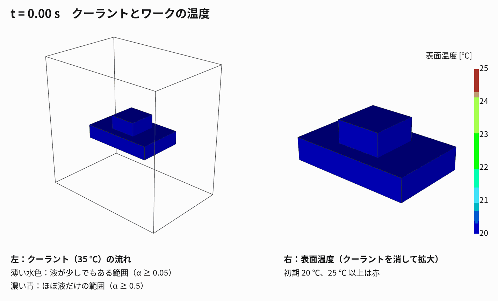

# 02 解析設定と結果：run004 加工エリアでワークにクーラントをかける

作成日：2026-11-03　OpenFOAM v2512　ソルバ：`chtMultiRegionTwoPhaseEulerFoam`（解説は 01）



---

## 1. ねらい

工作機械の加工エリア（空気）に、ポンプで温まったクーラントを流し、
ワークとテーブル（鋼）がどう温まるかを、気液二相流と固体の熱連成でまとめて解く。
参考：`refs/02_Klimant…`（加工エリア内の壁の熱伝達率）、`refs/03_Geist…`（切削油と空気の CFD を FEM に渡す）。

---

### 解いている式（くわしくは 01 の「2.4 基礎式」）

| 領域 | 何を解くか | 式 |
|---|---|---|
| 流体（空気＋クーラント） | **オイラー–オイラー二相流**：気相と液相をそれぞれ連続体として、体積分率 α・速度・温度を相ごとに解く。圧力は共通 | 相ごとの質量・運動量・エネルギー保存＋相間の抗力・熱伝達、α<sub>g</sub> + α<sub>l</sub> = 1 |
| 固体（テーブル・ワーク） | **熱伝導だけ**（流れ・変形は解かない） | ρc<sub>p</sub> ∂T/∂t = ∇·(κ∇T) |
| 境界 | 温度が等しく、熱流束がつり合う（液が濡れている所ほど熱がよく伝わる） | T<sub>流体</sub> = T<sub>固体</sub>、Σα<sub>k</sub>κ<sub>k</sub>∂T<sub>k</sub>/∂n = κ<sub>s</sub>∂T<sub>s</sub>/∂n |

## 2. 形状とメッシュ

| 項目 | 値 |
|---|---|
| 加工エリア（囲い） | x 0〜600、y 0〜600（上向き）、z 0〜400 mm |
| テーブル（鋼） | x 140〜460、y 240〜300（高さの真ん中）、z 100〜300 mm |
| ワーク（鋼） | x 240〜360、y 300〜360（テーブルの上）、z 140〜260 mm |
| クーラントのノズル出口 | 天井の中央 40 × 40 mm（x 280〜320、z 180〜220）＝ワークの真上 |
| 排出口 | 床の左右の帯（x < 100、x > 500 mm） |
| 換気口 | 天井のノズル以外の部分（大気に開放） |
| メッシュ | 20 mm の六面体。流体 17,412 セル、固体（テーブル＋ワーク）588 セル |

テーブルとワークは 1 つの固体領域 `solid` としてまとめている（接触熱抵抗なし）。

作成手順（`make_case.py` → `Allrun`）

```
blockMesh → topoSet（固体セル、ノズル・排出口の面）→ createPatch（inlet, drain）
→ splitMeshRegions -cellZonesOnly（water / solid に分割）→ setFields → ソルバ
```

---

## 3. 物性と条件

| 項目 | 設定 |
|---|---|
| 気相 | 空気（理想気体、分子量 28.96、c<sub>p</sub> 1007、μ 1.81×10⁻⁵、Pr 0.71） |
| 液相（クーラント） | 水の物性（密度 1000、c<sub>p</sub> 4195、μ 9.59×10⁻⁴、Pr 6.62）。水溶性クーラントの近似 |
| 固体 | 例題の鋼の物性 |
| 液滴の代表径（空気中に散ったとき） | 0.45 mm |
| ノズル出口 | 液のみ（α<sub>liquid</sub> = 1）、下向き 1.0 m/s、**35 ℃（308 K、ポンプで温まった想定）**。流量 約 96 L/min |
| 初期状態 | 加工エリアは空気のみ、空気・テーブル・ワーク 20 ℃（293 K） |
| 囲いの壁・床 | 20 ℃ 一定 |
| 排出口・換気口 | 圧力一定（大気）で出入り自由 |
| 時間 | 0〜3 秒、Δt ≤ 2 ms（Courant 数で自動調整）、0.25 秒ごとに書き出し |
| 計算時間 | 1 並列で約 12 分（この環境では mpirun が止まるため並列なし） |

---

## 4. 結果（t = 3 s）

- ノズルから出たクーラントは柱になって落ち、ワークの上面に当たって四方に広がる。
- ワークの縁からテーブルの上に流れ、テーブルの縁から床へ落ちて、左右の排出口へ流れる。
- 3 秒の間に温まったのは、クーラントが直接当たる**ワークの上面とテーブルの上面の縁**。
  - 固体のセル温度：最低 293.0 K、平均 293.3 K、最高 295.7 K
  - 表面（点の値）では、ワークの上面とテーブルの縁が 299 K 程度
- 鋼は熱容量が大きいので、3 秒では中まではほとんど温まらない。
  熱変形まで見るには、**数分〜数十分の計算**、または熱伝達率を求めて固体だけを長時間解く方法（Geist らの手順）が必要。

---

## 5. 限界と次の一手

1. **ノズル**：今は天井から 1 本の柱として落としている。実機では主軸の先のノズルから
   ワークの 50〜100 mm 上で斜めに吹き付けるので、主軸ブロックとノズル数本を付けた版にする。
2. **メッシュ**：20 mm は粗い。液膜の厚さ（数 mm）は表せない。ワーク周りだけ細かくする。
3. **時間**：3 秒では熱の入り始めしか見えない。熱伝達率を時間平均で取り出し、固体の長時間計算につなぐ。
4. **囲いの壁**：今は温度一定。壁を固体（板金）として追加すれば、Klimant らの図のような壁の熱伝達率が出せる。

---

## 6. 描画

`tools/render_workspace.py`（python の VTK を直接使用。この環境では ParaView の pvbatch が止まるため）

- 斜め上からの視点（y 軸が上）
- クーラントは「液の体積割合 α（そのセルの体積のうち液体が占める割合）」の等値面で 2 段階に描く
  - 薄い水色：α = 0.05（液が少しでもある範囲の外形。飛沫や薄い流れも含む）
  - 濃い青：α = 0.5（ほぼ液だけの範囲。ノズル直下の液の柱）
  - セルの値を点の値に直すときは、流体内部のセルだけを使う（境界の値を混ぜると、
    t = 0 で壁に沿った偽の面が出るため）
- テーブル・ワーク：流体との境界面の温度（熱をやり取りしている面の温度）で色付け（293〜300 K）
  - 3 秒の時点で、クーラントが当たるワークの側面の下やテーブル上面の縁が 295〜297 K
- 20 mm のメッシュでは、落ちる液の柱がすぐに空気と混ざってぼやけるため、α ≥ 0.5 はノズル直下にしか残らない
- 出力：`run004_workspace_coolant_work3D/images/frame_*.png`、`coolant_workspace.gif`

ParaView で開くときは `run004_workspace_coolant_work3D/post.foam`。
上下が逆に見えるときは、カメラの「+Y を上」に設定する。
