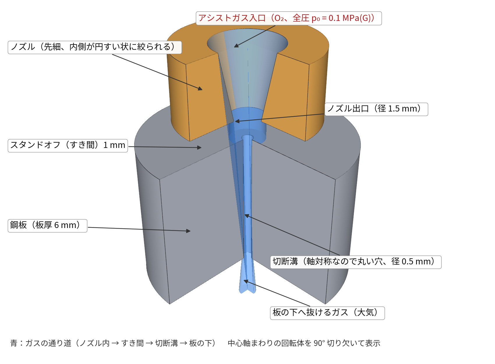
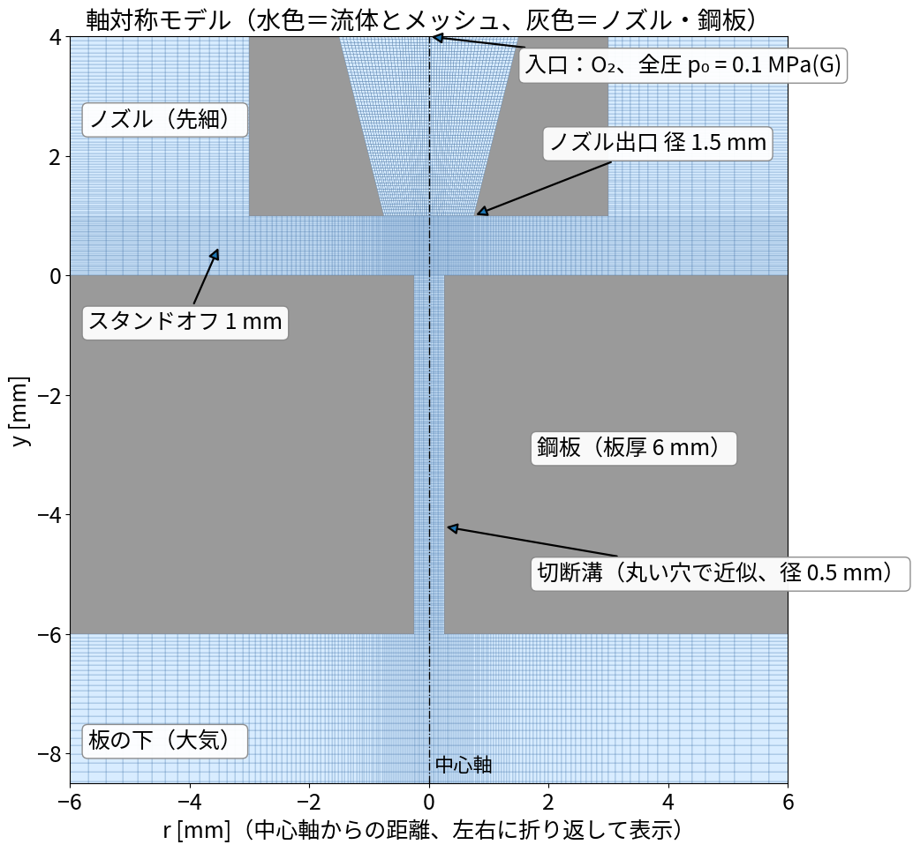
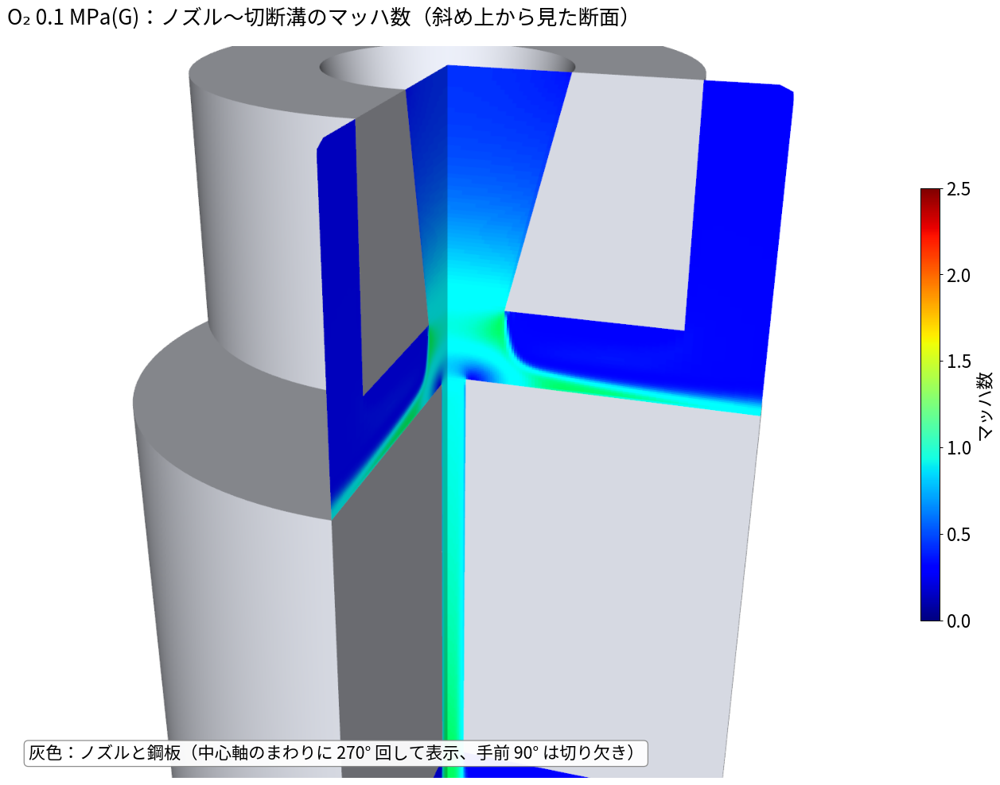
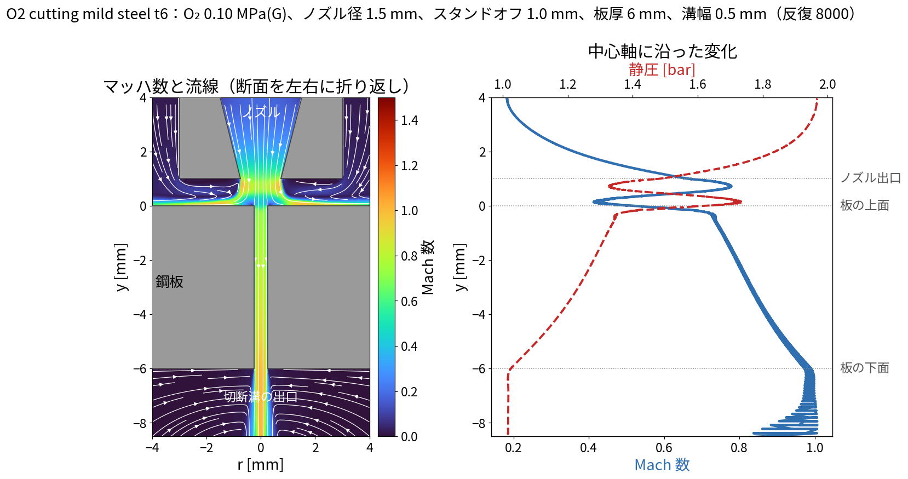
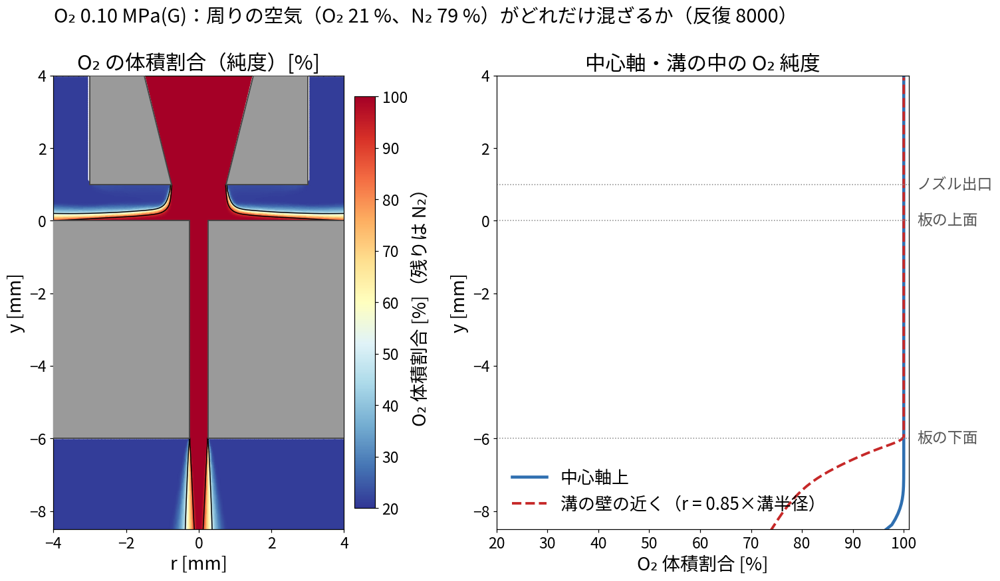
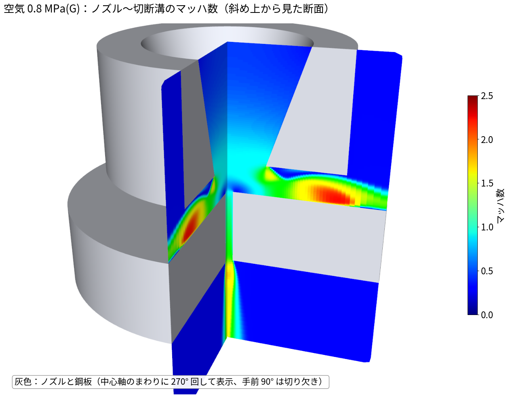
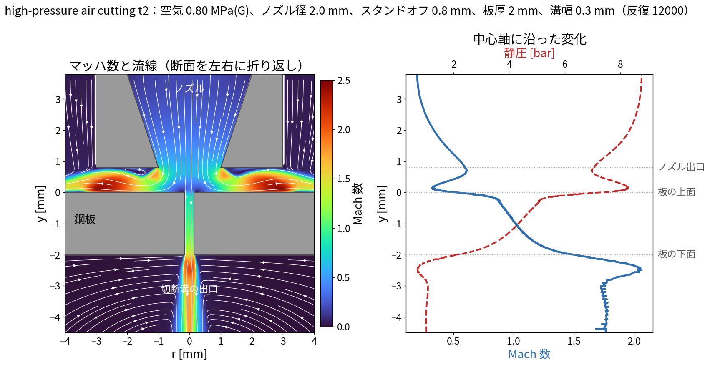
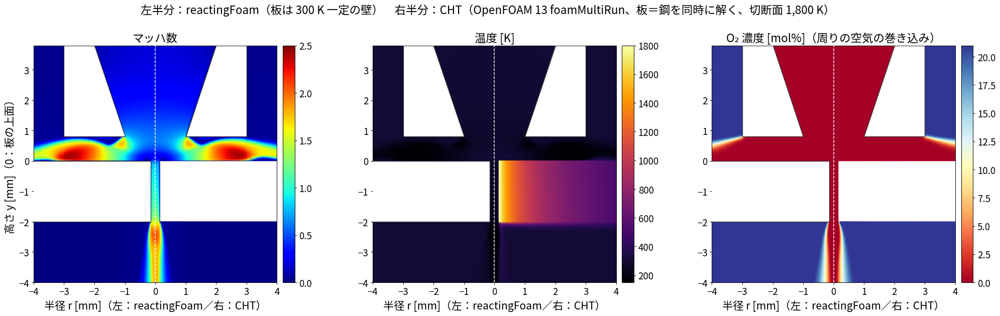
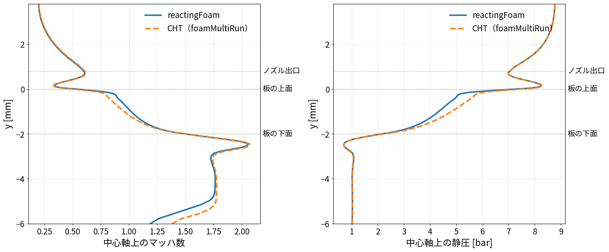
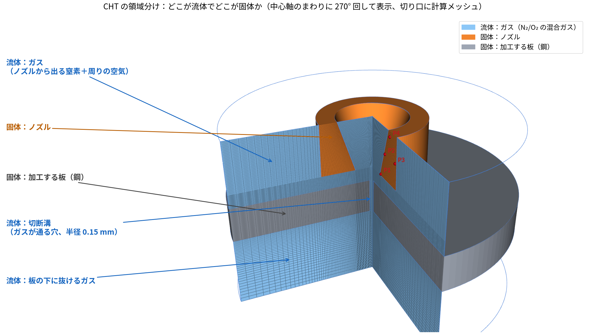

# 02 解析設定と結果：実際に近い条件のアシストガス流れ（run002・run003）

作成日：2026-11-03　OpenFOAM v2512　ソルバ：`reactingFoam`（化学反応なし、局所時間刻み LTS による疑似定常）
ソルバ選定・`transonic` の意味は `01_圧縮性ソルバの選び方とtransonic.md`

---

## 1. モデルの形（軸対称、両ケース共通の作り）

`tools/make_laser_case.py` で作る。中心軸（y）まわりの 5° のくさび形（wedge）で、3 次元の回転体を表す。



断面とメッシュ：




| 境界 | 条件 |
|---|---|
| inlet（ノズル入口） | 全圧を 0 → 1,500 回で目標値まで上げる（`uniformTotalPressure`）、全温 300 K |
| ambient（外周・上・下） | 大気圧 101,325 Pa、300 K、空気（O₂ 23.3 %、N₂ 76.7 %、質量分率） |
| nozzle・plate（壁） | すべりなし、300 K 一定 |
| ガス | O₂ と N₂ の 2 成分。比熱一定（O₂ 918、N₂ 1040 J/kgK）・理想気体。超音速で温度が下がっても使える |
| 乱流 | k-ω SST |

---

## 2. 2 つのケースの条件

| | run002 酸素切断 | run003 高圧空気切断 |
|---|---|---|
| 想定 | 軟鋼 板厚 6 mm の酸素切断 | 薄板 2 mm の高圧空気（窒素）切断 |
| ガス | O₂ 100 % | 空気 |
| 圧力（ゲージ） | 0.1 MPa | 0.8 MPa |
| ノズル出口径 | 1.5 mm | 2.0 mm |
| スタンドオフ | 1.0 mm | 0.8 mm |
| 切断溝の幅 | 0.5 mm | 0.3 mm |
| セル数 | 10,525 | 12,270 |
| 反復 | 8,000 | 12,000 |

---

## 3. 結果

### run002 酸素切断（0.1 MPa）



断面：



- 圧力比（全圧／大気圧）が約 2.0 で、音速になる限界（1.89）をわずかに超える程度。
- ノズル出口でマッハ約 0.8、板に当たって止まり（よどみ圧 約 1.7 bar）、大部分は板に沿って外へ流れる。
- 切断溝に入ったガスは溝の中で加速し、溝の出口でマッハ約 1.0 になる。
- 全体に穏やかな流れで、強い衝撃波はない。

#### 酸素と窒素の割合（O₂ 純度）



- ガスは O₂ と N₂ の 2 成分として解いているので、周りの空気（O₂ 21 %・N₂ 79 %、体積割合）が
  どれだけ混ざるかがわかる（`tools/plot_species.py`）。
- この軸対称モデルでは、ノズルから出た純酸素が切断溝の入口を完全に覆うため、
  **溝の中の O₂ 純度はほぼ 100 %**。空気が混ざるのは、板の上を外へ流れる薄い層と、板の下に噴き出した後だけ。
- 実際の溝（スリット・ノズルが移動）では、溝の後ろ側から空気が巻き込まれて純度が下がる。
  酸素切断では純度が 99.5 % から 1 % 下がるだけで切断速度が落ちるとされるので、3 次元モデルで確かめたい点。
- 入口の O₂ の割合（例：工業用酸素 99.5 %）を変えることも、`make_laser_case.py` の `YO2_in` で簡単にできる。

### run003 高圧空気切断（0.8 MPa）



断面：



- 圧力比 約 8.9 の強い超音速の流れ。
- 板の中央に当たったところで止まり（よどみ圧 約 8 bar）、**板の上面に沿ってマッハ 2 を超える超音速の壁噴流**になって外へ広がる。
- 切断溝に入ったガスは溝の中で加速し、板の下へマッハ約 2 で噴き出す。
- 想定していた流れ（ノズル → 板に当たる → 溝の中を下へ／板に沿って横へ）と同じ形の流れになっている。

---

## 4. 限界と次の一手

1. **切断溝を丸い穴で近似**している（軸対称のため）。実際の溝は細長いスリットで、
   ノズルが動きながら切るので、切断面（前面）が傾き、溝に入るガスはもっと多い。
   → 次はスリットと傾いた切断前面をもつ **3 次元モデル**（対称面で半分だけ解く）。
2. 溶けた金属（ドロス）や酸化反応の熱は入れていない（ガスだけの流れ）。
3. 衝撃波は upwind の離散化で数セル分なまる。衝撃波の位置を詳しく見るならメッシュを細かくするか、
   密度ベースの `rhoCentralFoam`（1 成分）と比べる。
4. この環境では mpirun が止まるため、1 並列で計算している。

---

## 5. 板（固体）も同時に解く：混合ガス＋固体連成（CHT）の定常解析

作成日：2026-11-10　ケース：`run010_N2cut_t2mm_CHT_steady_OF13`（比べる相手：`run008_N2cut_t2mm_reactingFoam`）

### 5.1 ねらい

ここまでの計算は、板を「温度一定の壁」として流れだけを解いていた。
実際の切断では、レーザーで切断面が溶け、その熱が板の中を伝わりながらアシストガスに奪われる。
そこで、**アシストガス（混合ガス・超音速）と板（鋼）を同時に解く**。
板とガスのあいだの熱の受け渡しは計算で決まるので、熱伝達率を仮定しなくてよい。

### 5.2 どのソルバで解けるか（調べた結果）

| ソルバ（版） | 定常 | 混合ガス | 超音速（`transonic`） | 固体連成 | 結果 |
|---|---|---|---|---|---|
| `chtMultiRegionSimpleFoam`（ESI v2512） | ○ | **×**（`rhoThermo`＝1 種類のガス） | **×**（圧縮性の項もない） | ○ | 空気（1 種類のガス）で試したら、ノズルが音速に達した反復 278 回目で発散（`run006`） |
| `chtMultiRegionSimpleFoam`（ESI v2606） | ○ | **×**（v2512 と同じ。リリースノートにも変更なし） | × | ○ | 試していない |
| `chtMultiRegionFoam`（ESI v2512） | **×**（LTS なし。`localEuler` にすると「`rDeltaT` が見つからない」で停止） | ○（`rhoReactionThermo`） | **×**（圧縮性の項はある） | ○ | 本当の時間で進めると、ノズルがチョークし始めるところで時間刻みが 10⁻¹² s 以下に縮んで止まる。空気は 0.18 ms（`_failed_run007`）、窒素は安定化しても 0.24 ms（`run009`） |
| `chtMultiRegionSimpleFoam`（Foundation） | — | — | — | — | v5 までで廃止。v6 以降は `chtMultiRegionFoam` が定常も兼ねる |
| **`foamMultiRun`（Foundation OpenFOAM 13）** | **○**（流体は LTS、固体は `steadyState`） | **○**（`multicomponentFluid`） | **○** | **○** | **計算できた**（`run010`、12,000 回、4 並列で 23 分） |

- ESI 版の CHT ソルバは、「定常」「混合ガス」「超音速」の 3 つを同時に満たせない。
- Foundation 版の OpenFOAM 13 では、領域ごとに別の部品（モジュール）を割り当てる `foamMultiRun` に作り直されている。
  - 流体の部品 `multicomponentFluid` は、`reactingFoam` と同じく **混合ガス・`transonic`・LTS** に対応している。
  - 固体の部品 `solid` は LTS には対応していないが、ソースに「LTS のときは `steadyState` を使って」とある。固体は定常の熱伝導として解く。
  - 起動時のログに `Using LTS` と `PIMPLE: Operating solver in mixed steady-state/transient mode` と出て、この組み合わせが受け付けられることを確かめた。

### 5.3 設定（OpenFOAM 13 の書き方）

`system/controlDict`：領域ごとに使う部品を書く

```
application     foamMultiRun;

regionSolvers
{
    air             multicomponentFluid;    // 混合ガス（O2/N2）、LTS、transonic
    plate           solid;                  // 鋼の板、定常の熱伝導
}

endTime         12000;          // LTS の反復回数
deltaT          1;
```

流体（`system/air/fvSchemes` と `system/air/fvSolution`）は、`reactingFoam` の run003 と同じ設定

```
ddtSchemes
{
    default         localEuler;     // LTS（局所時間刻み）
}

PIMPLE
{
    transonic               yes;    // 超音速
    maxCo                   0.2;
    rDeltaTSmoothingCoeff   0.02;
    alphaTemp               1;
    nCorrectors             2;
    nNonOrthogonalCorrectors 1;
}
```

固体（`system/plate/fvSchemes`）は定常

```
ddtSchemes
{
    default         steadyState;
}
```

切断面（板の、溝に接する 2 列のセル）を、鋼の融点に近い 1,800 K に固定する（`system/plate/fvConstraints`）

```
laserFront
{
    type            fixedTemperature;
    cellZone        laserFront;         // topoSet で作る
    mode            uniform;
    temperature     constant 1800;
}
```

ガスと板の境目は、両側とも `coupledTemperature`（温度と熱流束が等しくなる）

```
air_to_plate
{
    type            coupledTemperature;
    value           uniform 300;
}
```

ESI 版との書き方の主な違い

| 項目 | ESI v2512 | Foundation OpenFOAM 13 |
|---|---|---|
| ソルバの指定 | `application chtMultiRegionFoam;` と `constant/regionProperties` | `application foamMultiRun;` と `regionSolvers` |
| 物性のファイル | `thermophysicalProperties` | `physicalProperties` |
| 乱流のファイル | `turbulenceProperties`（`RASModel`） | `momentumTransport`（`model`） |
| 境目の温度 | `compressible::turbulentTemperatureCoupledBaffleMixed` | `coupledTemperature` |
| 温度の固定・上下限 | `fvOptions` | `fvConstraints`（`fixedTemperature`・`limitTemperature`） |
| 環境の読み込み | `source /usr/lib/openfoam/openfoam2512/etc/bashrc` | `source /opt/openfoam13/etc/bashrc ParaView_TYPE=none`（この WSL では ParaView の確認で止まるため） |

### 5.4 条件

| 項目 | 値 |
|---|---|
| 形 | run003 と同じ（軸対称、ノズル出口 2 mm、すき間 0.8 mm、板厚 2 mm、溝は半径 0.15 mm の穴で近似） |
| アシストガス | **窒素（N₂ 100 %）**、0.8 MPa（ゲージ）。周りは空気（O₂ 21 %） |
| 板 | 鋼（密度 7,850 kg/m³、熱伝導率 45 W/(m·K)）。外周（半径 8 mm）は 300 K |
| 切断面 | 1,800 K に固定（レーザーで溶けている状態の代わり） |
| 比べる相手 | `run008`：同じ条件を `reactingFoam` で解き、板は 300 K 一定の壁 |
| メッシュ | ガス 12,270 セル＋板 5,000 セル |
| 計算時間 | `run010`：4 並列で 23 分（12,000 回）／`run008`：4 並列で 18 分 |

### 5.5 結果

左半分が `reactingFoam`（板は 300 K の壁）、右半分が CHT（板を同時に解く）。



中心軸の上のマッハ数と静圧：



| 量 | reactingFoam（run008） | CHT（run010） |
|---|---|---|
| ノズル流量 | 6.61 g/s | 6.60 g/s |
| 中心軸上の最高マッハ数（溝の下） | 2.06 | 2.07 |
| 板からガスへ移る熱（360°） | —（板は 300 K） | **90.6 W** |
| 板の温度 | 300 K（固定） | 切断面 1,800 K → 半径 4 mm で約 600 K |
| 溝の出口の O₂ 濃度 | 0 % | 0 % |

- **流れ（マッハ数・圧力・ノズル流量）は、2 つでほぼ同じ**。CHT でも超音速の噴流・壁噴流・溝の下のショックセルが同じように出る。
  - 混合ガス＋`transonic`＋LTS の組み合わせが、`reactingFoam` と同じように働いていることが確かめられた。
- **溝の中の流れだけ少し違う**。CHT では切断面からガスが温められ、音速が上がるので、溝の中のマッハ数が少し下がり、静圧が少し上がる（中心軸の図の y = −2〜0 mm）。
- **板の温度分布が出た**。切断面の 1,800 K から、半径方向に下がる。熱は主に板の中を外へ伝わり、ガスへ移る熱は 90.6 W。
  - この 90.6 W は、熱伝達率を仮定せずに、流れの計算から出てきた値。
- **窒素は溝を完全に満たしている**（O₂ 0 %）。周りの空気は、ノズルの外側と板の下の噴流の外縁でだけ混ざる。切断面が温まっても、この傾向は変わらない。

### 5.6 限界

- 切断面の温度を 1,800 K に固定している。実際には、レーザーの入熱・溶けた金属の流れ・溶融潜熱で決まる。
- 溝を丸い穴で近似している（軸対称）。3 次元の溝（run004）で同じことをするには、OpenFOAM 13 用にメッシュを作り直す必要がある。
- ESI 版の `chtMultiRegionFoam` で時間を進める方法（`run009`）は、時間刻みを小さくし（Courant 数 0.3）、圧力をゆっくり上げ（0.5 ms）、1 ステップに 2 回解き直しても、ノズルの圧力が約 0.4 MPa（ゲージ）になった 0.24 ms で時間刻みが 10⁻¹² s 以下に縮んで進まなくなった。
  - `transonic` の形がない圧力の式では、チョークと超音速の膨張を安定して解けないことが確かめられた。
  - 混合ガス・超音速の固体連成には、OpenFOAM 13 の `foamMultiRun`（`multicomponentFluid`＋`solid`）を使う。

### 5.7 再現手順

```bash
source /opt/openfoam13/etc/bashrc ParaView_TYPE=none        # Foundation 版 OpenFOAM 13
cd 02_laserAssistGas
python3 tools/make_laser_cht_foundation.py run010_N2cut_t2mm_CHT_steady_OF13 '{"YO2_in": 0.0}'
cd run010_N2cut_t2mm_CHT_steady_OF13 && ./Allrun
reconstructPar -allRegions -latestTime
cd ..
python3 tools/compare_cht_vs_reacting.py docs/img/run010_cht_vs_run008 run008_N2cut_t2mm_reactingFoam run010_N2cut_t2mm_CHT_steady_OF13
```

- `YO2_in` で吹くガスを変えられる：0 は窒素切断、1 は酸素切断、0.233 は空気切断。

### 5.8 ノズルも固体として解く（`run011`、計算途中）

5.5 までの `run010` では、ノズルは「断熱の壁」で、ノズルの温度は解いていない。
ノズルの温度上昇を見るために、**ノズルも固体の領域にした 3 領域のモデル**（`run011_nozzleTemperature_OF13_transient`）を作った。



- 計算は 5° のくさび（軸対称）。図は中心軸のまわりに 270° 回して表示し、2 つの切り口に実際の計算メッシュを描いている（python の VTK で描画。ParaView のスクリーンショットではない）。
- **青＝流体**（ガス）：ノズルの中と周りの空気・切断溝・板の下に抜ける部分が、1 つの流体の領域。
- **橙＝固体**（ノズル）、**灰＝固体**（加工する板、鋼）。青と接する面で、熱を受け渡す（`coupledTemperature`）。
- 赤い点 P1〜P4 は、ノズルの中の温度を記録する点（先端・内壁側・外壁側・取り付け側）。

| 領域 | 部品（OpenFOAM 13） | 設定 |
|---|---|---|
| ガス | `multicomponentFluid` | N₂/O₂ の混合ガス、`transonic yes` |
| 板 | `solid` | 鋼（7,850 kg/m³、460 J/(kg·K)、45 W/(m·K)）。切断面は 1,800 K に固定 |
| ノズル | `solid` | **仮に銅**（8,960 kg/m³、385 J/(kg·K)、400 W/(m·K)）。取り付け面は 300 K に固定（仮定） |

現在の状況（2026-11-11）
- 温度の時刻歴を出すため、3 つの領域を同じ本当の時間で進めている。0.04 ms まで計算して保存した段階で、ノズルの温度上昇はまだ 0.001 K 程度。
- ノズルの温度が落ち着くには秒単位の時間がかかる。全部を本当の時間で解くと計算時間が足りないので、流れの定常解から壁の熱の受け渡しを求め、ノズルと板だけを時間で解く方法を検討中。
- ノズルの材質・実際の寸法・取り付け部の冷え方・レーザーの反射光や放射は、まだ決まっていない（仮定）。

---

## 6. 再現手順（run002・run003）

```bash
cd /mnt/d/work/002_CAE/openfoam/20261103_laserAssistGas
python3 tools/make_laser_case.py run002_O2cut_mildSteel6mm '{"RK":0.25,"RN":0.75,"RIN":1.5,"H":1.0,"T":6.0,"p0_gauge":0.1e6,"YO2_in":1.0}'
openfoam2512 -c './run002_O2cut_mildSteel6mm/Allrun'
python3 tools/plot_axisym.py run002_O2cut_mildSteel6mm      # images/axisym_Mach_<反復>.png
```

ParaView で見るときは各ケースの `post.foam`（wedge なので、`Reflect` で折り返すか `Rotational Extrusion` で回転体にすると見やすい）。
