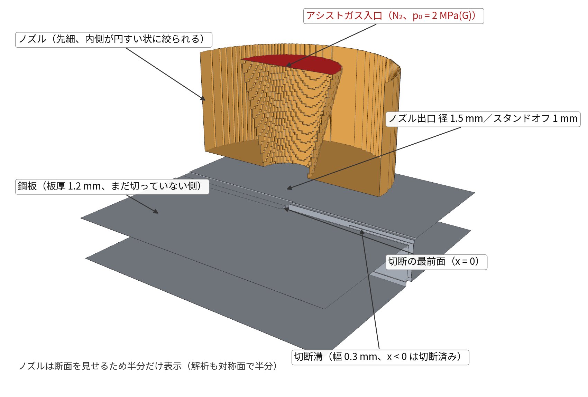
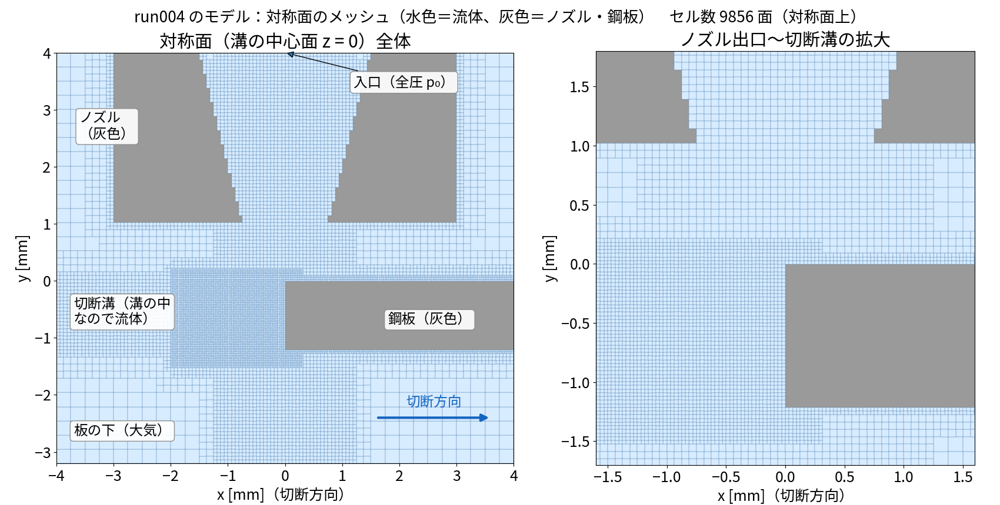
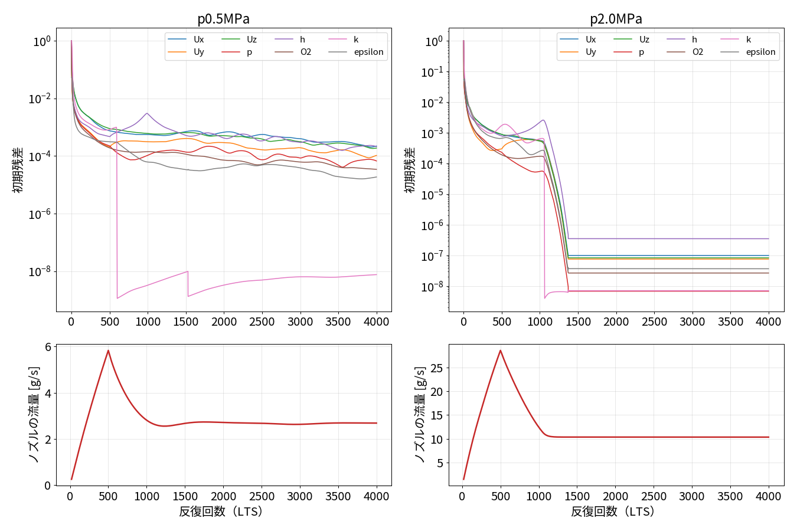
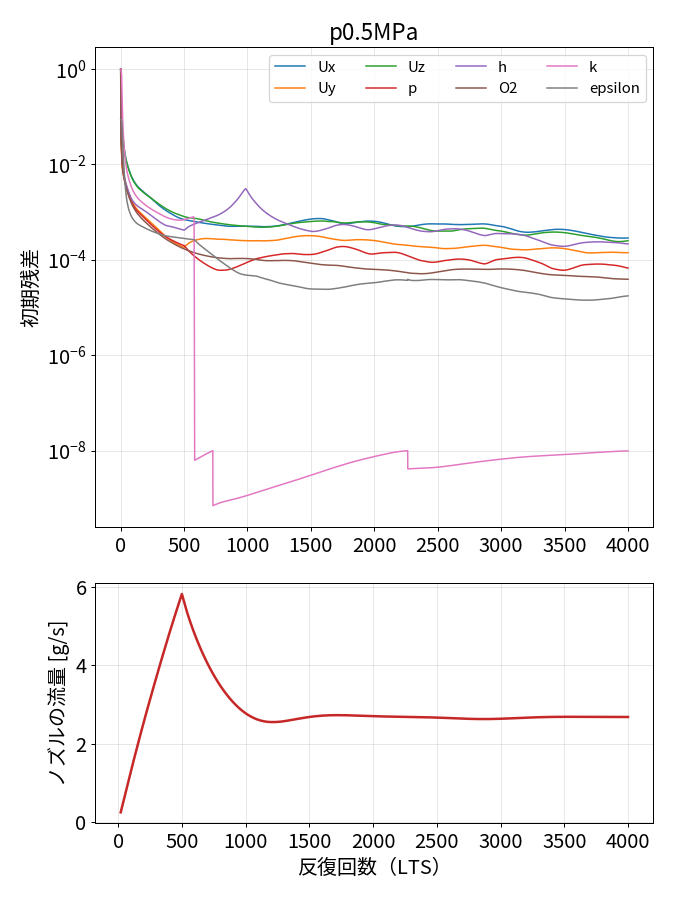
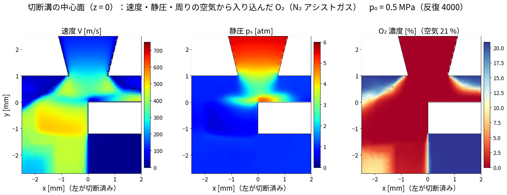
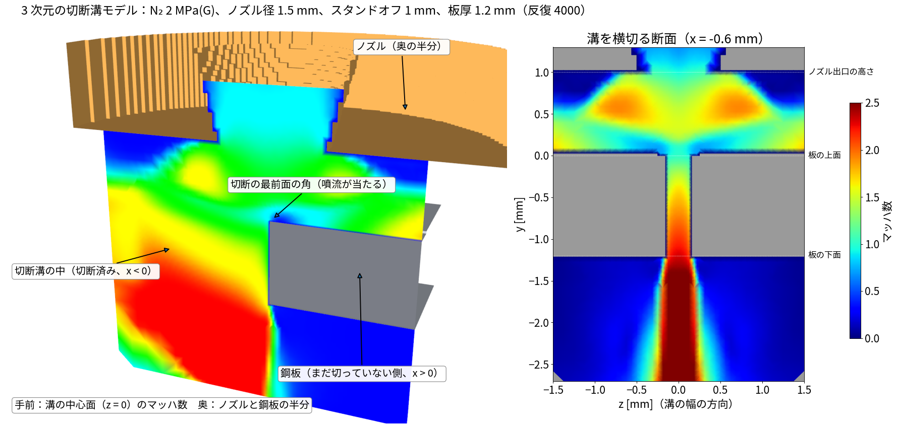
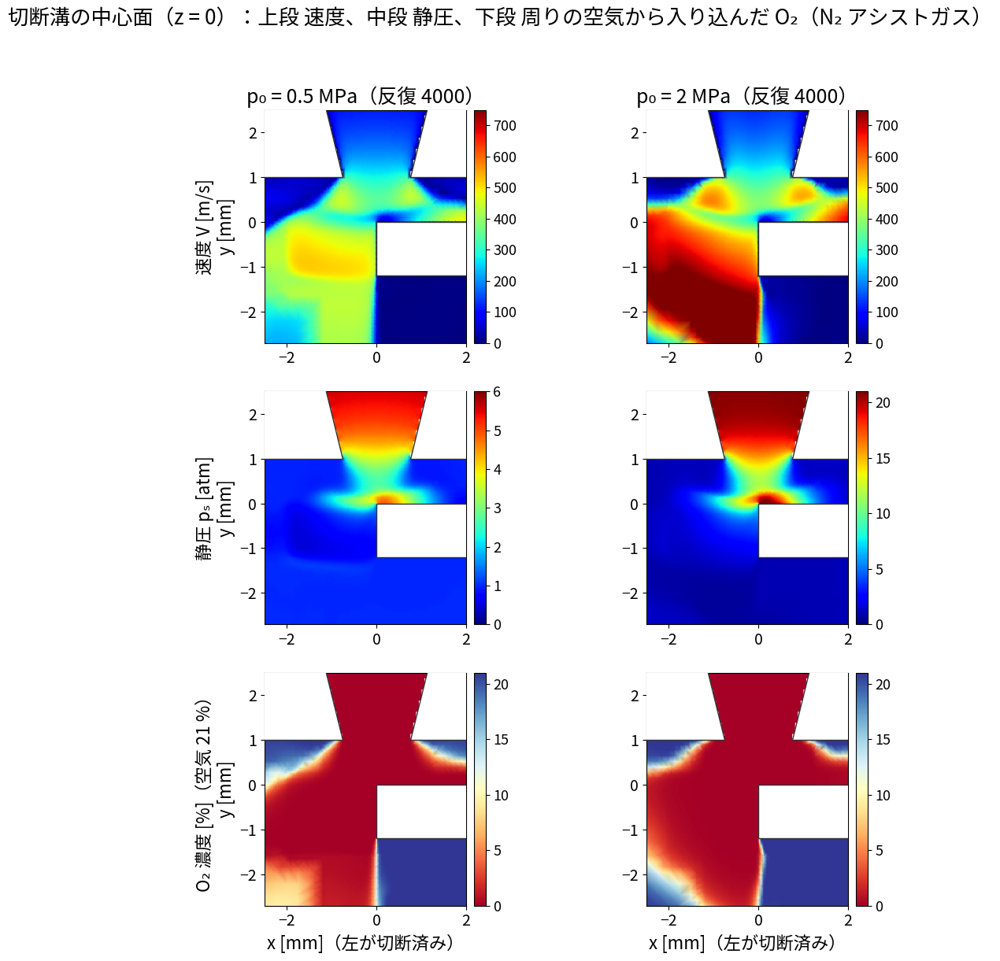
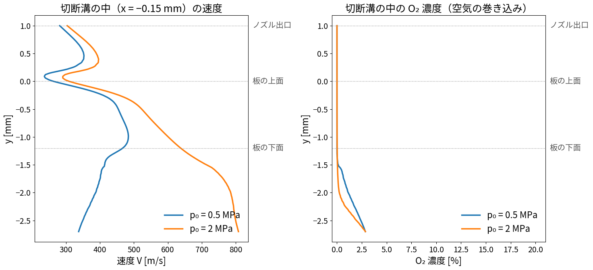
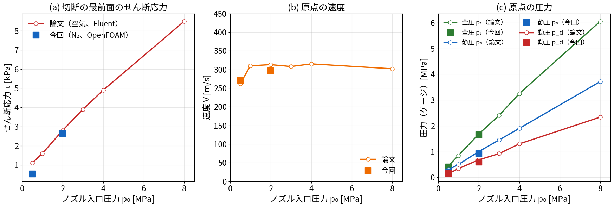
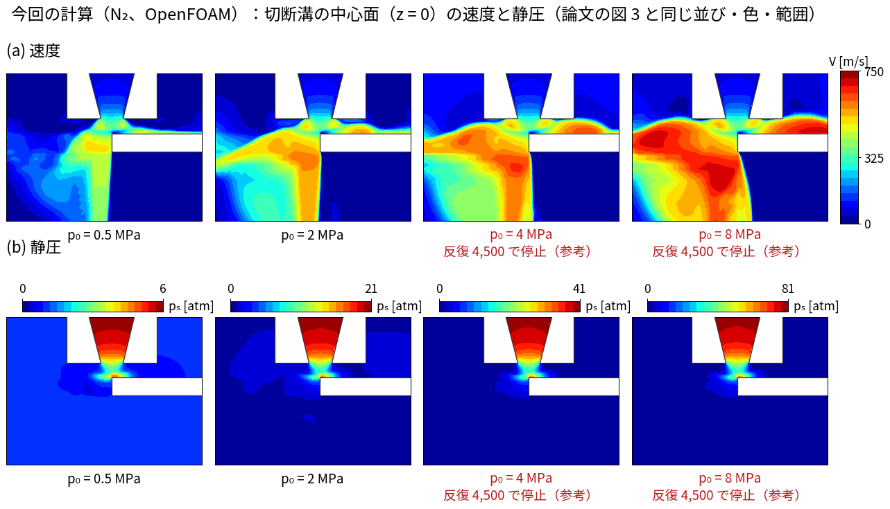

# 04 run004：3 次元切断溝モデル（混合ガス）の条件と結果

作成日：2026-11-04　OpenFOAM v2512　ソルバ：`reactingFoam`（O₂/N₂ 混合ガス、LTS 疑似定常、transonic）
状態：0.5・2.0 MPa は計算が終わり、論文と比べた（5.6、2026-11-05）。4.0・8.0 MPa は計算が途中で止まり、見直し中。5.1〜5.4 は 1 回目（板の下 2 mm の領域）の結果のため参考値

参考文献（`refs/`）
- `04_JSME2017_S0520603_…pdf`：松村・木綿・山口「レーザ切断溝内のアシストガスの流動解析」機械学会 2017 年次大会
  （3 次元・定常・圧縮性、空気、realizable k-ε、p₀ = 0.5〜8.0 MPa、De = 1.5 mm、H = 1.0 mm、板厚 1.2 mm）
- 東海大学 アシストガスの CFD（N₂ 0.2 MPa、切断溝の中心線上のアシストガス濃度と速度。板の下からの空気の巻き込み）
  https://teamcoil.sp.u-tokai.ac.jp/researches/assistgas/index.html

---

## 1. ねらい

run002・003（軸対称、溝を丸い穴で近似）と違い、**実際の切断に近い形**で解く。

- 切断溝は細長いスリット。ノズルは +x 方向へ進み、x < 0 はすでに切れている
- ノズルの軸は切断の最前面（x = 0）の真上 → 噴流の半分は板に当たり、半分は溝に入る
- アシストガス（N₂）と周りの空気（O₂ 21 %・N₂ 79 %）が**混ざる混合ガス**として解き、
  溝の中に空気（O₂）がどれだけ入り込むかを見る（N₂ 切断では O₂ が混ざると切断面が酸化する）
- 機械学会の論文と同じく、ノズル入口圧力 p₀ を 0.5／2.0／4.0／8.0 MPa に変えて比べる

---

## 2. モデルの形

| 項目 | 値 |
|---|---|
| 解析領域 | x −4〜4 mm、y −3.2〜4 mm、z 0〜4 mm（**溝の中心面 z = 0 で左右対称、半分だけ解く**） |
| ノズル | 先細ノズル。出口径 De = 1.5 mm、入口側の内径 3.0 mm、絞りの長さ 3.0 mm、外径 6 mm |
| スタンドオフ | H = 1.0 mm |
| 鋼板 | 板厚 1.2 mm |
| 切断溝 | 幅 0.3 mm、x < 0（切断済み）。切断の最前面は x = 0 の垂直な平面（実際は曲がって傾いている） |
| メッシュ | snappyHexMesh。外側 0.25 mm、ノズル・噴流 0.0625 mm、溝の中 0.031 mm（溝の半幅に約 5 セル）。**169,773 セル** |

**メッシュの課題**：ノズルの内側の円すい面が階段状のまま（snappyHexMesh の面合わせが効いていない）。
出口の径は合っているが、ノズルの中の壁がでこぼこ。次の版で直す（ノズル部だけ blockMesh の構造格子にする、など）。

---

## 3. 計算条件

| 項目 | 設定 |
|---|---|
| ソルバ | `reactingFoam`（化学反応なし）。O₂ と N₂ の 2 成分を解く混合ガス |
| 時間 | `localEuler`（局所時間刻み）で疑似定常。4,000 回（8 MPa は 6,000 回） |
| 圧力方程式 | `transonic yes`（チョーク・衝撃波に対応） |
| 乱流 | realizable k-ε（論文と同じ） |
| 物性 | 比熱一定の理想気体（O₂：分子量 32.0、cp 918、N₂：28.0、1040） |
| 入口 | N₂ 100 %、全圧 p₀（ゲージ圧 0.5／2.0／4.0／8.0 MPa）、全温 300 K。最初の 500 回（8 MPa は 2,000 回）で 1 気圧から p₀ まで上げる |
| 周り（上・横・下の境界） | 大気圧 101,325 Pa、300 K、空気（質量割合 O₂ 0.233、N₂ 0.767） |
| ノズル・鋼板 | すべりなし、断熱 |
| 見る量 | マッハ数・速度・静圧（論文の図 3 と同じ断面）、溝の中の O₂ 濃度（空気の巻き込み）、溝の壁のせん断応力、溝を抜ける質量流量 |

基礎式とソースコードの対応は `03_ソースコードで読む基礎式とlocalEuler.md`。

---

## 4. 計算時間（1 並列 × 4 本同時）

| ケース | 1 回あたり | 予定回数 | 見込み |
|---|---|---|---|
| 0.5／2.0／4.0 MPa | 約 4.4 s | 4,000 | 約 5 時間 |
| 8.0 MPa | 約 4.4 s | 6,000 | 約 7〜8 時間 |

8.0 MPa は最初の設定（500 回で昇圧、maxCo 0.2）で発散したため、2,000 回で昇圧・maxCo 0.1 に変えてやり直した。
ほかのケースも、昇圧の途中で温度が一時的に 420〜440 K まで上がっている（全温 300 K なので本来はほぼ超えない）。
落ち着くかどうかを結果で確かめる。

---

## 5. 結果（0.5・2.0 MPa、反復 4,000 回）

### 5.0 残差と、1 回目の計算の問題（2026-11-04 判明）

- 0.5 MPa：初期残差は 10⁻⁴ 前後で横ばい（小さく揺れている）。ノズルの流量は 1,500 回目以降ほぼ一定。
- 2.0 MPa：1,400 回目ごろから残差が 10⁻⁷ で**真っ平ら**になった。これは収束ではなく、計算が事実上止まった状態だった。
  - 局所時間刻みの最小値が 1,300 回目ごろから 4 × 10⁻¹³ s まで小さくなっていた（ふつうは 10⁻⁸ s 程度）。
    隣のセルとの時間刻みの比を制限する設定（`rDeltaTSmoothingCoeff 0.02`）のため、その小さな刻みが周りに広がり、ほとんど進まなくなった。
  - 原因：**解析領域の下の境界（板の下 2 mm）**のすぐ近くで、圧力がほぼ真空（最小 1.9 Pa、33 セル）になっていた。
    溝から出た超音速の噴流が、超音速のまま圧力一定の境界にぶつかり、境界条件と合わなくなったためと考えられる。
    密度がほぼ 0 のセルで局所時間刻みが極端に小さくなる。
  - 4.0・8.0 MPa が圧力を上げる途中で止まったのも、同じ原因と考えられる。
- 対策（2 回目）：板の下の空間を **2 mm → 10 mm** に広げ、噴流が周りと混ざって減速してから境界に達するようにした（27.9 万セル）。
  4 条件ともやり直している。
- 1 回目の結果（5.1〜5.4）は、溝の中・板の上の傾向は妥当と考えられるが、板の下の流れと数値は参考値。1 回目のケースは `_old_run004_v2/` に残してある。

### 5.0b 2 回目（板の下 10 mm に拡大）の途中結果（2026-11-04 15:40）

- 0.5 MPa は 4,000 回で完了。圧力の最小値は 48 kPa で、1 回目のような真空のセルはなくなった。
  局所時間刻みも 10⁻⁸ s 台のまま（止まっていない）。残差は 10⁻⁴ 前後で横ばい、ノズル流量は一定（2.7 g/s）。

| 0.5 MPa | 1 回目（板の下 2 mm） | 2 回目（板の下 10 mm） |
|---|---|---|
| 切断の最前面の平均せん断応力 | 511 Pa | 504 Pa |
| 溝を通る質量流量 | 0.40 g/s | 0.41 g/s |

  → 0.5 MPa では領域の大きさの影響はほとんどない（差 2 % 以内）。
- 2.0／4.0／8.0 MPa は計算中。

### 5.1a 斜め上から見た結果と、溝を横切る断面（2.0 MPa、1 回目の結果）

- 左：手前が溝の中心面（z = 0）、奥がノズルと鋼板の半分。噴流は切断の最前面の角（x = 0、板の上面）に当たり、
  一部は溝の中（x < 0）へ流れ込んで加速し、板の下ではマッハ 2 を超える。
- 右：溝を横切る断面（x = −0.6 mm）。板の上ではノズルから出た噴流が左右に広がり（マッハ 1.5〜2）、
  幅 0.3 mm の溝の中に入った流れは下へ向かって加速し、溝の出口からマッハ 2.5 近くで噴き出す。
- 道具：`tools/render_kerf3d_result.py`

### 5.1 切断溝の中心面（z = 0）：速度・静圧・O₂ 濃度

（白：ノズルと、まだ切っていない鋼板 x > 0。x < 0 は切断溝の中なので流体）

- **速度（上段）**：ノズルを出た直後に加速し、板の上面で一度減速、溝に入って再び加速する。
  2.0 MPa では溝の中から板の下にかけて 700 m/s を超える。論文の図 3 と同じ傾向。
- **静圧（中段）**：ノズル内は p₀ 近く。板の上面の切断の最前面の角（x ≈ 0、y ≈ 0）で圧力が高くなる（噴流が当たる所）。
  溝の中では静圧が大気圧以下まで下がる（超音速の膨張）。
- **O₂ 濃度（下段）**：溝の中はほぼ 0 %（純 N₂）。空気が混ざるのは、ノズルと板のすき間の外側と、板の下に出た後だけ。

### 5.2 溝の中（x = −0.15 mm）の速度と O₂ 濃度

| 量 | 0.5 MPa | 2.0 MPa | 論文（原点の速度） |
|---|---|---|---|
| 板の上面（y = 0）付近の速度 | 約 230 m/s | 約 290 m/s | 約 260 m/s（0.5 MPa）、約 310 m/s（1 MPa 以上） |
| 溝の出口（板の下面）の速度 | 約 450 m/s | 約 650 m/s | — |
| 溝の中の O₂ 濃度 | ほぼ 0 % | ほぼ 0 % | — |

- 板の上面の速度は論文とおおむね合う（論文は x = 0 の原点、ここは溝の中の x = −0.15 mm で、場所が少し違う）。
- 溝の中に空気は入り込まない。ノズルの軸が切断の最前面の真上にあり、溝の入口を N₂ が完全に覆うため。
  東海大学の例のように**ノズルを横にずらす**と、溝の下から空気が巻き込まれると考えられる → 次の比較（`XOFF` で設定できる）。

### 5.3 質量流量（半分のモデル × 2）

| | 0.5 MPa | 2.0 MPa |
|---|---|---|
| ノズルから出る N₂ | 2.68 g/s | 10.3 g/s |
| 一次元のチョーク流の理論値 | 2.48 g/s | 8.7 g/s |

計算のほうが 8〜19 % 多い。ノズル内側のメッシュが階段状で、出口の実効的な面積が大きくなっているためと考えられる（2 章の課題）。

### 5.4 論文の図 6 に当たる量：切断の最前面のせん断応力と、溝を通る質量流量

| | 0.5 MPa | 2.0 MPa |
|---|---|---|
| 切断の最前面（x = 0 の壁、溝の中）の平均せん断応力 τ | 511 Pa | 3,323 Pa |
| 板の上面から 1.1 mm 下の溝の断面を通る質量流量 ṁ | 0.40 g/s | 0.98 g/s |
| ノズルから出る全流量のうち溝を通る割合 | 15 % | 9.5 % |

- 論文と同じく、p₀ を上げると τ も ṁ も増える。τ は 6.5 倍、ṁ は 2.4 倍になった。
- ノズルから出たガスの大部分（85〜90 %）は板の上を横へ流れ、溝には入らない。
- 論文は溝の断面の「半円部分」を通る流量で、ここは溝の幅全体（x < 0）で数えているので、値そのものは直接比べられない。
- 計算：`tools/kerf_metrics.py`

### 5.5 4.0・8.0 MPa（やり直し中）

1 回目は、圧力を上げる途中で温度が負になって止まった。
2 回目は 2.0 MPa の結果を初期値にしたが、**入口の圧力の設定（`p0Coeffs`）が 2.0 MPa の値のまま優先されていて、
実際には 2.0 MPa のまま計算していた**（流量が 2.0 MPa と同じで気づいた）。
3 回目（2026-11-04）は、その設定を消して 2.0 MPa の 4,000 回目から 4.0／8.0 MPa へ上げ直している。終わりしだい追記する。

### 5.6 論文との比較（最新の計算：計算領域 ±10 mm、58.9 万セル、反復 4,000 回）

論文の値は、論文の図 5・図 6 から目で読み取ったものです（目盛りの ±3 % 程度の読み取り誤差があります）。
原点は「板の上面で、切断溝の幅の中央」です（今回のモデルでは x = −0.15 mm、y = 0、z = 0）。

| 量 | p₀ = 0.5 MPa：論文 | 0.5 MPa：今回 | p₀ = 2.0 MPa：論文 | 2.0 MPa：今回 |
|---|---|---|---|---|
| 切断の最前面のせん断応力 τ | 1.1 kPa | 0.54 kPa | 2.8 kPa | 2.65 kPa |
| 原点の速度 V | 262 m/s | 272 m/s | 313 m/s | 297 m/s |
| 原点の静圧 pₛ（ゲージ） | 0.30 MPa | 0.23 MPa | 1.00 MPa | 0.93 MPa |
| 原点の動圧 pd | 0.14 MPa | 0.15 MPa | 0.68 MPa | 0.60 MPa |
| 原点の全圧 pₜ（ゲージ） | 0.44 MPa | 0.41 MPa | 1.68 MPa | 1.66 MPa |

- **原点の速度と圧力は、2 つの圧力とも論文と 1 割前後で合った。**
  - 論文の「速度は p₀ が 1 MPa 以上でほぼ 310 m/s で一定、圧力は p₀ に比例して増える」という傾向も同じ。
- **せん断応力は、2.0 MPa ではほぼ一致した（−5 %）。0.5 MPa では論文の半分。**
  - 低圧では溝に入る流れが弱く、壁のすぐ近くの速度の分布が効く。
  - 論文は壁のごく近くまでメッシュを細かくしている（最小 0.01 mm、Enhanced Wall Treatment）。今回は壁関数（最小 約 0.03 mm）なので、その差が出たと考えられる。
- **溝を通る質量流量 ṁ は比べていない。**
  - 論文は、溝の断面のうち「半円の部分」（切断の最前面の丸い部分）だけを通る流量を数えている。今回の溝の最前面は平らなので、同じ範囲を決められない。
  - 参考までに、溝の幅全体で数えた今回の値は 0.50 g/s（0.5 MPa）・1.25 g/s（2.0 MPa）。論文の半円部分の値は 0.04 g/s・0.14 g/s。
- 条件の違い：
  - 論文のガスは空気、今回は N₂。比熱比がほぼ同じなので、流れはほぼ同じになる。
  - 論文の図のスタンドオフは本文 1.0 mm／図の説明 1.5 mm で食い違っている。今回は 1.0 mm。
- 4.0・8.0 MPa は計算が途中で止まったため、まだ載せていない（5.5）。
- 計算：`python3 tools/compare_jsme2017.py out.png run004_kerf3D_N2_p0.5MPa run004_kerf3D_N2_p2.0MPa`

### 5.7 コンターの比較（論文の図 3）

論文の図 3 と同じ並び・色・範囲で描いた、今回の計算の溝の中心面（z = 0）の速度と静圧です。下の図は**すべて今回の計算の結果**で、論文の図は入っていません。
- 並び：上が (a) 速度、下が (b) 静圧。左から p₀ = 0.5・2・4・8 MPa。
- 色の範囲：速度は 0〜750 m/s、静圧は 0〜(p₀ × 10 + 1) atm（論文と同じ 6・21・41・81 atm）。
- 範囲：ノズルのまわり、横 約 13 mm × 縦 約 10 mm。

論文の図 3（松村ら 2017、p. 3）と見比べてください。

- 4.0・8.0 MPa は、計算が反復 4,700 回前後で止まった状態の結果です。保存してある中で最後の反復 4,500 回目を使っています（参考）。
  - ノズル流量は、4.0 MPa が 18.5 g/s、8.0 MPa が 37.0 g/s で、理論から見込む値（18.4・36.4 g/s）とほぼ合っています。
  - ただし時間刻みが極端に小さくなって、流れがほとんど動かなくなっているので、細かいところは確かではありません。

| 見るところ | 論文 | 今回 | 判定 |
|---|---|---|---|
| ノズルを出た直後 | 不足膨張で加速。p₀ が高いほど出口の下の高速域が広がる | 同じ | 同じ |
| 板の上面・溝の入口 | 一度減速し、溝に入ると再び加速 | 同じ。溝の入口の角で静圧が最も高い | 同じ |
| 切断済みの側（左上）への流れ | 板の上面に沿って左へ。p₀ が高いほど速く広い | 同じ傾向。4・8 MPa では板の上に赤い高速の層ができる | ほぼ同じ |
| 溝の下に抜けた後 | 左下へ扇形に広がる。4・8 MPa では溝の下に赤い高速のかたまり | 切断の最前面に沿った**縦の帯**になり、横への広がりが小さい。高速のかたまりは板の上側に出る | **違う** |
| 静圧 | ノズルの中と溝の入口の角だけ高く、ほかは大気圧 | 同じ | 同じ |

- **溝の下の流れ方の違いの理由（考えられること）**：
  - 論文は、実際の切断溝を測った形でメッシュを作っている。最前面が丸く、下へ行くほど後ろへ傾いた形。
  - 今回は、まっすぐ下に落ちる平らな最前面で近似している。そのため、溝を出た噴流が最前面に沿って真下へ向かいやすい。
  - 次に試すなら、最前面を傾ける・丸くする（`make_kerf3d_mix.py` の板の形）。
- 0.5 MPa の静圧の背景の色は、論文が水色、今回が青になっている。
  - どちらも大気圧（1 atm ＝最大 6 atm の 1/6）で、値の違いではない。Fluent と matplotlib の虹色の配色の違い。
- ノズルの外側の形は、論文が円すい、今回が円筒。噴流には影響しないが、見た目が違う。
- 計算：`python3 tools/compare_contour_jsme2017.py out.png run004_kerf3D_N2_p0.5MPa run004_kerf3D_N2_p2.0MPa run004_kerf3D_N2_p4.0MPa run004_kerf3D_N2_p8.0MPa`
  - 論文の PDF の 3 ページ目を 200 dpi で画像にして `--paper page3.png` で渡すと、論文の図 3 と今回を交互に並べた比較図ができる。
  - この比較図は論文の図を含むため、公開リポジトリには入れず、手元の `docs/img_local/` に置いている。

### 今後追加する図

- p₀ 4 条件の比較（論文の図 3 の完全な再現）
- 4.0・8.0 MPa を加えた、論文の図 5・図 6 との比較（0.5・2.0 MPa は 5.6 に掲載）
