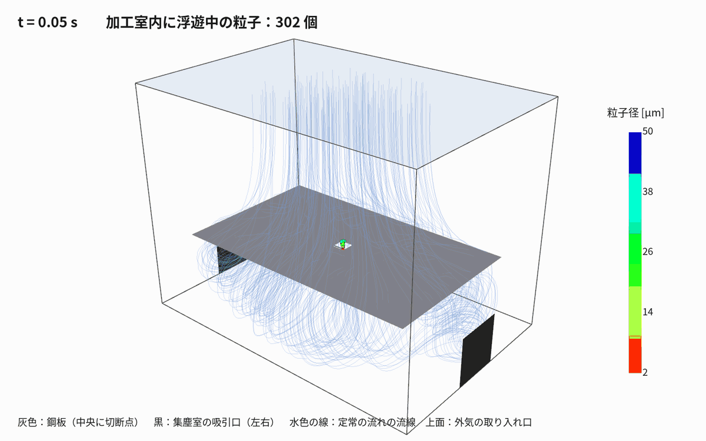

# 01 レーザー加工ヒュームの集塵：事例調査とOpenFOAM解析（run001）

作成日：2026-11-03　OpenFOAM v2512

手法選定の再調査（2026-11-04）：[02 文献に基づく解析手法の選定](02_文献に基づく解析手法の選定.md)。微細煙の濃度・加工後の除去時間には非定常スカラー輸送を主解析にする方針。以下は既存の粒子追跡による予備解析の記録。



---

## 1. 事例調査

レーザー切断では、材料・板厚・レーザー条件・アシストガスによって粒子の大きさや発生量が変わる。集塵性能はフード形状、発生源との距離、流量、周囲気流にも左右されるため、文献の数値を対象機へそのまま転用できない。今回の設定に関係する公開資料を、対象との近さと使い方を分けて整理する。

| 事例 | 内容 | 参考にした点 |
|---|---|---|
| 熱加工機の集塵装置（特許 6240477） | 加工エリアの下に上が開いた集塵室を設け、送気と吸気を向かい合わせてヒュームを除去 | **板の下の集塵室から吸う形**（本モデルの基本形） |
| 福岡県工業技術センター 研究報告（2024） | 溶接ヒュームをレーザーシートで可視化し、CFD（2 次元・SST k-ω）の条件を合わせ込み | 乱流モデル SST k-ω、可視化との比較の考え方 |
| Zhang ら（Nuclear Power Engineering, 2025） | レーザー切断エアロゾルを CFD＋DPM で解析し、フード角度と排気流量を比較 | **流れ＋粒子追跡**の構成と、形状・流量を比較する考え方。数値条件や捕集率を対象機へ直接移さない |
| Liu ら（Building and Environment, 2026） | コンクリートブロックのレーザー切断で、エアカーテン付きフードを CFD と実験で評価 | CFD を実験で検証する重要性。材料・加工機・フードが異なるため、効率値は本件に適用しない |
| 金属板レーザー切断の粒子特性（2022） | 複数金属板のレーザー切断で発生粒子を測定。微小粒子が多いことを報告 | 本 run001 の 2–50 µm 粒子を実ヒュームそのものと見なせない根拠 |
| LLNL（2003）ダウンドラフトテーブルの CFD | 部屋全体とダウンドラフトテーブルの気流・汚染物質の輸送 | 吸引テーブルを含む部屋全体を解く |
| 福岡県工業技術センター（2024） | 溶接ヒュームをレーザーシートで可視化し、SST k-ω の CFD と比較 | 溶接を対象とした参考例。粒子発生位置・条件を合わせて可視化や測定と照合する考え方 |
| SimScale（メーカー事例） | プラズマテーブル・ダウンドラフトの区画設計 | 区画ごとの吸引の偏り |

保存した文献：`refs/`（福岡県工技センター報告 PDF、特許 6240477 の HTML）。
リンク：
- 特許 6240477：https://ipforce.jp/patent-jp-B9-6240477
- 福岡県工業技術センター 研究報告 No.34（溶接ヒューム）：https://www.fitc.pref.fukuoka.jp/data/kenkyu-seika/report/no34/2024_kenkyuhoukoku_021.pdf
- LLNL downdraft table CFD：https://smartersmallbuildings.lbl.gov/publications/cfd-analysis-llnl-downdraft-table
- IRSN：https://hal-cea.archives-ouvertes.fr/hal-02478477v1
- Zhang ら（2025）：https://hdlgc.xml-journal.net/en/article/doi/10.13832/j.jnpe.2024.080018
- Liu ら（2026, Building and Environment, CFD と実験によるレーザー切断フード評価）：https://www.sciencedirect.com/science/article/pii/S0360132326008152
- 金属板レーザー切断粒子の特性評価（2022, IJERPH）：https://pmc.ncbi.nlm.nih.gov/articles/PMC9408184/
- SimScale：https://www.simscale.com/?p=111776

---

## 2. 解析の方針（2 段構え）

1. **流れ（定常）**：`simpleFoam`（非圧縮・定常・SST k-ω）で、加工室と集塵室の空気の流れを解く。
2. **粒子（非定常）**：`icoUncoupledKinematicParcelFoam` で、1 の速度場を固定したまま、
   切断点から出るヒューム粒子を時間とともに動かす（粒子は流れに影響しない一方向連成）。

ヒュームの濃度は低いので、粒子が空気の流れを変える効果は無視できる、という考え方。

---

## 3. 形状・メッシュ（`run001_underTableSuction_Q0.30/flow`）

| 項目 | 値 |
|---|---|
| 加工室 | x 0〜1.2 m、y −0.3〜0.6 m（鋼板の高さ y = 0）、z 0〜0.8 m |
| 鋼板 | x 0.1〜1.1、z 0.1〜0.7 m の薄い壁（`createBaffles` で作る両面の壁）。周囲に 0.1 m のすき間 |
| 切断点 | 鋼板の中央 (0.6, 0, 0.4) に 50 × 50 mm の開口 |
| 集塵室 | 鋼板の下、深さ 0.3 m |
| 吸引口 | 集塵室の左右の側壁（x = 0 と 1.2、y −0.3〜−0.1、z 0.3〜0.5） |
| 外気の取り入れ口 | 天井全面（大気圧） |
| メッシュ | 25 mm の六面体、48 × 36 × 32 = 55,296 セル |

**解像度上の注意**：切断開口 50 × 50 mm はこのメッシュで幅・奥行き各 2 セルしかない。開口近傍の速度勾配や粒子の通過割合を定量予測するには粗く、開口・すき間・吸引口の局所細分化とメッシュ依存性確認が必要。

作成手順：`blockMesh` → `topoSet`（鋼板・吸引口の面を選ぶ）→ `createPatch`（吸引口）→ `createBaffles`（鋼板）

---

## 4. 流れの計算条件（`flow/`）

| 項目 | 設定 |
|---|---|
| ソルバ | `simpleFoam`（SIMPLE 法、`consistent yes`） |
| 乱流モデル | k-ω SST |
| 空気 | 動粘性係数 1.5×10⁻⁵ m²/s |
| 吸引口 | `flowRateOutletVelocity` 合計 0.30 m³/s（約 1,080 m³/h） |
| 天井 | `totalPressure` p₀ = 0（大気圧）、`pressureInletOutletVelocity` |
| 壁・鋼板 | すべりなし、壁関数 |
| 反復 | 1,500 回 |

**結果の確認**：流量積分は吸引口から 0.300 m³/s、天井からの流入 0.299956 m³/s で、差は約 0.0146%。ただし U・p の初期残差は最終反復でもおおむね 1e-2 程度で、指定反復数に達しただけで収束判定を満たしていない。流量収支が合うことは、局所流れの収束やモデル妥当性を保証しない。粒子計算には反復 1500 の速度場を暫定的に使用した。

---

## 5. 粒子の計算条件（`particles/`）

| 項目 | 設定 |
|---|---|
| ソルバ | `icoUncoupledKinematicParcelFoam`（固定した速度場の上で粒子だけを動かす） |
| 速度場 | `flow/1500/U` をコピー、空気の密度 1.2 kg/m³、粘度 1.8×10⁻⁵ Pa·s |
| 粒子 | 密度 5,000 kg/m³（酸化鉄）、直径 2〜50 µm（Rosin–Rammler 分布、代表径 15 µm） |
| 力 | 抗力（球）＋重力 |
| 噴出 1：上向きの煙 `plumeUp` | 切断点の上から、上向き 1.5 m/s、広がり角 35°、0〜2 秒に 6,000 個 |
| 噴出 2：溝から下向き `kerfDown` | 切断点の下から、下向き 20 m/s（アシストガスで吹き下ろされる）、広がり角 10°、0〜2 秒に 6,000 個 |
| 壁との当たり方 | 吸引口・天井：抜ける（escape）、壁・鋼板：くっつく（stick） |
| 時間 | 0〜3 秒、Δt = 2 ms、0.05 秒ごとに書き出し |
| 乱流拡散 | なし（`dispersionModel none`） |

---

## 6. 結果（run001、Q=0.30 m³/s）

- 天井から入った空気は鋼板のすき間と切断点の開口を通って集塵室へ下り、
  集塵室の中で大きな渦を巻きながら左右の吸引口へ吸い込まれる（流線）。
- 下向きに吹き出した粒子は集塵室に入り、渦に乗って回りながら、徐々に吸引口へ吸われる。
- 上向きに初速を与えた粒子も、この固定流れ場では天井からの下降流に押し戻され、鋼板上に沈着するか開口を通って集塵室へ移動した。
- 3 秒の時点（噴出が止まってから 1 秒後）

| 行き先 | 個数 |
|---|---|
| 吸引口から抜けた | 6,123 |
| 天井から抜けた | 0 |
| 壁・鋼板にくっついた | 336 |
| まだ計算領域内にある（沈着分を含む） | 5,879 |
| うち未沈着で浮遊中 | 5,543 |

  合計 12,002 parcel（2噴出×6,001）の収支は 6,123 + 336 + 5,543 = 12,002。イベント記録を境界別に集計すると、退出した parcel は全て吸引口、天井退出は 0 だった。**これは本計算の仮定内での parcel 追跡結果であり、実機の捕集率 6,123/12,002 = 51.0% を意味しない。**注入 parcel 数は質量濃度・粒径別個数の実測を反映しておらず、噴出速度・発生量・流れ場も実測検証されていない。多数が領域内に残り、3 秒時点では定常的な除去性能を表さない。

### run002 / run003：吸引流量の感度比較

追加計算の進行状況と結果は完了後に記入する。比較は同じ簡略形状・粒子条件で吸引流量だけを変える**数値モデル内の感度試験**であり、実機の推奨ファン流量や安全性評価ではない。左右側面吸引口の合計面積は 0.08 m² なので、幾何平均速度は Q=0.15 / 0.30 / 0.60 m³/s に対し 1.875 / 3.75 / 7.5 m/s。

---

## 7. 限界と次の一手

- **粒径の代表性**：金属レーザー切断の報告ではサブミクロン粒子が多い。2–50 µm の設定は粗大粉じん・スパッタ相当の追跡例であり、微細なレーザーヒュームの粒径分布を再現しない。密度 5,000 kg/m³ の単一材料仮定も実材料の酸化物・合金組成を表さない。
- **流れの物理**：速度場は定常・固定で、熱浮力、実際のアシストガス噴流、加工機の囲い・開口、室内横風、ファン特性を含まない。粒子計算は `dispersionModel none` で乱流拡散を無視し、Brown 運動・凝集・蒸発/凝縮・沈着再飛散も扱わない。20 m/s は粒子初期速度であって、流体のアシストガスを解いた結果ではない。
- **数値精度**：残差が収束基準未達で、開口は幅 2 セル。局所メッシュ細分化、格子依存性、残差・流量・速度場の収束確認を行う前に定量設計へ使えない。
- **次に必要な情報**：加工機とテーブルの寸法・囲い、切断位置、材質と板厚、レーザー出力/速度、アシストガス種・圧力・流量/ノズル形状、既存フード・ダクト、ファン曲線、室内給気と横風、実粒径または濃度測定。これらを反映し、現場の風速・煙可視化・濃度等の測定と照合して段階的にモデルを検証する。
- **判断範囲**：現時点の計算は流れの概念確認・条件感度を見る予備解析。作業者ばく露評価、法令適合、集塵装置の能力保証には使用できない。参考研究でも測定・実験との検証が重要。
- 次の技術候補：熱浮力を含む非定常流れ、アシストガス噴流・囲いの再現、開口/吸引口細分化、実測粒径での粒子追跡、乱流分散、実測との比較。吸引量・吸引口位置の比較は、これらの前提条件と評価量を整えて進める。

---

## 8. 再現手順

```bash
cd /mnt/d/work/002_CAE/openfoam/20261103_laserFumeExtraction
python3 tools/make_fume_cases.py run001_underTableSuction_Q0.30 '{"Q":0.30}'
openfoam2512 -c './run001_underTableSuction_Q0.30/Allrun'
python3 tools/render_fume.py run001_underTableSuction_Q0.30    # images/fume_*.png と GIF
```

ParaView で見るときは `flow/post.foam` と `particles/post.foam` を開く（y 軸が上）。
