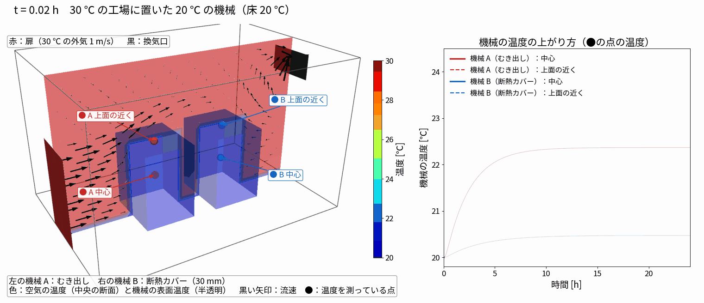

# 01 工場の気温と機械の温度（断熱カバーの効果）

作成日：2026-11-04　OpenFOAM v2512

| 項目 | 内容 |
|---|---|
| ケース | run001_factory_ambient_cover |
| ソルバ | chtMultiRegionFoam（空気の流れ 120 s → frozenFlow で温度だけ 24 h） |
| セル数 | 空気 24,960 ＋ 機械 960 × 2 |
| 計算時間 | 流れ 23 分 ＋ 温度 3 分（1 並列） |

## 条件と結果（Klimant ら 2026 の Franke の例を簡略化）



（黒い矢印は中央の断面の流速ベクトル。扉から入った空気が機械の間を抜けて換気口へ向かう）

- 工場 6 × 3.6 × 4.2 m、扉（x = 0、幅 1.2 m × 高さ 2.1 m）から 30 ℃・1 m/s、換気口（反対側の上）は大気圧
- 床 20 ℃ 一定（機械の下面も 20 ℃）、ほかの壁は断熱
- 機械 1.2 × 1.8 × 1.5 m の鋳鉄。中が空洞の構造を想定して**見かけの密度 1,000 kg/m³**（κ 50、c<sub>p</sub> 500）
- 機械 B は表面に断熱層（厚さ 30 mm、κ 0.03 W/mK）を熱抵抗として付けた
- 結果（24 h）：機械 A 中心 +2.4 K・上面近く +3.7 K、機械 B 中心 +0.5 K・上面近く +0.8 K。約 10 時間で落ち着く
- **注意（簡略化）**：空気は層流の設定で、15 cm の粗いメッシュでは壁の熱伝達がほとんど出なかった（約 0.4 W/m²K）。
  温度を進める段階では、空気の熱伝導率を乱流相当の値（Pr = 0.04、壁で h ≈ 6 W/m²K）に上げている。
  きちんとやるなら乱流モデル＋機械まわりを細かくしたメッシュにする。窓からの日射は入れていない

## 再現

```bash
python3 tools/make_factory_case.py run001_factory_ambient_cover
run001_factory_ambient_cover/Allrun          # stage1（流れ）→ stage2（frozenFlow で温度）
python3 tools/render_factory.py run001_factory_ambient_cover
```
