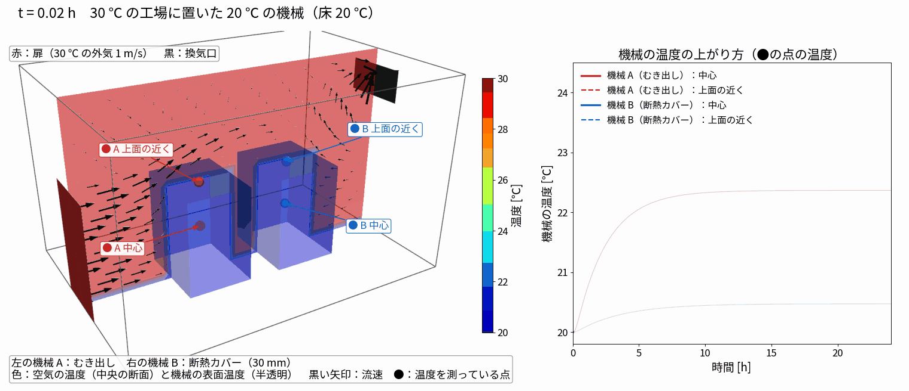
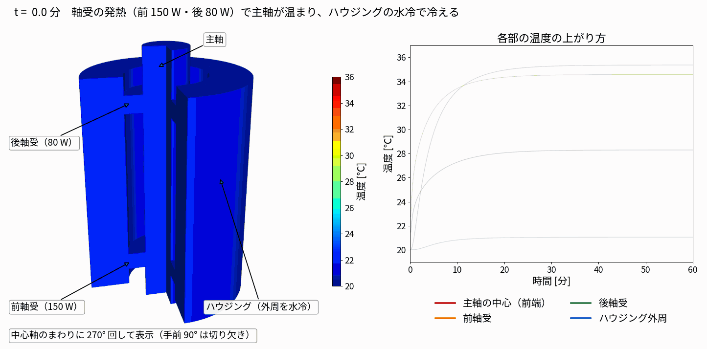
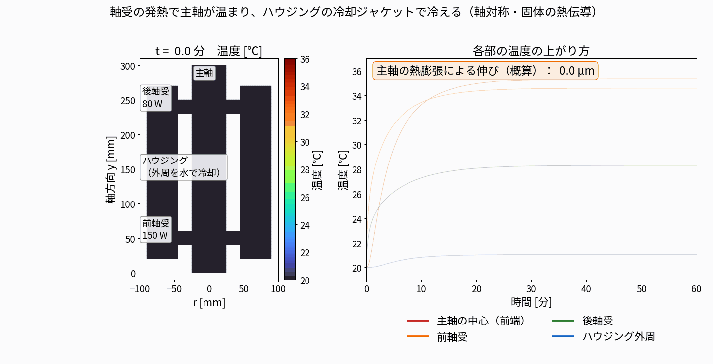
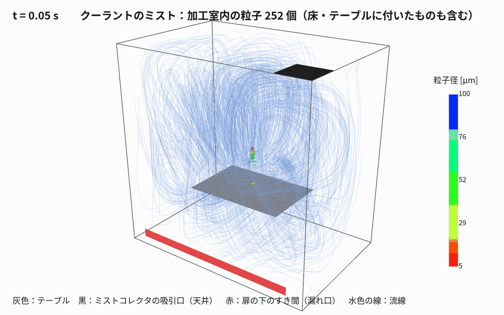
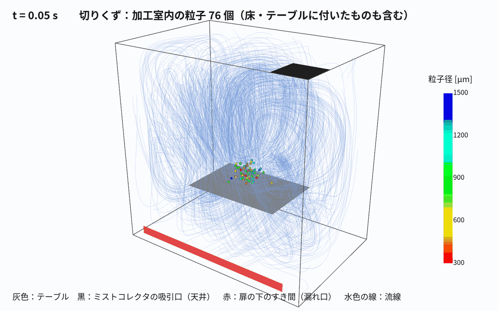

# 01 工作機械まわりの 3 つの簡易モデル：条件と結果

作成日：2026-11-04　OpenFOAM v2512　すべて 1 並列

| ケース | 内容 | ソルバ | セル数 | 計算時間 |
|---|---|---|---|---|
| run001_factory_ambient_cover | 30 ℃ の工場に 20 ℃ の機械 2 台（むき出し／断熱カバー 30 mm）、24 時間 | chtMultiRegionFoam（流れ 120 s → frozenFlow で温度だけ 24 h） | 空気 24,960 ＋ 機械 960 × 2 | 流れ 23 分 ＋ 温度 3 分 |
| run002_spindleBearing_heat | 主軸＋前後軸受（150 W／80 W）＋ハウジング（水冷）、1 時間、軸対称 | solidFoam | 1,584 | 18 秒 |
| run003_mist_chips_enclosure | 加工室のミスト（5〜100 µm）と切りくず（0.3〜1.5 mm）、ミストコレクタ 0.1 m³/s、扉の下のすき間 | simpleFoam ＋ icoUncoupledKinematicParcelFoam | 73,728 | 流れ 約 25 分、粒子 各 3〜4 分 |

## run001 工場の気温（Klimant ら 2026 の Franke の例を簡略化）



（黒い矢印は中央の断面の流速ベクトル。扉から入った空気が機械の間を抜けて換気口へ向かう）

- 工場 6 × 3.6 × 4.2 m、扉（x = 0、幅 1.2 m × 高さ 2.1 m）から 30 ℃・1 m/s、換気口（反対側の上）は大気圧
- 床 20 ℃ 一定（機械の下面も 20 ℃）、ほかの壁は断熱
- 機械 1.2 × 1.8 × 1.5 m の鋳鉄。中が空洞の構造を想定して**見かけの密度 1,000 kg/m³**（κ 50、c<sub>p</sub> 500）
- 機械 B は表面に断熱層（厚さ 30 mm、κ 0.03 W/mK）を熱抵抗として付けた
- 結果（24 h）：機械 A 中心 +2.4 K・上面近く +3.7 K、機械 B 中心 +0.5 K・上面近く +0.8 K。約 10 時間で落ち着く
- **注意（簡略化）**：空気は層流の設定で、15 cm の粗いメッシュでは壁の熱伝達がほとんど出なかった（約 0.4 W/m²K）。
  温度を進める段階では、空気の熱伝導率を乱流相当の値（Pr = 0.04、壁で h ≈ 6 W/m²K）に上げている。
  きちんとやるなら乱流モデル＋機械まわりを細かくしたメッシュにする。窓からの日射は入れていない

## run002 主軸の発熱



断面図版：



- 主軸 r 0〜25 mm・長さ 300 mm、軸受 r 25〜45 mm（前 y 40〜60、後 y 230〜250）、ハウジング r 45〜90 mm
- すべて鋼（κ 45、ρ 7850、c<sub>p</sub> 460）のひとかたまり。軸受の中の接触熱抵抗は入れていない
- 軸受の発熱は体積あたりの熱源（`scalarSemiImplicitSource`）、ハウジング外周は水冷 h = 800 W/m²K・20 ℃、ほかは空気 h = 15 W/m²K・20 ℃
- 結果：前軸受まわりが約 10 分で +15 K、主軸の伸び（α = 11.5 × 10⁻⁶ で積分）約 41 µm

## run003 ミストと切りくず




- 加工室 1.2 × 1.2 × 0.8 m、テーブル（薄い板、高さ 0.35 m）、天井の隅にミストコレクタ（0.1 m³/s）、扉の下に 5 cm のすき間（大気圧）
- ミスト：主軸の先から下向き 20 m/s（広がり 12°）＋ワークからの跳ね返り 4 m/s（75°）、各 5,000 個、密度 1,000
- 切りくず：ワークから 3 m/s（80°）、3,000 個、密度 7,800
- 結果（4 s）：ミストは吸引口へ 272 個（約 3 %）、ほとんどは加工室の大きな渦に乗って漂う。切りくずは 2,998 個がテーブル・床に付き、扉のすき間から 3 個
- 乱流による粒子のばらつきは入れていない（`dispersionModel none`）

## 再現

```bash
cd /mnt/d/work/002_CAE/openfoam/20261104_machineToolSims
python3 tools/make_factory_case.py run001_factory_ambient_cover    # → Allrun（stage1/2）
python3 tools/make_spindle_case.py run002_spindleBearing_heat && run002_spindleBearing_heat/Allrun
python3 tools/make_mist_cases.py run003_mist_chips_enclosure '{"Q":0.10}' && run003_mist_chips_enclosure/Allrun
python3 tools/render_factory.py run001_factory_ambient_cover; python3 tools/render_spindle.py run002_spindleBearing_heat
python3 tools/render_mist.py run003_mist_chips_enclosure particles_mist; python3 tools/render_mist.py run003_mist_chips_enclosure particles_chips
```
