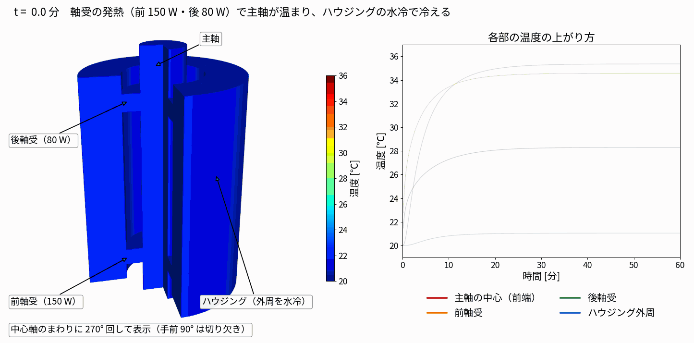
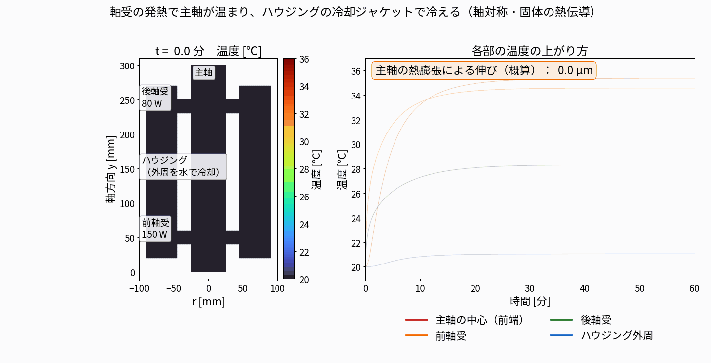

# 01 主軸と軸受の発熱・冷却（軸対称）

作成日：2026-11-04　OpenFOAM v2512

| 項目 | 内容 |
|---|---|
| ケース | run001_spindleBearing_heat |
| ソルバ | solidFoam（固体の熱伝導、非定常 1 時間） |
| セル数 | 1,584（5° のくさび） |
| 計算時間 | 18 秒（1 並列） |

## 条件と結果



断面図版：



- 主軸 r 0〜25 mm・長さ 300 mm、軸受 r 25〜45 mm（前 y 40〜60、後 y 230〜250）、ハウジング r 45〜90 mm
- すべて鋼（κ 45、ρ 7850、c<sub>p</sub> 460）のひとかたまり。軸受の中の接触熱抵抗は入れていない
- 軸受の発熱は体積あたりの熱源（`scalarSemiImplicitSource`）、ハウジング外周は水冷 h = 800 W/m²K・20 ℃、ほかは空気 h = 15 W/m²K・20 ℃
- 結果：前軸受まわりが約 10 分で +15 K、主軸の伸び（α = 11.5 × 10⁻⁶ で積分）約 41 µm

## 再現

```bash
python3 tools/make_spindle_case.py run001_spindleBearing_heat && run001_spindleBearing_heat/Allrun
python3 tools/render_spindle.py run001_spindleBearing_heat
python3 tools/render_spindle3d.py run001_spindleBearing_heat
```
