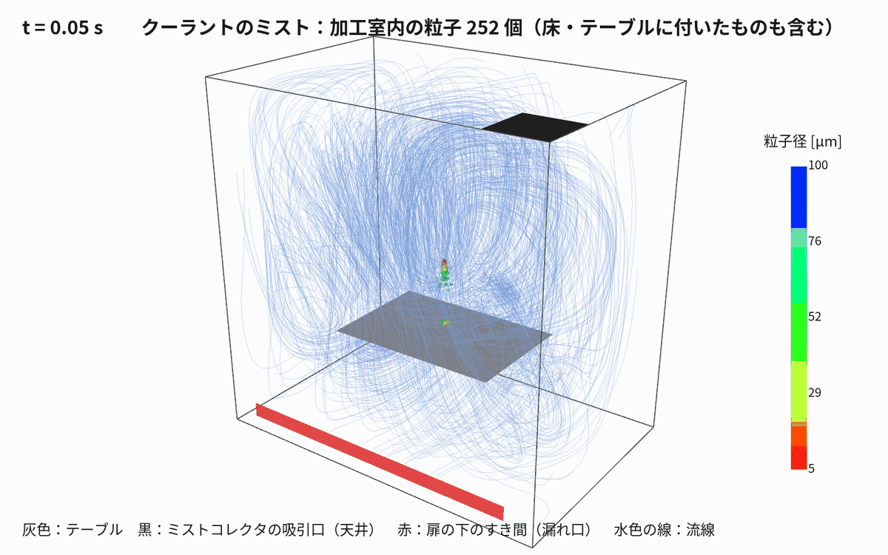
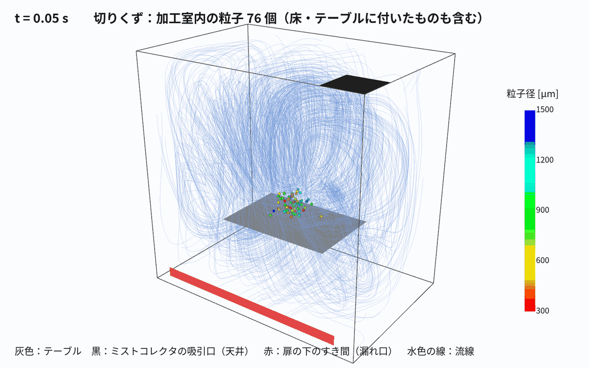

# 01 加工室のミストと切りくずの飛散

作成日：2026-11-04　OpenFOAM v2512

| 項目 | 内容 |
|---|---|
| ケース | run001_mist_chips_enclosure |
| ソルバ | simpleFoam（定常の流れ）＋ icoUncoupledKinematicParcelFoam（粒子） |
| セル数 | 73,728 |
| 計算時間 | 流れ 約 25 分、粒子 各 3〜4 分（1 並列） |

## 条件と結果




- 加工室 1.2 × 1.2 × 0.8 m、テーブル（薄い板、高さ 0.35 m）、天井の隅にミストコレクタ（0.1 m³/s）、扉の下に 5 cm のすき間（大気圧）
- ミスト：主軸の先から下向き 20 m/s（広がり 12°）＋ワークからの跳ね返り 4 m/s（75°）、各 5,000 個、密度 1,000
- 切りくず：ワークから 3 m/s（80°）、3,000 個、密度 7,800
- 結果（4 s）：ミストは吸引口へ 272 個（約 3 %）、ほとんどは加工室の大きな渦に乗って漂う。切りくずは 2,998 個がテーブル・床に付き、扉のすき間から 3 個
- 乱流による粒子のばらつきは入れていない（`dispersionModel none`）

## 再現

```bash
python3 tools/make_mist_cases.py run001_mist_chips_enclosure '{"Q":0.10}' && run001_mist_chips_enclosure/Allrun
python3 tools/render_mist.py run001_mist_chips_enclosure particles_mist
python3 tools/render_mist.py run001_mist_chips_enclosure particles_chips
```
