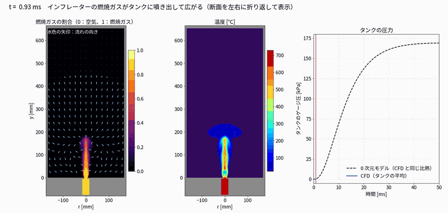
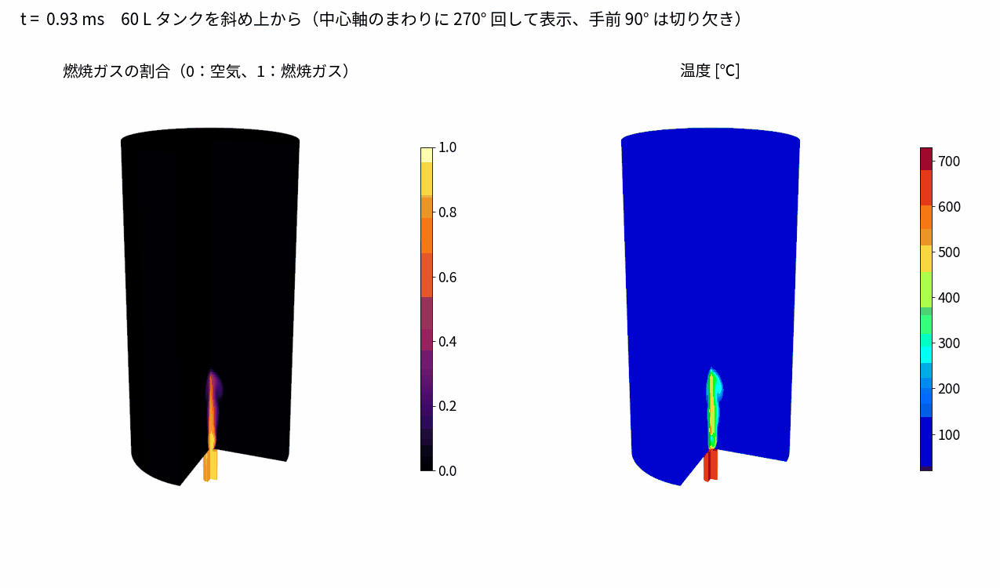
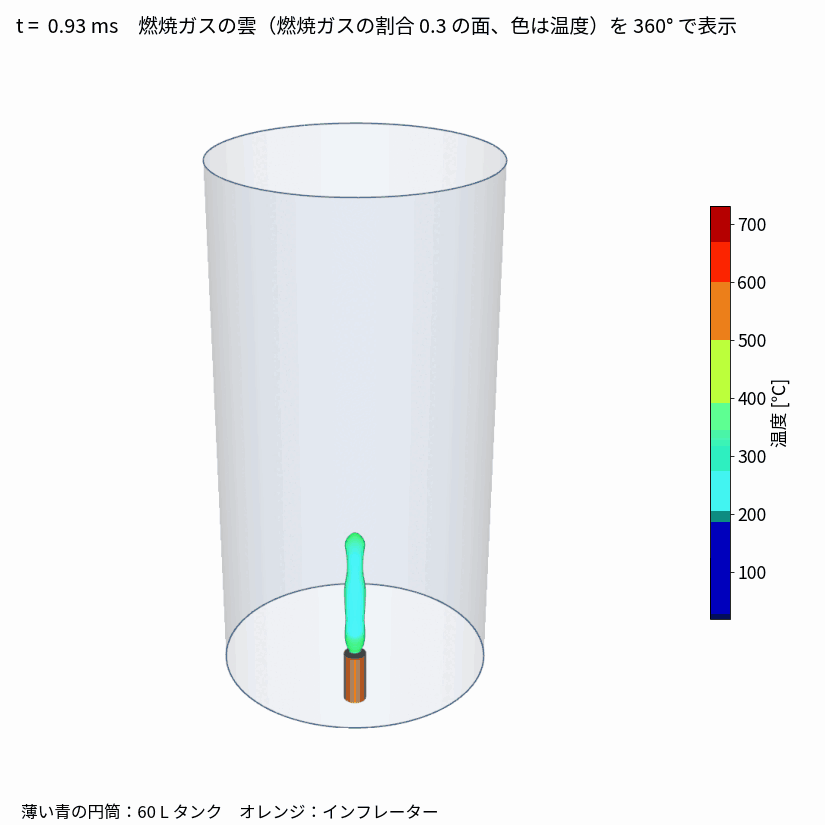
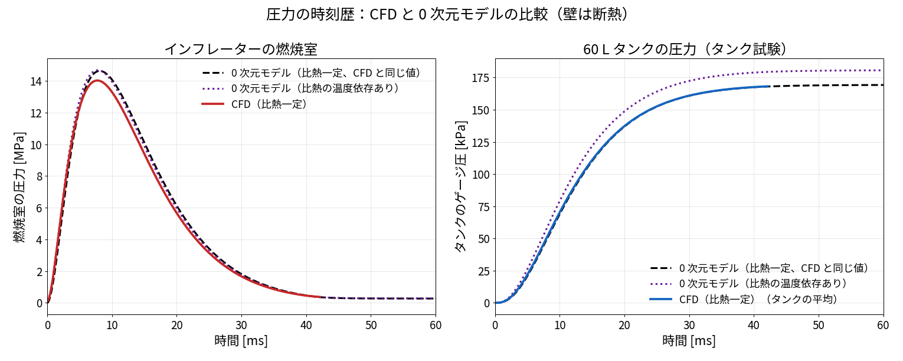

# 00 解析設定の手順書：エアバッグ用インフレーターのタンク試験（参考・テスト用）

作成日：2026-11-06　OpenFOAM v2512（ESI）　ソルバ：`reactingFoam`（化学反応なし・非定常・圧縮性）

火薬式インフレーターが燃焼ガスを出し、オリフィスから 60 L のタンクへ噴き出して、タンクの圧力が上がっていく様子を計算するケースです。
エアバッグの「タンク試験（インフレーターの性能を、決まった容積のタンクの圧力の上がり方で評価する試験）」をまねています。

> このフォルダは工作機械とは別の**参考・テスト用のケース**です。
> 「燃焼室で物を湧き出させる（質量・エネルギー・成分のソース項）」「音速で詰まるオリフィス」「多成分の気体が混ざる」という設定は、ほかの圧縮性の計算にも使い回せます。

- 結果と 0 次元モデルの式：`01_インフレーターのタンク試験_条件と結果`
- 理論式とソルバの向き不向き：`02_理論式とソルバの適性`

---

## 1. 計算のしくみ（全体像）

| 部分 | 大きさ | 中で起きること | 設定する場所 |
|---|---|---|---|
| 燃焼室 | 半径 15 mm × 長さ 70 mm（約 50 cc） | 燃焼ガスが湧き出す（火薬の燃焼の代わり） | `constant/fvOptions` |
| オリフィス | 直径 11 mm × 長さ 5 mm | 音速で詰まる（チョーク）。超音速の噴流になる | `system/fvSolution`（`transonic yes`） |
| タンク | 内径 340 mm × 高さ 660 mm（60 L） | 空気と燃焼ガスが混ざり、圧力が上がる | `constant/thermophysicalProperties` |
| 壁 | すべて | 断熱・すべりなし | `0.orig/*` の `walls` |

- **軸対称モデル**：形が中心軸のまわりで同じなので、5° のくさび形だけを計算します（10,700 セル）。
- **閉じた容器**：入口も出口もありません。ガスは燃焼室の中で「湧き出す」だけです。
- **元にしたチュートリアルはありません**。`tools/make_tank_case.py` で一から作っています。
  - ソルバと物性の組み合わせは、02 レーザー切断のアシストガス（`reactingFoam` で反応なしの混合ガス）と同じ考え方です。
  - 時間の進め方は、定常（LTS）ではなく**ふつうの時間進行**です。

---

## 2. 手順

### 手順 1：ケースを作る

```bash
cd 07_airbagTankTest
python3 tools/make_tank_case.py run_myTank
# 条件を変えるとき（例：ガス 30 g、燃焼の時定数 5 ms）
python3 tools/make_tank_case.py run_myTank '{"M_gas": 0.030, "tau": 0.005}'
```

スクリプトに渡せる条件

| 名前 | 意味 | 既定値 |
|---|---|---|
| `M_gas` | 出てくる燃焼ガスの総量 [kg] | 0.025（25 g） |
| `tau` | ガスの出方の時定数 [s]。この時刻で発生量が最大になる | 0.006（6 ms） |
| `Tc` | 燃焼ガスの温度（フィルタで冷えた後）[K] | 1000 |
| `YCO2`・`YH2O` | 燃焼ガスの CO₂・H₂O の質量割合（残りは N₂） | 0.20・0.10 |
| `tEnd` | 計算する時間 [s] | 0.05（50 ms） |
| `thermo` | 物性。`hConst`（比熱一定）か `janaf`（比熱が温度で変わる） | `hConst` |

形（燃焼室・オリフィス・タンクの寸法）は、スクリプトの先頭の `R`（半径方向の区切り [mm]）と `Y`（軸方向の区切り [mm]）で決めています。

### 手順 2：メッシュを作って計算する（4 並列）

```bash
cd run_myTank
export HWLOC_COMPONENTS=-gl           # WSL2 で mpirun が止まらないようにする
rm -rf 0 && cp -r 0.orig 0
blockMesh > log.blockMesh 2>&1
decomposePar > log.decomposePar 2>&1
mpirun -np 4 reactingFoam -parallel > log.reactingFoam 2>&1
```

- 50 ms 分の計算に、4 並列で約 5.6 時間かかりました（10,700 セル、時間刻み 約 4×10⁻⁷ s）。
- 1 並列なら `./Allrun` だけで動きます。

### 手順 3：0 次元モデルと比べる・図とアニメーションを作る

```bash
python3 tools/zero_d_inflator.py zeroD_cpCFD                 # 0 次元モデル（CFD と同じ比熱）
python3 tools/plot_pressure_history.py pressure.png run_myTank   # 圧力の時刻歴（CFD と 0 次元を重ねる）
python3 tools/render_tank_flow.py   run_myTank zeroD_cpCFD   # 断面の GIF（燃焼ガスの割合・温度）
python3 tools/render_tank_flow3d.py run_myTank               # 斜め上からの GIF（270° 回して表示）
python3 tools/render_tank_flow360.py run_myTank 0.3          # 燃焼ガスの雲を 360° で表示した GIF
python3 tools/render_wedge_mesh.py  run_myTank mesh.png      # くさび形のメッシュの図
```

---

## 3. 設定の肝

### 3.1 燃焼ガスを「湧き出させる」：`constant/fvOptions`（最重要）

火薬の燃焼（化学反応）は解かず、**燃焼室のセルに、質量・エネルギー・成分を時間の表で足し込みます**。

```
gasGeneration
{
    type            scalarSemiImplicitSource;
    selectionMode   cellZone;
    cellZone        chamber;            // 燃焼室のセルだけに足す
    volumeMode      specific;           // 値は「燃焼室 1 m³ あたり」

    sources
    {
        rho                             // 質量 [kg/(m³·s)]
        {
            explicit        table
                (
                    (0      0)
                    (0.006  30980)      // 6 ms で最大（実際は 401 点の表）
                    (0.05   ...)
                );
            implicit        0;
        }
        h                               // エネルギー [W/m³] = 質量 × 燃焼ガスの顕エンタルピー
        {
            explicit        table ( ... );
            implicit        0;
        }
        CO2                             // CO2 の質量 = 質量 × 0.20
        {
            explicit        table ( ... );
            implicit        0;
        }
        H2O                             // H2O の質量 = 質量 × 0.10
        {
            explicit        table ( ... );
            implicit        0;
        }
    }
}
```

- 質量の湧き出しは、火薬の燃え方を近似した式で与えています。

  $$\dot m(t) = M_{\mathrm{gas}}\,\frac{t}{\tau^2}\,e^{-t/\tau}$$

  - 時刻 τ = 6 ms で最大の 1.53 kg/s になります。
  - 燃焼室の体積（4.95×10⁻⁵ m³）で割ると、30,980 kg/(m³·s) です。
- エネルギーは「湧き出す質量 × 燃焼ガスの顕エンタルピー」です。燃焼ガスが 1,000 K で出てくるようにしています。

  $$h_s = \sum_k Y_k\, c_{p,k}\,(T_c - 298.15) = 9.08\times10^{5}\ \mathrm{J/kg}$$

- **N₂ のソースは書きません。** N₂ は `inertSpecie`（残りの成分）なので、「1 − ほかの成分の和」で自動的に決まります。
  - 湧き出すガスのうち、CO₂ と H₂O を除いた残り（70 %）が N₂ になります。
- 表は `make_tank_case.py` が式から作ります。手で書く必要はありません。
- `cellZone chamber` は、`blockMeshDict` のブロックに名前を付けて作っています（`hex (...) chamber (...)`）。
  - タンクも `tank` という名前の cellZone にして、平均の圧力・温度を出すのに使います（3.5）。

同じファイルに、温度の上下限も入れています。

```
limitT
{
    type            limitTemperature;
    selectionMode   all;
    min             150;        // 超音速で膨張して冷える所の下限 [K]
    max             3000;
}
```

起動直後に燃焼室へ急にエネルギーが入ると、一部のセルの温度が一瞬暴れます。上下限がないと、温度が負になって計算が止まりました（6 章）。

### 3.2 物性：`constant/thermophysicalProperties`

```
thermoType
{
    type            hePsiThermo;        // 密度 = ψ p（圧縮性が強い流れ向け）
    mixture         reactingMixture;    // 複数の成分（N2, O2, CO2, H2O）を運ぶ
    transport       const;              // 粘性一定
    thermo          hConst;             // 比熱一定
    energy          sensibleEnthalpy;
    equationOfState perfectGas;
    specie          specie;
}

inertSpecie     N2;
chemistryReader foamChemistryReader;
foamChemistryFile "<constant>/reactions";
foamChemistryThermoFile "<constant>/thermo.species";
```

各成分の値（`constant/thermo.species`）。N₂ の例：

```
N2
{
    specie
    {
        molWeight       28.0134;
    }
    thermodynamics
    {
        Cp              1170;       // 定圧比熱 [J/(kg·K)]
        Hf              0;
    }
    transport
    {
        mu              3.2e-05;
        Pr              0.72;
    }
}
```

| 成分 | 定圧比熱 c<sub>p</sub> [J/(kg·K)] |
|---|---|
| N₂ | 1,170 |
| O₂ | 1,090 |
| CO₂ | 1,230 |
| H₂O | 2,290 |

- 比熱は、300〜1,000 K の平均に近い値にしています。
- 比熱が温度で変わる形（JANAF の多項式）にするときは、`'{"thermo": "janaf"}'` を渡します。
  - **JANAF にするときは、粘性も `sutherland` にする必要があります。** `const` のままだと起動しません。スクリプトは自動でそうします。
- 反応は解きません。
  - `combustionProperties` は `combustionModel none;`
  - `chemistryProperties` は `chemistry off;`

### 3.3 時間の進め方：`system/controlDict`

```
endTime         0.05;           // 50 ms
deltaT          1e-08;          // 最初の時間刻み（すぐ自動で大きくなる）
adjustTimeStep  yes;
maxCo           0.5;            // Courant 数の上限
maxDeltaT       1e-05;
writeControl    adjustable;
writeInterval   0.0005;         // 0.5 ms ごとに保存（GIF のコマ数になる）
```

**`maxCo` は 0.5 より大きくしないこと。**
オリフィスは超音速なので、時間刻みは約 4×10⁻⁷ s とかなり小さくなります。2 に上げたら 0.3 ms で発散しました。

### 3.4 解き方：`system/fvSchemes`・`system/fvSolution`

`system/fvSchemes`（抜粋）

```
ddtSchemes
{
    default         Euler;              // ふつうの時間進行（LTS ではない）
}

divSchemes
{
    default         none;
    div(phi,U)      Gauss linearUpwindV grad(U);
    div(phi,Yi_h)   Gauss upwind;
    div(phid,p)     Gauss upwind;
    ...
}
```

`system/fvSolution`

```
solvers
{
    "p.*"
    {
        solver          GAMG;
        smoother        GaussSeidel;
        tolerance       1e-10;          // 厳しくする（下の注意）
        relTol          0.01;
        maxIter         200;
    }
    "(U|h|k|omega|Yi).*"
    {
        solver          PBiCGStab;
        preconditioner  DILU;
        tolerance       1e-9;
        relTol          0;
    }
}

PIMPLE
{
    momentumPredictor   yes;
    transonic           yes;            // オリフィスのチョーク・衝撃波に必須
    nOuterCorrectors    2;
    nCorrectors         2;
    nNonOrthogonalCorrectors 0;
}
```

**圧力の `tolerance` は 1e-10 まで厳しくします。**
- 緩くすると、最初の残差がすでに許容誤差より小さいと判定され、圧力方程式が 1 回も解かれなくなります（ログに `No Iterations 0`）。
- そうなると、燃焼室にガスが増えても圧力が上がらず、温度だけが上がって発散しました。
- 理由は、タンクの圧力が 10⁵ Pa、燃焼室が 10⁷ Pa と、値の幅がとても広いことです。

### 3.5 境界条件と、途中の値の取り出し

| 境界 | p | U | T | 成分 | 乱流（k-ω SST） |
|---|---|---|---|---|---|
| `walls`（燃焼室・オリフィス・タンクの壁） | `zeroGradient` | `noSlip` | `zeroGradient`（断熱） | `zeroGradient` | 壁関数 |
| `front`・`back`（くさびの両面） | `wedge` | `wedge` | `wedge` | `wedge` | `wedge` |

- 初期状態は、すべて空気です（N₂ 0.767・O₂ 0.233、101,325 Pa、293.15 K）。
- くさびの面は `blockMeshDict` でも `type wedge;` にしておきます。中心軸は辺がつぶれているので、境界はできません。

`system/controlDict` の `functions` で、途中の値をファイルに出しています。

```
tankAvg
{
    type            volFieldValue;
    libs            (fieldFunctionObjects);
    regionType      cellZone;
    name            tank;               // タンク全体の
    operation       volAverage;         // 体積平均
    fields          (p T CO2);
    writeFields     false;
    writeControl    timeStep;
    writeInterval   20;
}
```

- 燃焼室の平均（`chamberAvg`）と、3 点の圧力・温度（`probes`）も、同じように出しています。
- 結果は `postProcessing/tankAvg/0/volFieldValue.dat` などに出ます。
  - `plot_pressure_history.py` は、このファイルを読んで 0 次元モデルと重ねます。

---

## 4. 結果（参考）

### 4.1 アニメーション

断面（左：燃焼ガスの割合と流れの向き、右：温度）：



斜め上から（中心軸のまわりに 270° 回して表示、手前 90° は切り欠き）：



燃焼ガスの雲を 360° で表示（燃焼ガスの割合 0.3 の面、色は温度）：



- 燃焼ガスは、タンクの中心を柱のように上へ伸びます。天井に当たると、壁ぞいに戻る大きな渦になります。
- オリフィスのすぐ上は、超音速で膨張して冷える領域です。80 mm あたりで衝撃波（マッハディスク）を通って、温度が戻ります。
  - 実験式から見込む位置は 74 mm で、計算は約 80 mm でした。

### 4.2 圧力の時刻歴（0 次元モデルとの比較）



- タンクの平均圧力は、0 次元モデル（同じ比熱）と 1 % 以内で合いました。
- 最高は約 169 kPa（ゲージ）です。
- 比熱が温度で変わる 0 次元モデル（JANAF）では、181 kPa になります。

---

## 5. 条件を変えるときのチェックリスト

- [ ] 燃焼室・オリフィス・タンクの寸法を、`make_tank_case.py` の `R`・`Y` に入れた（タンク容積が試験と同じか確かめる）
- [ ] ガスの量 `M_gas`・時定数 `tau`・温度 `Tc`・組成を決めた（実機なら、燃焼室の圧力の測定値に合うように調整する）
- [ ] オリフィスの半径方向に 10 セル以上ある（粗いと発散する）
- [ ] `maxCo` は 0.5 以下、圧力の `tolerance` は 1e-10
- [ ] `limitTemperature` を入れた
- [ ] 0 次元モデル（`tools/zero_d_inflator.py`）と、タンクの平均圧力が合うか確かめた
- [ ] 壁は断熱にしている（実際のタンクは壁へ熱が逃げるので、圧力は計算より少し低くなる）と報告に書いた

---

## 6. 試行錯誤の記録（つまずいた点）

| 症状 | 原因 | 対策 |
|---|---|---|
| 0.3 ms で温度が負になり発散 | `maxCo` を途中で 0.5 → 2 に上げた | `maxCo` 0.5 に戻す |
| 0.24 ms で発散 | メッシュが粗い（5,586 セル） | オリフィスの半径方向を 10 セルにする（10,700 セル） |
| 燃焼室の圧力が上がらず、温度が暴れる | 圧力の許容誤差が緩く、圧力方程式が解かれていなかった | `tolerance 1e-10`、`maxIter 200` |
| 一瞬だけ温度が極端な値になる | 起動直後の急なエネルギーの湧き出し | `limitTemperature`（150〜3,000 K） |
| JANAF にすると起動しない | `janaf` は `sutherland` の粘性と組み合わせる必要がある | `transport sutherland;`（As 1.512e-6、Ts 120） |
| CFD と 0 次元の圧力が 1 割ずれた | 0 次元モデルの空気の比熱（1,005）が、CFD（1,151）と違っていた | 0 次元モデルも CFD と同じ比熱にする（`zeroD_cpCFD`） |

---

## 7. このフォルダの中身

| フォルダ・ファイル | 内容 |
|---|---|
| `run001_pyroInflator_60Ltank/` | 本番のケースの設定（`0.orig/`・`constant/`・`system/`・`Allrun`）と、図・GIF（`images/`）、途中の値（`postProcessing/`） |
| `tools/make_tank_case.py` | ケースを作るスクリプト |
| `tools/zero_d_inflator.py`・`zero_d_inflator_janaf.py`・`janaf_props.py` | 0 次元モデル（比熱一定・比熱が温度で変わる） |
| `tools/plot_pressure_history.py`・`render_*.py` | 図とアニメーション（ParaView の pvbatch がこの環境で止まるため、python の VTK で描画） |
| `zeroD_cpCFD/`・`zeroD_janaf/` | 0 次元モデルのまとめの値と図（大きな CSV は省略。スクリプトで作り直せる） |
