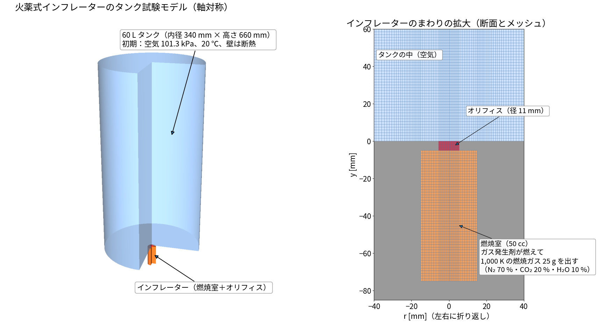
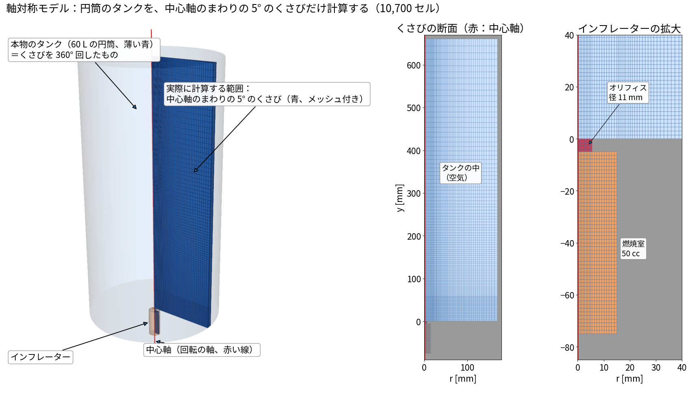
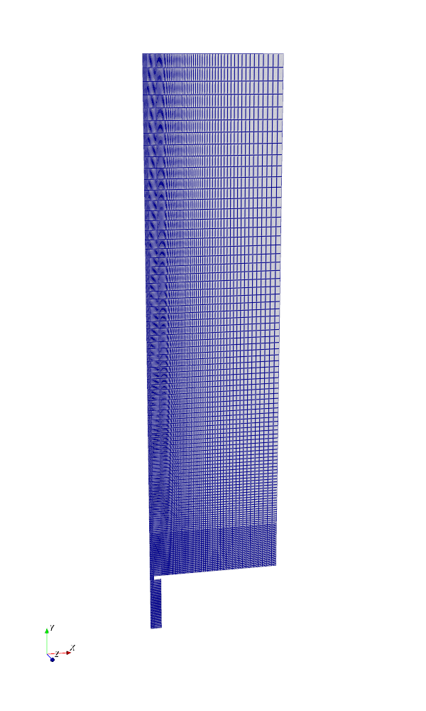
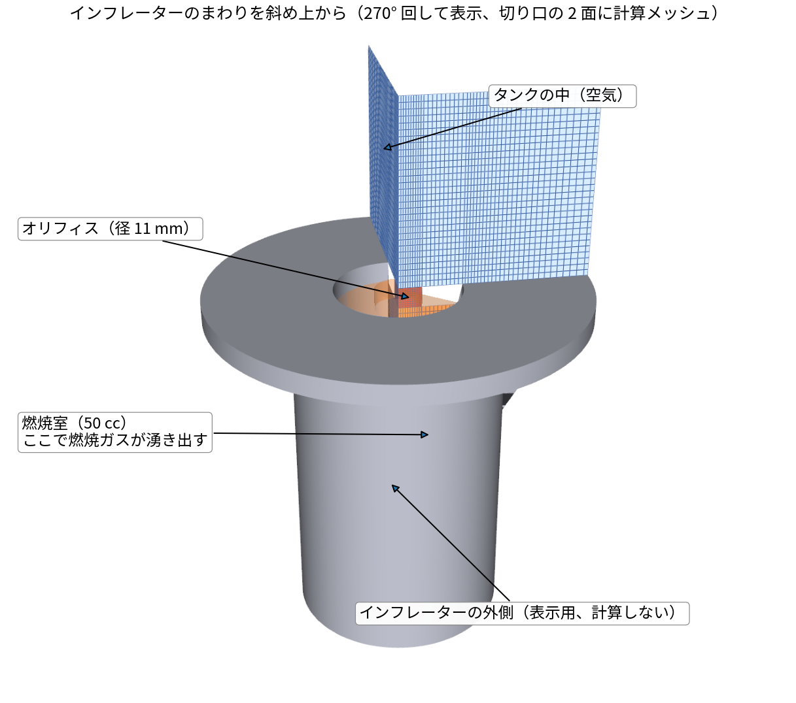
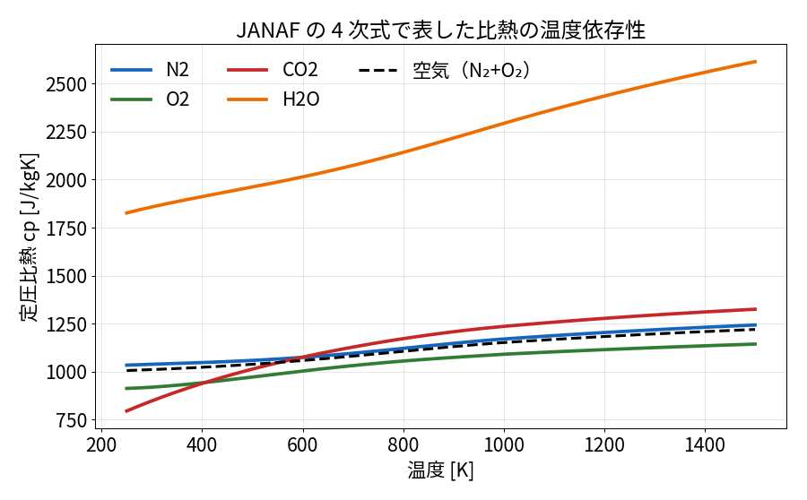
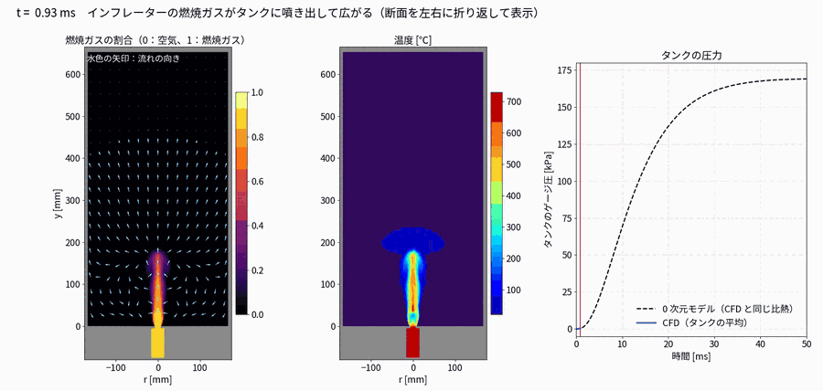
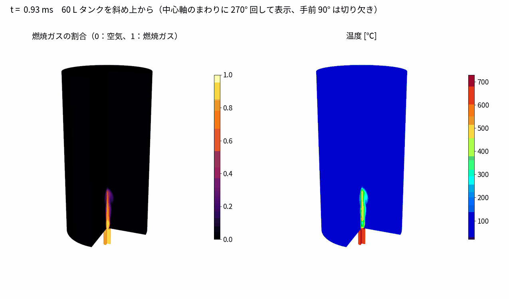
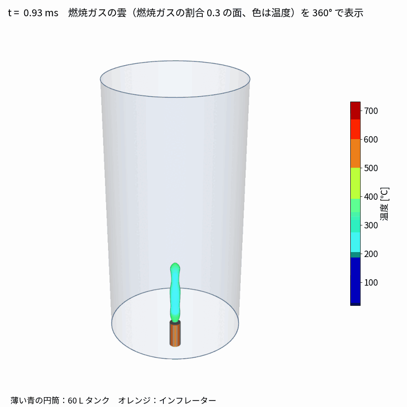
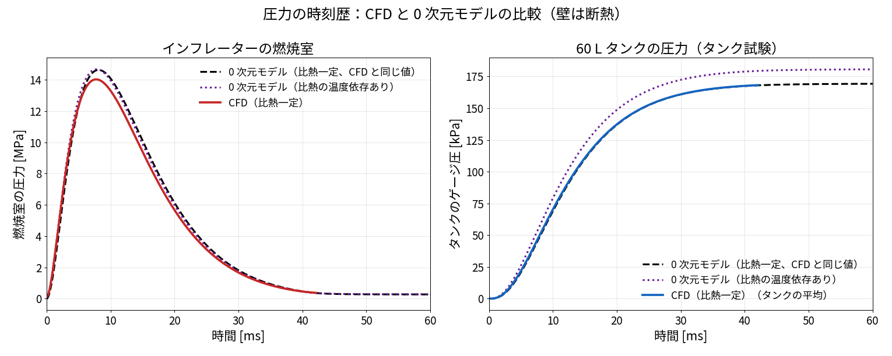

# 01 火薬式インフレーターのタンク試験：条件と結果

> 参考・テスト用のケースです。設定のしかたは `00_解析設定の手順書` を見てください。

作成日：2026-11-04　OpenFOAM v2512　状態：**CFD は計算中**（run001：比熱一定、4 並列）（50 ms まで約 11 時間の見込み、1 並列。ほかの計算 4 本と同時に実行中）

## 1. ねらい

エアバッグのインフレーター（ガス発生器）の性能を確かめる「タンク試験」を計算で再現する。
密閉した 60 L のタンク（空気）に、インフレーターの燃焼室からオリフィスを通して燃焼ガスを噴き出し、
**タンクの圧力の時間変化（タンク圧力曲線）**を求める。

- CFD：燃焼室・オリフィス・タンクをまとめて解く（軸対称、多成分の圧縮性・非定常）
- 0 次元モデル：同じ条件の簡単な式のモデル。CFD の**答え合わせ（比較）用**

## 2. モデル

**軸対称モデル**：円筒のタンクとインフレーターは中心軸のまわりで同じ形なので、5° のくさびだけを計算し（左の青）、
くさびの両面に `wedge` 条件を付けて、360° 回した全体と同じ結果を得る。

計算メッシュ（5° のくさび、10,700 セル。ParaView で見たときと同じ見え方）：

インフレーターのまわりを斜め上から（270° 回し、切り口の 2 面に計算メッシュ）：

| 項目 | 値 |
|---|---|
| 燃焼室 | 半径 15 mm × 長さ 70 mm（50 cc） |
| オリフィス | 径 11 mm（インフレーターの複数のガス噴出口の合計面積に相当）、長さ 5 mm |
| タンク | 内径 340 mm × 高さ 660 mm（60 L） |
| 初期状態 | すべて空気（N₂ 76.7 %・O₂ 23.3 %、質量割合）、101.3 kPa、20 ℃ |
| 壁 | すべて断熱・すべりなし（0 次元モデルと条件をそろえるため） |
| メッシュ | 5° のくさび形（軸対称）、10,700 セル。オリフィスの半径方向に 10 セル |

## 3. ガス発生（火薬の燃焼）の与え方

ガス発生剤の燃焼そのもの（化学反応）は解かず、燃焼室の中に**燃焼ガスが湧き出す**ものとして与える
（`constant/fvOptions` の `scalarSemiImplicitSource`、燃焼室のセルに一様）。

$$
\dot m_{\mathrm{gen}}(t) = M_{\mathrm{gas}}\,\frac{t}{\tau^2}\,e^{-t/\tau},\qquad M_{\mathrm{gas}} = 25\ \mathrm{g},\ \tau = 6\ \mathrm{ms}
$$

| 湧き出す量 | 内容 |
|---|---|
| 質量（ρ） | $\dot m_{\mathrm{gen}}$ |
| エネルギー（h） | $\dot m_{\mathrm{gen}}\, c_p (T_c - 298\ \mathrm{K})$、燃焼ガスの温度 $T_c$ = 1,000 K（フィルタで冷えた後） |
| 成分 | 燃焼ガスの組成 N₂ 70 %・CO₂ 20 %・H₂O 10 %（質量割合） |

数値は、運転席用インフレーターの一般的な値（ガス 1 mol 前後、燃焼室 10〜20 MPa、60 L タンクの最高圧 150〜250 kPa）になるように選んだ。

## 4. ソルバ

- **reactingFoam**（化学反応は切っている）：燃焼ガスとタンクの空気が混ざる**多成分の圧縮性・非定常**の流れを解く
  （成分ごとの輸送式＋混合物の物性、`transonic yes` でオリフィスのチョークに対応）
- 時間刻みはクーラン数 0.5 で自動調整（約 4×10⁻⁷ s）。乱流は k-ω SST
- 物性は比熱一定の理想気体（N₂ 1,170、O₂ 1,090、CO₂ 1,230、H₂O 2,290 J/kgK）

## 5. 0 次元モデル（比較用）

燃焼室とタンクを、それぞれ**中が一様な 1 つの部屋**とみなし、オリフィスは**等エントロピーのノズル**として、
質量とエネルギーのつり合いを時間で積分する（Δt = 2 µs）。壁は断熱。

### 5.1 燃焼室（体積 $V_c$）

$$
\frac{dm_c}{dt} = \dot m_{\mathrm{gen}}(t) - \dot m_o,\qquad
\frac{dE_c}{dt} = \dot m_{\mathrm{gen}}\,h_{\mathrm{gas}}(T_{\mathrm{gen}}) - \dot m_o\,h_c,\qquad
p_c = \frac{m_c R_c T_c}{V_c}
$$

（$E_c$：燃焼室の内部エネルギー、$h$：比エンタルピー、$T_{\mathrm{gen}}$ = 1,000 K：湧き出す燃焼ガスの温度）

### 5.2 オリフィス（面積 $A_o$、流量係数 $C_d$ = 0.85、比熱比 $\gamma$）

チョーク（$p_t/p_c \le (2/(\gamma+1))^{\gamma/(\gamma-1)}$）のとき

$$
\dot m_o = C_d A_o\,p_c\sqrt{\frac{\gamma}{R_c T_c}}\left(\frac{2}{\gamma+1}\right)^{\frac{\gamma+1}{2(\gamma-1)}}
$$

チョークしないとき

$$
\dot m_o = C_d A_o\,p_c\sqrt{\frac{2\gamma}{(\gamma-1)R_c T_c}\left[\left(\frac{p_t}{p_c}\right)^{2/\gamma}-\left(\frac{p_t}{p_c}\right)^{(\gamma+1)/\gamma}\right]}
$$

### 5.3 タンク（体積 $V_t$ = 60 L、初期は空気）

$$
\frac{dm_t}{dt} = \dot m_o,\qquad \frac{dE_t}{dt} = \dot m_o\,h_c,\qquad p_t = \frac{m_t R_t T_t}{V_t}
$$

$R_t$ と比熱は、空気と燃焼ガスの質量割合で混ぜた値。温度 $T_t$ は内部エネルギー $E_t$ から求める。

### 5.4 比熱の与え方（2 種類）

| | 比熱 | 用途 |
|---|---|---|
| ① 比熱一定 | 成分ごとに一定（N₂ 1,170、O₂ 1,090、CO₂ 1,230、H₂O 2,290 J/kgK）。CFD の run001 と同じ値 | CFD（run001）との答え合わせ |
| ② 温度依存あり（JANAF） | 下の 4 次式（0 次元モデルのみ） | より正しい値の目安 |

$$
\frac{c_p(T)}{R_s} = a_1 + a_2 T + a_3 T^2 + a_4 T^3 + a_5 T^4,\qquad
\frac{h(T)}{R_s} = a_1 T + \frac{a_2}{2}T^2 + \frac{a_3}{3}T^3 + \frac{a_4}{4}T^4 + \frac{a_5}{5}T^5 + a_6
$$

係数 $a_1 \sim a_6$ は 200（250）〜1,000 K と 1,000〜5,000 K で 2 組（OpenFOAM の `janaf` と同じデータ）。
温度はエネルギーからニュートン法で逆算する。

| 0 次元モデルの結果 | ① 比熱一定 | ② 温度依存あり |
|---|---|---|
| 燃焼室の最高圧力 | 14.6 MPa | 14.7 MPa |
| タンクの最高ゲージ圧 | 169 kPa | 181 kPa |
| タンクの最終温度 | 580 K | 604 K |

②のほうが 12 kPa 高い。① は常温の空気の比熱を 1,000 K 付近の値（1,151）で与えていて大きすぎ、
同じエネルギーでも温度が上がりにくかったため。JANAF では常温の空気は 1,009 J/kgK。

（最初の版の 0 次元モデルは空気の比熱を 1,005 にしていて、CFD（1,151）と条件がそろっていなかった。
これが「CFD が 1 割低い」ずれの原因だった。今は①に直してある）

## 6. CFD の結果

### ガスの流れ

斜め上から（270° 回して表示）：

360° で見た燃焼ガスの雲（燃焼ガスの割合 0.3 の面、色は温度）：

理論式とソルバの向き不向きは `02_理論式とソルバの適性.md`。

- 左：燃焼ガスの割合（空気の O₂ が薄まった割合から計算）と流れの向き。右：温度。
- オリフィスから噴き出した燃焼ガスは、タンクの中心を柱のように上へ伸び、天井に当たって壁ぞいに戻る大きな渦を作る。
- オリフィスのすぐ上（y ≈ 0〜80 mm）は、超音速で膨張して温度が下がる領域（不足膨張噴流）。y ≈ 80 mm あたりで衝撃波（マッハディスク）を通って再び高温になる。
- タンクの平均圧力は、7 ms までは 0 次元モデルとほぼ重なっている。

## 7. 試行錯誤の記録

| 回 | 内容 | 結果 |
|---|---|---|
| 1 | クーラン数を途中で 0.5 → 2 に上げた | 0.3 ms で温度が負になり発散 |
| 2 | メッシュを粗く（5,586 セル） | 0.24 ms で発散 |
| 3 | 圧力の許容誤差を緩めすぎて、圧力方程式が解かれていなかった（反復 0 回）| 燃焼室にガスが増えても圧力が上がらず、温度が暴れて発散 |
| 4（今回） | 細かいメッシュ、クーラン数 0.5、圧力の許容誤差を厳しく（反復の上限 200 回）、温度の上下限 150〜3,000 K | 安定して計算中 |
