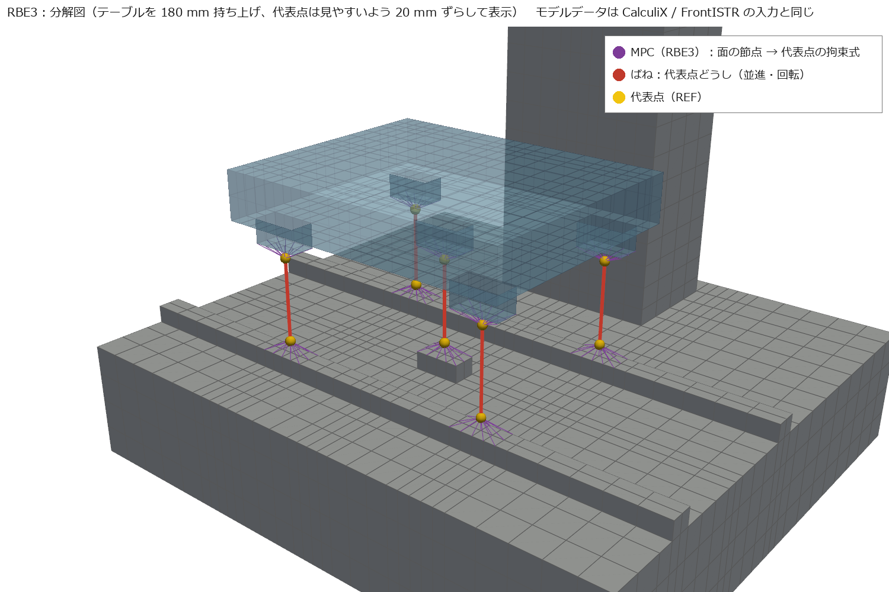
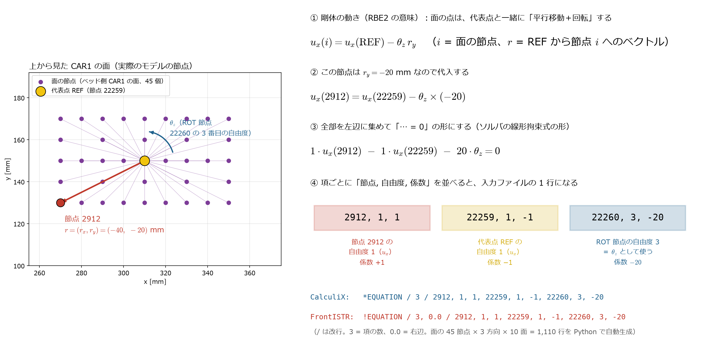
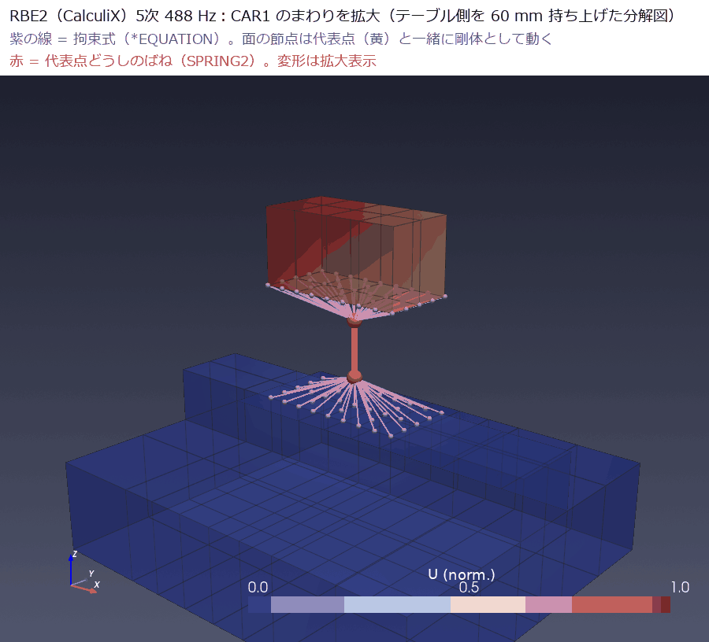
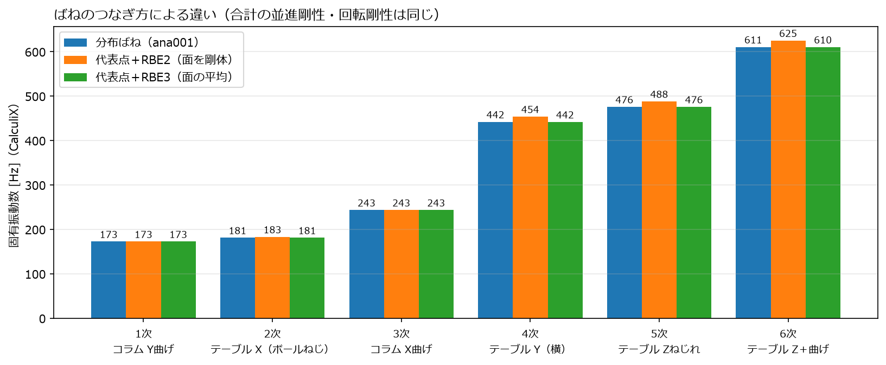

[← docs 目次](../../../docs/README.md) ｜ [⌂ トップ](../../../README.md) ｜ [← 前: ana002 簡易工作機械の周波数応答解析](../../../docs/ana002_CalculiX-FrontISTR_簡易工作機械の周波数応答解析.md) ｜ [次: ana004 ばねの種類の確認 →](../../../docs/ana004_CalculiX-FrontISTR_ばねの種類の確認.md)

# ana003 ばねのつなぎ方の比較：分布ばね vs 代表点＋MPC（RBE2 / RBE3）

作成: 2026-11-07
解析フォルダ: [analysis/ana003_ccx_fistr_mpc_spring](..)

## 1. 目的

「面と面から代表点を作って、代表点どうしをばねでつなぐ」方法（商用ソフトの RBE2 / RBE3 ＋ ばね要素に相当）が、
**CalculiX と FrontISTR でできるか**を確かめ、[ana001](../../../docs/ana001_CalculiX-FrontISTR_簡易工作機械の固有値解析.md) の分布ばねと比べる。

## 2. 方法

### 2.1 3 つのつなぎ方

| 方式 | 面のつなぎ方 | 特徴 |
|---|---|---|
| 分布ばね（ana001） | 向かい合う節点を 1 対 1 でばねにする | 面の変形も自然に入る。メッシュを両面で合わせる必要がある |
| **RBE2 相当**（剛体結合） | 面の全節点を代表点に**剛体として**縛る：$\boldsymbol{u}_i = \boldsymbol{u}_{\mathrm{ref}} + \boldsymbol{\theta} \times \boldsymbol{r}_i$ | 面が変形しなくなる → **少し硬めに出る** |
| **RBE3 相当**（平均） | 代表点の動き＝面の節点の**重み付き平均**：$\boldsymbol{u}_{\mathrm{ref}} = \sum_i w_i \boldsymbol{u}_i$、回転も平均 | 面は自由に変形できる。硬くならない |

代表点どうしは、**並進ばね 3 方向＋回転ばね 3 方向**でつなぐ。
値は分布ばねと同じになるようにした（並進 = 面の合計、回転 = $\sum_i k_i r_i^2$）。

| 面 | 並進ばね [N/mm] | 回転ばね [N·mm/rad] |
|---|---|---|
| キャリッジ 1 個 | Y 5.6 × 10⁵、Z 8.0 × 10⁵ | θx 1.6 × 10⁸、θy 4.8 × 10⁸、θz 3.4 × 10⁸ |
| ナット | X 2.0 × 10⁵ | ― |




*分解図。黄色の球 = 代表点、紫の細線 = MPC（拘束式）でつながる面の節点、赤い太線 = 代表点どうしのばね。*

### 2.2 実装：何をしたのか（ソルバの改造はしていない）

**結論：ソルバ（CalculiX・FrontISTR）は一切改造していない。** どちらにも標準で入っている「**線形拘束式（MPC）**」という機能だけを使った。
やったことは次の 3 つ。

| | やったこと | 種類 |
|---|---|---|
| ① | 「面が剛体として動く（RBE2）」「代表点は面の平均で動く（RBE3）」を**数式**で書く | 数式（力学の式） |
| ② | その式を、ソルバが読める「線形拘束式」の形（$\sum (\text{係数} \times \text{自由度}) = 0$）に書き直す | 数式の変形 |
| ③ | 面の節点ごとに係数（節点の位置から決まる）を計算し、入力ファイルの行として**書き出す Python スクリプトを自作**した（RBE2 で 1,110 行） | 自作スクリプト（[mpc_springs.py](../../tools/mpc_springs.py)） |

つまり「**数式で解決し、その式を入力ファイルに大量に書く部分を自作のスクリプトで自動化した**」。
商用ソフト（Nastran など）の RBE2 / RBE3 は、この①〜③をソフトが内部で自動でやっているだけで、中身は同じ線形拘束式。

#### 登場する節点

- **代表点 REF**：面の中心に置いた節点（要素なし）。並進 3 自由度 $u_x, u_y, u_z$ を持つ
- **回転用の補助節点 ROT**：REF と同じ位置に置いた節点（要素なし）。ソリッド要素の節点には回転の自由度がないので、
  **この節点の自由度 1, 2, 3 を「回転角 $\theta_x, \theta_y, \theta_z$」という意味で使う**（ソルバから見ればただの節点の変位。式の中で回転として扱っているだけ）
- **面の節点**：キャリッジ下面・レール上面などの節点（中間節点も含む）

#### RBE2 の式（面が剛体）

面の節点 $i$ の位置を、代表点からのベクトル $r = (r_x, r_y, r_z)$ で表す（面は $z$ = 一定なので $r_z = 0$）。
剛体の動き（平行移動 ＋ 小さな回転）は $u_i = u_{\mathrm{ref}} + \theta \times r$ なので、成分に分けると:

$$
u_{ix} = u_{\mathrm{ref},x} - \theta_z r_y,\quad
u_{iy} = u_{\mathrm{ref},y} + \theta_z r_x,\quad
u_{iz} = u_{\mathrm{ref},z} + \theta_x r_y - \theta_y r_x
$$

#### 式が入力ファイルの 1 行になるまで（実際の節点で）



*左：CAR1（ベッド側）の面を上から見た図。実際のモデルの節点 45 個が、紫の線で代表点 REF（黄）に結ばれている。
右：節点 2912 の $x$ 方向の式が、入力ファイルの 1 行になるまで。生成スクリプト: [make_mpc_explain.py](../make_mpc_explain.py)*

1. 節点 2912 は代表点から $r = (-40, -20)$ mm の位置にある
2. 式に代入：$u_x(2912) = u_x(\mathrm{REF}) - \theta_z \times (-20)$
3. 全部左辺に移す：$1 \cdot u_x(2912) - 1 \cdot u_x(\mathrm{REF}) - 20\,\theta_z = 0$
4. 各項を「節点番号, 自由度番号, 係数」の 3 つ組にして並べる

| 項 | 節点 | 自由度 | 係数 | 意味 |
|---|---|---|---|---|
| $1 \cdot u_x(2912)$ | 2912 | 1 | 1 | 面の節点の $x$ 変位 |
| $-1 \cdot u_x(\mathrm{REF})$ | 22259 | 1 | −1 | 代表点の $x$ 変位 |
| $-20 \cdot \theta_z$ | 22260 | 3 | −20 | ROT 節点の自由度 3（＝$\theta_z$ として使う） |

CalculiX（入力ファイル machine.inp の中）:

```text
*EQUATION
3
2912, 1, 1, 22259, 1, -1, 22260, 3, -20
```

- 1 行目 `*EQUATION`：これから拘束式を書く
- 2 行目 `3`：この式の項の数
- 3 行目：「節点, 自由度, 係数」× 3 項。**最初の項（節点 2912 の $u_x$）が従属自由度**になり、計算の中で消去される（ほかの自由度から決まる）

FrontISTR（メッシュファイル machine.msh の中）:

```text
!EQUATION
3, 0.0
2912, 1, 1, 22259, 1, -1, 22260, 3, -20
```

- 2 行目 `3, 0.0`：項の数と、式の右辺（$= 0.0$）
- 3 行目：CalculiX と同じ並び

この行を「面の節点 45 個 × 3 方向（$x, y, z$）× 面 10 枚（キャリッジ 4 ＋ ナット 1、それぞれベッド側とテーブル側）」ぶん、スクリプトで書き出した。
代表点どうしは、ふつうのばね（CalculiX `SPRING2`、FrontISTR `511` ＋ `!SPRING_D`）で、並進 3 方向（REF どうし）と回転 3 方向（ROT どうし）をつないだ。

#### RBE3 の式（代表点 = 面の平均）

RBE3 は向きが逆で、**代表点のほうが従属**（面の節点の重み付き平均で決まる）。面は剛体にならない。

$$
u_{\mathrm{ref},x} = \sum_i w_i\, u_{ix} \quad\Longrightarrow\quad -1 \cdot u_{\mathrm{ref},x} + \sum_i w_i\, u_{ix} = 0
$$

重み $w_i$ は分布ばねと同じ（角 1/32、辺 2/32、内部 4/32）。回転 $\theta$ も、節点の動きから最小二乗で求めた式を同じように書く。

#### 実際に動かすと（ParaView 風アニメーション）

CalculiX の RBE2 モデルの 5 次モード（テーブルのねじれ、488 Hz）で、CAR1 のまわりを拡大した。
紫の線（拘束式）でつながった面の節点が、代表点（黄）と一緒に**形を変えずに**動き、上下の代表点の間の赤いばねだけが伸び縮み・ねじれる。



*テーブル側を 60 mm 持ち上げた分解図。色 = 変位の大きさ。図は CalculiX の結果ファイル（rbe2/ccx/machine.frd）と、ソルバに渡したのと同じ節点・拘束式のデータから pyvista（ParaView と同じ VTK）で描いた*

| | CalculiX | FrontISTR |
|---|---|---|
| 拘束式 | `*EQUATION`（入力ファイル）。**最初の項が従属自由度**（消去される側） | `!EQUATION`（メッシュファイル）。1行目「項の数, 定数」、2行目以降「節点, 自由度, 係数, ...」 |
| ばね | `SPRING2`（REF 同士、ROT 同士） | `511` ＋ `!SPRING_D` |
| 剛体結合の専用機能 | `*RIGID BODY`（REF NODE / ROT NODE）、`*COUPLING` ＋ `*KINEMATIC` / `*DISTRIBUTING` もある。今回は両ソルバで同じ式にするため使わなかった | 専用機能はない（`!EQUATION` を並べて作る） |

コード: [analysis/tools/mpc_springs.py](../../tools/mpc_springs.py)（式の係数を計算）、[analysis/tools/machine_model.py](../../tools/machine_model.py)（`*EQUATION` / `!EQUATION` の行を書き出す）

## 3. 結果

| モード | 分布ばね CalculiX / FrontISTR [Hz] | RBE2 CalculiX / FrontISTR [Hz] | RBE3 CalculiX / FrontISTR [Hz] |
|---|---|---|---|
| 1 コラム Y曲げ | 172.5 / 172.2 | 172.5 / 172.2 | 172.5 / 172.2 |
| 2 テーブル X（ボールねじ） | 181.2 / 181.2 | 183.1 / 183.1 | 181.2 / 181.2 |
| 3 コラム X曲げ | 243.5 / 243.2 | 243.5 / 243.2 | 243.5 / 243.2 |
| 4 テーブル Y（横） | 442.0 / 441.8 | 453.8 / 453.5 | 441.7 / 441.5 |
| 5 テーブル Zねじれ | 475.7 / 474.4 | 488.1 / 486.8 | 475.7 / 474.4 |
| 6 テーブル Z＋曲げ | 610.6 / 610.9 | 625.1 / 625.3 | 610.4 / 610.7 |



- **MPC 方式は両ソルバで動き、2 つのソルバの結果も一致した**
- **RBE3 は分布ばねとほぼ同じ**（差 0.1 % 以下）
- **RBE2 は 1〜3 % 高く出る**。キャリッジ下面・レール上面が剛体になり、その部分の局部変形がなくなるため
- コラムのモード（1, 3 次）はばねと関係ないので、どの方式でも同じ

## 4. どれを使えばいいか

| 場面 | おすすめ |
|---|---|
| 面のメッシュを合わせられる（自分でメッシュを作る、構造格子） | 分布ばね（いちばん素直） |
| 面のメッシュが合わない（CAD からの自動四面体メッシュなど） | **RBE3 ＋ 代表点のばね**（硬くならない） |
| 部品の取付部を剛体とみなしてよい、カタログの剛性が「キャリッジ全体」の値 | RBE2 ＋ 代表点のばね（少し硬めになることを承知で） |
| ガイドのモーメント剛性（カタログ値）を直接入れたい | 代表点方式（回転ばねに直接入れられる） |

## 5. 再現手順

```bash
cd analysis/ana003_ccx_fistr_mpc_spring
./run.sh                         # RBE2 / RBE3 × CalculiX / FrontISTR
~/opt/venv/bin/python post.py    # 比較表とグラフ
```

---

[← docs 目次](../../../docs/README.md) ｜ [⌂ トップ](../../../README.md) ｜ [← 前: ana002 簡易工作機械の周波数応答解析](../../../docs/ana002_CalculiX-FrontISTR_簡易工作機械の周波数応答解析.md) ｜ [次: ana004 ばねの種類の確認 →](../../../docs/ana004_CalculiX-FrontISTR_ばねの種類の確認.md)
