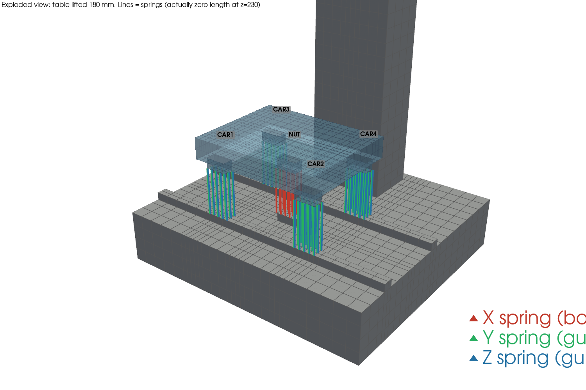
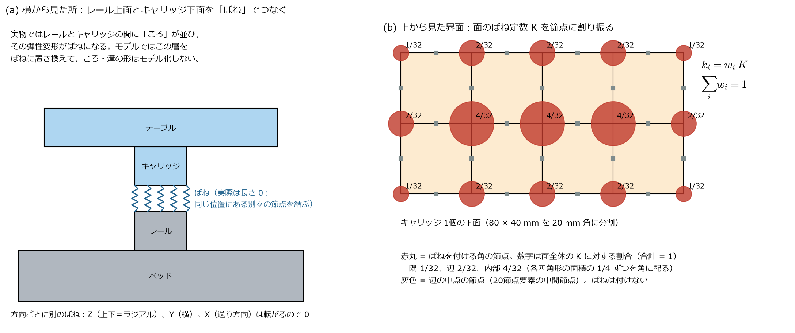
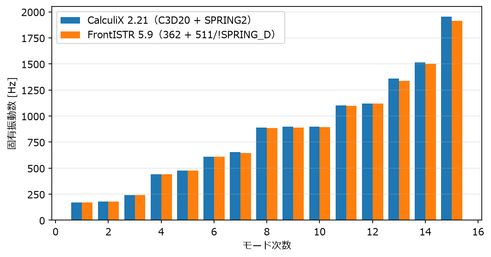
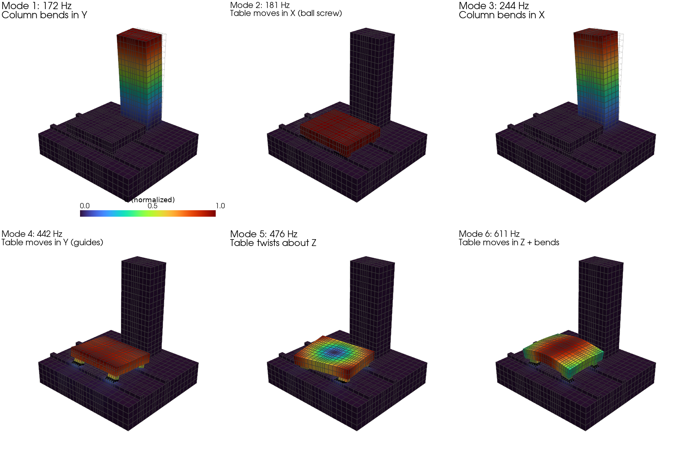
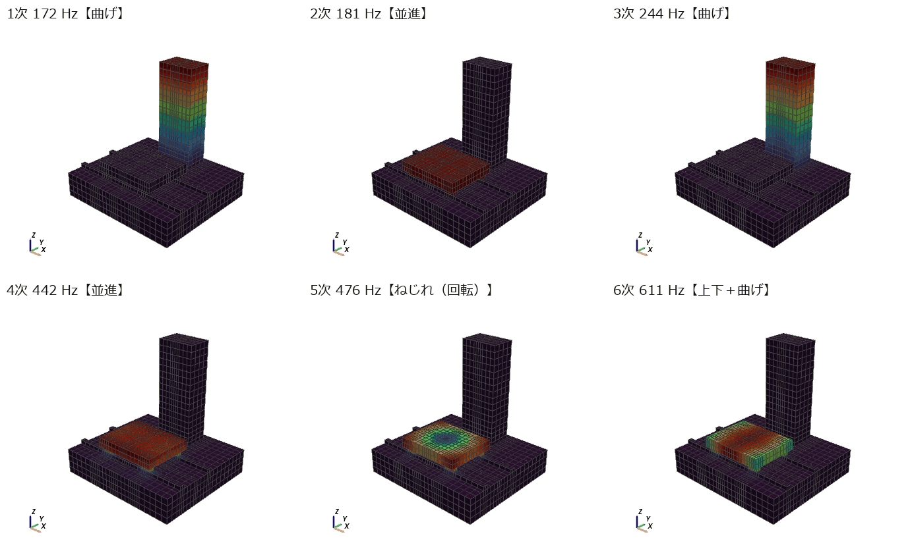
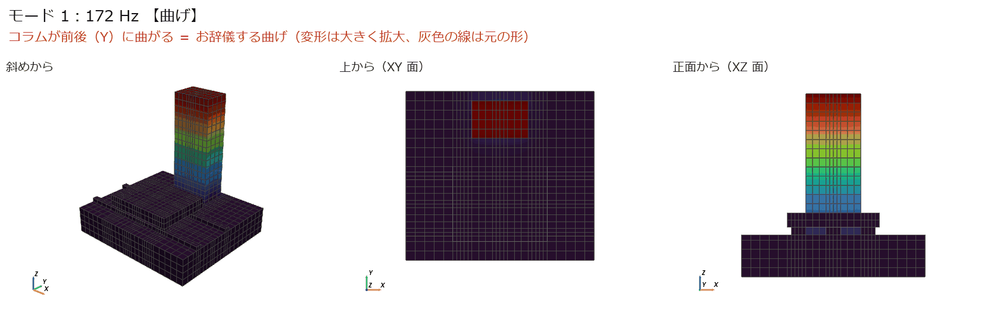
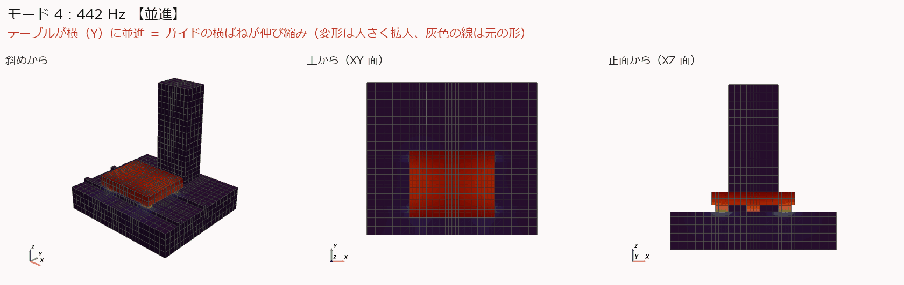
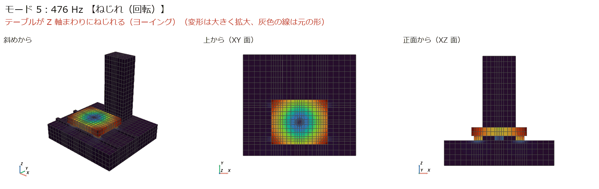
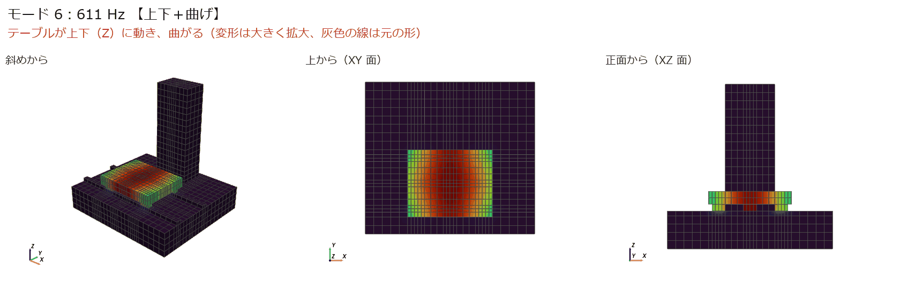
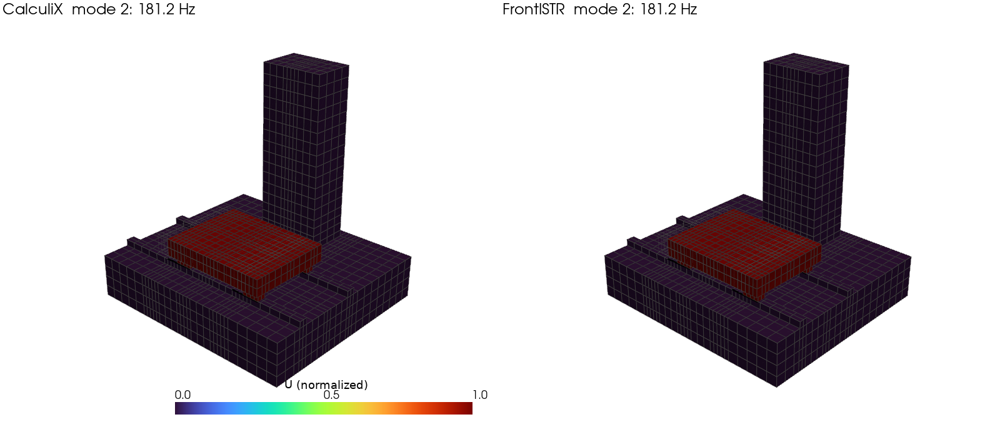

[← docs 目次](README.md) ｜ [⌂ トップ](../README.md) ｜ [← 前: ref006 6.0の変更点と5.9との比較](ref006_FrontISTR_6.0の変更点と5.9との比較.md) ｜ [次: ana002 簡易工作機械の周波数応答解析 →](ana002_CalculiX-FrontISTR_簡易工作機械の周波数応答解析.md)

# ana001 簡易工作機械モデルの固有値解析（CalculiX と FrontISTR）

作成: 2026-11-07
解析フォルダ: [analysis/ana001_ccx_fistr_modal](../analysis/ana001_ccx_fistr_modal/)

## 1. 目的

- コラム・テーブルの **1次固有振動数とモード形状**を求める
- リニアガイドとボールねじを、**面と面をつなぐばね**でモデル化する方法を確立する
- 同じモデルを **CalculiX** と **FrontISTR** で解き、結果が一致するか確かめる

## 2. 環境

| ソフト | バージョン | 入れ方（管理者権限なし） |
|---|---|---|
| CalculiX | 2.21 | Ubuntu のパッケージ `calculix-ccx` と依存ライブラリを `apt-get download` → `dpkg -x` で `~/opt/ccxroot` に展開。実行は `~/opt/ccx.sh` |
| FrontISTR | 6.0（当初 5.9 で実行。6.0 でも結果は同じ → [ref006](ref006_FrontISTR_6.0の変更点と5.9との比較.md)） | ソースを GitLab から取得して逐次版をビルド（MPI・METIS・MUMPS なし、OpenMP あり）→ `~/opt/frontistr/bin/fistr1` |
| Python | 3.12 | `~/opt/venv`（numpy, matplotlib, pyvista, cmake） |

可視化は ParaView と同じ VTK を使う **pyvista** で行った。結果は ParaView でも開ける（8 章）。

## 3. モデル



*テーブルを 180 mm 持ち上げて描いた分解図。線がばね（実際は長さ 0）。赤 = X（ボールねじ）、緑 = Y（ガイド横）、青 = Z（ガイド上下）。*

| 部品 | 寸法 [mm] | メモ |
|---|---|---|
| ベッド | 1000 × 900 × 200 | 底面を全拘束 |
| レール（2本） | 幅 40、高さ 30、長さ 1000 | ベッドと一体（同じ節点を共有） |
| コラム | 300 × 200 × 高さ 800 | ベッドと一体 |
| ボールねじ支持台 | 80 × 40 × 30 | ナットの真下。ベッドと一体。ボールねじの軸方向剛性をここで受ける（簡略化） |
| テーブル | 500 × 400 × 80 | |
| キャリッジ（4個） | 80 × 40 × 40 | テーブルと一体 |
| ナットブラケット | 80 × 40 × 40 | テーブルと一体 |

- 材料: 鋳鉄（FC300 相当）$E$ = 120 GPa、$\nu$ = 0.27、$\rho$ = 7300 kg/m³
- 要素: 20節点六面体（CalculiX `C3D20`、FrontISTR `362`）4,288 要素、22,258 節点
- 単位系: mm, N, t（トン）, s → 応力 MPa、ばね N/mm
- メッシュは Python で自作（[analysis/tools/machine_model.py](../analysis/tools/machine_model.py)）。同じ節点・要素を両ソルバに書き出す

## 4. ばねの設定（いちばん大事な所）

### 4.1 どこに、どの方向のばねが入っているか

| ばね | つなぐ面 | 方向 | 1面あたりのばね定数 | 実物 |
|---|---|---|---|---|
| CAR1〜CAR4 | レール上面 ⇔ キャリッジ下面（z = 230 mm） | **Y（横）** | 5.6 × 10⁵ N/mm（560 N/µm） | リニアガイドの横剛性 |
| 〃 | 〃 | **Z（上下）** | 8.0 × 10⁵ N/mm（800 N/µm） | リニアガイドのラジアル剛性 |
| 〃 | 〃 | X（送り） | **入れない（0）** | ガイドは転がる方向には支えない |
| NUT | 支持台上面 ⇔ ナットブラケット下面 | **X（送り）だけ** | 2.0 × 10⁵ N/mm（200 N/µm） | ボールねじ送り系の軸方向剛性 |

- **ボールねじのばねは入っている**（上の図の赤い線）。送り方向（X）だけに効く
- **テーブルが送り方向（X）に動くとき、それを支えるのはボールねじのばねだけ**。ガイドは X 方向に何も支えない。だから X 方向は他の方向より柔らかく、2次モード（181 Hz）になっている
- 値の根拠と、どういう値を入れるべきかは [study/ref004](../study/ref004_工作機械_ばね剛性と減衰の決め方.md) にまとめた

### 4.2 面と面をつなぐ方法（分布ばね）



1. レール上面（ベッド側）とキャリッジ下面（テーブル側）は**同じ位置・同じ分割**で、**別々の節点**を持たせる（向かい合う節点が同じ座標に 2 つある）
2. 向かい合う節点の組を、**方向を指定した線形ばね**でつなぐ
   - CalculiX: `SPRING2` 要素（2節点、自由度指定）
   - FrontISTR: `511` 要素（2節点コネクタ）＋ `!SPRING_D`（自由度指定ばね）
3. 面全体のばね定数 $K$ を、各節点が受け持つ面積の割合 $w_i$ で割り振る：$k_i = w_i K$、$\sum_i w_i = 1$
   - 1 つの四角形の面積の 1/4 ずつを 4 隅に配る → 隅 1/32、辺 2/32、内部 4/32（キャリッジ 1 個を 4×2 に分割した場合）
   - 20節点要素の**中間節点（辺の中点）にはばねを付けない**
4. ばねの長さは 0（同じ座標の 2 節点）。自由度指定ばねは長さに関係なく働くので問題ない

**分布ばねにする理由**: 面全体に分散して付けると、キャリッジの**傾き（モーメント）に対する剛性**も自然に入る。
1 点だけでつなぐと、キャリッジが首を振る方向に支えがなくなる。

### 4.3 MPC（代表点）方式もできる

面ごとに代表点を作り、面の節点を拘束式（MPC）で代表点に結び、代表点どうしをばねでつなぐ方法も、両ソルバで動くことを確認した。
→ [ana003](ana003_CalculiX-FrontISTR_代表点MPCばねの比較.md)

## 5. 入力ファイルの解説

### 5.1 CalculiX（[ccx/machine.inp](../analysis/ana001_ccx_fistr_modal/ccx/machine.inp)、約 31,000 行）

```text
*NODE, NSET=NALL                         ← 節点（番号, x, y, z）
1, 0, 0, 0
...
*ELEMENT, TYPE=C3D20, ELSET=EBED         ← ベッド＋レール＋コラムの20節点六面体
1, 1, 2, ..., 15,                         （1行目に要素番号＋15節点、2行目に残り5節点）
16, 17, 18, 19, 20
*ELEMENT, TYPE=C3D20, ELSET=ETABLE       ← テーブル＋キャリッジ＋ナットブラケット
...
*ELEMENT, TYPE=SPRING2, ELSET=SP_CAR1_2_0  ← ばね要素（要素番号, ベッド側節点, テーブル側節点）
4289, 2912, 18940
*SPRING, ELSET=SP_CAR1_2_0               ← このグループのばね定数
2, 2                                      ← ベッド側の自由度2(Y) と テーブル側の自由度2(Y) をつなぐ
1.750000e+04                              ← ばね定数 [N/mm]（= 560,000 × 1/32）
...                                      （面・方向・割合ごとにグループを分けて 27 組）
*NSET, NSET=FIX                          ← ベッド底面の節点
*NSET, NSET=MON                          ← テーブル上面中央（ana002 の加振点）
*MATERIAL, NAME=CASTIRON
*ELASTIC
120000.0, 0.27                            ← ヤング率 [MPa], ポアソン比
*DENSITY
7.3e-09                                   ← 密度 [t/mm^3]
*SOLID SECTION, ELSET=EBED, MATERIAL=CASTIRON
*SOLID SECTION, ELSET=ETABLE, MATERIAL=CASTIRON
*BOUNDARY
FIX, 1, 3                                 ← 底面の x, y, z を固定
*STEP
*FREQUENCY, STORAGE=YES                   ← 固有値解析。STORAGE=YES で次の周波数応答に結果を渡せる
15                                        ← 求めるモード数
*NODE FILE                                ← .frd（結果ファイル）に変位を出力
U
*END STEP
```

ポイント:
- `SPRING2` は**自由度を指定するばね**。`*SPRING` の 2 行目「2, 2」は「1つ目の節点の Y と 2つ目の節点の Y」の意味
- 方向がずれない（変形に追従しない）線形ばねなので、固有値解析・周波数応答でそのまま使える
- 1 つの `*SPRING` には 1 つの値しか書けないので、値ごとに ELSET を分けている
- 結果は `machine.dat`（固有振動数の表）と `machine.frd`（モード形状）

### 5.2 FrontISTR（メッシュ [machine.msh](../analysis/ana001_ccx_fistr_modal/fistr/machine.msh)、制御 [machine_eigen.cnt](../analysis/ana001_ccx_fistr_modal/fistr/machine_eigen.cnt)、全体制御 [hecmw_ctrl.dat](../analysis/ana001_ccx_fistr_modal/fistr/hecmw_ctrl.dat)）

メッシュファイル（.msh）:

```text
!NODE
...
!ELEMENT, TYPE=362, EGRP=EBED            ← 20節点六面体（節点の順番は CalculiX と同じ）
!ELEMENT, TYPE=362, EGRP=ETABLE
!ELEMENT, TYPE=511, EGRP=SP0             ← 2節点コネクタ要素（ばね用）
4289, 2912, 18940
!MATERIAL, NAME=CASTIRON, ITEM=2         ← 鋳鉄（ヤング率・ポアソン比、密度）
!MATERIAL, NAME=SPMAT0, ITEM=1           ← ばね用の材料（中身はダミー。★下の注意）
!ITEM=1, SUBITEM=2
1.0, 0.3
!SECTION, TYPE=INTERFACE, EGRP=SP0, MATERIAL=SPMAT0   ← ばね要素には TYPE=INTERFACE
!NGROUP, NGRP=FIX
!NGROUP, NGRP=MON
```

制御ファイル（.cnt）:

```text
!SOLUTION, TYPE=EIGEN                    ← 固有値解析
!EIGEN
 15, 1.0E-8, 300                         ← モード数, 収束判定, 最大反復回数（Lanczos 法）
!BOUNDARY
 FIX, 1, 3, 0.0                          ← 底面の 1〜3 方向を 0 に固定
!MATERIAL, NAME=SPMAT0                   ← ばね定数はここ（制御ファイル側）で与える
!SPRING_D
2, 2, 1.750000e+04                       ← 節点1の自由度2 と 節点2の自由度2 を k=17500 N/mm でつなぐ
...
!SOLVER, METHOD=DIRECT                   ← 直接法ソルバ
!WRITE,RESULT / !WRITE,VISUAL            ← 結果ファイルと VTK 出力
```

★ 詰まった点: 制御ファイルの `!MATERIAL, NAME=SPMAT0` は、**メッシュ側に同じ名前の材料が無いと**
`### Error: Fail in read in material definition` で止まる。メッシュ側にダミーの材料（`!ITEM=1` に適当な値）を置いて解決した。

## 6. 結果

### 6.1 固有振動数（CalculiX と FrontISTR の比較）

| モード | CalculiX [Hz] | FrontISTR [Hz] | 差 [%] | ゆれ方 |
|---|---|---|---|---|
| 1 | 172.5 | 172.2 | −0.16 | コラムが前後（Y）に曲がる |
| 2 | 181.2 | 181.2 | 0.00 | テーブルが送り方向（X）に動く（ボールねじのばね） |
| 3 | 243.5 | 243.2 | −0.11 | コラムが左右（X）に曲がる |
| 4 | 442.0 | 441.8 | −0.05 | テーブルが横（Y）に動く（ガイドの横ばね） |
| 5 | 475.7 | 474.4 | −0.27 | テーブルが Z 軸まわりにねじれる |
| 6 | 610.6 | 610.9 | +0.05 | テーブルが上下（Z）に動き、曲がる（ガイドの上下ばね） |

（7〜15次は [results/frequencies.md](../analysis/ana001_ccx_fistr_modal/results/frequencies.md)。差は最大 1.8 %）

- 6次までは差 0.3 % 以内で一致。高次で FrontISTR がわずかに低いのは、質量行列の作り方（集中質量か整合質量か）の違いと考えられる
- **FrontISTR のばね要素（511 + `!SPRING_D`）は固有値解析でも効く**ことを確認した（マニュアルには明記されていなかった）
- 計算時間: CalculiX 14 秒、FrontISTR 24 秒（OpenMP 8 スレッド）



### 6.2 モード形状（CalculiX、pyvista で描画）



*色 = 変位の大きさ（最大を 1 に正規化）。灰色の線 = 変形前の形。変形は誇張している。*

- **1次（172 Hz）**: コラムが前後にお辞儀する。コラムの断面は Y 方向に薄い（200 mm）ので、こちらが先に来る
- **2次（181 Hz）**: テーブル全体が送り方向にスライドする。ガイドは X を支えないので、ボールねじのばね 1 本で支えている
- **3次（243 Hz）**: コラムが左右に曲がる（断面の幅 300 mm 方向なので 1次より高い）
- **4次（442 Hz）**: テーブルが横にずれる（ガイド 4 個の横ばね）
- **5次（476 Hz）**: テーブルが真上から見て回る（中心はほぼ動かず、四隅が動く）
- **6次（611 Hz）**: テーブルが上下に動きながら弓なりに曲がる

### 6.2a アニメーション（GIF）で見る

静止画だと「並進（平行にずれる）」と「ねじれ（回る）」の区別がつきにくいので、各モードを動かして 3 方向から見る。
**上から（XY 面）**の図で、平行にずれれば並進、回っていればねじれ（Z 軸まわり）と判断できる。



| モード | 種類 | 見分け方 |
|---|---|---|
| 1次 173 Hz | 曲げ（コラム） | 正面図ではほぼ動かず、斜め図でコラム上端が前後に振れる |
| 2次 181 Hz | **並進**（テーブル X） | 上から見て、テーブルが形を保ったまま左右（X）に平行移動 |
| 3次 243 Hz | 曲げ（コラム） | 正面図でコラム上端が左右に振れる |
| 4次 442 Hz | **並進**（テーブル Y） | 上から見て、テーブルが上下（Y）に平行移動 |
| 5次 476 Hz | **ねじれ**（テーブル Z 軸まわり） | 上から見て、テーブルが中心のまわりに**回る**。中心は動かない（色が青） |
| 6次 611 Hz | 上下＋曲げ | 正面図でテーブルが上下し、弓なりに曲がる |

各モードの 3 方向アニメーション（左: 斜め、中: 上から、右: 正面から）:

**1次 173 Hz：コラムの Y 曲げ**



**2次 181 Hz：テーブルの X 並進（ボールねじ）**


**3次 243 Hz：コラムの X 曲げ**


**4次 442 Hz：テーブルの Y 並進（ガイド横ばね）**



**5次 476 Hz：テーブルの Z 軸まわりのねじれ（ヨーイング）**



**6次 611 Hz：テーブルの上下＋曲げ**



*生成スクリプト: [make_gifs.py](../analysis/ana001_ccx_fistr_modal/make_gifs.py)（pyvista で 20 コマ描画 → Pillow で GIF に。変形は誇張、灰色の線は元の形）*

これらのモードが周波数応答（コンプライアンス）のどのピークになるかは [ana002 の 4.2 節](ana002_CalculiX-FrontISTR_簡易工作機械の周波数応答解析.md) を参照。

### 6.3 CalculiX と FrontISTR のモード形状の比較（2次）



## 7. 妥当性チェック（手計算）

| モード | 手計算モデル | 手計算 | FEM | 差の理由 |
|---|---|---|---|---|
| 2次 テーブル X | テーブル質量 $m$ = 0.1215 t をばね $K$ = 2.0 × 10⁵ N/mm 1 本で支える：$f = \frac{1}{2\pi}\sqrt{K/m}$ | 204 Hz | 181 Hz | ベッド・支持台・テーブルの変形がばねと直列に入って柔らかくなる |
| 1次 コラム Y | 片持ちはり $f_1 = \frac{1.875^2}{2\pi}\sqrt{\frac{EI}{\rho A L^4}}$、$L$ = 800 mm、断面 300 × 200 | 205 Hz | 172 Hz | 根元（ベッド）が変形する、せん断変形 |
| 6次 テーブル Z | 4 キャリッジの上下ばね 3.2 × 10⁶ N/mm で $m$ を支える | 817 Hz | 611 Hz | テーブル自体の曲げが加わる |

どれも FEM が手計算より低く、理由も説明できるので妥当と判断した。

## 8. ParaView で見る

- results/ccx_modes.vtu（未収録：スクリプトで再生成） を ParaView で開く（File → Open）
  - 点データ `mode01_172.5Hz` 〜 `mode15_...`：各モードの変位
  - セルデータ `part`：0 = ベッド・コラム、1 = テーブル、2 = ばね
- モード形状を見る: Filters → **Warp By Vector**（Vectors にモードを選び、Scale Factor を 50〜100 程度に）
- ばねだけ見る: Filters → **Threshold**（`part` を 2〜2）
- FrontISTR の結果: `fistr/machine_eigen_vis_psf.000N.pvtu`（N = モード番号）をそのまま開ける

## 9. 再現手順

```bash
cd analysis/ana001_ccx_fistr_modal
~/opt/venv/bin/python make_inputs.py            # 入力ファイルを作る
(cd ccx && ~/opt/ccx.sh -i machine)              # CalculiX
(cd fistr && LD_LIBRARY_PATH=~/opt/ccxroot/usr/lib/x86_64-linux-gnu/blas:~/opt/ccxroot/usr/lib/x86_64-linux-gnu/lapack ~/opt/frontistr/bin/fistr1)
~/opt/venv/bin/python post.py                    # 表とグラフ
~/opt/venv/bin/python post_vtk.py                # VTU 出力と 3D 図
```

## 10. 詰まった点・次の課題

- FrontISTR の材料名の問題（5.2 の★）
- ばねの値は仮の値。カタログ値と取付部の影響で決める方法は [study/ref004](../study/ref004_工作機械_ばね剛性と減衰の決め方.md)
- **テーブル位置によるボールねじ剛性の変化**を入れて、位置ごとの固有振動数を調べる（次の課題）
- 主軸頭・サドルを追加して、工具先端の剛性を見る

---

[← docs 目次](README.md) ｜ [⌂ トップ](../README.md) ｜ [← 前: ref006 6.0の変更点と5.9との比較](ref006_FrontISTR_6.0の変更点と5.9との比較.md) ｜ [次: ana002 簡易工作機械の周波数応答解析 →](ana002_CalculiX-FrontISTR_簡易工作機械の周波数応答解析.md)
