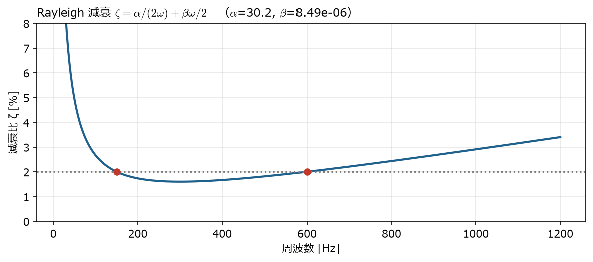
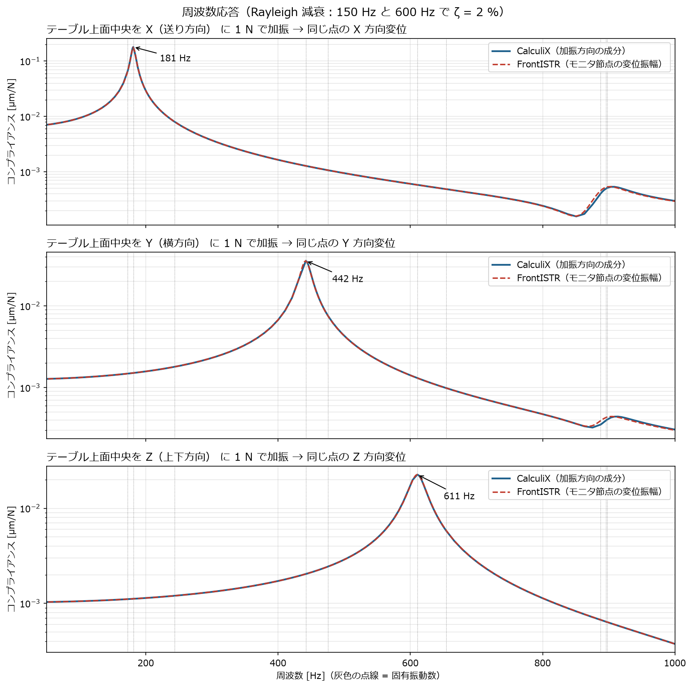
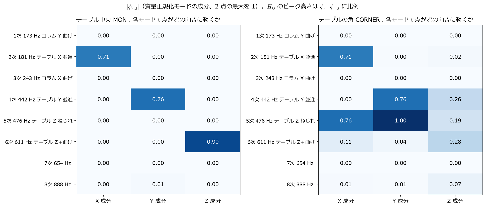
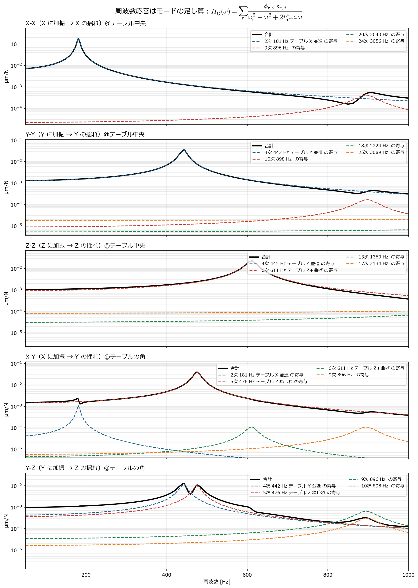
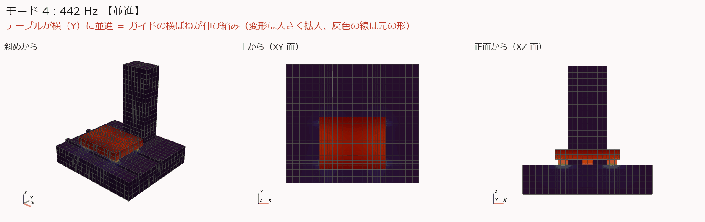
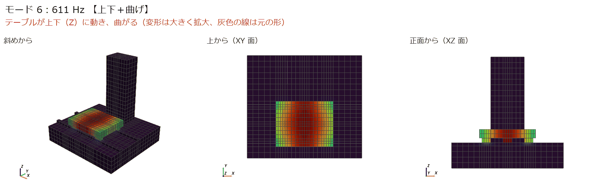
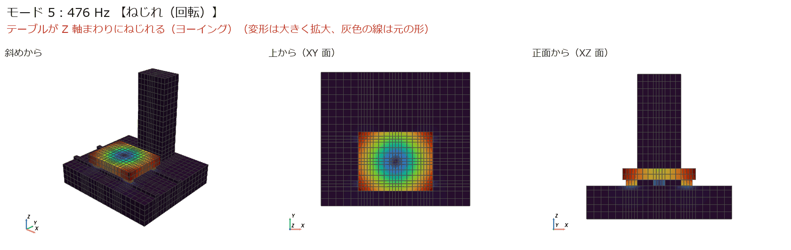
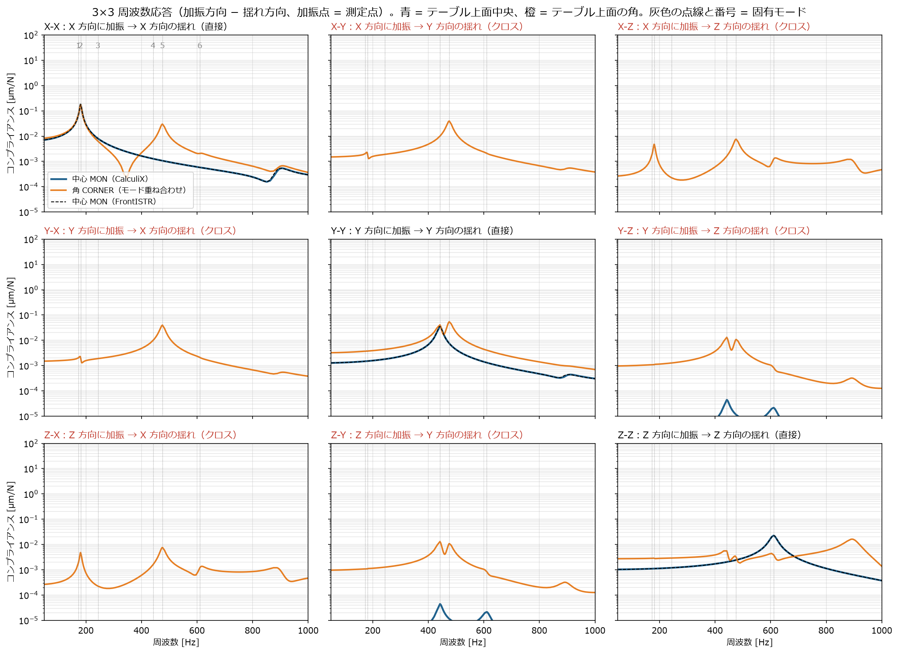

[← docs 目次](README.md) ｜ [⌂ トップ](../README.md) ｜ [← 前: ana001 簡易工作機械の固有値解析](ana001_CalculiX-FrontISTR_簡易工作機械の固有値解析.md) ｜ [次: ana003 代表点MPCばねの比較 →](ana003_CalculiX-FrontISTR_代表点MPCばねの比較.md)

# ana002 簡易工作機械モデルの周波数応答解析（CalculiX と FrontISTR）

作成: 2026-11-07
解析フォルダ: [analysis/ana002_ccx_fistr_frf](../analysis/ana002_ccx_fistr_frf/)

## 1. 目的

- テーブル上面の中央を揺すったとき、**どの周波数でどれだけゆれるか**（周波数応答関数 FRF）を求める
- 加工点の「動剛性」（何 N で何 µm ゆれるか）を見る。びびり振動の検討の入口になる
- CalculiX と FrontISTR で同じ結果になるか確かめる

## 2. 条件

| 項目 | 内容 |
|---|---|
| モデル | [ana001](ana001_CalculiX-FrontISTR_簡易工作機械の固有値解析.md) と同じ（分布ばね） |
| 解き方 | **モード重ね合わせ法**：先に固有値解析で 30 モードを求め、その足し合わせで応答を計算 |
| 加振 | テーブル上面中央（節点 20428）に 1 N の正弦波の力。X・Y・Z の 3 通り |
| 出力 | 同じ点の変位振幅（＝コンプライアンス [µm/N]） |
| 周波数 | 50〜1000 Hz |
| 減衰 | Rayleigh 減衰。150 Hz と 600 Hz で減衰比 $\zeta$ = 2 % になるように $\alpha$ = 30.16、$\beta$ = 8.49 × 10⁻⁶ |

減衰を Rayleigh にしたのは、FrontISTR の周波数応答が **Rayleigh 減衰しか入れられない**ため（CalculiX はモード減衰比を直接入れることもできる）。

$$
\zeta(\omega) = \frac{\alpha}{2\omega} + \frac{\beta\,\omega}{2}
$$



*150〜600 Hz の間は 2 % よりやや小さく、外側では大きくなる。*

## 3. 入力ファイルの解説

### 3.1 CalculiX（[ccx/machine.inp](../analysis/ana002_ccx_fistr_frf/ccx/machine.inp)）

ana001 のファイルの後ろに、加振方向ごとのステップを 3 つ追加している。

```text
*STEP
*FREQUENCY, STORAGE=YES          ← ① 固有値解析（30 モード）。STORAGE=YES で結果を保存
30
*END STEP
*STEP
*STEADY STATE DYNAMICS           ← ② 定常応答（モード重ね合わせ）
50., 1000., 20, 1.0              ← 下限, 上限 [Hz], 固有振動数の間ごとの計算点数, 点の偏り
*MODAL DAMPING, RAYLEIGH         ← Rayleigh 減衰
,,3.015929e+01,8.488264e-06      ← (空), (空), α, β
*CLOAD
MON, 1, 1.0                      ← 加振点 MON の X 方向に 1 N
*NODE PRINT, NSET=MON            ← MON の変位を .dat に出力（周波数ごとに実部と虚部）
U
*END STEP
（Y, Z 方向も同様に *CLOAD だけ変えたステップが続く）
```

### 3.2 FrontISTR（[fistr/freq_1.cnt](../analysis/ana002_ccx_fistr_frf/fistr/freq_1.cnt)）

先に固有値解析（ana001 と同じ形の cnt）を流し、ログ `0.log` を `eigen_0.log` に改名しておく。
次に、全体制御ファイルで固有値解析の結果を読み込む設定にして、周波数応答を流す。

```text
!SOLUTION, TYPE=DYNAMIC
!DYNAMIC
 11, 2                            ← 2 = 周波数応答解析
 50.0, 1000.0, 400, 50.0          ← 下限, 上限 [Hz], 計算点数, 変位分布を出力する周波数
 0.0, 1.0                         ← 時刻歴の可視化用（開始・終了時刻）
 1, 1, 3.015929e+01, 8.488264e-06 ← 質量行列の種類, 減衰の種類(1=Rayleigh), α, β
 1, 2, 20428                      ← 出力点数, 可視化の種類, ★モニタする節点番号
 1, 1, 1, 1, 1, 1                 ← 変位・速度・加速度を出力するか
!EIGENREAD
 eigen_0.log                      ← 固有値解析のログ（固有振動数をここから読む）
 1, 30                            ← 使うモード（1〜30）
!BOUNDARY
 FIX, 1, 3, 0.0
!FLOAD, LOAD CASE=1               ← 加振力（LOAD CASE=1 が実部、2 が虚部）
 MON, 1, 1.0                      ← MON の X 方向に 1 N
```

全体制御ファイル（[hecmw_ctrl_freq_1.dat](../analysis/ana002_ccx_fistr_frf/fistr/hecmw_ctrl_freq_1.dat)）には、固有値解析の結果ファイルを
`!RESULT, NAME=result-in, IO=IN` で指定する（固有モードの形はここから読む）。

モニタ節点の応答は `0.log` に「周波数 [Hz] : 変位振幅」の形で出る。

実行の流れは [run.sh](../analysis/ana002_ccx_fistr_frf/run.sh) を参照。

## 4. 結果



| 加振方向 | 静剛性 [N/µm] | 最大ピーク | ピークのコンプライアンス [µm/N] | 動剛性の最小 [N/µm] |
|---|---|---|---|---|
| X（送り方向） | 141 | **181 Hz**（2次：ボールねじ） | 0.180 | **6** |
| Y（横方向） | 782 | 442 Hz（4次：ガイド横） | 0.036 | 28 |
| Z（上下方向） | 968 | 611 Hz（6次：ガイド上下） | 0.023 | 44 |

- **CalculiX と FrontISTR の曲線はほぼ重なる**（ピークの位置・高さとも一致）
- 送り方向（X）がいちばん弱い。静剛性 141 N/µm に対して、181 Hz では**動剛性が 6 N/µm まで下がる**（約 1/25）
  - 共振のピークは約 $1/(2\zeta)$ 倍になる。$\zeta$ ≈ 2 % なので 25 倍 → 計算と一致
- **減衰を大きくするとピークは下がる**。だから実機では減衰の値（実測で合わせる）が重要
- X 加振では、1次（コラム Y）・3次（コラム X）のピークはほとんど出ない。テーブル上面中央を X に押しても、コラムはほとんど揺れないため
- 850〜900 Hz の小さな山は、テーブル上下の高次モードが少しだけ現れたもの

### 意味（加工に置き換えると）

切削力が 500 N で、その変動成分が 181 Hz 付近にあると、テーブルは送り方向に $500 \times 0.18 = 90$ µm 程度ゆれる計算になる。
実際にはサーボ制御（位置ループ）が X 方向の剛性を補うので、この値より小さくなる。
制御を含めた評価は [study/ref003](../study/ref003_工作機械_固有振動数とサーボゲイン.md) の 2 慣性モデルとつなげるのが次の段階。

### 4.1 コンプライアンスとは

**コンプライアンス** $H$ は「1 N の力で何 µm 動くか」[µm/N]。剛性（N/µm）の逆数。
振動する力に対しては周波数ごとに値が変わり、これを**動コンプライアンス**（周波数応答関数、FRF）と呼ぶ。

$$
H_{ij}(\omega) = \frac{u_j(\omega)}{F_i(\omega)} \quad \text{（}i\text{ 方向に加振して、}j\text{ 方向の揺れを測る）}
$$

- 低い周波数（ここでは 50 Hz）の値 ≈ **静コンプライアンス**（= 1 / 静剛性）
- ピークの値の逆数 = **動剛性の最小値**。びびりや面品位を決めるのはこちら

### 4.2 ピークはどのモードか：周波数応答 ＝ モードの足し算

周波数応答は、ana001 で求めた固有モードの足し算で書ける（モード重ね合わせ。CalculiX・FrontISTR とも内部でこれを計算している）:

$$
H_{ij}(\omega) = \sum_{r} \frac{\phi_{r,i}\,\phi_{r,j}}{\omega_r^2 - \omega^2 + 2i\,\zeta_r\,\omega_r\,\omega}
$$

- $\omega_r$：$r$ 次の固有角振動数、$\zeta_r$：その減衰比（Rayleigh：$\zeta_r = \alpha/(2\omega_r) + \beta\omega_r/2$）
- $\phi_{r,i}$：$r$ 次モード（質量で正規化）で、**加振点が $i$ 方向にどれだけ動くか**
- $\omega = \omega_r$ のとき分母が小さくなり、**ピーク**になる。ピークの高さは $\phi_{r,i}\phi_{r,j} / (2\zeta_r\omega_r^2)$

つまり「**そのモードで、加振点が加振方向にも測定方向にも動くか**」でピークが出るかが決まる。
CalculiX の結果から MON 点の $\phi$ を取り出して足し算すると、CalculiX の周波数応答と**相対誤差 $10^{-5}$ 以下で一致**した（[post_cross.py](../analysis/ana002_ccx_fistr_frf/post_cross.py)）。



- テーブル中央（左）では、2次は X、4次は Y、6次は Z **だけ**が動く → X-X・Y-Y・Z-Z のピークがそれぞれ 1 本ずつ
- **1次・3次（コラムの曲げ）はテーブルを動かさない**（0.00）。このモデルではテーブルとコラムがつながっていない（ベッドを介すだけ）ため。
  実機で工具とワークの**相対**コンプライアンスを測れば、コラムのモードも出る（→ 次の課題）
- テーブルの角（右）では、5次（ねじれ）で X と Y が両方動く → クロスのピークになる



*黒 = 合計、破線 = 各モードの寄与（大きい 4 つ）。生成スクリプト: [post_cross.py](../analysis/ana002_ccx_fistr_frf/post_cross.py)*

| ピーク | 原因のモード（アニメーション） |
|---|---|
| X-X 181 Hz | 2次：テーブルの X 並進（ボールねじ）  |
| Y-Y 442 Hz | 4次：テーブルの Y 並進（ガイド横ばね）  |
| Z-Z 611 Hz | 6次：テーブルの上下＋曲げ（ガイド上下ばね）  |
| X-Y・Y-Y（角）476 Hz | 5次：テーブルの Z 軸まわりのねじれ  |

### 4.3 クロス方向の周波数応答（3×3）

加振方向 − 揺れ方向の 9 通り（X-X, X-Y, X-Z, Y-X, Y-Y, Y-Z, Z-X, Z-Y, Z-Z）を並べた。対角（X-X, Y-Y, Z-Z）が**直接**、それ以外が**クロス**。



*青 = テーブル上面中央（MON、CalculiX の直接計算）、橙 = テーブル上面の角（750, 500, 350）（同じ固有モードからモード重ね合わせで計算）、黒破線 = FrontISTR（MON の振幅）*

#### テーブル上面中央 MON (500, 300, 350)

| 加振 − 揺れ | 50 Hz の値 [µm/N] | 最大ピーク [Hz] | ピーク値 [µm/N] | 主に効いているモード |
|---|---|---|---|---|
| X-X | 7.07e-03 | 181 | 1.80e-01 | 2次 181 Hz テーブル X 並進 |
| X-Y | 1.11e-15 | 181 | 3.34e-14 | ―（対称のため 0） |
| X-Z | 3.77e-16 | 181 | 1.02e-14 | ―（対称のため 0） |
| Y-X | 1.11e-15 | 181 | 3.34e-14 | ―（対称のため 0） |
| Y-Y | 1.28e-03 | 442 | 3.57e-02 | 4次 442 Hz テーブル Y 並進 |
| Y-Z | 6.80e-07 | 442 | 4.43e-05 | 4次 442 Hz テーブル Y 並進 |
| Z-X | 3.77e-16 | 181 | 1.02e-14 | ―（対称のため 0） |
| Z-Y | 6.80e-07 | 442 | 4.43e-05 | 4次 442 Hz テーブル Y 並進 |
| Z-Z | 1.03e-03 | 611 | 2.26e-02 | 6次 611 Hz テーブル Z＋曲げ |

#### テーブル上面の角 CORNER (750, 500, 350)

| 加振 − 揺れ | 50 Hz の値 [µm/N] | 最大ピーク [Hz] | ピーク値 [µm/N] | 主に効いているモード |
|---|---|---|---|---|
| X-X | 8.24e-03 | 181 | 1.78e-01 | 2次 181 Hz テーブル X 並進 |
| X-Y | 1.50e-03 | 476 | 3.95e-02 | 5次 476 Hz テーブル Z ねじれ |
| X-Z | 2.65e-04 | 476 | 7.64e-03 | 5次 476 Hz テーブル Z ねじれ |
| Y-X | 1.50e-03 | 476 | 3.95e-02 | 5次 476 Hz テーブル Z ねじれ |
| Y-Y | 3.24e-03 | 476 | 5.44e-02 | 5次 476 Hz テーブル Z ねじれ |
| Y-Z | 9.71e-04 | 442 | 1.31e-02 | 4次 442 Hz テーブル Y 並進 |
| Z-X | 2.65e-04 | 476 | 7.64e-03 | 5次 476 Hz テーブル Z ねじれ |
| Z-Y | 9.71e-04 | 442 | 1.31e-02 | 4次 442 Hz テーブル Y 並進 |
| Z-Z | 2.74e-03 | 893 | 1.63e-02 | 9次 896 Hz  |


読み方:
- **テーブル中央ではクロスがほぼ 0**（X-Y, X-Z は $10^{-14}$ ＝ 数値誤差）。モデルが X 方向に左右対称で、中央は対称面の上にあるため。
  Y-Z は少し出る（$4\times10^{-5}$ µm/N）が、直接の 1/1000 以下
- **角ではクロスが直接と同じくらい大きくなる**。X-Y のピーク 0.040 µm/N（476 Hz）は、Y-Y のピーク（0.054）と同程度
  - 原因は 5次の**ねじれ**。中心から離れた点では、回転が X と Y の両方の動きになる（$u_x = -\theta_z\,y$, $u_y = \theta_z\,x$）
- **相反性** $H_{ij} = H_{ji}$：X-Y と Y-X、X-Z と Z-X は同じ曲線になる（剛性・質量行列が対称なため）
- 角の X-X には、中央にはない 476 Hz のピーク（ねじれ）が加わる。**工具がテーブルの端で加工すると、中央より揺れやすい周波数が増える**
- 加工で問題になるのは、例えば X 方向の切削力で Y（切込み方向）に揺れる X-Y のようなクロス項。びびりの解析では、2×2（XY 平面）の FRF 行列を使う

## 5. 再現手順

```bash
cd analysis/ana002_ccx_fistr_frf
./run.sh                         # 入力作成 → CalculiX → FrontISTR（固有値 → 周波数応答 × 3）
~/opt/venv/bin/python post.py    # グラフと表
~/opt/venv/bin/python post_cross.py   # 3×3（クロス）とモード寄与
```

計算時間: 合計 約 3 分（CalculiX 2.5 分、FrontISTR 固有値 25 秒＋周波数応答 各 5 秒）。

## 6. 次の課題

- 減衰を実測値（または文献値）に合わせる
- コラム側（工具）とテーブル側（ワーク）の**相対**コンプライアンスを求め、コラムのモードも含めて評価する
- 工具先端（主軸）の FRF を求め、安定限界線図（びびり）につなげる
- サーボの剛性（位置・速度ループ）を X 方向に加えたモデル

---

[← docs 目次](README.md) ｜ [⌂ トップ](../README.md) ｜ [← 前: ana001 簡易工作機械の固有値解析](ana001_CalculiX-FrontISTR_簡易工作機械の固有値解析.md) ｜ [次: ana003 代表点MPCばねの比較 →](ana003_CalculiX-FrontISTR_代表点MPCばねの比較.md)
