[← docs 目次](README.md) ｜ [⌂ トップ](../README.md) ｜ [← 前: ana002 簡易工作機械の周波数応答解析](ana002_CalculiX-FrontISTR_簡易工作機械の周波数応答解析.md) ｜ [次: ana003_ばね接続モデルを自分で作る手順 →](ana003_ばね接続モデルを自分で作る手順.md)

# ana003 CalculiX・FrontISTRで部品をばね接続する：設定ファイルと周波数応答・GIF

更新: 2026-11-07

自分で作る場合は、まず[FrontISTR・CalculiX別の作成手順（完成入力・実行確認付き）](ana003_ばね接続モデルを自分で作る手順.md)から進める。面の節点集合→代表点とのMPC→代表点間ばねの順に解説する。

**MONとは**：こちらで「観測点（monitor）」に付けた節点集合名。ソルバ固有の特別な点ではない。このモデルではテーブル上面中央の節点20428、座標(500,300,350) mmが1点だけ入る。「MONをY加振→MONのZ変位」は、この点をY方向に押したときの、同じ点のZ方向の揺れを意味する。

## 1. ばね接続モデルの概要

**CalculiXでもFrontISTRでも作れる。** ソリッドで作ったベッドとテーブルの間に、ガイドやボールねじの弾性を表す「2節点ばね」を入れる。ソルバの改造は不要。

| やりたいこと | CalculiX | FrontISTR |
|---|---|---|
| 2節点間をX・Y・Zの指定方向にばね接続 | `SPRING2`＋`*SPRING` | 要素`511`＋`!SPRING_D` |
| 面の複数節点を代表点に結ぶ | `*EQUATION`で線形拘束式を記述 | `!EQUATION`で線形拘束式を記述 |
| 接続後の固有振動数を求める | `*FREQUENCY` | `!SOLUTION, TYPE=EIGEN` |
| 接続後の調和加振の周波数応答を求める | `*STEADY STATE DYNAMICS` | この環境のFrontISTR 5.9で`!DYNAMIC`の周波数応答経路を実行 |

**実行ログで確認した版はCalculiX 2.21、FrontISTR 5.9／6.0。** RBE2の初回固有値解析は5.9、RBE3は6.0。実行中に既定の`~/opt/frontistr/bin/fistr1`が6.0へ切り替わっていたため、追加の9成分掃引では`~/opt/frontistr59/bin/fistr1`を明示して5.9に固定した。版は各ケースの実行ログで確認できる。 FrontISTRの公開マニュアルには周波数応答について「未実装」の記載が残る版もあるが、この環境では実装ソースと実行出力の両方を確認した。すべての配布バイナリでの動作を保証する意味ではない。

ここで扱うのは、2部品間のばね。FrontISTRの`!SPRING`は地面に対する弾性支持であり、今回の`!SPRING_D`とは別。基本3種類の静解析による確認は[ana004](ana004_CalculiX-FrontISTR_ばねの種類の確認.md)を参照。

## 2. 接続部品と節点の構成

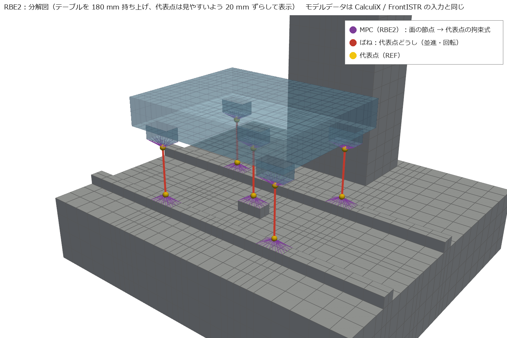

**灰色＝ベッドとコラム、青＝テーブル、黄色＝面を代表する節点、赤＝ばね、紫＝面と代表点を結ぶ拘束。** 見えるようにテーブルを持ち上げた分解表示で、実際の接続面は同じ高さにある。

接続は次の順序になっている。

```text
ベッドの取付面 ─ 拘束式 ─ 代表点B ─ ばね ─ 代表点T ─ 拘束式 ─ テーブルの取付面
```

ばねは両端の相対変位に応じた力を出す。例えばY方向なら、ばね力の大きさは`k × (テーブル側Y変位 − ベッド側Y変位)`。部品を一体化する拘束とは違い、両端に変位差が残る。

| 接続箇所 | このモデルでの剛性 | 意味 |
|---|---|---|
| ガイドのキャリッジ4個 | 1個につきY: 560,000 N/mm、Z: 800,000 N/mm | 横と上下の弾性支持。X方向の移動はこのガイドばねでは拘束しない |
| ナット部1個 | X: 200,000 N/mm | ボールねじ系の送り方向の弾性を簡略化 |
| 各接続の回転成分 | 分布ばねの剛性と中心からの距離から計算 | 有限の取付面が傾くときの抵抗を表現 |

単位系はmm・N・t・s。例えば560,000 N/mmは560 N/µm。材料は鋳鉄相当、ヤング率120,000 N/mm²、ポアソン比0.27、密度7.3×10⁻⁹ t/mm³。ベッド底面をXYZ固定する。

面のつなぎ方は2種類を実行した。

- **RBE2相当**：面の形を保って代表点と一緒に動かす。取付面を剛体とする近似。
- **RBE3相当**：面の節点の動きから代表点の平均運動を決める。面全体を剛体にはしない。

どちらも本検証の自作拘束式であり、商用ソフトの同名要素の全機能を再現するという意味ではない。また、RBE3相当と分布ばねは局部変形に対する抵抗まで同一ではない。今回の低次モードが近いという結果を一般的な完全等価性とは扱わない。

## 3. CalculiXのばね・MPC・解析設定

実行した入力: [RBE2のresponse.inp](../analysis/ana003_ccx_fistr_mpc_spring/frf/rbe2/ccx/response.inp)／[RBE3のresponse.inp](../analysis/ana003_ccx_fistr_mpc_spring/frf/rbe3/ccx/response.inp)。節点・ソリッド要素の大量の行の後に、次の記述がある。

### 3.1 2節点とばね定数を指定する

RBE2入力のCAR1のYばねを抜粋する。

```text
*ELEMENT, TYPE=SPRING2, ELSET=SP_CAR1_2_0
4289, 22259, 22261
*SPRING, ELSET=SP_CAR1_2_0
2, 2
5.600000e+05
```

| 行 | 読み方 |
|---|---|
| `*ELEMENT, TYPE=SPRING2, ELSET=SP_CAR1_2_0` | 方向指定の2節点ばねを作り、要素グループに名前を付ける |
| `4289, 22259, 22261` | 要素4289の両端は、ベッド側代表点22259とテーブル側代表点22261 |
| `*SPRING, ELSET=SP_CAR1_2_0` | このグループのばね特性を指定する |
| `2, 2` | 第1節点の自由度2と第2節点の自由度2を結ぶ。2はY方向 |
| `5.600000e+05` | 剛性560,000 N/mm |

自由度1=X、2=Y、3=Z。**方向は節点間の線の向きではなく自由度番号で指定する**ので、同じ座標の別節点間にも置ける。これだけでは面には力が伝わらないため、次の拘束式も必要。

### 3.2 代表点を取付面に結ぶ

実際のRBE2相当の拘束式の一例。

```text
*EQUATION
3
2912, 1, 1, 22259, 1, -1, 22260, 3, -20
```

これは`uX(2912) − uX(22259) − 20 θZ = 0`という意味。面の節点2912は、代表点の並進に加えて、中心からの距離に応じた回転分だけ動く。先頭の自由度が従属となる。

22260は回転用の補助節点。その自由度1〜3を回転角の未知数として使う**今回のモデル化上の工夫**であり、ソリッド節点に通常の回転自由度を追加したわけではない。補助節点間のばねには、回転剛性N·mm/radを入れる。補助節点の値を物理的なmm変位として表示・集計しない。

RBE3相当では式の向きを変え、代表点の並進を面の重み付き平均で決める。係数の作成処理は[mpc_springs.py](../analysis/tools/mpc_springs.py)。

### 3.3 固有値→周波数応答を設定する

```text
*BOUNDARY
FIX, 1, 3
*STEP
*FREQUENCY, STORAGE=YES
30
*NODE FILE
U
*END STEP
*STEP
*STEADY STATE DYNAMICS
50.0, 750.0, 12, 1.0
*MODAL DAMPING, RAYLEIGH
,,30.1592894745,8.4882636316e-6
*CLOAD, OP=NEW
MON, 1, 1.0
*NODE PRINT, NSET=MON
U
*NODE FILE
U
*END STEP
```

- `FIX, 1, 3`：FIXに含まれる底面節点のXYZを固定。
- `*FREQUENCY, STORAGE=YES`と`30`：30モードを求め、後の応答計算用に保存する。
- `50.0, 750.0, 12, 1.0`：50〜750 Hzを計算する。12は**全帯域を12点にする意味ではなく**、固有振動数で分割される区間の計算点数指定。実際の周波数列は出力CSVで確認する。
- `*MODAL DAMPING, RAYLEIGH`：$C=\alpha M+\beta K$の減衰。150 Hzと600 Hzで減衰比2%となる係数を仮定した。実測値ではない。
- `MON, 1, 1.0`：テーブル上面中央のMON節点にX方向の振幅1 Nの調和力。方向を2・3に変えたステップも実行する。
- `OP=NEW`：前の方向の荷重を持ち越さず、今回の方向だけを加振。
- `*NODE PRINT`：MONの複素変位を`.dat`へ出力。`*NODE FILE`：全体の複素変位を`.frd`へ出力。後者をGIFに使う。

## 4. FrontISTRのばね・MPC・解析設定

RBE2の実ファイル: [machine.msh](../analysis/ana003_ccx_fistr_mpc_spring/frf/rbe2/fistr/machine.msh)、[eigen.cnt](../analysis/ana003_ccx_fistr_mpc_spring/frf/rbe2/fistr/eigen.cnt)、[sweep_1.cnt](../analysis/ana003_ccx_fistr_mpc_spring/frf/rbe2/fistr/sweep_1.cnt)、[shape_1.cnt](../analysis/ana003_ccx_fistr_mpc_spring/frf/rbe2/fistr/shape_1.cnt)。

| ファイル | 中身 |
|---|---|
| `.msh` | 節点、ソリッド要素、ばね要素、材料・セクションの対応、拘束式、節点グループ |
| `.cnt` | 固有値／周波数応答の選択、ばね定数、固定、加振、減衰、出力指定 |
| `hecmw_ctrl.dat` | 使用するメッシュ・制御ファイルと、固有モードの読込先・結果の出力先の対応 |

### 4.1 `.msh`に2節点ばねを作る

CAR1のYばねは、**節点22259（ベッド側の面の代表点）と節点22261（テーブル側の面の代表点）**を結ぶ。

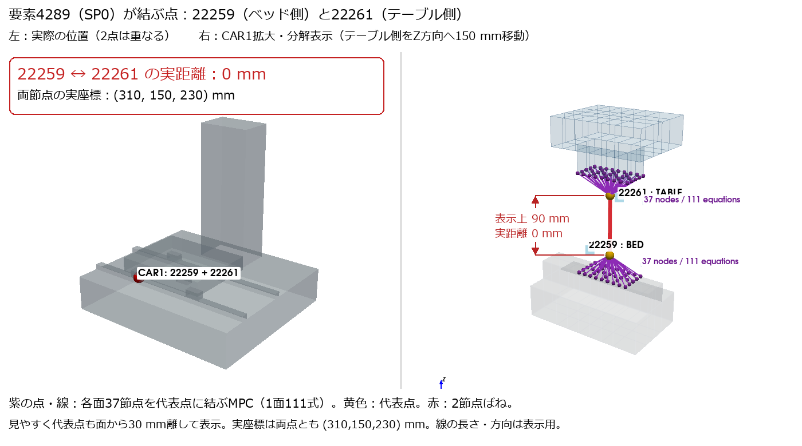

| 番号 | 何か | 実際の座標 mm |
|---|---|---|
| 22259 | レール上面・ベッド側の代表点 | (310, 150, 230) |
| 22261 | キャリッジ下面・テーブル側の代表点 | (310, 150, 230) |
| 4289 | 上の2節点をつなぐばね要素。節点番号ではない | SP0に所属 |

2点間の**初期の実距離は0 mm**（座標差ΔX=ΔY=ΔZ=0）。座標が同じでも、別の節点なので変位は別々。右図の赤線は表示上90 mmで、実長ではない。テーブル側の表示移動150 mmから、上下代表点を面から離した30 mmずつを引いた表示距離（150−30−30=90 mm）である。右図は見えるようにテーブル側をZ方向へ150 mm持ち上げ、代表点もそれぞれの面から30 mm離して表示した。赤線は接続関係を示し、その線の方向がばねの作用方向ではない。Y方向の指定は`.cnt`の`2, 2, 560000`で行う。

ParaViewで開くデータ：実位置のcar1_actual.vtm（未収録：スクリプトで再生成）／分解表示のcar1_exploded.vtm（未収録：スクリプトで再生成）。VTMと同名フォルダ内の付属データを一緒に保持する。`node_id`に節点番号、`element_id`に要素番号を保存した。

**多点拘束は紫の点・線の部分**。この実行モデルでは、CAR1のベッド側37節点と代表点22259を111本の拘束式（37節点×XYZ）で結び、テーブル側37節点と代表点22261も同様に結ぶ。回転は補助節点22260・22262を使う。赤のばね要素4289自体は2節点要素であり、多点拘束は別の`!EQUATION`で定義する。

```text
面の37節点 ── MPC（111式）── 22259 ── ばね4289 ── 22261 ── MPC（111式）── 面の37節点
```

紫の拘束線も含めてParaViewで確認できるcar1_mpc_network.vtm（未収録：スクリプトで再生成）を追加した。このファイルの線は拘束関係を可視化した表示用形状であり、ばね・MPCの解析設定は`.msh`／`.cnt`側にある。

以下がこの2点を結ぶ入力。

```text
!ELEMENT, TYPE=511, EGRP=SP0
4289, 22259, 22261
!MATERIAL, NAME=SPMAT0, ITEM=1
!ITEM=1, SUBITEM=2
1.0, 0.3
!SECTION, TYPE=INTERFACE, EGRP=SP0, MATERIAL=SPMAT0
1.0
```

`511`が2節点コネクタ。`4289, 22259, 22261`の意味はCalculiXと同じ。`!SECTION`で要素グループSP0を材料名SPMAT0に対応させる。ここでの`TYPE=INTERFACE`はコネクタ用セクションの指定であり、面同士を自動接触させる設定ではない。

この入力生成器では材料名登録のため`.msh`にもダミーの材料欄を置く。**`1.0, 0.3`やセクション行の`1.0`が、求めるばね定数ではない。** ばね定数は次の`.cnt`側で与える。

**初期距離0 mmでも方向指定ばねは使える。** `SPRING2`／`511＋!SPRING_D`は、節点間の線から方向を計算せず、指定された自由度の相対変位から力を計算する。例えばY方向は $F_y=k_y(u_{22261,y}-u_{22259,y})$。同じ座標の別節点なら変位差を持てるが、節点をマージするとこの接続は作れない。初期節点間方向を必要とする軸方向ばねと区別する。

### 4.2 `.cnt`にばね定数を書く

```text
!MATERIAL, NAME=SPMAT0
!SPRING_D
2, 2, 5.600000e+05
```

SPMAT0の2節点コネクタに、第1節点Yと第2節点Yを結ぶ560,000 N/mmのばねを定義する。Xなら`1, 1, k`、Zなら`3, 3, k`。定義しなかった方向に、このばねからの剛性は加わらない。

この材料定義は、固有値解析の`eigen.cnt`にも周波数応答の`sweep_*.cnt`／`shape_*.cnt`にも含める。

### 4.3 `.msh`に面―代表点の拘束を書く

```text
!EQUATION
3, 0.0
2912, 1, 1, 22259, 1, -1, 22260, 3, -20
```

3項の線形拘束、右辺0。最後の行はCalculiXと同じ「節点番号・自由度・係数」の組。同じ剛体運動式を両ソルバの入力書式で表している。

### 4.4 固有値解析を実行し、応答計算で読み込む

```text
!SOLUTION, TYPE=EIGEN
!EIGEN
30, 1.0E-8, 300
!BOUNDARY
FIX, 1, 3, 0.0
```

30モード、固有値計算の収束条件と反復上限を指定。固有値解析で出力した`0.log`を`eigen_0.log`へ保存し、モード結果`eigen.res.0.*`とともに応答計算へ渡す。

X方向の周波数応答制御は次の通り。実ファイルには、これに前述の各ばね材料定義とソルバ設定が続く。

```text
!SOLUTION, TYPE=DYNAMIC
!DYNAMIC
11, 2
50.0, 750.0, 350, 183.0
0.0, 0.00546448087431694
1, 1, 3.015929e+01, 8.488264e-06
1, 2, 20428
1, 0, 0, 0, 0, 0
!EIGENREAD
eigen_0.log
1, 30
!BOUNDARY
FIX, 1, 3, 0.0
!FLOAD, LOAD CASE=1
MON, 1, 1.0
```

| 行 | この周波数応答経路での意味 |
|---|---|
| `11, 2` | 第2値2で周波数応答を選ぶ。この場合、第1値11を時刻歴の陽解法で加振するという解釈はしない |
| `50, 750, 350, 183` | 帯域の開始・終了、分割数、時間位相出力用の加振周波数 |
| `0, 1/183` | 位相出力の時間範囲。立上がり過渡の計算時間ではない |
| `1, 1, alpha, beta` | 動解析用のパラメータ欄。周波数応答では後ろ2値のRayleigh係数を使う |
| `1, 2, 20428` | 位相出力数1、可視化種別2、監視節点20428 |
| `1, 0, 0, 0, 0, 0` | 変位を出力対象にし、速度・加速度等を省略 |
| `!EIGENREAD`以下 | 固有値ログと使用モード1〜30を指定。固有ベクトル本体は別の結果ファイルから読む |
| `!FLOAD`以下 | MON節点にX方向1 Nの実部荷重。Y/Zでは方向番号を変える |

FrontISTRの掃引点はこの実装では52、54、…、750 Hzであり、開始値50 Hzそのものは含まない。CalculiXとは周波数点が異なるため、ピーク位置の数字が完全に一致することは要求しない。

GIF用の`shape_*.cnt`では帯域を選択周波数の直前〜その周波数、分割数1とし、`!WRITE,RESULT`で全節点の位相0の実部・虚部を出力する。周波数応答の振幅だけを変形ベクトルにして動かすことはしない。

`hecmw_ctrl.dat`の重要部分は次の対応。固有モードを読むための`result-in`を忘れない。

```text
!MESH, NAME=fstrMSH, TYPE=HECMW-ENTIRE
machine.msh
!CONTROL, NAME=fstrCNT
shape_1.cnt
!RESULT, NAME=fstrRES, IO=OUT
shape_1.res
!RESULT, NAME=result-in, IO=IN
eigen.res
!RESULT, NAME=fstrDYNA, IO=OUT
shape_1_dyna.res
```

## 5. 実際に計算した周波数応答

テーブル上面中央をX・Y・Z方向に別々に1 Nで加振し、**同じ点の複素変位3成分の振幅ノルム**を両ソルバで比較する。FrontISTRの標準監視ログがこのノルムなので、CalculiXも同じ量に合わせた。方向成分単独のFRFとは区別する。

- 30モードを使用したモード重ね合わせによる線形定常応答。
- 50〜750 Hz、Rayleigh減衰を共通に設定。
- 熱・切削・サーボ制御は入れない。ばね接続した構造の動作確認。
- 高次モード数の収束確認・実機検証は今回の対象外。

### RBE2相当：取付面を剛体とする接続

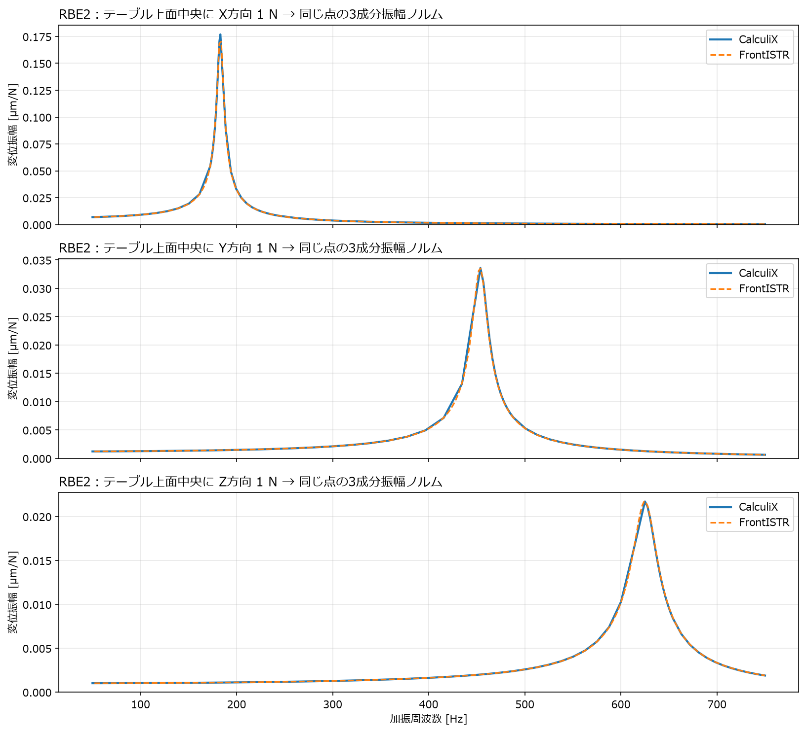

### RBE3相当：面の平均運動から代表点を決める接続

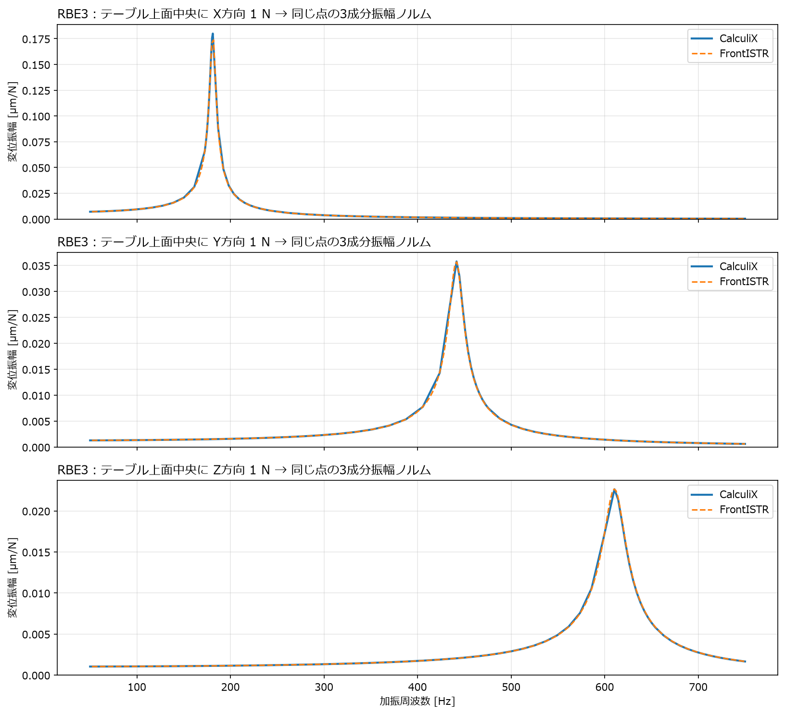

| 接続 | 方向 | CalculiXピーク Hz | 振幅 µm/N | FrontISTRピーク Hz | 振幅 µm/N |
|---|---|---:|---:|---:|---:|
| RBE2 | X | 183.120 | 0.17695 | 184.000 | 0.17021 |
| RBE2 | Y | 453.790 | 0.03359 | 454.000 | 0.03352 |
| RBE2 | Z | 625.062 | 0.02171 | 624.000 | 0.02167 |
| RBE3 | X | 181.162 | 0.18000 | 182.000 | 0.17366 |
| RBE3 | Y | 441.684 | 0.03578 | 442.000 | 0.03568 |
| RBE3 | Z | 610.432 | 0.02264 | 610.000 | 0.02265 |

X方向のピーク振幅は離散掃引点の違いにより約4%の差がある。Y・Z方向のピークと全体の曲線も含めて比較する。GIFのFrontISTR側は別途、選択周波数で計算している。

数値の表と各点のCSVは[結果フォルダ](../analysis/ana003_ccx_fistr_mpc_spring/results/frf/)に保存する。ピークは各ソルバの離散掃引点の最大値であり、連続周波数で探索した厳密な最大値ではない。

## 6. 周波数応答の揺れ方GIF

### コンプライアンスのピークと全体振動の対応

**加振点も観測点も、テーブル上面中央MON（節点20428、座標(500,300,350) mm）。** 入力はX・Y・Zの各方向に別々に与える振幅1 Nの調和力。下段には同じMON点のX・Y・Zの変位振幅をそれぞれ別の曲線として表示する。

$$H_{ij}(f)=U_i(\mathrm{MON},f)/F_j(\mathrm{MON},f)$$

**添字は先が観測変位方向i、後が加振方向j。図はその絶対値（振幅）で、単位µm/N。** 位相・実部・虚部は振幅と別の量。対角3成分は同方向、非対角6成分がクロス方向となる。

| 加振位置 | 加振方向 | 観測位置 | GIF下段の3曲線 |
|---|---|---|---|
| テーブル上面中央MON | +X方向1 N | 同じMON | Hxx：X変位、Hyx：Y変位、Hzx：Z変位 |
| 同上 | +Y方向1 N | 同じMON | Hxy：X変位、Hyy：Y変位、Hzy：Z変位 |
| 同上 | +Z方向1 N | 同じMON | Hxz：X変位、Hyz：Y変位、Hzz：Z変位 |

**上段は組立状態の全体振動、下段はクロス方向を含む3成分コンプライアンス。** FrontISTRのRBE2相当モデルの結果。上段の赤点が加振・観測点、赤矢印が正の加振方向。下段の縦線が上段の応答周波数、丸印が各方向の変位振幅に対応する。上段は全XYZ変位を同時に用いて部品を動かしており、1方向だけの変形図ではない。形状の切り出し・分解はせず、見えるよう変位だけを誇張してスロー再生する。

#### X方向：183 Hz付近の山と送り方向の動き

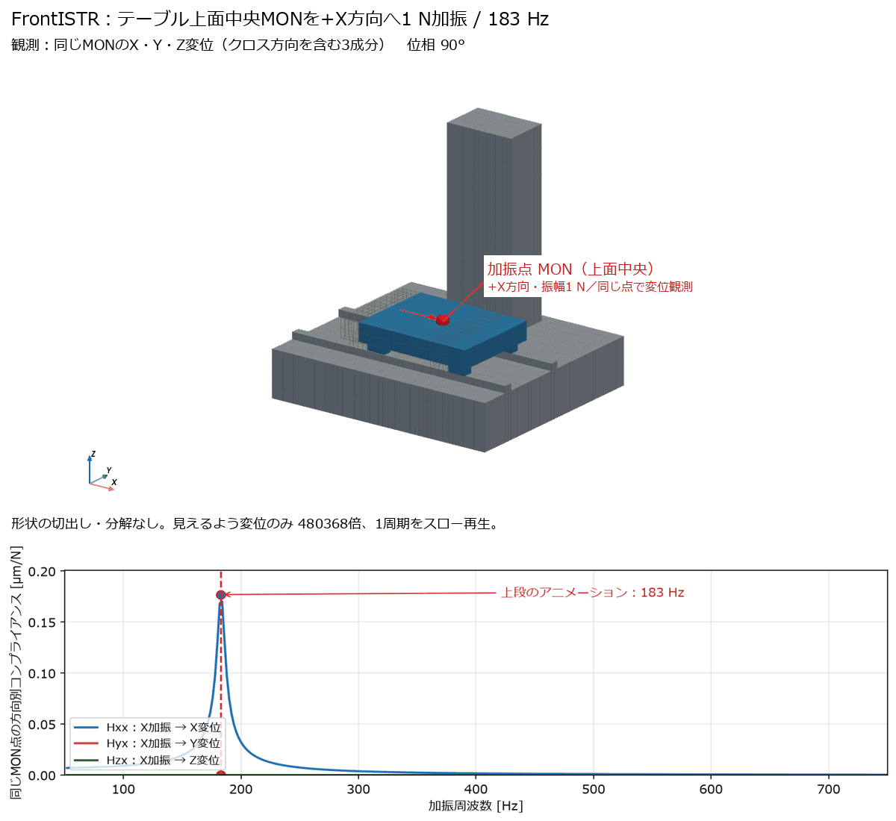

#### Y方向：454 Hz付近の山と横方向の動き

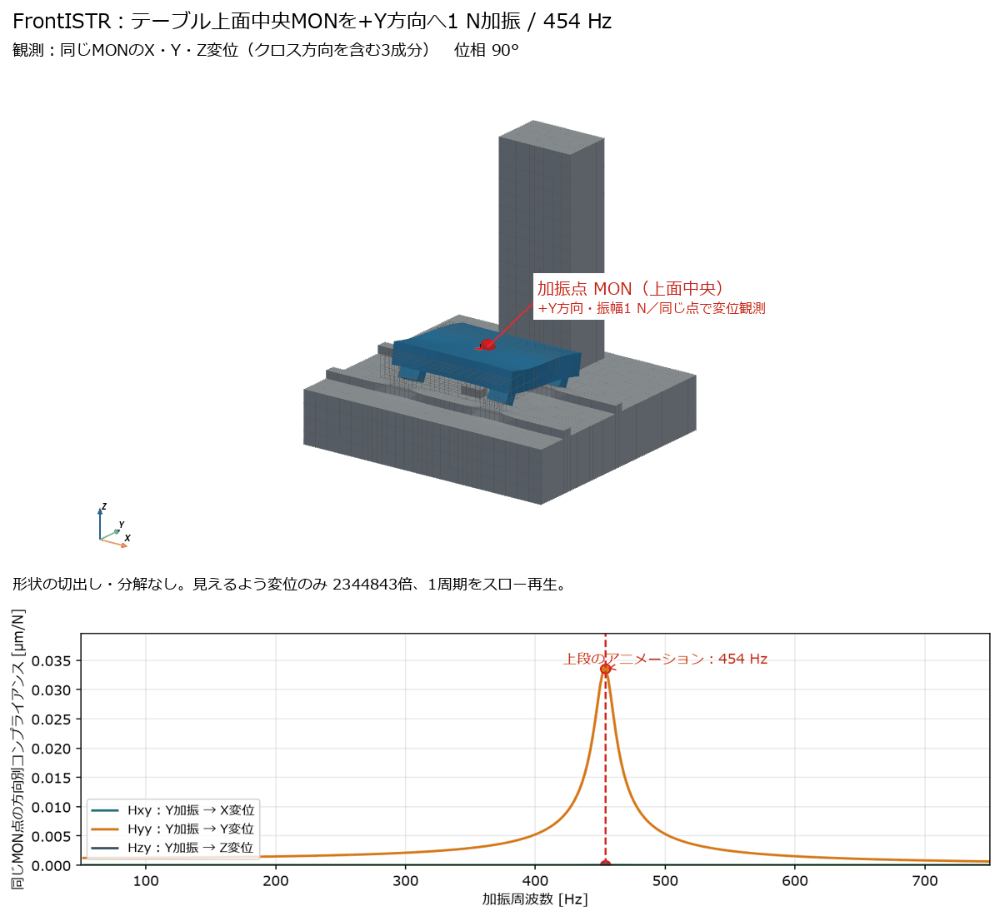

#### Z方向：625 Hz付近の山と上下方向の動き

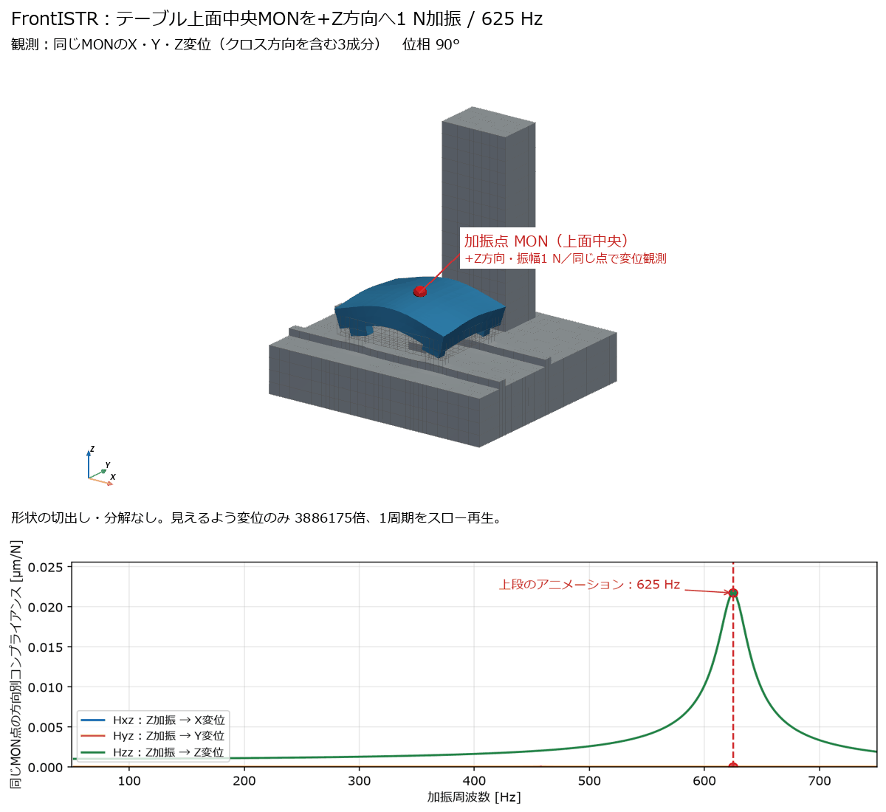

下段の曲線はテーブル上面中央MONの方向別変位振幅、上段は同じ加振周波数での全節点の応答。山に対応してどの部品が動くかを見るための表示である。Y方向ばねの要素4289だけが3方向すべてに抵抗するという意味ではなく、モデル内の他の方向のばねも働く。

GIFが再生されない画面では、[X方向の4位相静止図](../analysis/ana003_ccx_fistr_mpc_spring/results/frf/whole_peak_response_1_phases.png)、[Y方向](../analysis/ana003_ccx_fistr_mpc_spring/results/frf/whole_peak_response_2_phases.png)、[Z方向](../analysis/ana003_ccx_fistr_mpc_spring/results/frf/whole_peak_response_3_phases.png)で動きを確認できる。

生成スクリプト：[render_whole_peak.py](../analysis/ana003_ccx_fistr_mpc_spring/render_whole_peak.py)。ParaView用に全体形状と複素変位を保存した`results/frf/whole_response_1.vtu`〜`whole_response_3.vtu`も参照できる。

### 同方向・クロス方向の9成分を両ソルバで比較する

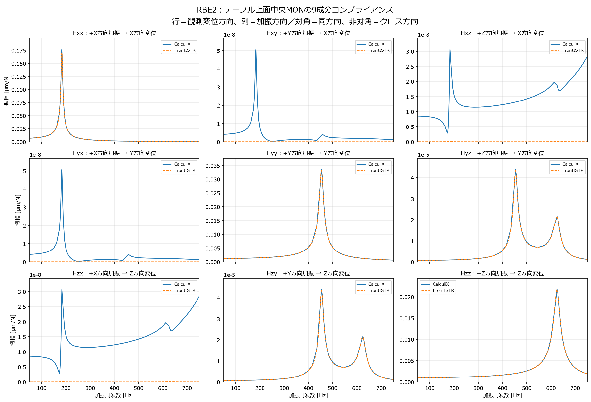

各図の加振点と観測点は同じMON。対角がHxx・Hyy・Hzz、非対角がクロス方向。CalculiXは`.dat`の複素変位成分から絶対値を計算し、FrontISTRは周波数ごとの結果ファイルの変位3成分を抽出している。**監視ログの合成ノルムからクロス成分を推測したものではない。**

非常に小さいクロス成分は対称性や数値誤差の影響も受けるため、ピークの見た目だけを物理的な連成の強さと解釈しない。全て縦軸は0始まりの線形目盛り。3×3図は微小なクロス成分も確認できるよう各図で縦軸上限を設定するため、図ごとの数値・単位を見て比較する。GIF下段は3成分を同じ線形軸に描くため、非常に小さいクロス成分は0付近に重なる。[9成分の集計表](../analysis/ana003_ccx_fistr_mpc_spring/results/frf/component_summary.md)も参照。

再生成は`compute_component_frf.py`→`plot_component_frf.py`→`render_whole_peak.py`の順。FrontISTRの全節点掃引出力は監視点の方向別CSVへ抽出・照合後、作成した一時結果のみ削除する。実行入力とログは`frf/rbe2/component_sweep59/`に残す。追加掃引はFrontISTR 5.9、上段の選択周波数の場は既存の結果を利用しており、方向別振幅の合成を元の監視ログと照合する。

### 全体形状を両ソルバで比較する


**左がCalculiX、右がFrontISTRの計算結果。** それぞれの複素変位を使い、$u(\varphi)=\mathrm{Re}[Ue^{i\varphi}]$で一周期を描いた。固有モードのアニメーションではなく、1 Nの調和力が加わったときの定常応答。

色は各点の複素変位の振幅ノルム（µm）、変形は大きく拡大している。左右は同じ変形倍率・色範囲で描く。各GIF同士の拡大率は異なるので、揺れの見た目だけで振幅を比較しない。再生はスロー表示で、実時間の183回/秒等ではない。

CalculiXのGIFは掃引点のうち指定周波数に最も近い点、FrontISTRは指定周波数そのものを使う。**左右の正確な周波数と拡大率は各GIF上部に表示**する。完全な同一周波数での場の誤差比較ではない。

### RBE2：X加振、送り方向のばねでテーブルが揺れる


### RBE2：Y加振、ガイド横方向の変形を伴う

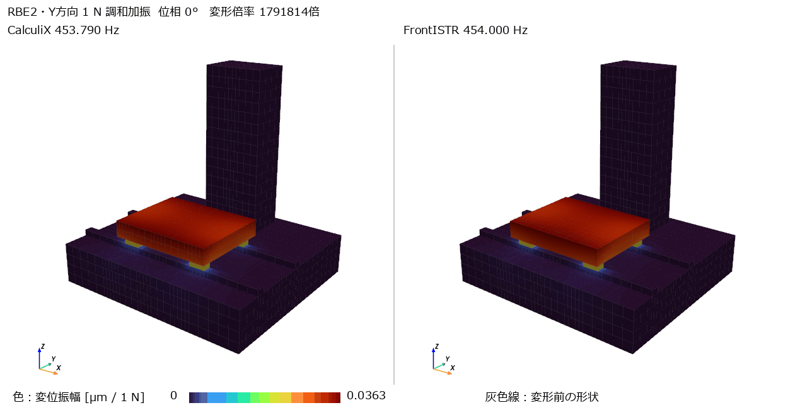

### RBE2：Z加振、ガイド上下方向とテーブル変形を伴う

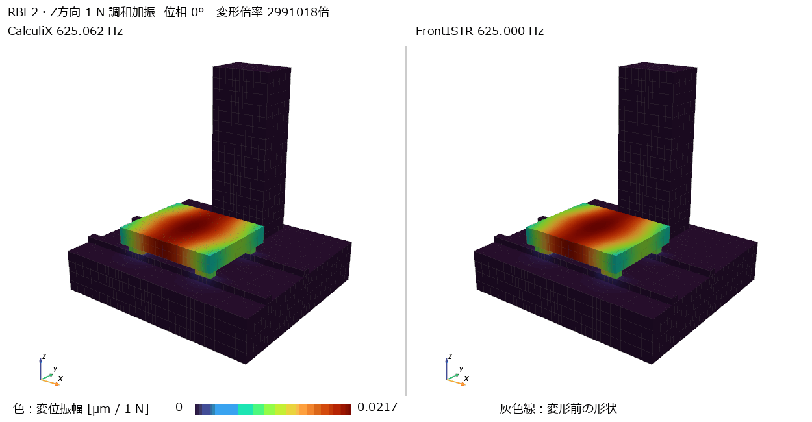

### RBE3：同じX・Y・Z加振での揺れ方

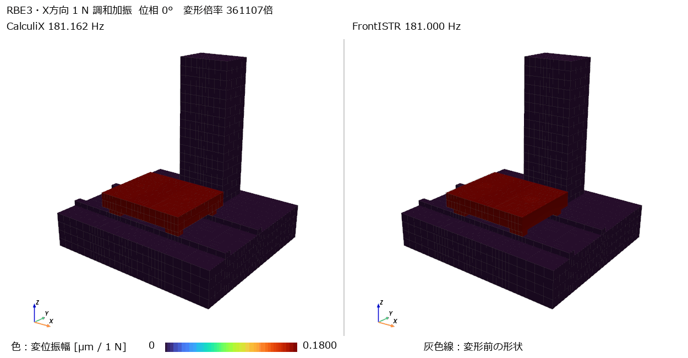

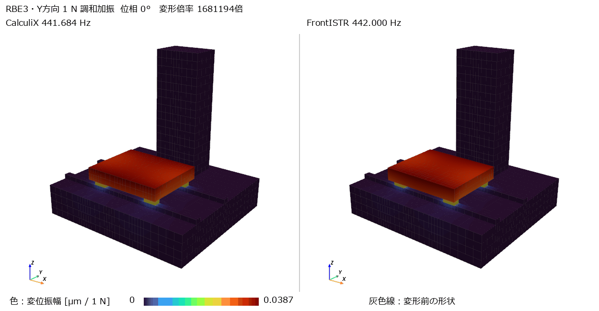


## 7. 再現手順

```bash
cd analysis/ana003_ccx_fistr_mpc_spring
~/opt/venv/bin/python frequency_response.py
~/opt/venv/bin/python post_frequency.py
```

再現スクリプトは`~/opt/ccx.sh`と`~/opt/frontistr59/bin/fistr1`（5.9を明示）を使う。パス・ライブラリの設定は[実行スクリプト](../analysis/ana003_ccx_fistr_mpc_spring/frequency_response.py)にある。入力は`frf/rbe2/`と`frf/rbe3/`に生成し、従来の固有値比較用の入力・結果とは別の場所で実行する。

[描画スクリプト](../analysis/ana003_ccx_fistr_mpc_spring/post_frequency.py)では、CalculiXのGIF元変位と`.dat`のMON変位、FrontISTRのGIF元変位と監視ログを照合する。確認数値は[checks.json](../analysis/ana003_ccx_fistr_mpc_spring/results/frf/checks.json)へ保存する。

拘束係数の詳しい説明は[旧説明の保存版](../analysis/ana003_ccx_fistr_mpc_spring/notes/previous_explanation.md)にも残した。

参考: [CalculiX公式マニュアル](https://www.dhondt.de/ccx_2.22.pdf)、[FrontISTRのSPRING_D](https://source-docs.frontistr.com/keyword_reference/cnt/spring_d.html)、[FrontISTRのDYNAMIC](https://source-docs.frontistr.com/en/keyword_reference/cnt/dynamic.html)。周波数応答の出力処理はローカルのFrontISTR 5.9ソース`fistr1/src/analysis/dynamic/freq/fstr_frequency_analysis.f90`でも確認した。

---

[← docs 目次](README.md) ｜ [⌂ トップ](../README.md) ｜ [← 前: ana002 簡易工作機械の周波数応答解析](ana002_CalculiX-FrontISTR_簡易工作機械の周波数応答解析.md) ｜ [次: ana003_ばね接続モデルを自分で作る手順 →](ana003_ばね接続モデルを自分で作る手順.md)
## 8. 追加：基礎部もMPC＋ばねで支持するモデル

### 8.1 ベッド底面の支持条件

前半のモデルはベッド底面全体を直接固定した。ここでは、その固定を解除し、**底面の4か所の取付面をMPCでそれぞれ代表点に結び、固定地面側の代表点とばね接続する**。

```text
テーブル・ガイド・ナット（前半と同じ）
                   │
              ベッド・コラム
                   │
   底面の4取付面 → 各面のMPC → ベッド側代表点B
                                    │ XYZばね＋回転ばね
                              固定地面側代表点G
```

地盤そのもののソリッドモデルは作らず、設置部・基礎の弾性を等価ばねとして表す。線形ばねなので引張・圧縮の両方に抵抗する。浮上り、接触の開閉、摩擦すべりは扱わない。

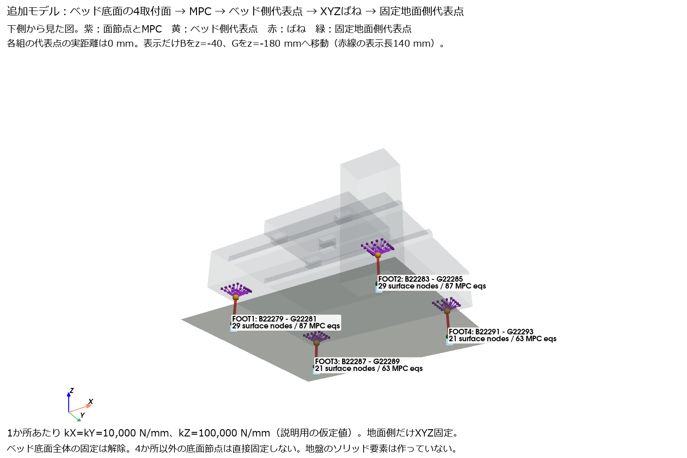

紫が面節点とMPC、黄がベッド側代表点、赤がばね、緑が固定地面側代表点。図は接続を見せるため代表点を上下に離した表示。**各組の代表点の実距離は0 mm**。全体振動GIFでは機械を分解しない。

### 8.2 4か所の位置と、仮定した剛性

各取付面は100×100 mm。中心は次の4点で、いずれもベッド底面z=0 mmにある。

| 支持 | 取付面中心 mm | 面の範囲 mm |
|---|---|---|
| FOOT1 | (100,100,0) | x=50〜150、y=50〜150 |
| FOOT2 | (900,100,0) | x=850〜950、y=50〜150 |
| FOOT3 | (100,800,0) | x=50〜150、y=750〜850 |
| FOOT4 | (900,800,0) | x=850〜950、y=750〜850 |

1か所当たりの並進剛性は**kx=ky=10,000 N/mm、kz=100,000 N/mm**。説明用の仮定値であり、実機・地盤の同定値ではない。

各面に均等な分布ばねがある場合の剛体運動に対するモーメント抵抗を参考に、100 mm角の面積二次モーメントから、回転剛性をkθx=kθy=8.3333×10⁷ N·mm/rad、kθz=1.6667×10⁷ N·mm/radとした。面中心の並進ばねだけと、有限面の回転抵抗を含むモデルは別なので、ここでは後者で統一する。

実際の節点番号、面節点リスト、並進・回転剛性は[supports.json](../analysis/ana003_ccx_fistr_mpc_spring/foundation/results/supports.json)に保存する。

### 8.3 FrontISTRでの変更手順

実入力：[machine.msh](../analysis/ana003_ccx_fistr_mpc_spring/foundation/fistr/machine.msh)、[eigen.cnt](../analysis/ana003_ccx_fistr_mpc_spring/foundation/fistr/eigen.cnt)、[shape_1.cnt](../analysis/ana003_ccx_fistr_mpc_spring/foundation/fistr/shape_1.cnt)。

1. `!NGROUP`で底面の4取付面を`FOOT1_FACE`〜`FOOT4_FACE`として抽出する。角節点だけでなく中間節点も含める。
2. 各面にベッド側代表点Bと回転用補助点、地面側代表点Gと回転用補助点を追加する。BとGの座標は同じでも節点番号は別にする。
3. 面の各節点をBの並進・回転に結ぶ`!EQUATION`をXYZについて作る。式は前半の取付面と同じ剛体運動式で、今度はz=0の底面を対象にする。
4. `TYPE=511`と`TYPE=INTERFACE`でB―G間のXYZばねを作り、`.cnt`の`!SPRING_D`で方向と定数を書く。回転用補助点間にも3本のばねを作る。
5. `FIX`グループを**地面側代表点と地面側回転用補助点だけ**に変更する。ベッド底面全体を固定する古い節点リストを残さない。
6. 静解析・固有値・周波数応答の順に確認する。面節点・補助節点が無視されたという警告がないことも確認する。

FOOT1のXばねは次の形になる。節点番号は実モデルの番号。

```text
# machine.msh
!ELEMENT, TYPE=511, EGRP=SP22
4311, 22279, 22281
!SECTION, TYPE=INTERFACE, EGRP=SP22, MATERIAL=SPMAT22
1.0

# eigen.cnt / 周波数応答のcnt
!MATERIAL, NAME=SPMAT22
!SPRING_D
1, 1, 1.000000e+04
```

22279はFOOT1のベッド側、22281は固定地面側。`.msh`の同名材料欄も前半と同様に登録する。各`.cnt`で基礎の並進・回転ばねの材料定義を省略しない。

**補助節点の保持にも注意する。** このモデルは回転用補助節点を回転ばね要素にも接続している。今回のFrontISTR 5.9では、要素に接続していない補助節点が読込時に除外される場合があり、その節点を使うMPCが無視される。解析が終了したことだけでは正しい接続の証明にならない。警告・固有値・拘束式残差まで確認する。

### 8.4 CalculiXでの変更手順

実入力：[response.inp](../analysis/ana003_ccx_fistr_mpc_spring/foundation/ccx/response.inp)。

1. 底面の4取付面を選ぶ。各面の節点番号を確認する。
2. B・Gと各回転用補助点を`*NODE`に追加する。
3. 各面の節点をBと回転用補助点に結ぶ`*EQUATION`を作る。面の節点の自由度を従属側として先頭に置く。
4. B―G間に`SPRING2`と`*SPRING`でXYZばねを定義し、補助点間に回転ばねを定義する。
5. `FIX`の節点リストを地面側代表点・地面側回転用補助点だけにする。`*BOUNDARY`の書式は同じでも、固定対象の節点集合が変わる。
6. 30モードの固有値解析後、同じMONを各方向に1 Nで加振する。

FOOT1のXばねの実際の記述。

```text
*ELEMENT, TYPE=SPRING2, ELSET=SP_FOOT1_1_22
4311, 22279, 22281
*SPRING, ELSET=SP_FOOT1_1_22
1, 1
1.000000e+04
```

### 8.5 支持条件による周波数応答の比較

加振点・観測点は前半と同じMON (500,300,350) mm。振幅1 NのX・Y・Z加振を別々に行い、同じ点のX・Y・Z変位から全9成分を求める。**縦軸は全て線形**。

基礎支持による低い周波数のモードも見るため、追加モデルは5〜750 Hzを対象とし、FrontISTRの掃引点は6〜750 Hzの1 Hz刻み。使用する30モードとRayleigh係数は前半と同じ。低い周波数での減衰比は2%一定ではなく、同じRayleigh係数では低周波側ほど大きくなる。この減衰設定も説明用の仮定として扱う。

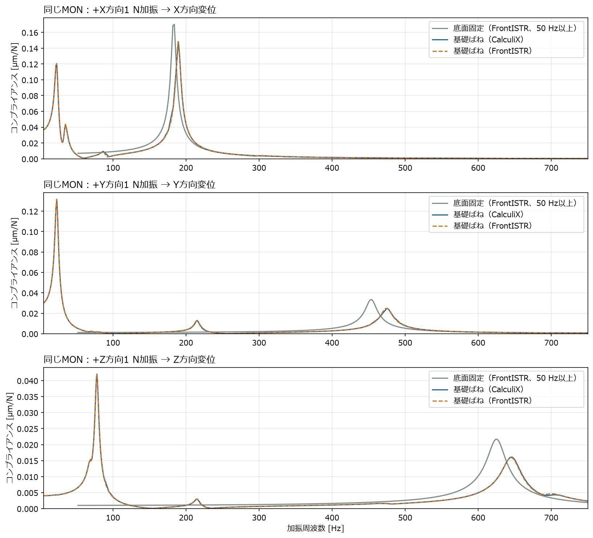

上の比較は各加振方向と同方向の変位。底面固定の既存結果は50 Hz以上なので、50 Hz未満に固定モデルの線を補間・外挿していない。両ソルバの追加モデルを同じ図に重ねる。

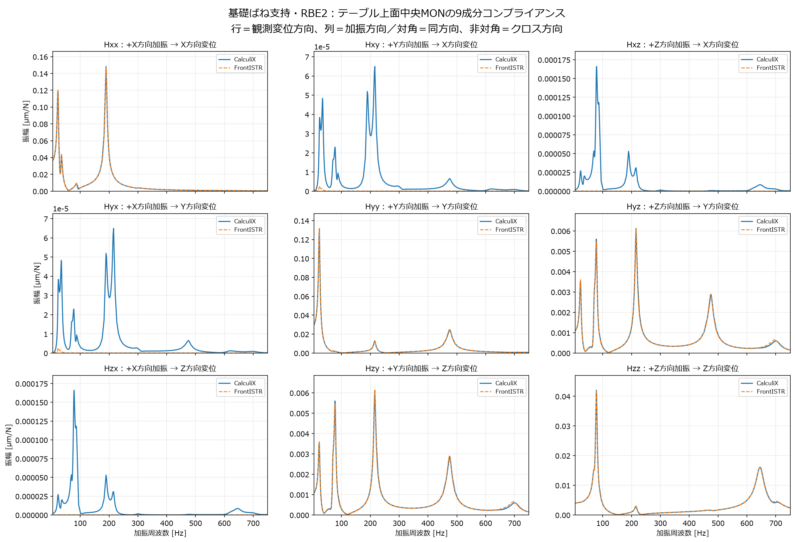

行が観測方向、列が加振方向。例えばHzyは「MONをY加振したときの、同じMONのZ変位」。各図は0始まりの線形軸で、上限は成分ごとに異なる。

底面固定では最初の弾性モードが約172 Hzだったが、この仮定の基礎ばね支持では約23 Hzからモードが現れる。両ソルバの低次6モードは次の通り。

| モード | CalculiX Hz | FrontISTR Hz |
|---|---:|---:|
| 1 | 23.127 | 23.129 |
| 2 | 23.165 | 23.166 |
| 3 | 34.877 | 34.828 |
| 4 | 69.405 | 69.204 |
| 5 | 78.043 | 77.992 |
| 6 | 87.679 | 87.602 |

### 8.6 基礎支持による低周波応答の全体振動GIF

FrontISTRの6〜100 Hzの掃引範囲から、同方向変位が最大となる点を各加振方向について選び、全節点の複素変位を改めて出力した。**全帯域の最大ピークを必ず選んでいるわけではない。** 上段は組立状態の機械全体の揺れ方、下段は同じ点のX・Y・Z変位のコンプライアンス。赤点が加振・観測位置、赤矢印が加振方向。

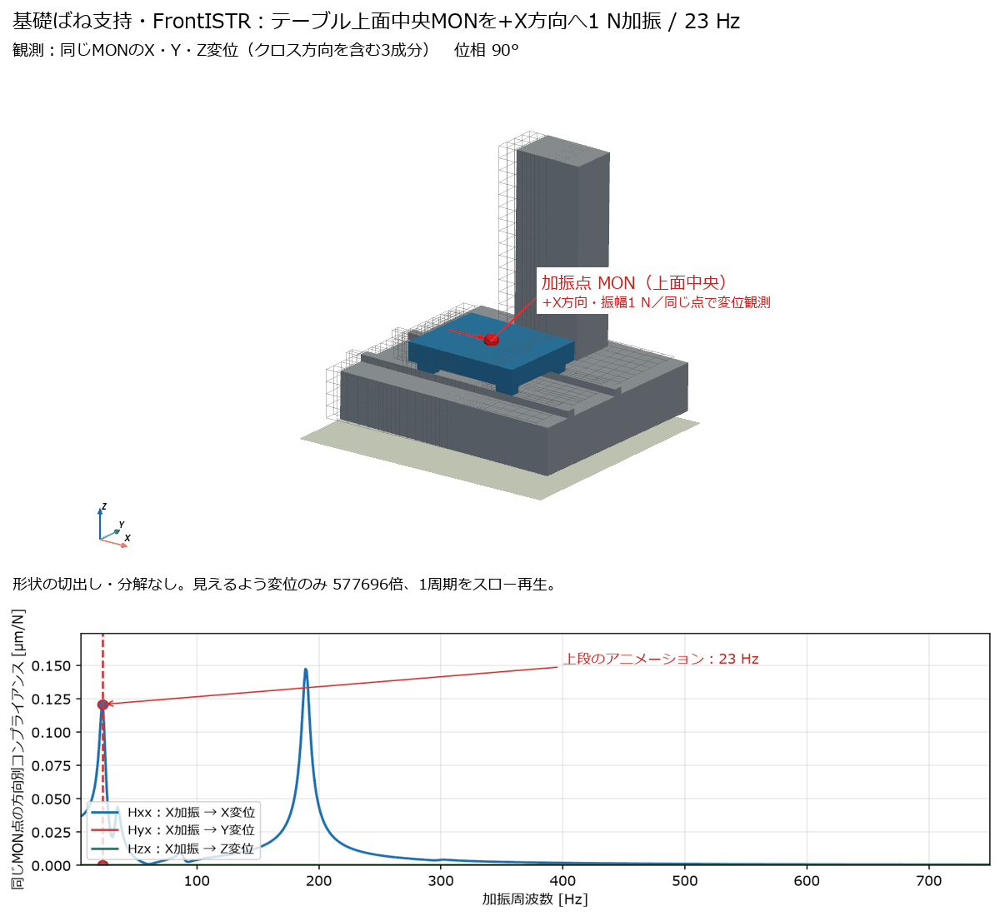

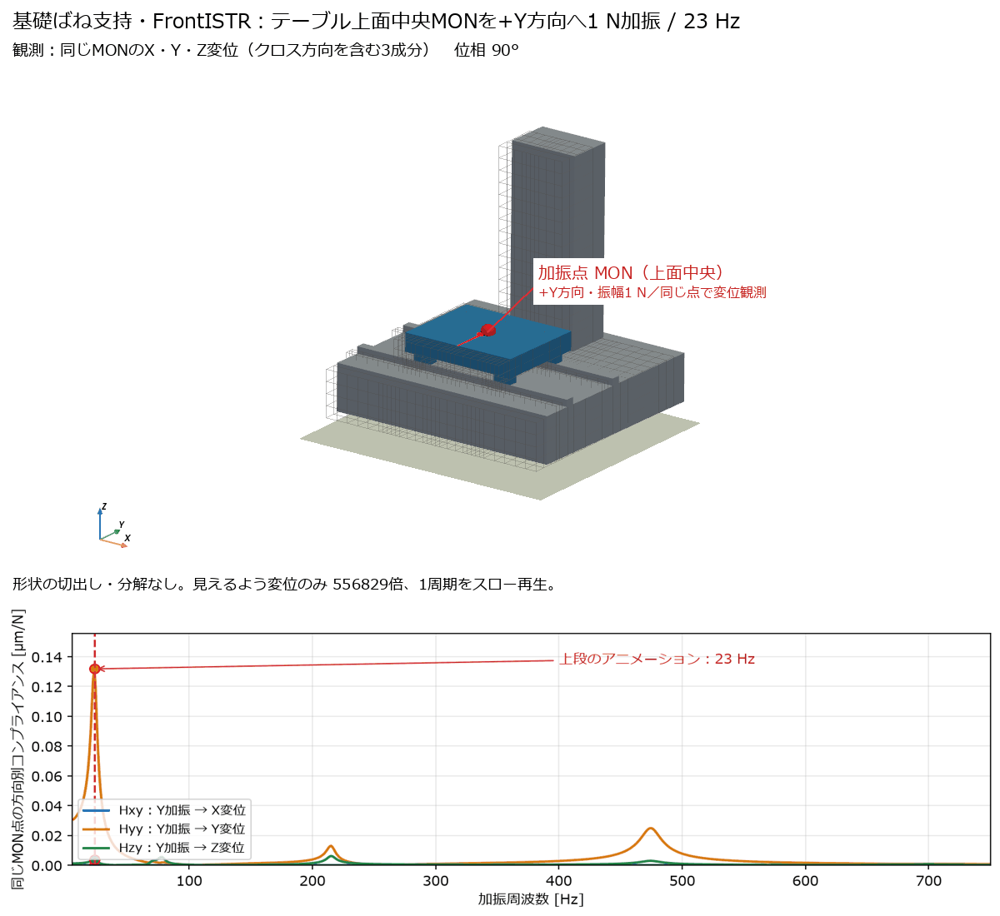

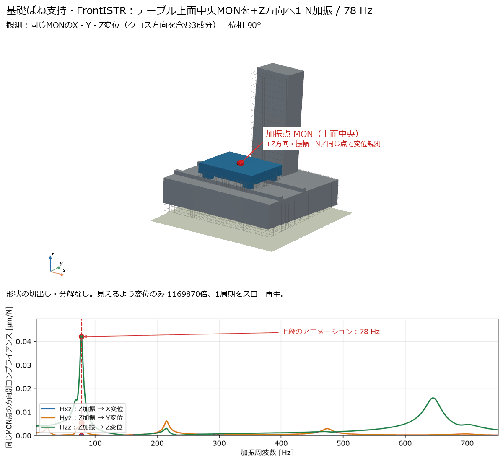

薄緑の地面表示は固定の参照表示。地盤の変形を計算したものではない。機械の変位だけを誇張し、同じ倍率でベッド・コラム・テーブルを動かす。

### 8.7 再現と確認

```bash
cd analysis/ana003_ccx_fistr_mpc_spring
~/opt/venv/bin/python run_foundation.py
~/opt/venv/bin/python post_foundation.py
~/opt/venv/bin/python render_foundation_model.py
~/opt/venv/bin/python plot_component_frf.py --foundation
~/opt/venv/bin/python render_whole_peak.py --foundation
```

モデル作成：[foundation_model.py](../analysis/ana003_ccx_fistr_mpc_spring/foundation_model.py)。元の底面固定モデルは残し、追加モデルの入力・ログ・結果は[foundation/](../analysis/ana003_ccx_fistr_mpc_spring/foundation/)に分ける。使用ソルバはCalculiX 2.21とFrontISTR 5.9（実行パスを明示）。

選択周波数の変位成分と掃引結果の一致、MPC式の残差を[checks.json](../analysis/ana003_ccx_fistr_mpc_spring/foundation/results/checks.json)へ記録する。基礎剛性・減衰は未同定なので、結果を実機の予測値とは扱わない。

---

[← docs 目次](README.md) ｜ [⌂ トップ](../README.md) ｜ [← 前: ana002 簡易工作機械の周波数応答解析](ana002_CalculiX-FrontISTR_簡易工作機械の周波数応答解析.md) ｜ [次: ana003_ばね接続モデルを自分で作る手順 →](ana003_ばね接続モデルを自分で作る手順.md)
