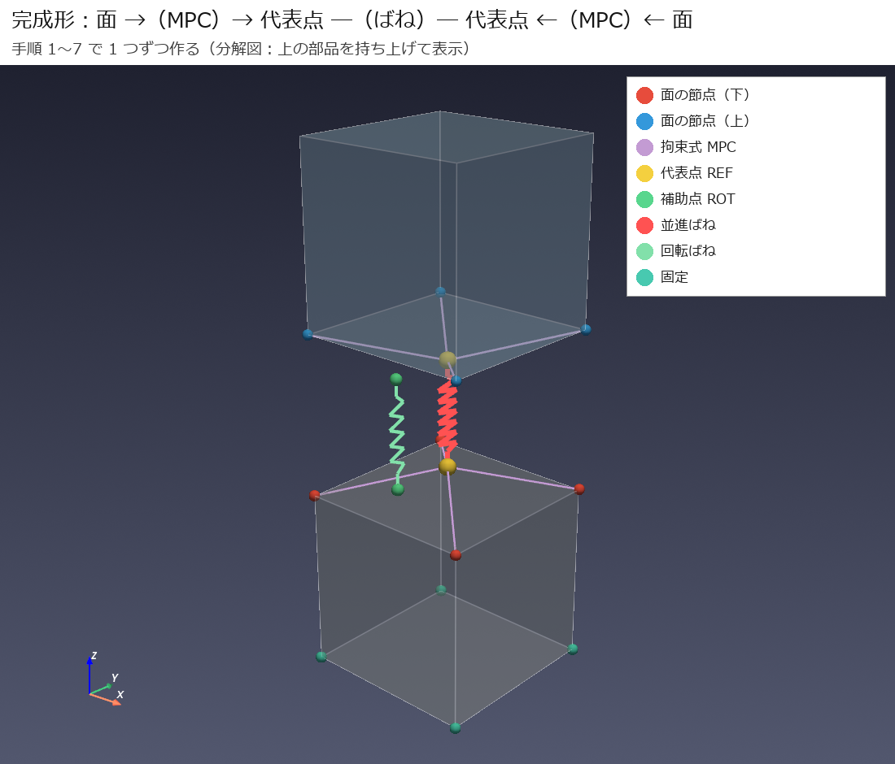
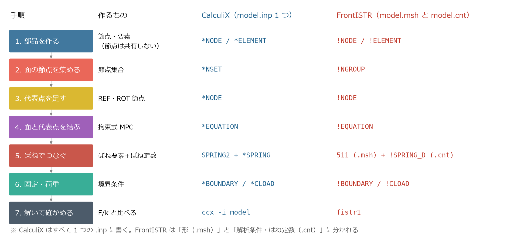
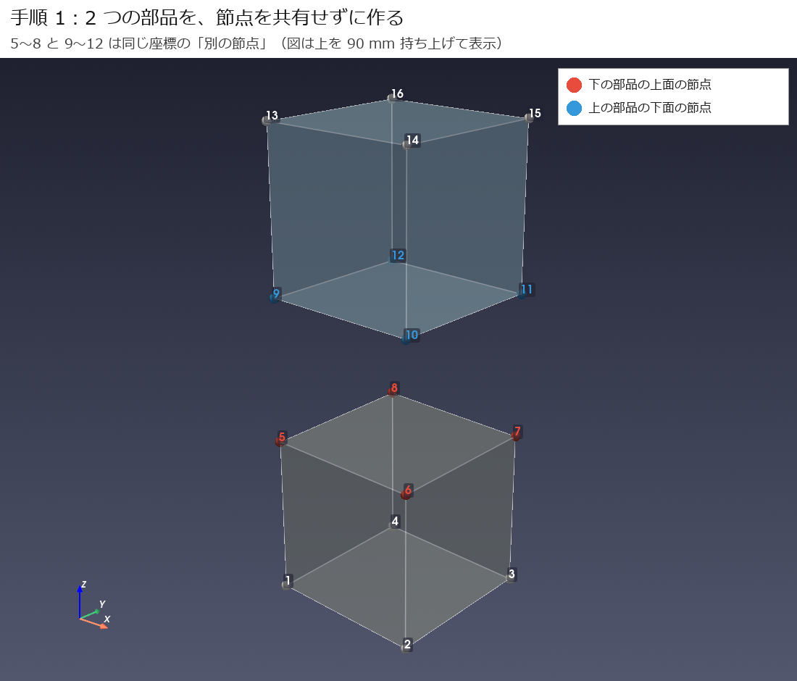
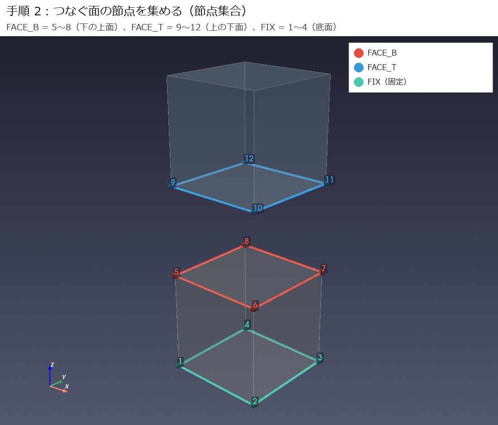
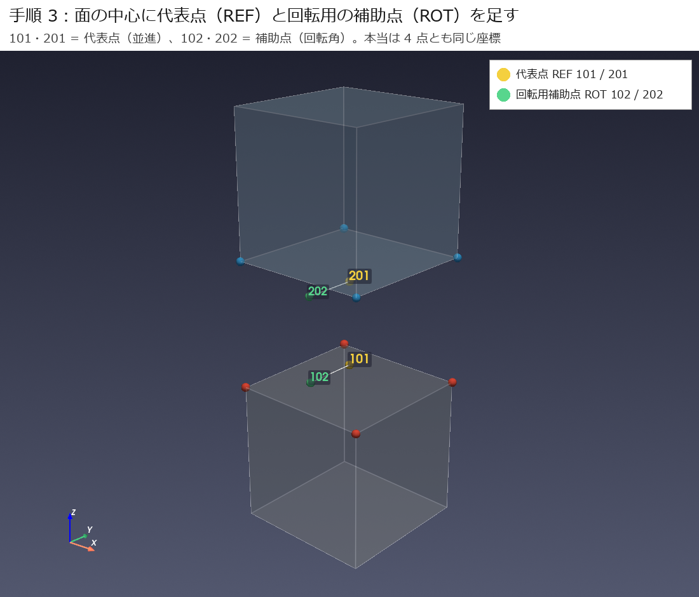
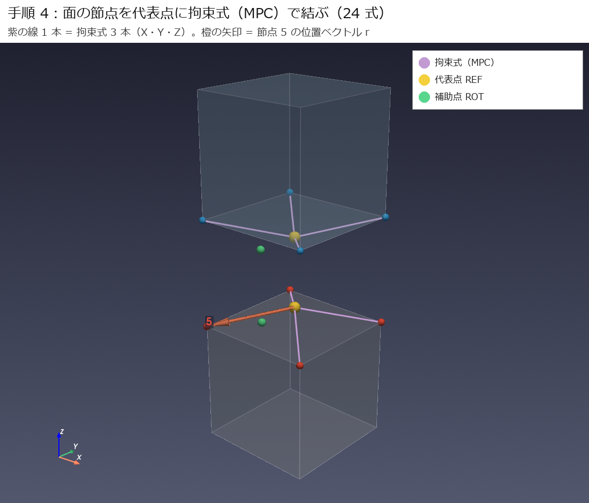
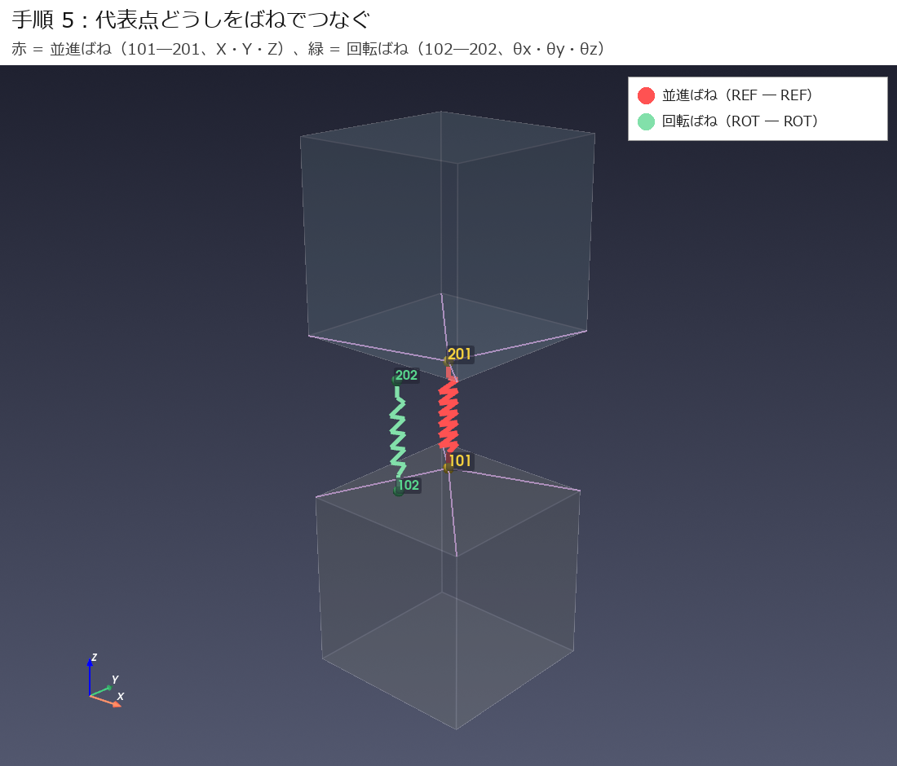
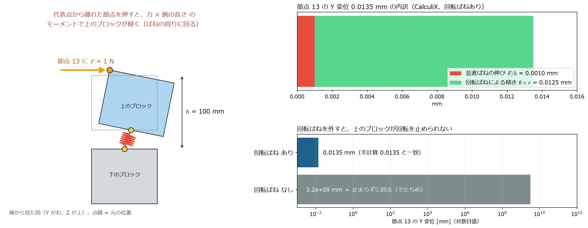
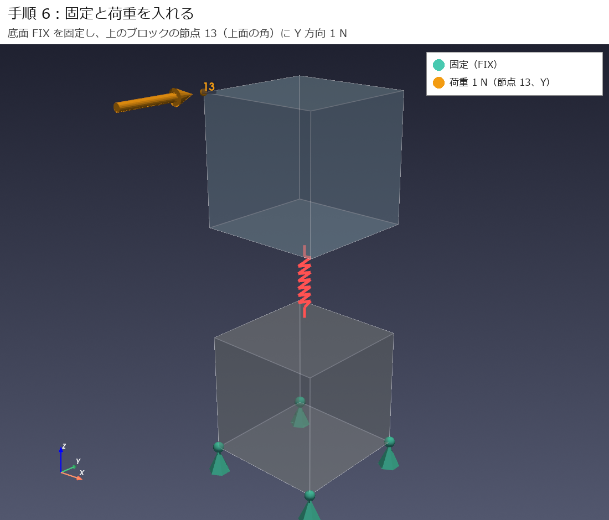
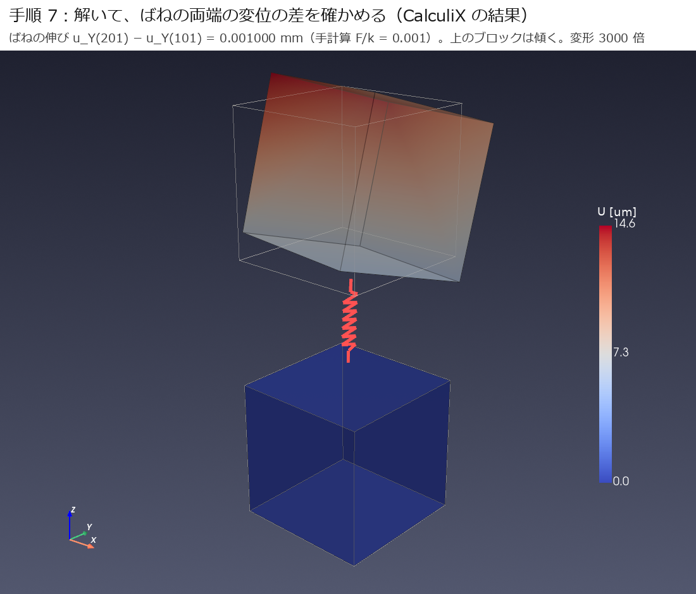

[← docs 目次](README.md) ｜ [⌂ トップ](../README.md) ｜ [← 前: ana003 代表点MPCばねの比較](ana003_CalculiX-FrontISTR_代表点MPCばねの比較.md) ｜ [次: ana004 ばねの種類の確認 →](ana004_CalculiX-FrontISTR_ばねの種類の確認.md)

# 【図解】CalculiX・FrontISTR で「面と面をばねでつなぐ」モデルを自分で作る手順（代表点＋MPC）

作成: 2026-11-07　／　使用ソフト: CalculiX 2.21、FrontISTR 6.0、ParaView（または pyvista）

工作機械の FEM では、リニアガイドやボールねじを「ばね」に置き換えます。
ところが実際にやろうとすると、

- 2 つの部品の**面と面**を、どうやってばねでつなぐの？
- 「代表点」「MPC」「RBE2」って、入力ファイルに何を書けばいいの？
- CalculiX と FrontISTR で書き方はどう違うの？

と、手が止まってしまいます。
この記事では、**100 mm の立方体 2 個**といういちばん小さいモデルを使って、面と面をばねでつなぐモデルを**7 つの手順で、図を見ながら**一から作ります。
最後に実際に解いて、手計算と一致することまで確かめます。

**この記事でわかること**

- 面の節点を集める（節点集合）→ 代表点を作る → 拘束式（MPC）で結ぶ → 代表点どうしをばねでつなぐ、の流れ
- 各手順で CalculiX（`.inp`）と FrontISTR（`.msh`・`.cnt`）に**何を書くか**
- 拘束式の係数の決め方（数式）
- 結果を ParaView で確認する方法
- 実際の工作機械モデルに広げるときのコツ

**目次**

1. 完成形と全体の流れ
2. 例題のモデル
3. 手順 1：部品を作る
4. 手順 2：つなぐ面の節点を集める
5. 手順 3：代表点を足す
6. 手順 4：面と代表点を拘束式（MPC）で結ぶ
7. 手順 5：代表点どうしをばねでつなぐ
8. 手順 6：固定と荷重
9. 手順 7：解いて確かめる
10. ParaView で確認する
11. 工作機械のモデルに広げる
12. よくある失敗
13. まとめ

---

## 1. 完成形と全体の流れ

まず、最後にできあがるモデルを見てください。



↑完成したモデルです（上の立方体を持ち上げて描いた分解図。本当は z = 100 mm で接しています）。

つなぎ方は、次の 1 行にまとまります。

> **面の節点 →（拘束式 MPC）→ 代表点 ―（ばね）― 代表点 ←（拘束式 MPC）← 面の節点**

ポイントは、**ばねは面と面を直接つなぐのではなく、それぞれの面の「代表点」どうしをつなぐ**ことです。
面の節点は、拘束式（MPC）で代表点にぶら下げます。

作業の流れと、各手順で書くキーワードを 1 枚にまとめました。



↑CalculiX は 1 つの `.inp` にすべて書きます。FrontISTR は「形（`.msh`）」と「解析条件・ばね定数（`.cnt`）」の 2 つのファイルに分かれます。

---

## 2. 例題のモデル

| 項目 | 設定 |
|---|---|
| 下の部品（ベッドのつもり） | 立方体 x = 0〜100、y = 0〜100、z = 0〜100 mm。節点 1〜8 |
| 上の部品（キャリッジのつもり） | 立方体 x = 0〜100、y = 0〜100、z = 100〜200 mm。節点 9〜16 |
| 要素 | 8 節点六面体（CalculiX `C3D8`、FrontISTR `361`）各 1 個 |
| 材料 | 鋼 $E$ = 200,000 N/mm²、$\nu$ = 0.3 |
| 代表点 | 101（下の面用）、201（上の面用）。どちらも (50, 50, 100) |
| 回転用の補助点 | 102（下）、202（上）。同じく (50, 50, 100) |
| 並進ばね | X・Y・Z 各 1,000 N/mm（= 1 N/µm） |
| 回転ばね | θx・θy・θz 各 1,000,000 N·mm/rad |
| 固定 | 下の部品の底面（節点 1〜4） |
| 荷重 | 上のブロックの節点 13（上面の角 (0, 0, 200)）に Y 方向 1 N。ばね（代表点）に直接ではなく、部品の節点を押す |
| 単位系 | mm・N・s（質量は t） |

完成した入力ファイルはここにあります。横に開きながら読み進めてください。

- CalculiX：[tutorial/ccx/model.inp](../analysis/ana003_ccx_fistr_mpc_spring/tutorial/ccx/model.inp)
- FrontISTR：[tutorial/fistr/model.msh](../analysis/ana003_ccx_fistr_mpc_spring/tutorial/fistr/model.msh)、[model.cnt](../analysis/ana003_ccx_fistr_mpc_spring/tutorial/fistr/model.cnt)、[hecmw_ctrl.dat](../analysis/ana003_ccx_fistr_mpc_spring/tutorial/fistr/hecmw_ctrl.dat)

※ 記事の中のコードは**抜粋**です。抜粋だけを保存しても解ける入力にはなりません。

---

## 3. 手順 1：部品を作る（節点は共有しない）



↑下の部品の上面（節点 5〜8、赤）と、上の部品の下面（節点 9〜12、青）は**同じ座標にある別の節点**です。

**CalculiX（model.inp）**

```text
*NODE
1, 0, 0, 0
...
5, 0, 0, 100        ← 下の部品の上面
...
9, 0, 0, 100        ← 上の部品の下面（5 と同じ座標だが別の番号）
...
*ELEMENT, TYPE=C3D8, ELSET=SOLIDS
1, 1,2,3,4,5,6,7,8           ← 下の部品
2, 9,10,11,12,13,14,15,16    ← 上の部品
```

**FrontISTR（model.msh）**

```text
!NODE
（CalculiX と同じ）
!ELEMENT, TYPE=361, EGRP=SOLIDS
1, 1,2,3,4,5,6,7,8
2, 9,10,11,12,13,14,15,16
```

- `C3D8` / `361`：8 節点の六面体要素。節点の並び順は両ソフトで同じ（下の面 4 つ → 上の面 4 つ）

**ポイントは、接する面の節点を共有（マージ）しないこと**です。
共有すると 2 つの部品が直接くっつき、間にばねを入れる意味がなくなります。メッシュ作成ソフトでも「別パート」「節点をマージしない」にしておきます。

---

## 4. 手順 2：つなぐ面の節点を集める（節点集合）



↑赤 = FACE_B（下の部品の上面）、青 = FACE_T（上の部品の下面）、緑 = FIX（固定する底面）。

**CalculiX（model.inp）**

```text
*NSET, NSET=FACE_B
5,6,7,8
*NSET, NSET=FACE_T
9,10,11,12
*NSET, NSET=FIX
1,2,3,4
```

**FrontISTR（model.msh）**

```text
!NGROUP, NGRP=FACE_B
5,6,7,8
!NGROUP, NGRP=FACE_T
9,10,11,12
!NGROUP, NGRP=FIX
1,2,3,4
```

- `*NSET` / `!NGROUP`：節点に名前を付けてまとめる

面の節点は、次の 3 つの条件で選びます。

1. **その部品の節点であること**（座標だけで選ぶと、同じ位置にある相手の部品の節点も混ざります）
2. **面の高さ**にあること（ここでは z = 100）
3. **取付面の範囲内**にあること（x, y が範囲内）

※ 2 次要素（20 節点など）では、辺の中間の節点も含めます。

※ **節点集合を作っただけでは、まだ何もつながっていません。** 集合は「選んだ節点の確認用」です。次の手順で、1 節点ずつ式を書いてつなぎます。

---

## 5. 手順 3：代表点を足す（REF と ROT）



↑黄 = 代表点 REF（101, 201）、緑 = 回転用の補助点 ROT（102, 202）。図ではずらしていますが、**4 点とも同じ座標 (50, 50, 100)** です。

**CalculiX（`*NODE` に追加）／ FrontISTR（`!NODE` に追加）**

```text
101, 50, 50, 100     ← 下の面の代表点 REF
102, 50, 50, 100     ← 下の面の回転用補助点 ROT
201, 50, 50, 100     ← 上の面の代表点 REF
202, 50, 50, 100     ← 上の面の回転用補助点 ROT
```

- **代表点 REF**：面全体の「平行移動」$u_x, u_y, u_z$ を受け持つ節点
- **回転用補助点 ROT**：面全体の「回転」$\theta_x, \theta_y, \theta_z$ を受け持つ節点

★ここがいちばんのミソです。ソリッド要素の節点には**回転の自由度がありません**。
そこで、要素につながっていない節点 ROT を 1 つ用意し、その**自由度 1・2・3 を「回転角 θx・θy・θz」という意味で使います**。
ソルバから見ればただの節点の変位ですが、次の手順の式の中で「回転」として扱います。

※ 要素は付けません。節点を足すだけです。番号は既存の節点と重ならないものにします。

---

## 6. 手順 4：面と代表点を拘束式（MPC）で結ぶ



↑紫の線が拘束式。1 本の線は、X・Y・Z の 3 本の式を表します。橙の矢印は、代表点から節点 5 へのベクトル $r$ です。

### 6.1 式の考え方

「面の節点は、代表点と一緒に**剛体として**動く」（RBE2 相当）とします。
剛体の小さな動きは「平行移動 ＋ 回転 × 位置」なので、

$$
\boldsymbol{u}_i = \boldsymbol{u}_{\mathrm{REF}} + \boldsymbol{\theta} \times \boldsymbol{r}_i
$$

$\boldsymbol{r}_i = (r_x, r_y, r_z)$ は代表点から節点 $i$ へのベクトルです。成分に分けると、

$$
\begin{aligned}
u_{ix} &= u_{\mathrm{REF},x} + \theta_y r_z - \theta_z r_y \\
u_{iy} &= u_{\mathrm{REF},y} + \theta_z r_x - \theta_x r_z \\
u_{iz} &= u_{\mathrm{REF},z} + \theta_x r_y - \theta_y r_x
\end{aligned}
$$

この例では面が水平（$r_z = 0$）なので、もう少し簡単になります。

### 6.1a この式は「標準の機能」なの？

**式そのものはソフトの機能ではなく、力学の基本式（剛体の小さな動き）**です。どのソフトでも同じです。
ソフトによって違うのは、**この式を自動で作ってくれるコマンドがあるかどうか**です。

| ソフト | この式を自動で作るコマンド（標準機能） | 自分で書く方法（この記事） |
|---|---|---|
| CalculiX | **ある**：`*RIGID BODY, NSET=FACE_B, REF NODE=101, ROT NODE=102`（`*COUPLING` ＋ `*KINEMATIC` も同じ働き） | `*EQUATION` で 1 式ずつ書く |
| FrontISTR | **ない**（剛体結合の専用コマンドはない） | `!EQUATION` で 1 式ずつ書く（これしか方法がない） |
| 商用（Nastran など） | `RBE2`（Abaqus は `*COUPLING, KINEMATIC`） | ― |

実は CalculiX の `*RIGID BODY` も、**「REF NODE ＝ 平行移動、ROT NODE の自由度 1〜3 ＝ 回転角」という、この記事と同じ仕組み**で動いています。
確かめるために、この例の 12 式 × 2 面を消して `*RIGID BODY` の 2 行に置き換えて解くと、**結果は全桁一致**しました。

| 書き方 | $u_Y(101)$ [mm] | $u_Y(201)$ [mm] |
|---|---:|---:|
| `*EQUATION` を 24 式（この記事） | 3.900000E-07 | 1.000390E-03 |
| `*RIGID BODY` を 2 行（CalculiX の標準機能） | 3.900000E-07 | 1.000390E-03 |

*入力: [tutorial/ccx_rigidbody/model.inp](../analysis/ana003_ccx_fistr_mpc_spring/tutorial/ccx_rigidbody/model.inp)*

```text
*RIGID BODY, NSET=FACE_B, REF NODE=101, ROT NODE=102   ← FACE_B の節点を 101・102 に剛体で結ぶ
*RIGID BODY, NSET=FACE_T, REF NODE=201, ROT NODE=202
```

**ではなぜ自分で書くのか？**

- **FrontISTR には専用コマンドがない**ので、両方のソルバで同じモデルを作るには `!EQUATION` を書くしかない
- 中身（何が何に結ばれているか）が**目に見える**ので、間違いに気づきやすい
- RBE3（平均で結ぶ）のような、専用コマンドがない結び方も同じ書き方で作れる

※ CalculiX だけを使うなら、`*RIGID BODY` を使うのがいちばん簡単で確実です。

### 6.2 節点 5 の X の式を、入力ファイルの 1 行にする

節点 5 は (0, 0, 100)、代表点は (50, 50, 100) なので $r = (-50, -50, 0)$。X の式に代入すると、

$$
u_x(5) = u_x(101) - \theta_z \times (-50)
\quad\Longrightarrow\quad
1 \cdot u_x(5) - 1 \cdot u_x(101) - 50\,\theta_z = 0
$$

あとは各項を「**節点番号, 自由度番号, 係数**」の 3 つ組にして並べるだけです。$\theta_z$ は「ROT 節点 102 の自由度 3」です。

| 項 | 節点 | 自由度 | 係数 |
|---|---|---|---|
| $1 \cdot u_x(5)$ | 5 | 1 | 1 |
| $-1 \cdot u_x(101)$ | 101 | 1 | −1 |
| $-50\,\theta_z$ | 102 | 3 | −50 |

**CalculiX（model.inp）**

```text
*EQUATION
3                                       ← 項の数
5, 1, 1, 101, 1, -1, 102, 3, -50        ← 節点, 自由度, 係数 を 3 項ぶん
*EQUATION
3
5, 2, 1, 101, 2, -1, 102, 3, 50         ← Y の式（r_x = −50）
*EQUATION
4
5, 3, 1, 101, 3, -1, 102, 1, 50, 102, 2, -50   ← Z の式
```

**FrontISTR（model.msh）**

```text
!EQUATION
3, 0.0                                  ← 項の数, 右辺（= 0）
5, 1, 1, 101, 1, -1, 102, 3, -50
3, 0.0
5, 2, 1, 101, 2, -1, 102, 3, 50
4, 0.0
5, 3, 1, 101, 3, -1, 102, 1, 50, 102, 2, -50
```

- `*EQUATION`（CalculiX）：1 式ごとに `*EQUATION` → 項の数 → 項の並び
- `!EQUATION`（FrontISTR）：`!EQUATION` の後に「項の数, 右辺」→ 項の並び、を繰り返す
- **最初の項が「従属自由度」**：計算の中で消去される側。面の節点を先頭に書きます

これを面の節点 4 個 × X・Y・Z × 面 2 枚 = **24 式**書きます（上の面は 101 → 201、102 → 202 に置き換え）。

※ $r_x, r_y$ は節点ごとに**符号も含めて**計算し直します。手で書くと間違えやすいので、実際のモデルでは Python などで自動生成します（11 章）。

※ 1 つの自由度を 2 つの式の先頭（従属）にしない、固定した自由度を従属にしない、の 2 つに注意します。

---

## 7. 手順 5：代表点どうしをばねでつなぐ



↑赤 = 並進ばね（101 ― 201）、緑 = 回転ばね（102 ― 202）。

**CalculiX（model.inp）**：Y 方向の並進ばねの例

```text
*ELEMENT, TYPE=SPRING2, ELSET=SP102
102, 101, 201              ← 要素番号, 節点1, 節点2
*SPRING, ELSET=SP102
2, 2                       ← 節点1の自由度, 節点2の自由度（2 = Y）
1000.0                     ← ばね定数 [N/mm]
```

**FrontISTR**：要素は `.msh`、ばね定数は `.cnt` に書きます

```text
（model.msh）
!ELEMENT, TYPE=511, EGRP=SP102
102, 101, 201
!MATERIAL, NAME=SP102, ITEM=1        ← 名前の登録用（値はばね定数ではない）
!ITEM=1, SUBITEM=2
1.0, 0.3
!SECTION, TYPE=INTERFACE, EGRP=SP102, MATERIAL=SP102

（model.cnt）
!MATERIAL, NAME=SP102
!SPRING_D
2, 2, 1000.0                         ← 自由度, 自由度, ばね定数
```

- `SPRING2` / `511`：2 つの節点の間のばね要素
- `*SPRING` / `!SPRING_D`：どの自由度どうしを、どの硬さでつなぐか
- ※ FrontISTR は、`.cnt` の `!MATERIAL` と**同じ名前の材料が `.msh` にもないとエラー**になります（`Fail in read in material definition`）

同じように、X（`1, 1`）・Z（`3, 3`）の並進ばねと、ROT どうし（102 ― 202）の回転ばね 3 本も書きます。合計 6 本です。

| ばね | 節点 | 何を表すか（工作機械では） |
|---|---|---|
| 並進 X・Y・Z | 101 ― 201 | ガイドの上下・横の剛性、ボールねじの軸方向剛性（[ばね剛性の決め方](../study/ref004_工作機械_ばね剛性と減衰の決め方.md)） |
| 回転 θx・θy・θz | 102 ― 202 | ガイドのモーメント剛性（ピッチング・ローリング・ヨーイング）。単位は N·mm/rad |

※ Y のばね 1 本だけだと、ほかの方向に支えがなくなり、計算が解けません（特異行列）。

### 7.1 並進ばねと回転ばねを分ける理由

理由は 3 つあります。

**① 代表点 1 点では、並進ばねだけだと回転を止められない**

面と面を「たくさんの節点どうし」でつなぐ分布ばね（[ana001](ana001_CalculiX-FrontISTR_簡易工作機械の固有値解析.md)）なら、面が傾くと端の節点のばねが伸び縮みするので、回転の硬さは自然に出てきます。

$$
k_\theta = \sum_i k_i\, r_i^2 \qquad (\text{分布ばね：中心から離れたばねほど回転を強く止める})
$$

ところが代表点方式では、ばねは**中心の 1 点だけ**です。腕の長さ $r = 0$ なので、並進ばねは回転に対してまったく抵抗しません。
だから回転の硬さは**別に入れる必要があります**。

**② ばね 1 本は「1 つの自由度どうし」しかつなげない**

`SPRING2`・`511`＋`!SPRING_D` は、「節点 1 の自由度 ○」と「節点 2 の自由度 ○」を 1 つの値でつなぐ要素です。
代表点 REF の自由度 1〜3 は**平行移動**、補助点 ROT の自由度 1〜3 は**回転角**なので、

- 平行移動の硬さ → REF ― REF のばね（単位 N/mm）
- 回転の硬さ → ROT ― ROT のばね（単位 N·mm/rad）

と、つなぐ節点も単位も違う別のばねになります。

**③ カタログの値も別々に載っている**

リニアガイドのカタログには、上下・横の**剛性（N/µm）**と、ピッチング・ローリング・ヨーイングの**モーメント剛性（N·m/rad など）**が別々に載っています。
並進ばねと回転ばねを分けておくと、カタログ値をそれぞれそのまま入れられます。

**計算で確かめる**：この例では荷重を上のブロックの角（節点 13）にかけているので、ばねのまわりにモーメントがかかり、上のブロックが傾きます。



↑左：代表点から離れた節点を押すと傾く。右上：節点 13 の動きの内訳。右下：回転ばねを外すと答えがでたらめになる。

節点 13 は代表点から $r = (-50, -50, 100)$ mm の位置なので、モーメントは

$$
\boldsymbol{M} = \boldsymbol{r} \times \boldsymbol{F} = (-50, -50, 100) \times (0, 1, 0) = (-100,\ 0,\ -50)\ \mathrm{N \cdot mm}
$$

回転ばね $k_\theta = 10^6$ N·mm/rad で割ると、$\theta_x = -1\times10^{-4}$ rad、$\theta_z = -5\times10^{-5}$ rad。節点 13 の Y 変位は

$$
u_Y(13) = \underbrace{\frac{F}{k}}_{\text{並進ばね}} + \underbrace{\theta_z r_x - \theta_x r_z}_{\text{回転ばね}} = 0.001 + 0.0125 = 0.0135\ \mathrm{mm}
$$

となり、CalculiX（0.01350 mm）・FrontISTR（0.01350 mm）と一致しました。
**この例では、回転ばねによる傾きのほうが並進ばねの伸びより 12 倍も大きい**ことに注目してください。工具先端のように取付面から離れた点では、ガイドのモーメント剛性が効いてきます。

| 回転ばね | 節点 13 の Y 変位 |
|---|---|
| あり（1,000,000 N·mm/rad） | 0.0135 mm（手計算どおり） |
| なし | 3×10⁹ mm（回転を止めるものがなく、でたらめな値） |

*入力: [tutorial/ccx_no_rot/model.inp](../analysis/ana003_ccx_fistr_mpc_spring/tutorial/ccx_no_rot/model.inp)（回転ばね 3 本を消したもの）*

※ ソルバがエラーで止まらず、でたらめな数字を出すことがあります。**結果は必ず手計算や絵で確かめます。**

### 7.1b ばねに回転剛性を直接入れられないのか

実は、回転ばね（102―202）がやっていることは「回転剛性を直接入れる」ことそのものです。ばね定数 1,000,000 N·mm/rad は回転の硬さの値で、カタログのモーメント剛性をそのまま書けます。ただ、その回転ばねを**どの節点につなぐか**に制約があります。

ソリッド要素（C3D8・361 など）の節点は、X・Y・Z の 3 つの並進しか持っていません。回転の自由度（自由度 4・5・6）がないので、面の節点に直接「回転ばね」をつけることはできません。そこで、面の動きから回転角を表す節点（ROT）を別に作り、そこに回転ばねをつないでいます。はりやシェルの要素なら節点に回転の自由度があるので、そういう部品どうしなら補助点なしで回転ばねを直接つけられます。

もう一つの考え方として、代表点を使わずに、面と面の向かい合う節点どうしを並進ばねでたくさんつなぐ方法（分布ばね、[ana001](ana001_CalculiX-FrontISTR_簡易工作機械の固有値解析.md)）もあります。この場合は回転ばねは不要で、面が傾くと端の方のばねが伸び縮みするので、回転の硬さ $k_\theta = \sum_i k_i r_i^2$ が自動的に生まれます。ただしその値は、ばねの並べ方で決まってしまい、カタログのモーメント剛性に合わせて自由に設定することはできません。代表点＋回転ばねの方式は、並進と回転の硬さを別々にカタログ値どおりに入れたいときに使います。

### 7.1c 代表点どうしを「1 本の 6 成分ばね」としてつなぐ道具

CalculiX の `SPRING2` も FrontISTR の `511`＋`!SPRING_D` も、ばねでつなげるのは自由度 1〜3（並進）だけです。CalculiX で `*RIGID BODY` の代表点（REF NODE）どうしに自由度 4〜6 のばねを入れて試したところ、回転ばねは効かず、答えが発散しました（[ref6dof/ccx/model.inp](../analysis/ana003_ccx_fistr_mpc_spring/tutorial/ref6dof/ccx/model.inp)）。ソルバの入力だけで「代表点 1 つに 6 成分のばね」を直接書く方法は、どちらのソルバにもありません。

そこで、使う側からは「面 A の節点、面 B の節点、代表点の位置、6 つのばね定数」を渡すだけで済むように、補助点・拘束式・ばねをまとめて書き出す Python の道具を作りました（[analysis/tools/rep_spring.py](../analysis/tools/rep_spring.py)）。中身はこの記事の手順 3〜5 と同じで、補助点 ROT は道具の中で自動的に作られます。

```python
from rep_spring import RepSpring
rs = RepSpring(first_node=101, first_elem=101)          # 新しく使う節点・要素番号の始まり
rs.add("JOINT", [5, 6, 7, 8], [9, 10, 11, 12],          # 面 A の節点、面 B の節点
       center=(50, 50, 100),                            # 代表点の位置
       k=(1000, 1000, 1000, 1e6, 1e6, 1e6),             # kx, ky, kz [N/mm]、krx, kry, krz [N·mm/rad]
       coords=P)                                        # 節点番号 → 座標
ccx_lines = rs.ccx()                 # CalculiX：.inp に貼る行（節点・*EQUATION・SPRING2）
msh_lines, cnt_lines = rs.fistr()    # FrontISTR：.msh に貼る行と .cnt に貼る行
```

ガイドが 4 個あれば `add` を 4 回呼ぶだけです。この記事の例題をこの道具で作り直すと、CalculiX・FrontISTR とも、手で書いた入力と同じ結果（ばねの伸び 0.001000 mm、節点 13 の Y 変位 0.013502 mm）になりました（[rep_spring_demo/demo.py](../analysis/ana003_ccx_fistr_mpc_spring/tutorial/rep_spring_demo/demo.py)）。

### 7.2 回転の硬さは CalculiX でも FrontISTR でも入れられる？

**どちらでも入れられます。** この記事の方法（補助点 ROT ＋ ばね）は、両方のソルバで同じように動きます。
上の 9 章の表のとおり、回転ばねの両端の角度の差は CalculiX・FrontISTR とも手計算の $-1\times10^{-4}$ rad に一致しました。

| | CalculiX | FrontISTR |
|---|---|---|
| ソリッドの節点に回転の自由度はあるか | ない（X・Y・Z の 3 つだけ） | ない（同じ） |
| 回転の硬さの入れ方（この記事） | 補助点 ROT どうしを `SPRING2` ＋ `*SPRING`（自由度 1〜3）でつなぐ | 補助点 ROT どうしを `511` ＋ `!SPRING_D`（自由度 1〜3）でつなぐ |
| ROT を面に結ぶ方法 | `*EQUATION`、または標準機能の `*RIGID BODY`（ROT NODE を指定） | `!EQUATION`（専用コマンドはない） |
| 結果（この例の $\theta_x$） | −1.0×10⁻⁴ rad | −1.0×10⁻⁴ rad |

違いは「**ROT を面に結ぶ専用コマンドがあるかどうか**」だけで、回転ばねそのものはどちらも同じ書き方で入ります。
※ どちらのソルバにも「ソリッドの節点に直接つける回転ばね」はありません。ソリッドの節点には回転の自由度がないためで、だから補助点 ROT を使います。

---

## 8. 手順 6：固定と荷重



↑緑の三角 = 固定した底面、橙の矢印 = 上のブロックの節点 13（上面の角）に Y 方向 1 N。

**CalculiX（model.inp）**

```text
*MATERIAL, NAME=STEEL
*ELASTIC
200000, 0.3
*SOLID SECTION, ELSET=SOLIDS, MATERIAL=STEEL
*BOUNDARY
FIX, 1, 3                ← FIX の自由度 1〜3 を固定
*STEP
*STATIC
*CLOAD
13, 2, 1.0               ← 上のブロックの節点 13 の Y に 1 N
*NODE PRINT, NSET=MON
U
*NODE FILE
U
*END STEP
```

**FrontISTR（model.cnt）**

```text
!VERSION
3
!SOLUTION, TYPE=STATIC
!BOUNDARY
FIX, 1, 3, 0.0
!CLOAD
13, 2, 1.0
（ここに手順 5 の !MATERIAL / !SPRING_D）
!SOLVER, METHOD=DIRECT
!WRITE,RESULT
!END
```

- 荷重は**ばね（代表点）ではなく、部品の節点**にかけます。力は上のブロックの中を伝わり、面の 4 節点 → 拘束式 → 代表点 201 → ばね、と流れます
- 実際の機械でも、切削力は工具先端（部品の上）にかかります。代表点に直接かけると、モーメント（傾き）が出ず、回転ばねの確認ができません
- `MON` は確認用に 101・102・201・202・13 をまとめた節点集合です

---

## 9. 手順 7：解いて確かめる

```bash
# CalculiX（.inp は付けない）
ccx -i model

# FrontISTR（hecmw_ctrl.dat がある場所で）
fistr1
```



↑CalculiX の結果（変形を 3,000 倍に拡大）。上のブロックは Y へずれながら傾きます（荷重が角にかかっているため）。下のブロックはほとんど動きません。

**結果の読み方**：上のブロックの節点を押しても、Y 方向の力 1 N はすべて並進ばねを通るので、ばねの両端の変位の差は

$$
u_Y(201) - u_Y(101) = \frac{F}{k} = \frac{1\ \mathrm{N}}{1000\ \mathrm{N/mm}} = 0.001\ \mathrm{mm}
$$

回転ばねの両端の角度の差は、7.1 節のモーメントから $\theta_x = M_x / k_\theta = -1\times10^{-4}$ rad、$\theta_z = M_z / k_\theta = -5\times10^{-5}$ rad です。

| ソルバ | 下の代表点 101 の Y 変位 [mm] | 上の代表点 201 の Y 変位 [mm] | ばねの伸び [mm] | 手計算 [mm] |
|---|---:|---:|---:|---:|
| CalculiX | 3.90e-07 | 0.00100039 | 0.00100000 | 0.001 |
| FrontISTR | 5.40e-07 | 0.00100054 | 0.00100000 | 0.001 |

| ソルバ | $\theta_x(202) - \theta_x(102)$ [rad] | $\theta_z(202) - \theta_z(102)$ [rad] | 節点 13 の Y 変位 [mm] |
|---|---:|---:|---:|
| 手計算 | −1.0e-4 | −5.0e-5 | 0.0135 |
| CalculiX | −1.0e-4 | −5.0e-5 | 0.013502 |
| FrontISTR | −1.0e-4 | −5.0e-5 | 0.013502 |

**両ソルバとも手計算と一致しました。**（照合は [make_tutorial.py](../analysis/ana003_ccx_fistr_mpc_spring/make_tutorial.py) が自動で行い、結果を [tutorial/check.md](../analysis/ana003_ccx_fistr_mpc_spring/tutorial/check.md) に書き出します）

※ 201 の値そのものではなく**差**で比べます。下のブロック自体もわずかに変形する（101 が 4×10⁻⁷ mm 動く）ためです。
※ 回転ばねの「両端の差」は、補助点 ROT の自由度 1・3 の値（ソルバの出力では変位として出る）の差です。

---

## 10. ParaView で確認する

モデルが意図どおりにつながっているかは、**絵で見るのがいちばん確実**です。
確認用のファイルを用意しました。

| ファイル | 内容 |
|---|---|
| tutorial/vtu/tutorial_model_exploded.vtu（未収録：スクリプトで再生成） | 分解図（上の部品を持ち上げ、代表点をずらしたもの）。この記事の図と同じ配置 |
| tutorial/vtu/tutorial_model.vtu（未収録：スクリプトで再生成） | 実際の座標のもの |

どちらにも、ソリッド・拘束式・ばねが入っています。

- セルデータ `kind`：0 = ソリッド、1 = 拘束式（面の節点 → 代表点の線）、2 = 並進ばね、3 = 回転ばね
- 点データ `set`：1 = FACE_B、2 = FACE_T、3 = FIX、4 = 代表点 REF、5 = 補助点 ROT
- 点データ `node_id`（節点番号）、`DISPLACEMENT`（CalculiX の結果）

**ParaView での手順**

1. File → Open で `tutorial_model_exploded.vtu` を開き、Apply
2. 表示を **Surface With Edges**、Opacity を 0.3 にする（中が透けて見える）
3. Filters → **Threshold**（Scalars = `kind`、範囲 1〜1）→ 紫で表示 … **拘束式の線**が見える
4. もう一度 **Threshold**（`kind` = 2〜3）→ 赤で表示 … **ばね**が見える
5. 元のデータを選び、Filters → **Glyph**（Glyph Type = Sphere）、色を `set` にする … **面の節点・代表点**が色分けされる
6. 番号を見たいとき：View → **Find Data**（または Spreadsheet View）で `node_id` を表示
7. 結果を見るとき：`tutorial_model.vtu` を開いて Filters → **Warp By Vector**（`DISPLACEMENT`、Scale Factor = 20000）

チェックすること:

- [ ] 紫の線が、**つなぎたい面の節点だけ**から出ているか（相手の部品の節点が混ざっていないか）
- [ ] 代表点が面の中心にあるか
- [ ] ばねが、下の代表点と上の代表点の間にあるか
- [ ] 解いた後、上の部品が**形を変えずに**動いているか（RBE2 なので面は剛体）

この記事の図は、同じデータを ParaView と同じ VTK ライブラリ（Python の pyvista）で描いたものです。
生成スクリプト: [make_tutorial_figs.py](../analysis/ana003_ccx_fistr_mpc_spring/make_tutorial_figs.py)、[make_tutorial_flow.py](../analysis/ana003_ccx_fistr_mpc_spring/make_tutorial_flow.py)

---

## 11. 工作機械のモデルに広げる

立方体 2 個でできたら、あとは**同じことを面の数だけ繰り返す**だけです。
ただ、実際のモデルでは面の節点が数十〜数百個になるので、手で式を書くのは無理です。
次のような短いスクリプトで、節点集合と拘束式を自動で作ります。

```python
import numpy as np

def face_nodes(part_nodes, z0, x0, x1, y0, y1, tol=1e-6):
    """部品の節点 {番号: (x, y, z)} から、高さ z0・範囲内の節点を選ぶ（手順 2）"""
    return [n for n, (x, y, z) in part_nodes.items()
            if abs(z - z0) < tol and x0 - tol <= x <= x1 + tol and y0 - tol <= y <= y1 + tol]

def rbe2_equations(nodes, face, ref, rot, center):
    """面の各節点を代表点 ref・補助点 rot に剛体で結ぶ式（手順 4）。項は (節点, 自由度, 係数)"""
    eqs = []
    for n in face:
        rx, ry, rz = np.array(nodes[n]) - np.array(center)
        eqs.append([(n, 1, 1), (ref, 1, -1), (rot, 2, -rz), (rot, 3, ry)])   # ux = uR,x + θy rz − θz ry
        eqs.append([(n, 2, 1), (ref, 2, -1), (rot, 3, -rx), (rot, 1, rz)])   # uy = uR,y + θz rx − θx rz
        eqs.append([(n, 3, 1), (ref, 3, -1), (rot, 1, -ry), (rot, 2, rx)])   # uz = uR,z + θx ry − θy rx
    return [[t for t in eq if t[2] != 0] for eq in eqs]                      # 係数 0 の項は省く

def write_ccx(eqs):
    out = []
    for eq in eqs:
        out += ["*EQUATION", str(len(eq)), ", ".join(f"{n}, {d}, {c:g}" for n, d, c in eq)]
    return out

def write_fistr(eqs):
    out = ["!EQUATION"]
    for eq in eqs:
        out += [f"{len(eq)}, 0.0", ", ".join(f"{n}, {d}, {c:g}" for n, d, c in eq)]
    return out
```

このスクリプトで立方体の例を作ると、手で書いた 24 式と同じものができます（立方体の例の生成: [make_tutorial.py](../analysis/ana003_ccx_fistr_mpc_spring/make_tutorial.py)）。
工作機械モデル全体（キャリッジ 4 個＋ボールねじナット、面 10 枚）を作ったコードは [analysis/tools/mpc_springs.py](../analysis/tools/mpc_springs.py) です。

**進め方のおすすめ**

1. この記事の立方体の例をそのまま解き、ばねの伸び 0.001 mm・節点 13 の変位 0.0135 mm になることを確かめる
2. ばね定数を 2 倍にして、差が半分になることを確かめる
3. 荷重を X・Z に変えて、それぞれのばねが効くことを確かめる
4. 自分のモデルで、部品ごとに面の節点集合を作り、**ParaView で選んだ節点を確認**する
5. スクリプトで拘束式とばねを書き出し、静解析で意図した方向に動くか確かめる
6. 固有値解析で、余計な剛体モード（0 Hz 付近）や局所モードがないか確かめる（[ana001](ana001_CalculiX-FrontISTR_簡易工作機械の固有値解析.md)）
7. 周波数応答を解く（[ana002](ana002_CalculiX-FrontISTR_簡易工作機械の周波数応答解析.md)、[ana003](ana003_CalculiX-FrontISTR_代表点MPCばねの比較.md)）

---

## 12. よくある失敗

| 症状 | 原因 | 対策 |
|---|---|---|
| ばねを入れたのに結果が変わらない／2 部品がくっついている | 接する面の節点を共有（マージ）している | 部品ごとに別の節点にする（手順 1） |
| 面の選択に相手の部品の節点が混ざる | 座標だけで選んでいる | 「部品」で絞ってから座標で選ぶ（手順 2） |
| 解けない（特異行列・ゼロピボット） | ばねの方向が足りない、回転ばねがない | 並進 3 方向＋回転 3 方向を入れる。または全体がほかで支えられているか確認 |
| 固有値解析で 0 Hz のモードが出る | 上と同じ。どこにもつながっていない自由度がある | ParaView でばね・拘束線がすべての部品に届いているか確認 |
| FrontISTR が `Fail in read in material definition` | `.cnt` の `!MATERIAL` と同じ名前の材料が `.msh` にない | `.msh` にダミーの材料と `!SECTION, TYPE=INTERFACE` を書く（手順 5） |
| CalculiX が拘束式でエラー | 同じ自由度が 2 つの式の先頭（従属）になっている／固定と重なっている | 先頭には面の節点だけを書く。固定した節点を面に含めない |
| 結果が硬すぎる | MPC は「無限に硬い」ので、面の中の柔らかさが消える | RBE2 の代わりに RBE3（平均）を使う（[ana003](ana003_CalculiX-FrontISTR_代表点MPCばねの比較.md)、[ana004 3 章](ana004_CalculiX-FrontISTR_ばねの種類の確認.md)） |

---

## 13. まとめ

- 面と面をばねでつなぐときは、**面 →（MPC）→ 代表点 ―（ばね）― 代表点 ←（MPC）← 面** の形にする
- 手順は 7 つ：①部品を作る（節点を共有しない）②面の節点集合 ③代表点 REF と回転用補助点 ROT ④拘束式 ⑤並進ばねと回転ばね ⑥固定・荷重（荷重は部品の節点に）⑦解いて $F/k$・$M/k_\theta$ と比べる
- 拘束式は「剛体の動き $\boldsymbol{u}_i = \boldsymbol{u}_{\mathrm{REF}} + \boldsymbol{\theta} \times \boldsymbol{r}_i$」を「節点, 自由度, 係数」の並びに書き直したもの。**ソルバの標準機能（`*EQUATION` / `!EQUATION`）だけで作れる**
- 回転は、要素のない補助点 ROT の自由度 1〜3 を回転角として使う
- CalculiX は 1 ファイル、FrontISTR は `.msh`（形・拘束式・ばね要素）と `.cnt`（ばね定数・条件）に分けて書く
- 作ったら必ず **ParaView で絵にして**、つなぎ方を目で確認する

次は、このつなぎ方を工作機械モデル全体に使った結果（RBE2 と RBE3 の違い、周波数応答）を [ana003](ana003_CalculiX-FrontISTR_代表点MPCばねの比較.md) で見てください。

---

[← docs 目次](README.md) ｜ [⌂ トップ](../README.md) ｜ [← 前: ana003 代表点MPCばねの比較](ana003_CalculiX-FrontISTR_代表点MPCばねの比較.md) ｜ [次: ana004 ばねの種類の確認 →](ana004_CalculiX-FrontISTR_ばねの種類の確認.md)

基礎部も同じ手順で作る例は、[ana003後半の基礎ばね支持モデル](ana003_CalculiX-FrontISTR_代表点MPCばねの比較.md#8-追加基礎部もmpcばねで支持するモデル)を参照。底面固定の解除、4面の抽出、地面側代表点の固定まで示す。

---

[← docs 目次](README.md) ｜ [⌂ トップ](../README.md) ｜ [← 前: ana003 代表点MPCばねの比較](ana003_CalculiX-FrontISTR_代表点MPCばねの比較.md) ｜ [次: ana004 ばねの種類の確認 →](ana004_CalculiX-FrontISTR_ばねの種類の確認.md)
