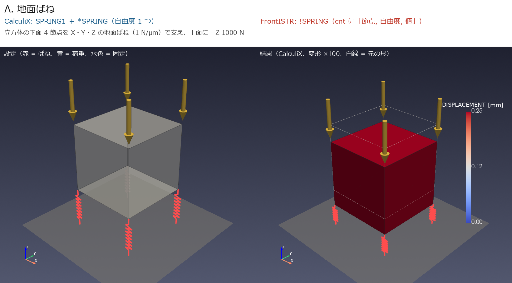
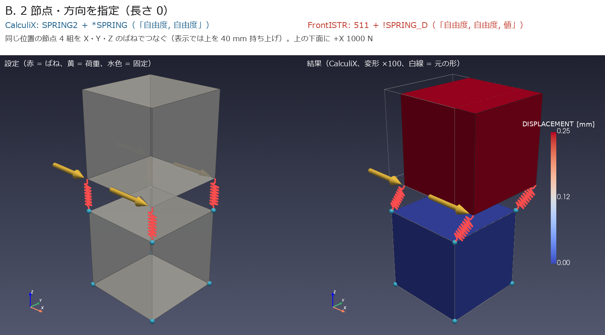
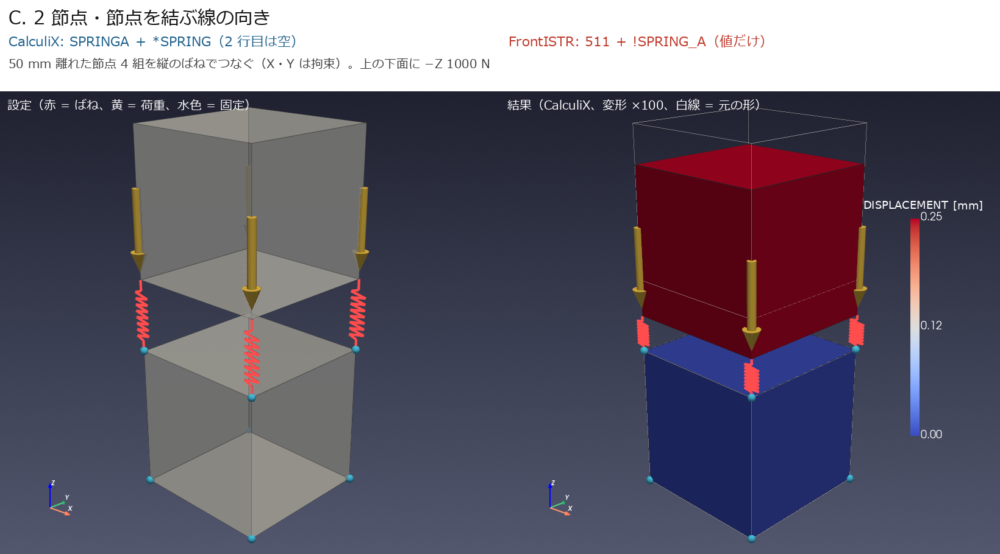
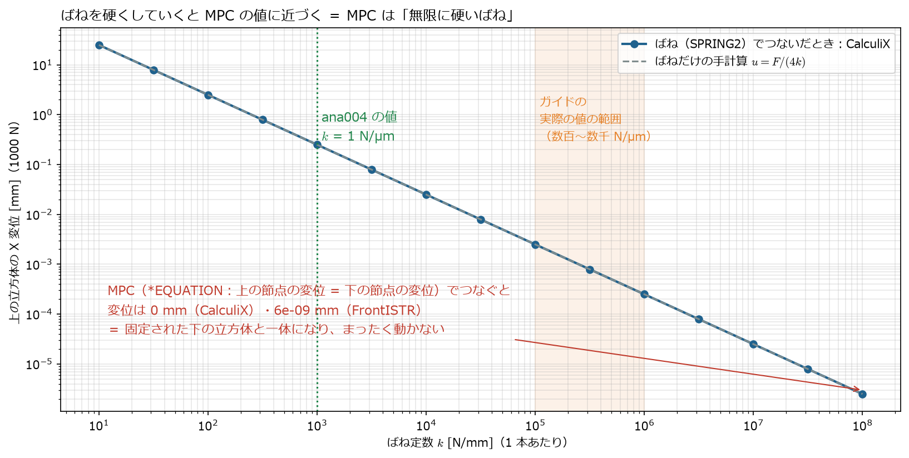

[← docs 目次](README.md) ｜ [⌂ トップ](../README.md) ｜ [← 前: ana003_ばね接続モデルを自分で作る手順](ana003_ばね接続モデルを自分で作る手順.md) ｜ [次: ana005_基礎ばねモデルの加減速と再生びびり分析 →](ana005_基礎ばねモデルの加減速と再生びびり分析.md)

# ana004 ばねの種類ごとの最小モデル（CalculiX と FrontISTR）

作成: 2026-11-07

## 1. 目的

ana001〜003 で使っている「ばね」の書き方を、いちばん小さいモデルで確かめる。
地面ばね・方向指定のばね（長さ 0）・軸方向のばね（長さあり）の 3 種類を、**CalculiX と FrontISTR の両方で静解析**し、手計算と比べる。

## 2. モデルと結果

立方体（1 辺 100 mm、鋼 $E = 210$ GPa、8 節点六面体 1 個）を、ばね定数 $k = 1000$ N/mm（= 1 N/µm）のばね 4 本で支え、1000 N をかける。
手計算は $u = F / (4k) = 0.25$ mm。

| ケース | ばね | 理論値 [mm] | CalculiX [mm] | FrontISTR [mm] |
|---|---|---|---|---|
| A_ground | 地面ばね（SPRING1 / !SPRING） | -0.2500 | -0.2500 | -0.2500 |
| B_spring2 | 2節点・方向指定（SPRING2 / 511+!SPRING_D） | 0.2500 | 0.2500 | 0.2500 |
| C_springa | 2節点・軸方向（SPRINGA / 511+!SPRING_A） | -0.2500 | -0.2500 | -0.2500 |

**3 種類とも、2 つのソルバが手計算と一致した**（FrontISTR は 5.9・6.0 とも同じ値。[ref006](ref006_FrontISTR_6.0の変更点と5.9との比較.md)）。







*ParaView と同じ VTK（pyvista）で描画。左 = 設定、右 = CalculiX の結果（変形 100 倍）*

入力ファイルの書き方（1 行ずつの意味）は [ref005 の 1.1 節](ref005_CalculiX-FrontISTR_ばね・固有値・周波数応答の設定比較.md) にまとめた。

## 3. このばねは何のばね？ MPC と何が違う？

### 3.1 何のばねか

ana004 のばねは、**特定の部品ではなく「ばねの書き方を確かめるための試験用のばね」**（$k$ = 1 N/µm は計算しやすい値）。
書き方としては、工作機械の次の部分に使うのと同じもの:

| ana004 のケース | 機械のどこに使う書き方か | 実際の値の目安（[study/ref004](../study/ref004_工作機械_ばね剛性と減衰の決め方.md)） |
|---|---|---|
| A 地面ばね | 機械を床に載せる**レベリングボルト・基礎** | 数百 N/µm 程度（床・アンカーによる） |
| B 方向指定・長さ 0 | **リニアガイドのキャリッジ**（上下・横）、**ボールねじのナット**（送り方向）、ボルト締結面。ana001〜003 で使っている書き方 | ガイド 1 個 数百〜数千 N/µm、ボールねじ 100〜500 N/µm |
| C 軸方向・長さあり | 斜めの支え、ばね・ダンパ部品、カウンタバランスのシリンダ | 部品のカタログ値 |

### 3.2 MPC との違い

**ばね**は「2 点の間に、力に比例して**ずれを許す**」もの。**MPC（拘束式）**は「2 点（や面と点）の動きを**式で決めてしまう**」もので、ずれは許さない。

| | ばね（`SPRING2` / `511`＋`!SPRING_D`） | MPC（`*EQUATION` / `!EQUATION`） |
|---|---|---|
| 何を書くか | ばね定数 $k$ | 変位どうしの関係式（例：$u_{\mathrm{top}} - u_{\mathrm{bottom}} = 0$） |
| 2 点のずれ | $\Delta u = F / k$（力に比例してずれる） | 式のとおり（$= 0$ なら全くずれない） |
| 力学的な意味 | 柔らかさ（剛性）を入れる | 硬さ無限大の結合。剛性は入らない |
| 工作機械での役割 | ガイド・ボールねじ・ボルト結合の**柔らかさそのもの** | 面の多数の節点を**代表点 1 つにまとめる**（ana003）、部品の固着 |
| 組み合わせ | ― | 面 →（MPC）→ 代表点 —（**ばね**）— 代表点 ←（MPC）← 面（ana003 の方式） |

つまり、**MPC だけでは柔らかさが入らない**。ガイドの剛性を表すのは必ずばねで、MPC は「どの面のどの節点にばねの力を配るか」を決める道具。

### 3.3 計算で確かめる：MPC は「無限に硬いばね」

ケース B の 4 本のばねの定数を $10$〜$10^8$ N/mm まで変えて解き、さらにばねを外して MPC（上の節点の変位 = 下の節点の変位）でつないだものと比べた。



| つなぎ方 | 上の立方体の X 変位（1000 N） |
|---|---|
| ばね $k$ = 1 N/µm（ana004 の値） | 0.25 mm |
| ばね $k$ = 100 N/µm | 0.0025 mm |
| ばね $k$ = 100,000 N/µm | 0.0000025 mm |
| **MPC（CalculiX `*EQUATION`）** | **0**（固定された下の立方体と一体） |
| **MPC（FrontISTR `!EQUATION`）** | **$6\times10^{-9}$ mm**（数値誤差。実質 0） |

- ばねでは変位は $F/(4k)$ で、$k$ を大きくするほど 0 に近づく
- MPC は、その極限（$k \to \infty$）と同じ。**MPC で部品をつなぐと、ガイドの柔らかさが消えて固有振動数が高く出すぎる**
- ana003 の RBE2 が分布ばねより 1〜3 % 硬く出たのも同じ理由（面の中の柔らかさが MPC で消えた）

*スクリプト: [spring_vs_mpc.py](../analysis/ana004_ccx_fistr_spring_types/spring_vs_mpc.py)、結果: [spring_vs_mpc.md](../analysis/ana004_ccx_fistr_spring_types/results/spring_vs_mpc.md)*

## 4. ファイル

| ファイル | 内容 |
|---|---|
| [make_and_run.py](../analysis/ana004_ccx_fistr_spring_types/make_and_run.py) | 3 ケースの入力作成 → CalculiX・FrontISTR 実行 → 手計算と照合（[results/check.md](../analysis/ana004_ccx_fistr_spring_types/results/check.md)） |
| [render.py](../analysis/ana004_ccx_fistr_spring_types/render.py) | 図と ParaView 用の VTU（`results/*.vtu`） |
| `A_ground/`・`B_spring2/`・`C_springa/` | 各ケースの `ccx/model.inp`、`fistr/model.msh`・`model.cnt`・`hecmw_ctrl.dat` |

## 5. 再現手順

```bash
cd analysis/ana004_ccx_fistr_spring_types
~/opt/venv/bin/python make_and_run.py   # 数秒
~/opt/venv/bin/python render.py
~/opt/venv/bin/python spring_vs_mpc.py   # ばねと MPC の比較
```

ParaView で見るときは `results/B_spring2.vtu` などを開き、Warp By Vector（`DISPLACEMENT`、倍率 100）をかける。

---

[← docs 目次](README.md) ｜ [⌂ トップ](../README.md) ｜ [← 前: ana003_ばね接続モデルを自分で作る手順](ana003_ばね接続モデルを自分で作る手順.md) ｜ [次: ana005_基礎ばねモデルの加減速と再生びびり分析 →](ana005_基礎ばねモデルの加減速と再生びびり分析.md)
