[← docs 目次](README.md) ｜ [⌂ トップ](../README.md) ｜ [← 前: ana004 ばねの種類の確認](ana004_CalculiX-FrontISTR_ばねの種類の確認.md) ｜ [次: ana006 主軸頭の高さとコラム位置のびびりパラスタ →](ana006_CalculiX_主軸頭の高さとコラム位置のびびりパラスタ.md)

# ana005 立型MCの基礎支持・加減速・再生びびり分析

作成: 2026-11-07。入力・計算コード・結果：[ana005_foundation_accel_chatter](../analysis/ana005_foundation_accel_chatter/)。

## 1. 分析対象と評価指標

主軸頭・主軸・工具・ワークを追加した簡略立型マシニングセンタで、次を調べる。

| 分析対象 | 入力 | 評価量 |
|---|---|---|
| 加減速反力による基礎振動 | テーブルの相対加速度指令 | 本体の床に対する変位、停止後振動、整定時間 |
| 駆動力の伝達 | ナット両側の逆向きの駆動力 | 刃先―ワーク相対FRF |
| 切削点の動剛性 | 刃先・ワーク接触位置の逆向きの切削力 | 相対FRFの実部・虚部、クロス成分 |
| 基礎支持とテーブル結合の影響 | 支持・結合剛性の比較 | 相対FRFと再生びびりの安定限界 |

**MON**は「観測点（monitor）」に付けた任意の節点集合名。前のana003ではテーブル上面中央をMONとした。本資料では実際の切削位置に**WORK（ワーク側）とTOOL（刃先側）**という別の節点集合を作り、両者の差を観測する。

本体が床に対して揺れる量と、刃先・ワークの相対振動を区別する。工具とワークが同じ量だけ動く並進成分は相対変位から消えるため、基礎振動の大きさだけで加工誤差やびびりの限界を決めない。

## 2. 立型マシニングセンタの検証モデル

### 2.1 部品形状と材料

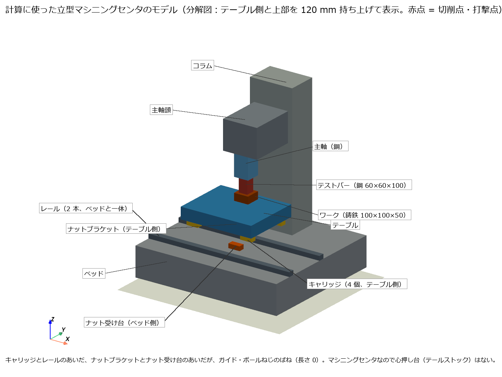

テーブルの下には、リニアガイドのキャリッジ（黄、4 個）とボールねじのナットブラケット（橙）が付いています。それぞれの相手はベッド側のレール（2 本）とナット受け台で、このモデルではレールとナット受け台はベッドと一体のソリッドにしています。キャリッジとレールのあいだ、ナットブラケットとナット受け台のあいだが、ガイドとボールねじのばね（長さ 0）でつながっています。実機のキャリッジは、テーブル下面にボルトで留めたブロックですが、ここではテーブルと一体の小さな直方体で表しています。マシニングセンタはワークをテーブルに固定して削る機械なので、旋盤のような心押し台（テールストック）はありません。

*生成スクリプト: [render_model.py](../analysis/ana005_foundation_accel_chatter/render_model.py)*

キャリッジは、リニアガイドのレールの上を滑るブロックのことです（メーカーによってはブロック、スライダとも呼びます）。レールはベッドの上に、キャリッジはテーブルの裏にボルトで止まっていて、テーブルは 4 個のキャリッジに載って前後に動きます。送り方向にテーブルを押さえているのはボールねじで、ねじ軸を回すとナットが進み、ナットブラケットを通してテーブルを動かします。モデルではねじ軸と軸受を描かず、「ナット受け台」とばね 1 本で代わりに表しています。

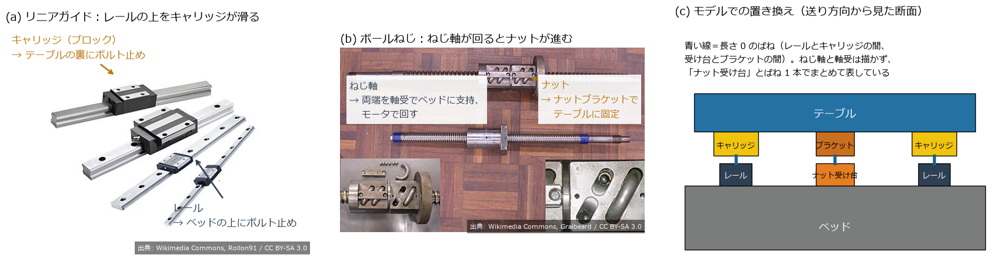

*生成スクリプト: [explain_guide_parts.py](../analysis/ana005_foundation_accel_chatter/explain_guide_parts.py)。写真：[Mono Rail.jpg](https://commons.wikimedia.org/wiki/File:Mono_Rail.jpg)（Rollon91、[CC BY-SA 3.0](https://creativecommons.org/licenses/by-sa/3.0/)）、[BallScrews-with-detail-insets.jpg](https://commons.wikimedia.org/wiki/File:BallScrews-with-detail-insets.jpg)（Graibeard、CC BY-SA 3.0）*

このモデルは、ベッドの上に C 形のコラムが立ち、テーブルが前後に動く小形の立形マシニングセンタを想定しています。大きさはテーブル 500 × 400 mm、ベッド 1,000 × 900 mm で、マザックの製品でいえば VCN-430 クラス（テーブル 900 × 430 mm、主軸 12,000 min⁻¹、#40）の小形立形 MC に近い大きさです。ただし形や寸法を似せただけで、実機の図面や剛性値を使ったモデルではありません。線図は 500〜16,000 min⁻¹ まで計算していますが、12,000 min⁻¹ を超える範囲は高速主軸を付けた場合の参考と考えてください。

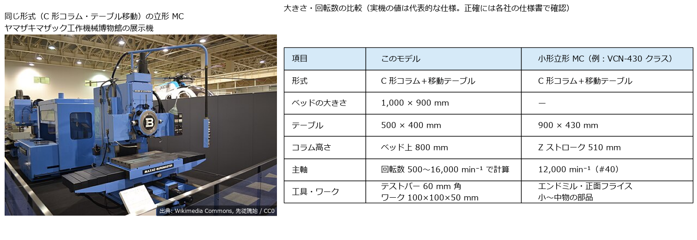

*生成スクリプト: [explain_machine_class.py](../analysis/ana005_foundation_accel_chatter/explain_machine_class.py)。写真：[Vertical MC Econo Center Ⅲ-25 (21032515051).jpg](https://commons.wikimedia.org/wiki/File:Vertical_MC_Econo_Center_%E2%85%A2-25_(21032515051).jpg)（先従隗始、CC0）。VCN-430 の仕様は [Mazak 製品ページ](https://mazak.com/id-en/products/vcn) などによる代表値*

前のベッド・コラム・テーブル・ガイド・ボールねじモデルに、主軸頭、主軸、工具、ワークのソリッド形状を追加した。

| 部品 | 形状・寸法 mm | 材料 |
|---|---|---|
| ベッド・コラム・主軸頭 | ベッド 1000×900×200、コラム 300×200×800、主軸頭 x=380〜620、y=340〜750、z=650〜850 | 鋳鉄相当、E=120 GPa、密度7,300 kg/m³ |
| 主軸 | 100×100断面、z=500〜650 | 鋼相当、E=210 GPa、密度7,800 kg/m³ |
| 工具（テストバー） | 60×60断面、長さ100、z=400〜500 | 鋼相当、E=210 GPa、密度7,800 kg/m³ |
| ワーク | 100×100×50、z=350〜400 | 鋳鉄相当、テーブルと結合 |
| 切削位置 | **(500,400,400)** | 工具下面とワーク上面が接する位置 |

工具は、打撃試験で使う太くて硬いテストバーを想定した角柱です（以前は 20×20 mm の細い超硬工具でしたが、工具の先が振れるモードばかりが目立って機械本体の評価にならないため、置き換えました。細い工具の結果は [results_slender_tool/](../analysis/ana005_foundation_accel_chatter/results_slender_tool/) に残しています）。主軸軸受・工具把持部・ワーク固定部は完全結合とし、各結合部の個別剛性・減衰、主軸回転・ジャイロ効果は含めていない。特定の市販機の精度・加工能力を再現するモデルではない。

メッシュは20節点六面体。部品の体積と材料密度から質量を計算した。[モデル生成コード](../analysis/ana005_foundation_accel_chatter/vmc_model.py)、ParaView用モデル（未収録：スクリプトで再生成）、[部品別情報と節点番号](../analysis/ana005_foundation_accel_chatter/metadata.json)を保存した。

### 2.2 刃先とワーク接触面の結合

テストバー下面の 60×60 mm 領域と、対応するワーク上面の領域を、それぞれ別の代表点にMPCで結ぶ。工具側・ワーク側の代表点は**同じ座標だが別の節点**であり、両者を固定結合していない。

```text
主軸頭 → 主軸 → 工具ソリッド → 工具下面MPC → TOOL（刃先側）
                                                   ↑ 同じ座標、別節点
テーブル → ワークソリッド → ワーク上面MPC → WORK（ワーク側）
```

WORKに＋1 N、TOOLに−1 Nの切削力対を与える。作用位置が同じなので、全機に人工的な合力・合モーメントを加えない。切削による力の作用反作用を表すための入力であり、今回の構造計算そのものが切りくず生成や接触を解くわけではない。

XYZを別々に加振し、各加振に対する両点のXYZ変位を出力する。したがって、相対FRFの同方向3成分とクロス6成分を得る。

### 2.3 比較ケース

ana001〜ana004 の機械モデルは、すべてベッドの底面を床に完全に固定していました。脚をばねで支える「基礎ばねモデル」は ana003 の 8 章で初めて作り、この ana005 ではそれを標準のモデルとして使っています。3 章〜5 章で特に断りがない図や数値は基礎ばねモデルの結果で、底面固定とテーブル結合 10 倍は比べるための別ケースです。

基礎ばねモデルでは、ベッド底面の 4 か所（100 × 100 mm の面）をそれぞれ拘束式で脚の代表点にまとめ、その代表点と地面のあいだを X・Y・Z の並進ばねと回転ばねでつないでいます。テーブルとベッドのあいだのガイド 4 個とボールねじナットは、これまでと同じく代表点どうしのばねでつないでいます。下の図は、ばねが見えるようにテーブルを持ち上げ、地面を下げて描いた分解図です（実際はどのばねも長さ 0 です）。

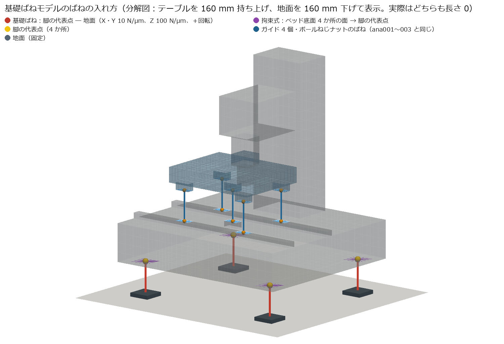

*生成スクリプト: [render_springs.py](../analysis/ana005_foundation_accel_chatter/render_springs.py)。ParaView では foundation_springs.vtm（未収録：スクリプトで再生成） を開くと、ベッド・テーブル・拘束式の線・ばねを別々に表示・非表示できます。入力ファイルの書き方は [ana003 の 8 章](ana003_CalculiX-FrontISTR_代表点MPCばねの比較.md#8-追加基礎部もmpcばねで支持するモデル) と [ばね接続モデルの手順](ana003_ばね接続モデルを自分で作る手順.md) を参照。*


| ケース | 基礎支持 | テーブル―ベッドの結合 |
|---|---|---|
| 底面固定 | ベッド底面を固定 | 元のガイド・ナット剛性 |
| 基礎ばね | 4面のMPC＋基礎ばね | 元のガイド・ナット剛性 |
| テーブル結合10倍 | 同じ基礎ばね | ガイド・ナットの並進・回転剛性を10倍 |

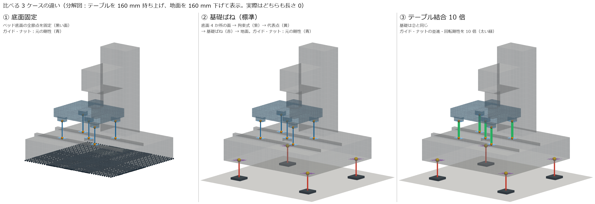

*生成スクリプト: [render_cases.py](../analysis/ana005_foundation_accel_chatter/render_cases.py)*

第3ケースはテーブル結合の感度を切り分けるための比較で、10倍の実部品を提案・実証したものではない。質量と形状は全ケースで同じ。

基礎1か所当たりkx=ky=10,000 N/mm、kz=100,000 N/mm。回転剛性・面の選択は[ana003の基礎モデル](ana003_CalculiX-FrontISTR_代表点MPCばねの比較.md#8-追加基礎部もmpcばねで支持するモデル)と同じ。これらは説明用の仮定値。

ばねの値の出どころは次のとおりです。リニアガイドの上下 800 N/µm・横 560 N/µm（キャリッジ 1 個あたり）は、NSK ローラガイド RA35〜45 のカタログの理論剛性（1,500〜2,000 N/µm）を、取付ボルトやベッドの局部変形が直列に入るとして半分程度に見積もった値です（[study/ref004 の 2.3 節](../study/ref004_工作機械_ばね剛性と減衰の決め方.md)）。ボールねじの送り方向 200 N/µm は、送り系全体の一般的な範囲（100〜500 N/µm）の中間です。基礎ばね（X・Y 10 N/µm、Z 100 N/µm）は説明用の仮定値です。マザックを含む工作機械メーカーは、機種ごとのガイドやボールねじの実効剛性を公開していないので、特定の機種に合わせた値ではありません。実機に合わせるには、打撃試験で測った FRF のピーク周波数と高さに合うように、これらのばねを調整します。

## 3. 刃先―ワーク相対FRF

### 3.1 入力と出力の定義

ワーク側変位を$U_w$、刃先側を$U_t$とする。方向jの切削力をWORKに＋F、TOOLに−Fで加えたとき、観測方向iの相対コンプライアンスは

$$G_{ij}(\omega)=\frac{U_{w,i}(\omega)-U_{t,i}(\omega)}{F_j(\omega)}$$

である。**添字は先が観測変位方向、後が加振方向**。Gxyなら、切削点をY方向に加振したときの刃先―ワーク相対X変位。単位はmm/N、図ではµm/N。

自己・相互FRFで表すと

$$G=H_{ww}+H_{tt}-H_{wt}-H_{tw}$$

となる。差を取るのは複素変位であり、$|U_w|-|U_t|$ではない。両点の位相差も必要である。

### 3.2 解析条件と入力ファイル

CalculiX 2.21、80モード、5〜3,000 Hzのモード重ね合わせ応答を計算した。Rayleigh係数は前のモデルと共通で、α=30.1592894745 s⁻¹、β=8.4882636316×10⁻⁶ s。減衰は実測していない。150 Hzと600 Hzで減衰比2%となり、それ以外では一定ではない。

実入力：[底面固定](../analysis/ana005_foundation_accel_chatter/fixed/relative.inp)、[基礎ばね](../analysis/ana005_foundation_accel_chatter/foundation/relative.inp)、[テーブル結合10倍](../analysis/ana005_foundation_accel_chatter/foundation_table_stiff/relative.inp)。

```text
*CLOAD, OP=NEW
WORK, 1, 1.0
TOOL, 1, -1.0
*NODE PRINT, NSET=WORK
U
*NODE PRINT, NSET=TOOL
U
```

上はX方向の切削力対。方向番号を2・3に変えた計算も行う。別のステップでは、ナットのテーブル側＋F・ベッド側−FというX方向駆動力対を加え、同じ相対変位を観測する。

### 3.3 FRFの比較

相対コンプライアンスだけを見ると、どちら側が揺れているのかが分かりません。そこで、刃先（テストバーの先）だけを叩いて刃先で測ったとき、ワークだけを叩いてワークで測ったとき、刃先とワークの相対の 3 つを、3 つの支持条件ごとに並べました。点線が片側だけのコンプライアンス、太い実線が相対です。

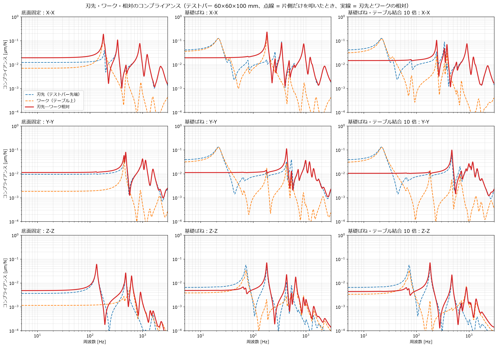

*生成スクリプト: [frf_tool_work_rel.py](../analysis/ana005_foundation_accel_chatter/frf_tool_work_rel.py)*

基礎ばねのモデルでは、刃先とワークの両方に 22 Hz の大きな山があります。これは機械全体が脚の上で揺れるモードで、刃先とワークが一緒に動くので、相対の実線には現れません。相対でいちばん高い山は X-X の 182 Hz（0.23 µm/N）で、ここではワーク側（オレンジ）が大きく動いています。テーブルがボールねじのばねで送り方向に揺れるモードです。Y-Y の 431 Hz もワーク側の山で、テーブルがガイドの横ばねで揺れるモードです。一方、X-X の 345 Hz や 910 Hz の山では刃先側（青）だけが動いていて、主軸頭・主軸とテストバーの曲げのモードです。

テーブル結合を 10 倍にすると、ワーク側の 182 Hz の山がなくなり（ワークの X-X の最大は 0.029 µm/N に下がる）、相対の最大も 0.23 から 0.11 µm/N に下がります。底面固定と基礎ばねでは、100 Hz 以上の山の位置と高さはほとんど同じです。

基礎ばねモデルの 9 成分（XYZ の各方向に叩いて、各方向の揺れを測る）も同じ形で描きました。

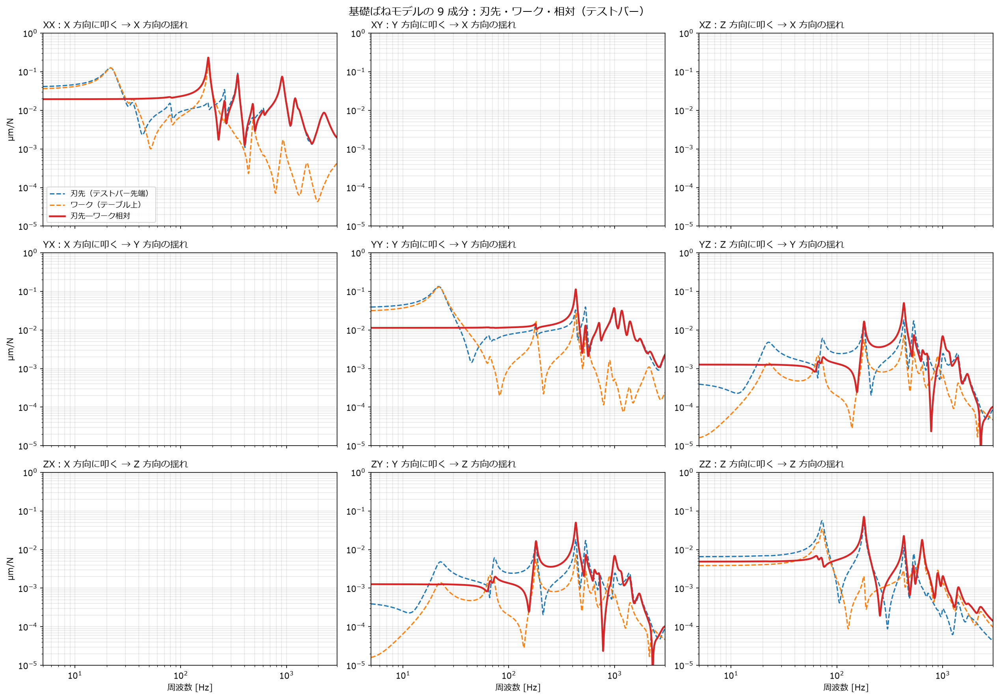

対角の X-X・Y-Y・Z-Z に比べ、クロス成分（XY など）は 1〜2 桁小さく、テストバーの中心で叩く限り方向どうしの連成は小さいことが分かります。

### 3.4 切削力対に対する全体振動

相対 X-X の山のうち、ワーク側が主役の山（100〜600 Hz）と刃先側が主役の山（800〜3,000 Hz）を 1 つずつ選び、その周波数で切削力対を加えたときの機械全体の揺れをアニメーションにしました。下段は相対 XYZ のコンプライアンスで、縦線と丸印が上段の周波数です。

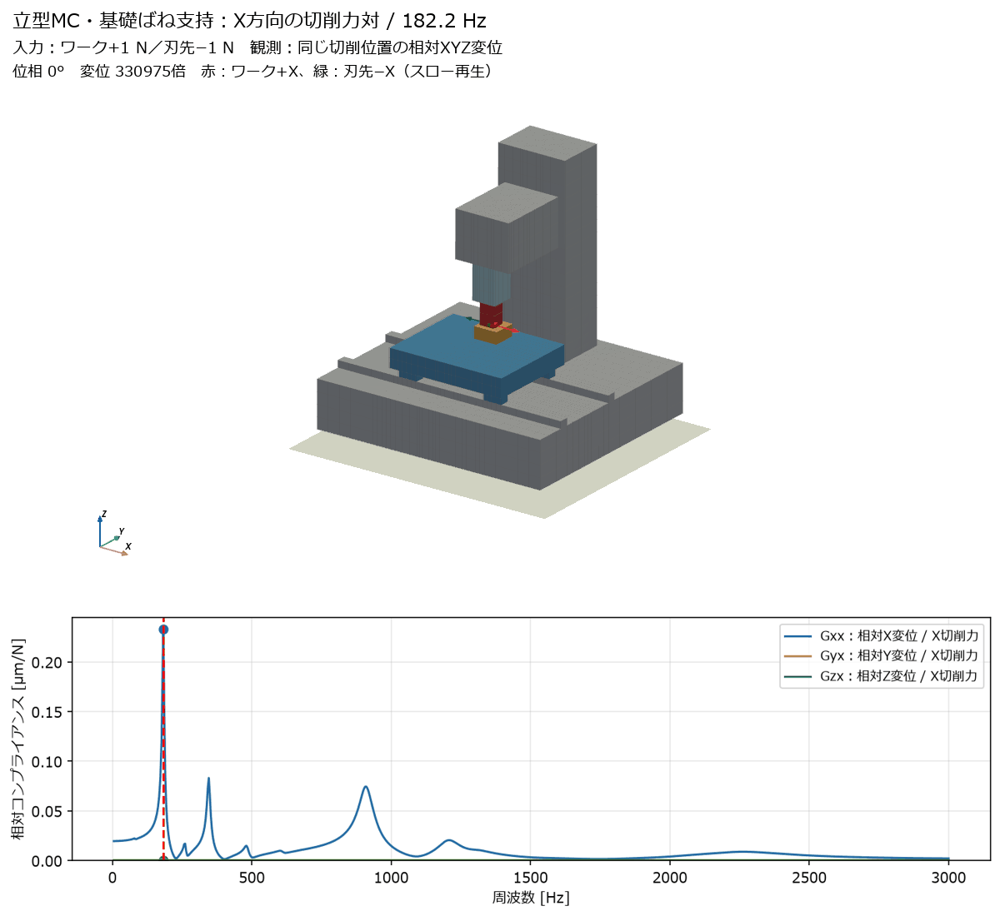

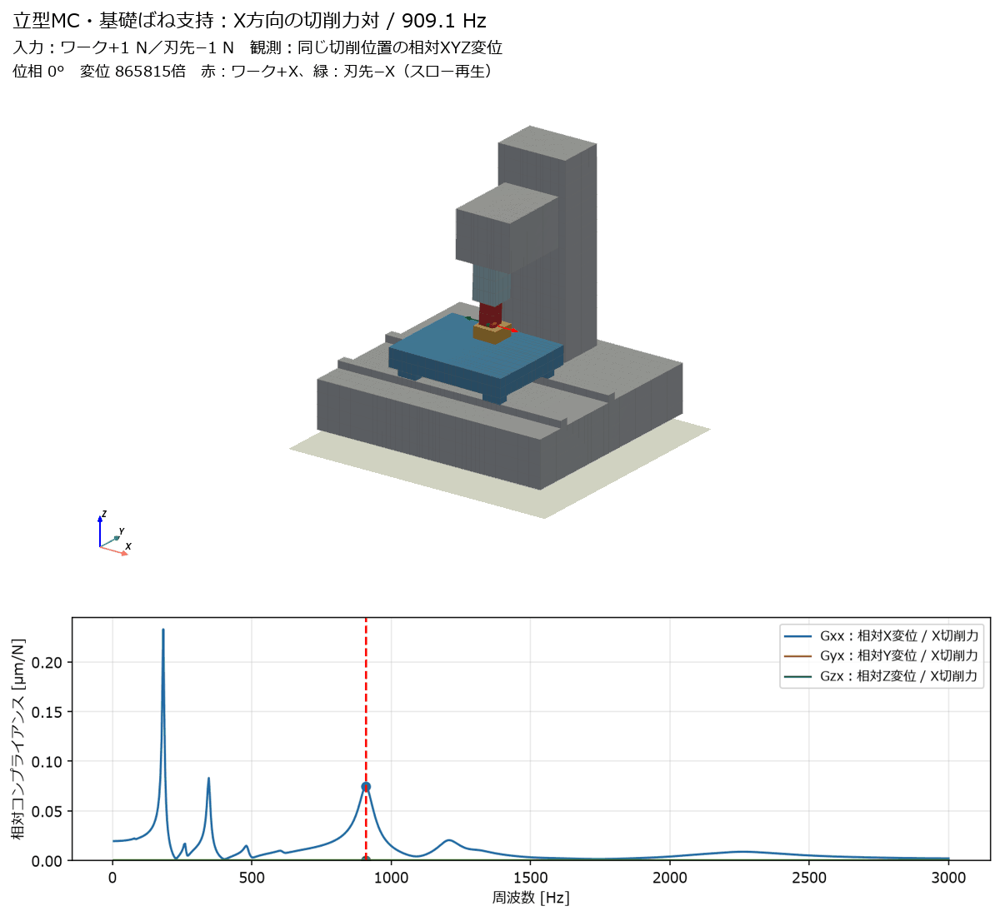

| 応答周波数 Hz | ワーク側 X 振幅 µm/N | 刃先側 X 振幅 µm/N | 相対 X 振幅 µm/N |
|---:|---:|---:|---:|
| 182.2 | 0.1941 | 0.0404 | 0.2328 |
| 909.1 | 0.0016 | 0.0736 | 0.0744 |

182 Hz ではテーブルが送り方向に大きく揺れ、ワーク側の動きが刃先側の約 5 倍です。909 Hz では主軸とテストバーが一緒に曲がり、ほとんど刃先側だけが動いています。相対の振幅は、両側の振幅を足し引きしたものではなく、位相を含めた複素数の差で求めています。

### 3.5 どのコンプライアンスが、どのモードから来ているか

刃先―ワーク相対 FRF を、基礎ばねモデルの 80 個の固有モード（質量正規化）の足し算に分解しました。

$$
G_{ij}(\omega) = \sum_r \frac{d_{r,i}\, d_{r,j}}{\omega_r^2 - \omega^2 + 2i\zeta_r\omega_r\omega},\qquad
\boldsymbol{d}_r = \boldsymbol{\phi}_r(\text{ワーク}) - \boldsymbol{\phi}_r(\text{刃先})
$$

$\boldsymbol{d}_r$ は、そのモードで刃先とワークがどれだけ食い違って動くかを表します。刃先とワークが一緒に動くモードは、どれだけ大きく揺れても相対コンプライアンスには出てきません。

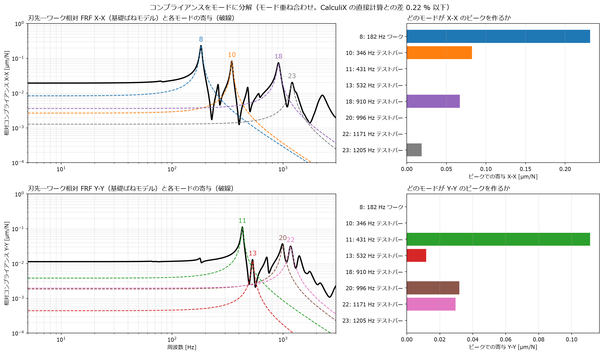

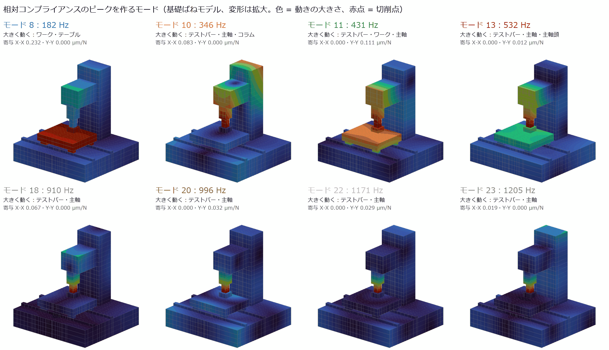

*色は動きの大きさ、赤点は切削点。生成スクリプト: [compliance_modes.py](../analysis/ana005_foundation_accel_chatter/compliance_modes.py)、[anim_compliance_modes.py](../analysis/ana005_foundation_accel_chatter/anim_compliance_modes.py)*

| モード番号 | 固有振動数 Hz | 大きく動く部品（最大の動きの 50 % 以上） | 運動エネルギーの多い部品 | X-X 寄与 µm/N | Y-Y 寄与 µm/N | ワーク側の動き | 刃先側の動き |
|---|---:|---|---|---:|---:|---:|---:|
| 8 | 182.4 | ワーク・テーブル | テーブル 83%、ベッド 7% | 0.2317 | 0.0000 | 2.78 | 0.532 |
| 10 | 345.6 | テストバー・主軸・コラム | コラム 41%、主軸頭 26% | 0.0825 | 0.0000 | 0.166 | 3.71 |
| 11 | 430.6 | テストバー・ワーク・主軸 | テーブル 55%、主軸頭 19% | 0.0000 | 0.1113 | 2.62 | 2.65 |
| 13 | 532.4 | テストバー・主軸・主軸頭 | テーブル 27%、ベッド 27% | 0.0000 | 0.0118 | 1.74 | 3.97 |
| 18 | 910.3 | テストバー・主軸 | テストバー 35%、主軸頭 20% | 0.0670 | 0.0000 | 0.331 | 11.2 |
| 20 | 996.4 | テストバー・主軸 | ベッド 45%、テストバー 18% | 0.0000 | 0.0319 | 0.771 | 7.75 |
| 22 | 1171.1 | テストバー・主軸 | ベッド 31%、テストバー 30% | 0.0000 | 0.0295 | 0.224 | 10.5 |
| 23 | 1204.7 | テストバー・主軸 | コラム 40%、ベッド 27% | 0.0187 | 0.0000 | 0.141 | 8.7 |

モード番号は、固有振動数の低い順に全体で数えた番号です（22 Hz の脚のモードがモード 1・2）。モード 8（182 Hz）とモード 11（431 Hz）はテーブルが動くモードで、ワーク側の動きが大きく、ボールねじとガイドのばねで決まっています。モード 10（346 Hz）は主軸頭とコラムが前後に曲がるモード、モード 18（910 Hz）以降は主軸とテストバーが一緒に曲がるモードで、こちらは刃先側だけが動きます。相対コンプライアンスの山は、低い周波数ではテーブル側、高い周波数では主軸側から来ていて、下げたい山によって直す場所が変わります。この分解は 5 章で、どのモードがびびりの限界を決めるかを調べるときにそのまま使います。

支持条件を変えたときの比較（CalculiX の直接計算）です。

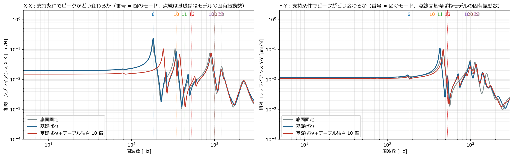

テーブル結合を 10 倍にすると、テーブル側の山（182 Hz・431 Hz）だけが高い周波数へ移って低くなり、主軸側の山は変わりません。基礎（脚）の条件を変えても、100 Hz 以上の相対の山はほとんど変わりません。

### 3.6 静解析との照合

同じ形状・材料・MPCに静的な切削力対1 Nを加え、静コンプライアンスを別途求めた。低周波FRFがこの値を再現するかを点検する。

80 モードで計算しています。**構造モデルが解けたことと、モード打切りが十分であることは別**である。

| ケース | 方向 | 静解析 µm/N | 5 Hz FRF実部 µm/N | 比較差 % |
|---|---|---:|---:|---:|
| 底面固定 | X | 0.019841 | 0.019434 | 2.05 |
| 底面固定 | Y | 0.011746 | 0.011391 | 3.03 |
| 底面固定 | Z | 0.005001 | 0.004831 | 3.39 |
| 基礎ばね | X | 0.020257 | 0.019417 | 4.15 |
| 基礎ばね | Y | 0.012172 | 0.011328 | 6.93 |
| 基礎ばね | Z | 0.005172 | 0.004872 | 5.78 |
| テーブル結合10倍 | X | 0.015403 | 0.014854 | 3.57 |
| テーブル結合10倍 | Y | 0.011372 | 0.010525 | 7.45 |
| テーブル結合10倍 | Z | 0.004695 | 0.004397 | 6.35 |

XYの比較差は約2〜7%、Zは約3〜7%です。今回のフライス安定限界はXY行列に限定する。5 Hzと静解析の違いも含む比較なので、この表だけで厳密なモード数収束を証明したとは扱わない。FEMメッシュ・モード数・周波数点の収束確認は今後の検証項目。

## 4. 加減速反力による基礎振動

### 4.1 質量・剛性・減衰と運動方程式

FEM形状の全質量Mとテーブル側質量mt、4支持の横剛性合計kを用い、本体の並進1自由度を計算する。

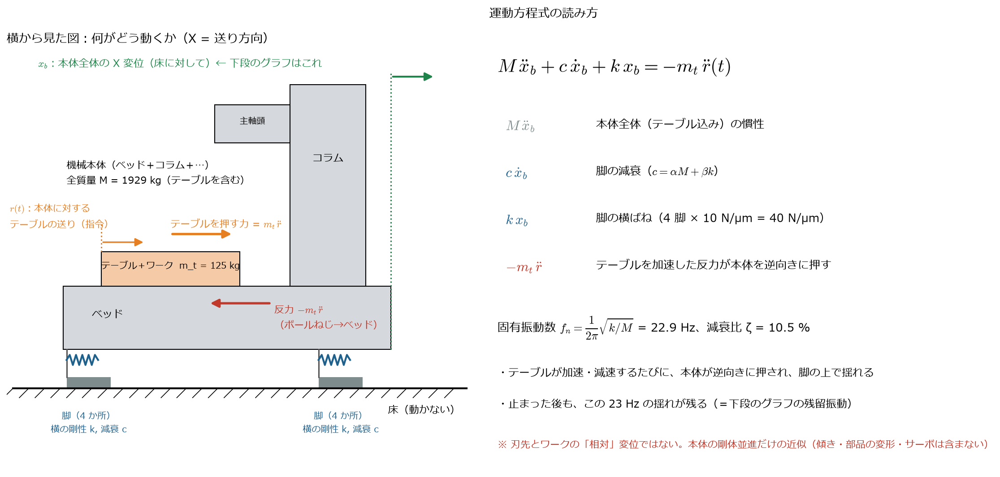

*生成スクリプト: [explain_accel_model.py](../analysis/ana005_foundation_accel_chatter/explain_accel_model.py)*

図の左側は床に固定された脚の上に機械本体が載る様子です。青いばねと減衰器が床と本体をつなぎ、緑の矢印 $x_b$ が本体の床に対する動きを表します。テーブルが右（$+X$）へ加速すると、テーブルを押す力は右向き、本体に戻る反力は左向きです。加速を止めた後も、脚のばねに蓄えた力で本体が揺れます。

解析ではベッド・コラム・主軸頭・テーブルを機械本体としてまとめ、床の上をX方向に動く剛体とみなします。4本の脚の横ばねと減衰が本体を支えます。図の右側の式は、この本体の運動と、送りテーブルから伝わる反力のつり合いです。

$$M\ddot x_b+c\dot x_b+kx_b=-m_t\ddot r(t),\qquad c=\alpha M+\beta k$$

| 式の項 | 図との対応 | 今回の値 |
|---|---|---:|
| $M\ddot{x}_b$ | 本体全体の質量が加速度に抵抗する慣性 | $M=1928.65$ kg |
| $c\dot{x}_b$ | 脚・支持部の減衰が速度に応じて揺れを弱める | $c=58{,}506.1$ N·s/m |
| $kx_b$ | 4本の脚の横ばねが本体を元へ戻す | $k=40.0$ MN/m |
| $-m_t\ddot{r}(t)$ | テーブル＋ワークの加速でベッドに伝わる反力 | $m_t=125.122$ kg |

例えばテーブルを $+X$ に $2$ m/s² で加速すると、ベッドにかかる反力は $-125.122\times2\approx-250$ N です。ばねだけで静的につり合うと仮定した変位は $250/(40.0\times10^6)\approx6.25$ µm です。過渡応答では慣性と減衰も働くため、加速度が変わった後に振動が残ります。

$r(t)$は本体に対するテーブルの送り位置、$x_b$は床に対する本体変位です。テーブルが指令どおりに動くと仮定します。したがって、これは刃先とワークの相対変位ではなく、本体の傾き・部品の弾性変形・サーボ追従誤差も含みません。

この値では、近似並進固有振動数は 22.92 Hz、減衰比は 10.53 % です。

これは全FEMの厳密な縮約ではなく、基礎支持に起因する本体並進の近似。ピッチ・ロール、部品の弾性、摩擦、サーボ追従誤差は含まない。また、この本体変位をそのまま刃先―ワーク誤差として扱わない。

### 4.2 加速度・ジャークと停止後の本体振動

移動距離50 mm、最高速度0.2 m/s、始端・終端速度0を共通にし、最大加速度1／2／4 m/s²と、ジャーク立上げ0／20／40 msを比較した。0 msは加速度段差で、有限のジャーク上限を持たない比較波形。

ジャークは加速度の変化の速さで、加速度を時間で微分したもの（単位 m/s³）です。位置を微分すると速度、速度を微分すると加速度、加速度を微分するとジャークになります。車でいえばアクセルやブレーキをどれだけ急に踏み込むかに当たり、急に踏むと体がガクンと揺れるのと同じように、機械も加速度を急に変えると揺れます。

$$
j = \frac{d a}{d t},\qquad \text{ジャーク立上げ 40 ms のとき } j = \frac{2\ \mathrm{m/s^2}}{0.04\ \mathrm{s}} = 50\ \mathrm{m/s^3}
$$

「ジャーク立上げ 40 ms」は、加速度を 0 から 2 m/s²（または 2 から 0）まで変えるのに 40 ms かけるという意味です。1 回の移動の中に、加速の始め・終わり、減速の始め・終わりの 4 か所あります（下の図の緑の帯）。0 ms は加速度を一瞬で切り替える「段差」で、ジャークは無限大です。

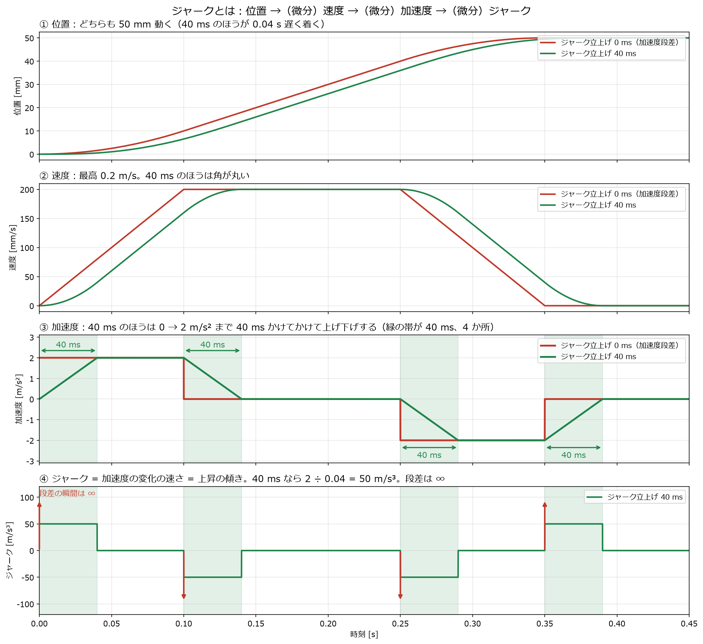

*生成スクリプト: [explain_jerk.py](../analysis/ana005_foundation_accel_chatter/explain_jerk.py)*

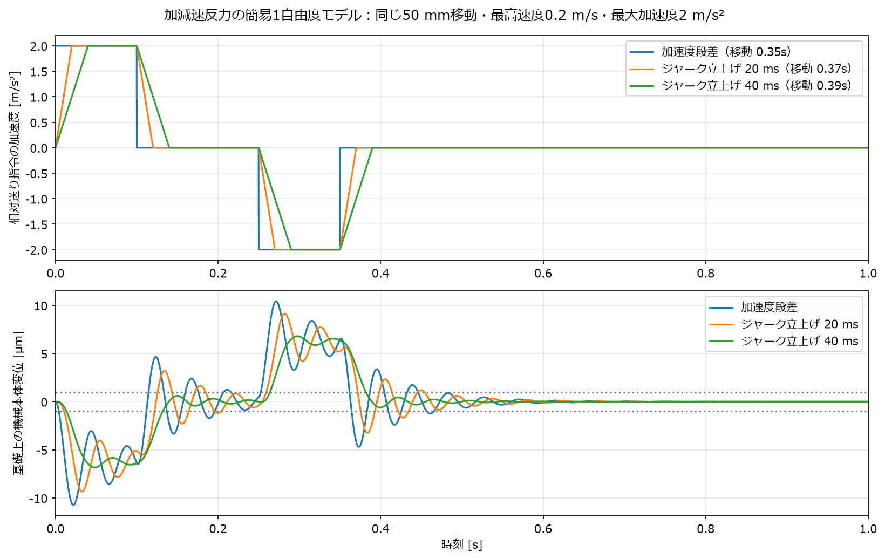

*上段：テーブルの送り指令の加速度 $\ddot r(t)$。下段：そのときの**機械本体全体の床に対する X 変位 $x_b$**（4.1 節の図の緑の矢印）。点線は ±1 µm。
加速・減速の切り替わりで本体が押され、止まった後も約 23 Hz・減衰比 10 % で揺れが残る。ジャーク（加速度の立ち上がり）をなだらかにすると、残る揺れが小さくなる。*

| 最大加速度 m/s² | ジャーク立上げ ms | 移動 s | 停止後の本体変位最大 µm | 本体変位±1 µm整定 s | 移動＋本体整定 s |
|---:|---:|---:|---:|---:|---:|
| 1 | 0 | 0.450 | 3.304 | 0.070 | 0.520 |
| 1 | 20 | 0.470 | 1.635 | 0.038 | 0.508 |
| 1 | 40 | 0.490 | 0.308 | 0.000 | 0.490 |
| 2 | 0 | 0.350 | 6.566 | 0.115 | 0.465 |
| 2 | 20 | 0.370 | 3.247 | 0.084 | 0.454 |
| 2 | 40 | 0.390 | 0.612 | 0.000 | 0.390 |
| 4 | 0 | 0.300 | 9.465 | 0.140 | 0.440 |
| 4 | 20 | 0.320 | 4.679 | 0.108 | 0.428 |
| 4 | 40 | 0.340 | 0.882 | 0.000 | 0.340 |

最大加速度2 m/s²の例では、ジャーク立上げ0→40 msで指令移動時間は0.350→0.390 sとなる一方、停止後の本体変位最大は6.566→0.612 µmとなり、±1 µm基準の移動＋本体整定は0.465→0.390 sとなった。この基礎モデル・指令条件での比較値である。

整定は、指令終了後に本体変位が±1 µm以内に入り、その後外れない時刻までの待ち時間。終了後1.2 sまで評価した。0 sは「停止後の最大振幅が既に許容帯内」の意味。

表の「移動＋本体整定」は基礎振動を基準とした比較指標で、実機の加工開始可能時刻ではない。移動時間だけでなく停止後の待ち時間も含めると、加速度・ジャークの評価が変わる。

### 4.3 なぜ加速度の上昇時間を周期と同じにすると揺れが消えるのか

下の図は、4.1 節で使った「脚の上に載った機械本体」のモデルで、テーブルが加速し始める瞬間に機械本体がどう動くかを描いたものです。加速度を 0 から 2 m/s² に上げる 1 回の操作だけを取り出し、そのとき本体が床に対して X 方向にどれだけずれるか（$x_b$）を時間ごとに追っています。

縦軸の「1」は、加速度 2 m/s² がずっと続いたときに本体が落ち着く位置です。テーブルを押す反力 $m_t A$ で脚のばねが縮み、本体は $m_t A / k$ だけずれたところで止まります。この量を 1 として、揺れがその位置のまわりでどれだけ残るかを比べます。話を分かりやすくするため、減衰は 0 にしています。

図は 4 段に分かれていて、上から順に「入力 → 1 つずつの揺れ → 合計 → まとめ」になっています。

②に何本も揺れが描いてあるのは、実際に揺れが何本もあるからではありません。本体の動きは 1 つだけで、それが③の太線です。②は、③がなぜその形になるのかを見るための「分解図」です。

加速度を 20 ms や 44 ms かけて上げる指令は、①の灰色の階段のように、小さな段差（ここでは 8 個）を少しずつ時間をずらして積み上げたものとみなせます。脚の上の本体はばねと質量だけでできた線形な系なので、入力を分けて考えても、それぞれへの応答を足せば元の応答に戻ります（重ね合わせ）。そこで、8 個の小さな段差がそれぞれ単独で本体をどう揺らすかを描いたのが②です。どの段差も同じ 22.9 Hz で、大きさは 1/8 の揺れを起こしますが、段差が入る時刻がずれているので、揺れの始まりも少しずつずれます。

この 8 本を足すと③になります。8 本の始まりが 1 周期（44 ms）の中に均等に散らばっていると、ある揺れが山のときに別の揺れが谷になって打ち消し合い、合計は揺れずに止まります。ブランコを 8 人が 1 周期の間に順番に押すと、押す力が打ち消し合ってブランコがほとんど揺れないのと同じです。逆に 20 ms のように短い時間に押す時刻が固まっていると、8 本の山がほぼそろって重なり、揺れが残ります。

| 段 | 波形 | 意味 |
|---|---|---|
| ① | 加速度指令 | 段差（0 ms）・上昇時間 20 ms・上昇時間 44 ms の 3 通り。加速度の上昇は 8 個の小さな段差（丸）で近似して考える |
| ② | 小さな段差 1 つずつが起こす本体の揺れ | 段差 1 つは本体を 22.9 Hz で揺らす。加速度をゆっくり上げると 8 本の揺れが**少しずつ遅れて**始まる（色は①の丸と対応） |
| ③ | ②を全部足したもの ＝ 実際の本体の変位 $x_b$ | 1 で止まれば揺れは残らない。1 のまわりで振れ続ければ揺れが残る |
| ④ | ③の残る揺れの大きさを、加速度の上昇時間ごとに描いたもの | 固有振動数ごとの曲線。0 になる点が「揺れが消える上昇時間」 |

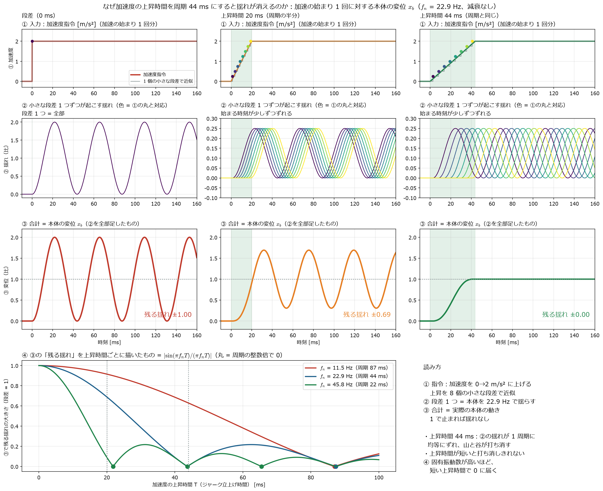

*生成スクリプト: [explain_jerk_cancel.py](../analysis/ana005_foundation_accel_chatter/explain_jerk_cancel.py)*

ここでいう**加速度の上昇時間**は、加速度のグラフ（4.2 節の図③）で加速度が 0 から 2 m/s² まで斜めに上がっていくのにかける時間のことで、ジャーク立上げ時間と同じものです。

加速度をゆっくり上げることは、小さな段差を少しずつずらしてたくさん並べることと同じだと考えられます。段差の 1 つ 1 つは本体を固有振動数（22.9 Hz、周期 44 ms）で揺らします（②）。上昇時間がちょうど 1 周期だと、小さな揺れの始まる時刻が 1 周期の中に均等に散らばるので、ある揺れの山に別の揺れの谷が重なって打ち消し合い、合計（③）は 1 の位置でぴたりと止まります（右列）。上昇時間が 20 ms と短いと打ち消しきれずに 7 割の揺れが残り（中央列）、段差（0 ms）では揺れがそのまま全部残ります（左列）。

1 回の加速度の切り替えで残る揺れ（段差を 1 とした比）は

$$
\text{残る揺れ} = \left| \frac{\sin(\pi f_n T)}{\pi f_n T} \right|
$$

$T$ が周期 $1/f_n$ の整数倍で 0 になる（④）。

加速度の上昇時間を短くする（ジャークを大きくする）と、段差に近づくので残る揺れは大きくなります。ただし固有振動数が高い機械なら周期が短いので、短い上昇時間でも揺れを 0 にできます（45.8 Hz なら 22 ms）。つまり固有振動数を上げると、揺れの少なさを保ったままジャークを大きくでき、移動時間が縮みます。

| 用語の向き | 意味 |
|---|---|
| ジャークが**大きい** | 加速度の上昇時間が**短い**（急に加速度を変える）。速いが揺れやすい |
| ジャークが**小さい** | 加速度の上昇時間が**長い**（ゆっくり加速度を変える）。揺れにくいが移動が遅くなる |

### 4.4 固有振動数を上げたい理由は、ここに現れるか

**現れる。** 4.1 と同じモデルで、脚の横剛性 $k$ だけを変えて固有振動数を半分（11.5 Hz）・今（22.9 Hz）・2 倍（45.8 Hz）にし、同じ 50 mm 移動（最大加速度 2 m/s²）で比べた。

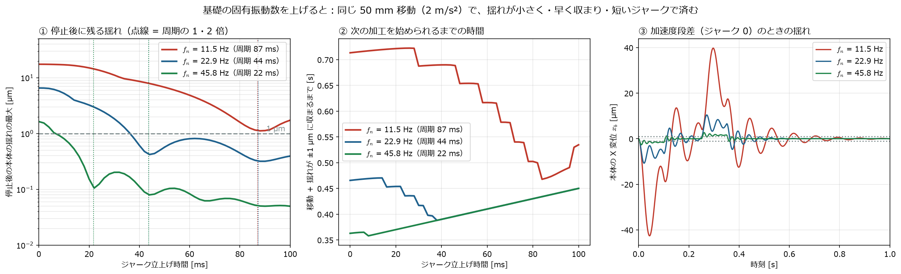

*生成スクリプト: [fn_effect.py](../analysis/ana005_foundation_accel_chatter/fn_effect.py)（減衰比 10.5 % で固定。22.9 Hz の値は 4.2 節の表と一致）*

**アニメーションで見る**（本体の揺れ µm は大きく拡大、テーブルの送りは縮小して表示）

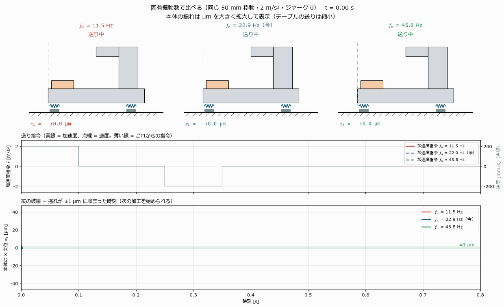

↑同じ加減速で 3 台を動かす。固有振動数が低い（左）ほど本体が大きく揺れ、止まった後も長く揺れ続ける。下のグラフの破線は ±1 µm に収まった時刻。

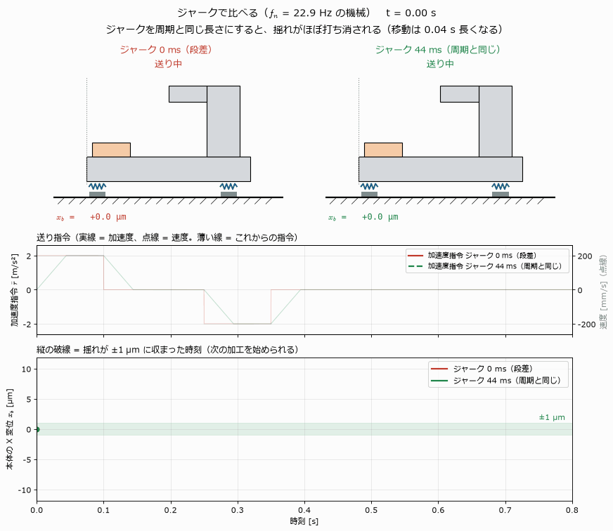

↑今の機械（22.9 Hz）で、ジャークを周期と同じ 44 ms にすると、揺れがほぼ打ち消される。移動は 0.04 s 長くなるが、待ち時間がなくなるので合計では早い。

*生成スクリプト: [fn_effect_anim.py](../analysis/ana005_foundation_accel_chatter/fn_effect_anim.py)*

| 固有振動数 | 加速度段差（ジャーク 0）の残留揺れ | そのときの移動＋整定 | 移動＋整定が最短になるジャーク | そのときの移動＋整定 |
|---|---:|---:|---:|---:|
| 11.5 Hz | 17.5 µm | 0.713 s | 84 ms | 0.468 s |
| **22.9 Hz（今）** | **6.6 µm** | **0.466 s** | **38 ms** | **0.388 s** |
| 45.8 Hz | 1.6 µm | 0.363 s | 8 ms | 0.358 s |

固有振動数を上げたい理由が、3 つの形で現れる。

1. **揺れが小さい**：同じ反力 $m_t A$ でも、たわみは $m_t A / k$ で、$k \propto f_n^2$ なので**固有振動数 2 倍で揺れは約 1/4**（6.6 → 1.6 µm）
2. **早く収まる**：揺れが減る速さは $e^{-\zeta \omega_n t}$。**固有振動数 2 倍で収まる時間は約半分**以下（0.116 s → 0.013 s）
3. **短いジャークで済む**：ジャーク立上げを**固有振動数の周期と同じ長さ**にすると揺れがほぼ打ち消される（①の点線の位置で谷になる）。周期が短い（固有振動数が高い）ほど短いジャークで済み、**移動時間を延ばさなくてよい**（今は 38 ms 必要 → 2 倍なら 8 ms）

つまり「固有振動数を上げたい」は、**同じ精度（±1 µm）を守りながら、より速く動かして次の加工を早く始めたい**ということ。サーボのゲインを上げられる理由（[study/ref003](../study/ref003_工作機械_固有振動数とサーボゲイン.md)）と同じ考え方で、ここでは基礎（脚）のモードについて現れている。

**固有振動数が低い機械は何がダメか（因果の順に）**

| 段階 | 起きること | 11.5 Hz | 22.9 Hz | 45.8 Hz |
|---|---|---:|---:|---:|
| ① 力 | テーブルを加速すると反力 $F = m_t A$ = 125 kg × 2 m/s² = 250 N が本体を押す（3 台とも同じ） | 250 N | 250 N | 250 N |
| ② 硬さ | 固有振動数が低い ＝ 脚が柔らかい。$k = M(2\pi f_n)^2$ | 10 N/µm | 40 N/µm | 160 N/µm |
| ③ 揺れの大きさ | 押されたときのずれ $\approx F/k$。急に押すと最大その 2 倍 | 25 µm | 6 µm | 1.6 µm |
| ④ 収まる速さ | 揺れは $e^{-\zeta \omega_n t}$ で減る。$f_n$ が低いと 1 秒あたりの揺れの回数が少なく、減るのが遅い | 0.36 s | 0.12 s | 0.01 s |
| ⑤ 待ち時間 | ±1 µm に収まるまで次の加工を始められない（停止後の待ち） | 長い | 中 | ほぼ 0 |
| ⑥ 対策の代償 | 待たないためには加速度を下げる・加速度の上昇時間を長く（周期以上に）するしかない → 移動そのものが遅くなる | 上昇時間 87 ms 必要 | 44 ms | 22 ms |
| ⑦ 結果 | 位置決めのたびに ⑤か⑥の時間を失う。穴あけ 100 か所なら 100 回分 | 約 +30 秒 | 約 +10 秒 | ほぼ 0 |

つまり **低い固有振動数 → 柔らかい → 大きく揺れる × ゆっくりしか収まらない → 待つか、ゆっくり動かすしかない → サイクルタイムが延びる**。

注意（このモデルの範囲）：ここでの $x_b$ は**機械全体が床に対して一緒に動く量**で、刃先とワークは一緒に動くので、それ自体は加工誤差にはならない（3.5 節：基礎のモードは相対 FRF にほとんど出ない）。実機で問題になるのは、①本体の揺れが傾き（ピッチング）や部品の変形と連成して刃先―ワークの相対誤差になる、②揺れがサーボの外乱として入り、位置決めの整定を遅らせる・ゲインを上げられなくする（[study/ref003](../study/ref003_工作機械_固有振動数とサーボゲイン.md)）、③床を通じて隣の機械や測定器・ロボットを揺らす、の 3 つ。±1 µm はその目安として使っている。

※ ここでは脚の剛性で固有振動数を変えた。テーブルを軽くする（$m_t$ を減らす）と反力そのものが小さくなり、同じように揺れが減る（トポロジー最適化で可動部を軽くする価値。[study/ref008](../study/ref008_工作機械_トポロジー最適化の社内導入と多目的最適化.md)）。

### 4.5 本当に固有振動数は変わるか：全体 FEM で確かめる

4.4 は 1 自由度モデル（$f_n=\sqrt{k/M}/2\pi$ なので、$k$ を 4 倍にすれば必ず 2 倍）。そこで**全体 FEM（CalculiX）**で、4 本の脚の横剛性（X・Y）だけを 1/4・1・4 倍にして、固有値とコンプライアンスを計算した。脚の上下の剛性は変えていない。

| ケース | 1 次 Hz | 2 次 Hz | 3 次 Hz | 1 次の比（今 = 1） | 1 自由度モデルの f_n |
|---|---:|---:|---:|---:|---:|
| 脚の横剛性 1/4（2.5 N/µm/脚） | 11.3 | 11.4 | 17.4 | 0.51 | 11.5 |
| 今（10 N/µm/脚） | 22.2 | 22.2 | 34.7 | 1.00 | 22.9 |
| 4 倍（40 N/µm/脚） | 39.3 | 40.9 | 68.7 | 1.77 | 45.8 |

- **1/4 倍と今は、1 自由度モデルとよく一致**（11.3 vs 11.5 Hz、22.2 vs 22.9 Hz）
- **4 倍は 39.3 Hz で、1 自由度モデルの 45.8 Hz に届かない**。モード形状（下図）を見ると、横に平行移動するのではなく、**コラムが前後に傾く揺れ（ロッキング）**が混ざってくる。横を硬くすると、今度は脚の**上下の剛性**（傾きを止める硬さ）が効いてくるため
- → 「固有振動数を上げる」には、効いているモードの形を見て、**どのばねが支配しているか**を確かめる必要がある

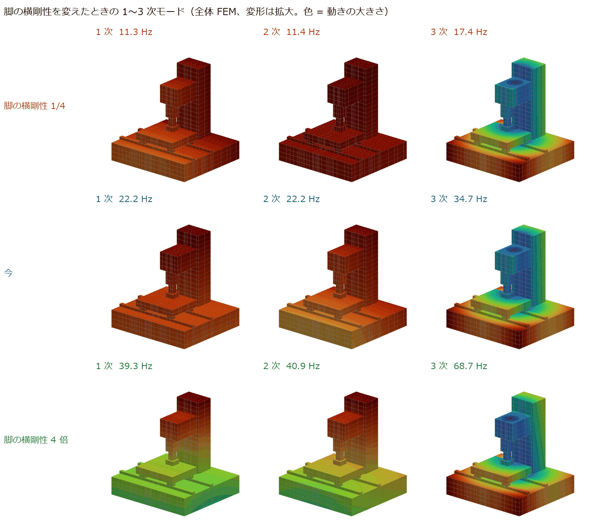

上の 2 段では 1 次・2 次とも機械全体が脚の上で平行に揺れますが、4 倍（下段）では 1 次・2 次でコラム上端が大きく動き、ベッドはあまり動きません。横に滑る揺れから、前後に傾く揺れに変わっていることが分かります。3 次はどのケースも Z 軸まわりのねじれです。

*生成スクリプト: [anim_modes.py](../analysis/ana005_foundation_accel_chatter/k_sweep/anim_modes.py)*

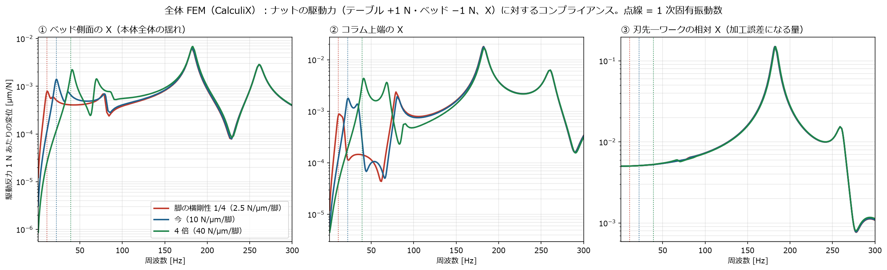

*ナットの両端に +1 N（テーブル）・−1 N（ベッド）＝加減速の反力を X 方向に加えた周波数応答。生成スクリプト: [run_k_sweep.py](../analysis/ana005_foundation_accel_chatter/k_sweep/run_k_sweep.py)、[post.py](../analysis/ana005_foundation_accel_chatter/k_sweep/post.py)*

- ①②（ベッド・コラムの揺れ）：脚が硬いほど、低い周波数のピークが**右（高い周波数）へ移り、低くなる**
- ③（刃先―ワークの相対）：**3 ケースで全く同じ**。脚のモードは機械全体が一緒に動くので、刃先とワークの相対には出ない（3.5 節と同じ結論）。相対のピーク（約 183 Hz）はテーブルのボールねじのモード

### 4.6 モードの形が変わっても同じ議論ができるか

4.5 で見たように、脚を 4 倍硬くすると 1 次モードは平行な揺れから傾く揺れに変わります。1 自由度モデルは平行な揺れしか表せないので、そのまま使ってよいかを確かめるために、全体 FEM の固有モード 10 個を使って同じ加減速の時刻歴を計算しました。テーブルを加速する反力は、本体から見るとテーブルの質量全体に慣性力 $-m_t a(t)$ がかかるのと同じなので、それをテーブルの節点に配って各モードを揺らし、足し合わせています。

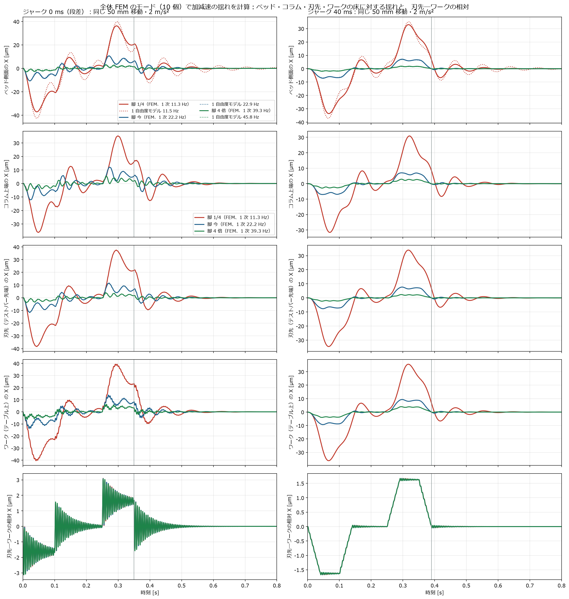

*点線は 1 自由度モデル。生成スクリプト: [transient_modal.py](../analysis/ana005_foundation_accel_chatter/k_sweep/transient_modal.py)*

| ケース | ジャーク | 刃先の最大 µm | ワークの最大 µm | 刃先―ワーク相対の最大 µm | 停止後のベッド揺れ最大 µm | 停止後のコラム上端揺れ最大 µm | 1 自由度モデル µm | ベッドが ±1 µm に収まるまで s | コラム上端が ±1 µm に収まるまで s |
|---|---|---:|---:|---:|---:|---:|---:|---:|---:|
| 脚 1/4 | 0 ms | 38.35 | 40.36 | 3.122 | 20.84 | 17.10 | 17.46 | 0.192 | 0.198 |
| 脚 今 | 0 ms | 11.59 | 13.88 | 3.123 | 6.39 | 6.17 | 6.56 | 0.098 | 0.137 |
| 脚 4 倍 | 0 ms | 3.99 | 6.21 | 3.125 | 1.38 | 2.35 | 1.64 | 0.012 | 0.062 |
| 脚 1/4 | 40 ms | 34.57 | 36.18 | 1.674 | 6.81 | 8.47 | 8.61 | 0.135 | 0.134 |
| 脚 今 | 40 ms | 7.69 | 9.35 | 1.673 | 0.73 | 0.69 | 0.61 | 0.000 | 0.000 |
| 脚 4 倍 | 40 ms | 2.38 | 3.99 | 1.674 | 0.17 | 0.32 | 0.11 | 0.000 | 0.000 |

ベッドの揺れは、1/4 倍と今のケースでは 1 自由度モデルとほぼ重なり、4 倍でも大きさは近い値になりました。脚が硬いほど揺れが小さく早く収まる、加速度の上昇時間を周期に合わせると揺れが消える、という 4.4・4.3 の議論は、モードの形が変わってもそのまま成り立ちます。

ただし 4 倍のケースでは、コラム上端の揺れがベッドより大きく、±1 µm に収まるまでの時間もベッドの 0.012 s に対して 0.062 s と長くなりました。傾く揺れになると、高い所ほど大きく動くからです。どの点の揺れを問題にするかで、効くモードと待ち時間が変わることに注意が必要です。

刃先とワークは、それぞれ床に対しては大きく揺れ（脚の剛性 1/4 倍・段差で約 40 µm）、脚が柔らかいほど大きくなります。ところが両者の相対の揺れは、脚の剛性によらず 3 ケースとも同じ値（段差で最大 3.1 µm、上昇時間 40 ms で 1.7 µm）でした。刃先とワークが脚の上で一緒に揺れるので、その分は相対には残らないからです。残った 3.1 µm は、テーブルがボールねじのばねで揺れる 183 Hz のモードから来ています。加工誤差を小さくしたいなら、脚ではなく送り系を見る必要があります。

### 4.7 サーボ・駆動系との連成条件

実機の許容加速度やサイクル時間を決めるには、モータ推力／トルク・電流・回転速度、ねじ回転慣性、摩擦、位置・速度・電流ループ、フィードフォワード、制御遅れを加える。評価量はTCP追従誤差と刃先―ワーク相対整定にする。

現在のFEMは一定姿勢まわりの弾性変位を計算するモデル。50 mmの剛体送りをそのままガイド・ねじばねの伸びとして与えず、送り軌道に重ねる弾性残差として連成する。

## 5. フライス加工の安定限界線図

### 5.1 切削条件と零次近似

フライス加工は、刃が何枚かある工具を回転させ、ワークに当てながら横に送って削る加工で、マシニングセンタの主な加工です。旋盤ではワークが回りますが、フライス加工では工具が回ります。エンドミルはフライス工具の一種（側面と先端に刃がある細長い工具）で、安定限界の計算方法は同じです。変わるのは刃数、刃が削る角度の範囲、切削係数だけです。ここでは、次の条件で 4 枚刃のエンドミルが溝を掘る場合を考えます。

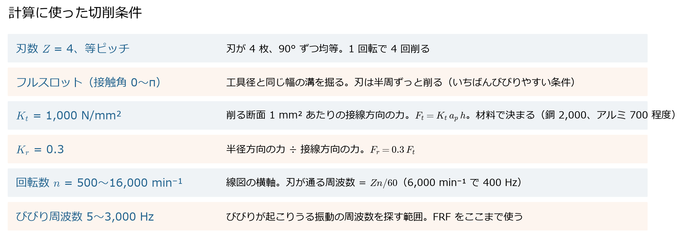

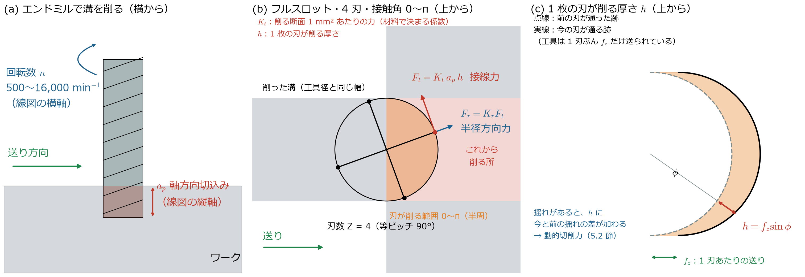

(c) の $h$ は、1 枚の刃が実際に削り取る厚さです。工具は刃 1 枚ぶん $f_z$ だけ送られながら回るので、前の刃が通った跡（点線）と今の刃が通る跡（実線）のあいだの三日月形が、1 枚の刃が削る部分になります。その厚さは刃の角度 $\phi$ によって変わり、$h = f_z\sin\phi$ です。刃先が揺れると、この $h$ に今の揺れと前の刃のときの揺れの差が加わり、それが 5.2 節の動的切削力になります。


切削係数は説明用の仮定値で、実際に削って求めたものではありません。構造の計算ではテストバー（角柱）を使い、切削力の計算では刃溝やねじれ角を省いた等ピッチ 4 枚刃を仮定しています。計算には刃先とワークの相対 FRF の XY 成分（クロス成分 $G_{xy}$・$G_{yx}$ を含む）を使います。

ここから先の計算に必要なのは、「刃先とワークが食い違ったとき、どの向きにどれだけ力が出るか」です。それを 1 つの行列 $B_0$（方向係数）にまとめる手順を、下の図で順に追います。

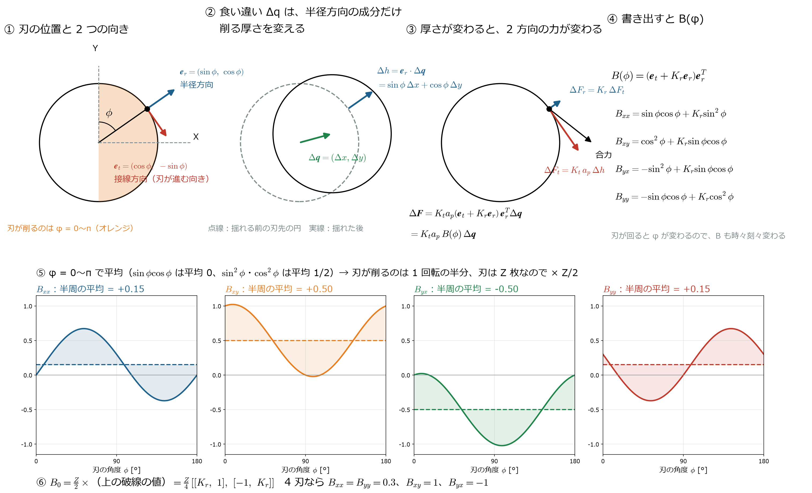

*生成スクリプト: [explain_B.py](../analysis/ana005_foundation_accel_chatter/explain_B.py)*

①刃先の位置を角度 $\phi$ で表し、工具の中心から外へ向かう向きを $\boldsymbol{e}_r$、刃が進む向きを $\boldsymbol{e}_t$ とします。②刃先とワークが $\Delta\boldsymbol{q}$ だけ食い違うと、刃が削る厚さは、そのうち $\boldsymbol{e}_r$ 向きの成分だけ変わります（$\Delta h = \sin\phi\,\Delta x + \cos\phi\,\Delta y$）。③厚さが変わると、刃の進む向きに $\Delta F_t = K_t a_p \Delta h$、外向きにその $K_r$ 倍の力が出ます。この 2 つを足した力を X・Y の成分で書くと $\Delta\boldsymbol{F} = K_t\,a_p\,B(\phi)\,\Delta\boldsymbol{q}$ の形になり、④その行列が $B(\phi)$ です。

$B(\phi)$ は刃が回るとともに変わります。⑤刃が削っている半周（$\phi = 0 \sim \pi$）で 4 つの成分をそれぞれ平均すると、$\sin\phi\cos\phi$ の項は正と負が打ち消して 0 になり、$\sin^2\phi$ と $\cos^2\phi$ の項はどちらも 1/2 になります（図の破線）。⑥1 回転のうち削っているのは半分で、刃は $Z$ 枚あるので、平均に $Z/2$ を掛けたものが

$$
B_0 = \frac{Z}{2\pi}\int_0^{\pi}B(\phi)\,d\phi = \frac{Z}{4}\left[\begin{matrix}K_r & 1\\ -1 & K_r\end{matrix}\right]
$$

です。このように時間で変わる係数を 1 回転で平均してしまう近似を**零次近似**と呼びます。対角の $K_r$ は揺れた向きに押し返す力、非対角の $1$ と $-1$ は揺れと直角に出る力を表していて、X に揺れると Y にも力が出ます。コードでは数値積分でもこの値になることを確かめています。

この $B_0$ が、次の 5.2 節の動的切削力の式 (3) にそのまま入り、そこから限界切込みが求まります。全体の計算の流れは次のとおりです。

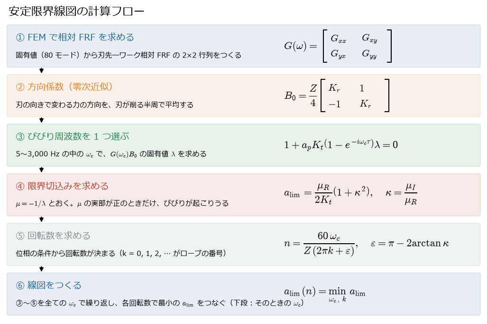

*生成スクリプト: [explain_milling.py](../analysis/ana005_foundation_accel_chatter/explain_milling.py)*

### 5.2 再生びびりの理論：動的切削力から限界切込みまで

ここでは、計算フローの図の①〜⑥を、式で順に追います。記号は次のとおりです。

| 記号 | 意味 |
|---|---|
| $Z$ | 工具の刃の数（刃数）。この計算では 4 |
| $n$ | 主軸回転数 [min⁻¹] |
| $\tau = 60/(Z n)$ | 1 枚の刃が通ってから次の刃が同じ場所に来るまでの時間（刃の通過周期）[s] |
| $a_p$ | 軸方向の切込み [mm]（線図の縦軸） |
| $K_t$ | 削る断面 1 mm² あたりの接線方向の力（比切削抵抗）[N/mm²] |
| $K_r$ | 半径方向の力と接線方向の力の比 |
| $\boldsymbol{q}(t)$ | ワークに対する刃先の相対変位（X, Y）[mm] |
| $G(\omega)$ | 刃先―ワーク相対 FRF の 2×2 行列 [mm/N] |

**(1) 刃 1 枚にかかる力**

刃の角度を $\phi$（0 から $\pi$ まで刃が削る）、その刃が削る厚さを $h(\phi)$ とすると、刃にかかる力は削る断面積 $a_p h$ に比例します。

$$
F_t = K_t\,a_p\,h(\phi),\qquad F_r = K_r\,F_t
$$

**(2) 動的切削力：揺れが削る厚さを変える**

刃先が揺れていなければ、削る厚さは送りで決まる一定の値で、力も周期的に繰り返すだけです。ところが刃先がワークに対して揺れると、**今の刃の位置 $\boldsymbol{q}(t)$ と、1 つ前の刃が残した面の位置 $\boldsymbol{q}(t-\tau)$ の差**だけ、削る厚さが変わります。

$$
\Delta h(t) = \left[\sin\phi\ \ \cos\phi\right]\left\{\boldsymbol{q}(t)-\boldsymbol{q}(t-\tau)\right\}
$$

この「揺れによる厚さの変化」が生む力の変化を**動的切削力**と呼びます。前の刃が残した波打った面を今の刃が削るので、揺れが次の揺れを生む仕組み（**再生効果**）になっています。これがびびりの原因です。

**(3) 方向係数：刃の向きで力の向きが変わる**

(2) の厚さの変化に、5.1 節の図で求めた方向係数を掛けて 1 回転で平均すると（**零次近似**）、動的切削力は次の形になります。

$$
\boldsymbol{F}(t) = -\,a_p\,K_t\,B_0\left\{\boldsymbol{q}(t)-\boldsymbol{q}(t-\tau)\right\},\qquad
B_0 = \frac{Z}{2\pi}\int_0^{\pi}B(\phi)\,d\phi = \frac{Z}{4}\left[\begin{matrix}K_r & 1\\ -1 & K_r\end{matrix}\right]
$$

$B_0$ の非対角成分（1 と −1）は、**X 方向に揺れると Y 方向にも力が出る**ことを表しています。$Z$ が大きいほど、同じ揺れに対して力が大きくなります。

**(4) 構造の応答**

揺れは、その力に対する構造の応答です。周波数 $\omega$ の揺れ $\boldsymbol{q}(t) = \boldsymbol{Q}e^{i\omega t}$ を考えると、$\boldsymbol{q}(t-\tau) = \boldsymbol{Q}e^{i\omega t}e^{-i\omega\tau}$ なので、

$$
\boldsymbol{Q} = G(\omega)\,\boldsymbol{F} = -\,a_p\,K_t\,\left(1-e^{-i\omega\tau}\right)G(\omega)\,B_0\,\boldsymbol{Q}
$$

$G$ は刃先とワークの相対 FRF（3.3 節）で、X・Y の 2×2 行列です。構造としては Z も含めた 3×3（3.3 節の 9 成分）ですが、側面で削るエンドミルでは削り厚さ $h = f_z\sin\phi$ を変えるのは X・Y の揺れだけで、Z に揺れても厚さは変わりません。また、ねじれ角を考えない今回のモデルでは切削力に Z 成分がありません。そのため 3×3 のうち X・Y の 2×2 だけを取り出して使います。

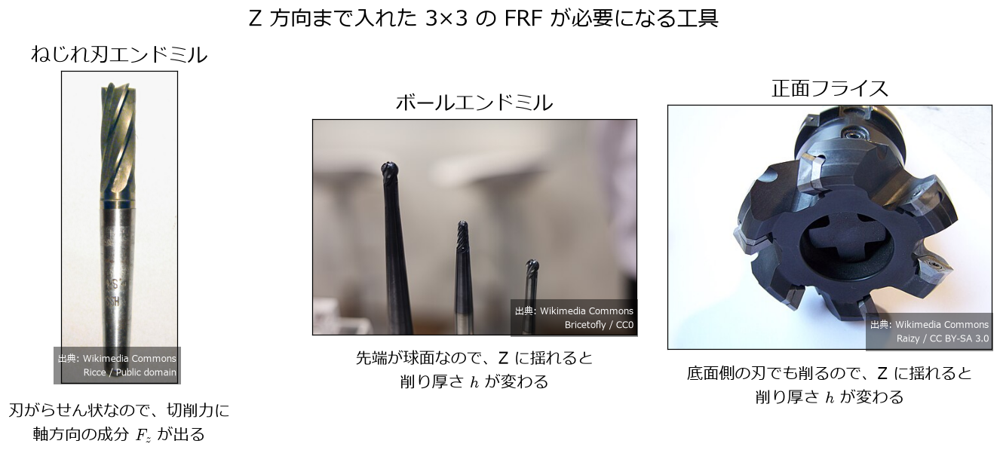

*生成スクリプト: [explain_tool_types.py](../analysis/ana005_foundation_accel_chatter/explain_tool_types.py)。写真はいずれも Wikimedia Commons から：[Fresa.jpg](https://commons.wikimedia.org/wiki/File:Fresa.jpg)（Ricce、パブリックドメイン）、[Fraises sphériques.jpg](https://commons.wikimedia.org/wiki/File:Fraises_sph%C3%A9riques.jpg)（Bricetofly、CC0）、[VHM-WSP-ALU-F-45-IH2.jpg](https://commons.wikimedia.org/wiki/File:VHM-WSP-ALU-F-45-IH2.jpg)（Raizy、[CC BY-SA 3.0](https://creativecommons.org/licenses/by-sa/3.0/)）*

実際のエンドミルの多くは左のようなねじれ刃で、軸方向の力 $F_z$ が出ます。Z に揺れても側面を削る厚さは変わりませんが、$F_z$ そのものが構造を押すので、クロス FRF $G_{xz}$・$G_{yz}$ を通して X・Y の揺れを生み、それが削り厚さに入ります。この影響は 3×3 で計算しないと分かりません。そこで、軸方向の力を $F_z = K_a a_p h$（$K_a/K_t = \pm 0.3$、符号はねじれの向き）として、Z 列まで入れた計算と比べました。削り厚さは X・Y の揺れだけで決まるので、$B_0$ は 3×2 になり、Z の行を刃が削る半周で平均すると $\frac{Z}{\pi}\frac{K_a}{K_t}(1,\ 0)$ です。

3×3 の式は、このあと (4) の続きにまとめて書きます。比べた計算では、削り厚さに効く $Q_x$・$Q_y$ の 2 行と、$F_z$ に掛かる 3 列目（$G_{xz}$・$G_{yz}$）まで入れた 2×3 の部分を使っています。


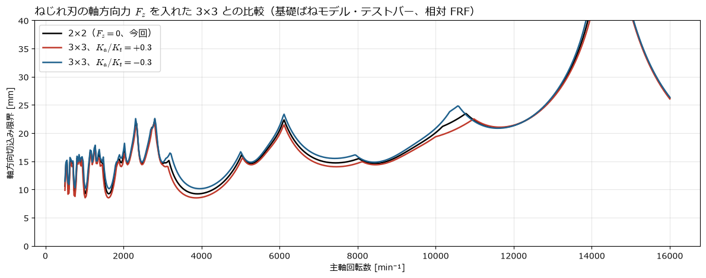

*生成スクリプト: [check_3x3.py](../analysis/ana005_foundation_accel_chatter/check_3x3.py)*

最小の限界は 2×2 の 9.22 mm に対して、3×3 では 8.51 mm（$K_a/K_t=+0.3$）と 10.14 mm（$-0.3$）になり、約 ±8 % 変わりました。回転数によっては最大 18 % 違います。このモデルでは $G_{xz}$ はほぼ 0 ですが、$G_{yz}$ は 185 Hz で $G_{yy}$ と同じくらいの大きさがあり、$F_z$ が Y・Z が一緒に動くモード（テーブルが Y に動きながら傾くモード 11 など）を通して Y の揺れを生んでいます。ねじれの向きで限界が上がるか下がるかが変わる点も、2×2 では見えません。したがって、ねじれ刃の工具で実機と比べるなら 3×3 で計算するべきです。この章の 2×2 の結果は、直刃という前提での値で、どのモードが限界を決めるかという結論（モード 8）は 3×3 でも変わりませんが、限界の値には ±1 割ほどの幅があると考えてください。ボールエンドミルや正面フライスでは、Z の揺れそのものが削り厚さに入るので、3×3 が必須です。

主軸を逆転させたらどうなるかも、同じ計算で確かめられます。逆転は、上から見た図を送りの向きを軸にして鏡に映した形になり、$X$ に揺れたときに $Y$ に出る力の向きが逆になります（$B_0$ の非対角の 1 と −1 が入れ替わる）。ただ、このモデルは $X$ と $Y$ が連成しない（$G_{xy} \approx 0$）ので、正転と逆転で線図は完全に同じになりました。$X$ を押すと $Y$ にも動く構造（$G_{xy} \neq 0$）なら、正転と逆転で限界が変わります。ねじれ刃では、ねじれの向きと回転の向きの組み合わせで $F_z$ が上向きか下向きかが決まり、上の比較のとおり約 ±1 割効きます。

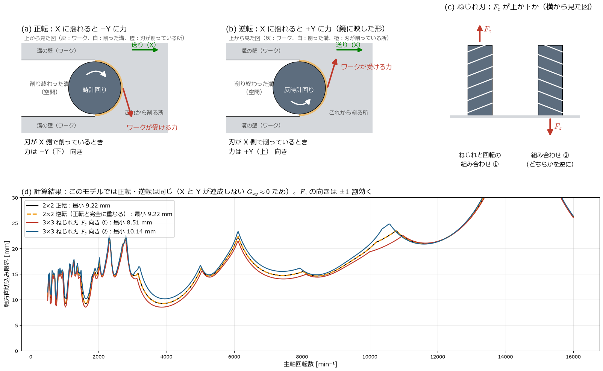

*生成スクリプト: [explain_rotation.py](../analysis/ana005_foundation_accel_chatter/explain_rotation.py)*

正転と逆転で変わるのは、X に揺れたときに Y に出る力の向き（$B_0$ の非対角の符号）だけです。びびりは「X に揺れる → Y に力 → Y に揺れる → X に力 → …」と一周して育つので、一周のあいだに非対角を 2 回通り、符号は $(-1)\times(+1)$ でも $(+1)\times(-1)$ でも同じ $-1$ になります。だから $G_{xy}=0$ の機械では正転と逆転で結果が変わりません。$G_{xy}\neq0$ だと、X の揺れが Y の力を経由せずに直接 Y の揺れにもつながる道ができ、そこでは非対角を 1 回しか通らないので、符号の違いがそのまま結果に出ます。

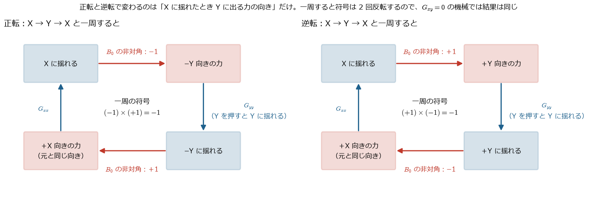

*生成スクリプト: [explain_rotation_loop.py](../analysis/ana005_foundation_accel_chatter/explain_rotation_loop.py)*

「Z に揺れる」とは、工具が主軸の方向（上下）にずれることです。横から見ると下の図のようになります。今回の計算は (a) の、直刃の平エンドミルで溝を削る場合を想定しています。刃は溝の側面を削っていて、削る厚さ $h$ は横方向の幅なので、工具が上下にずれても $h$ は変わりません。直刃なので切削力も X・Y 平面の中だけに出て、$F_z = 0$ です。Z の揺れは削り厚さに入らず、Z を揺らす力も出ないので、Z を省いた 2×2 で同じ答えになります。(b) のボールエンドミルや (c) の正面フライスでは、工具が下にずれるとそのぶん深く削るので、Z の揺れが削り厚さに入り、3×3 が必要です。

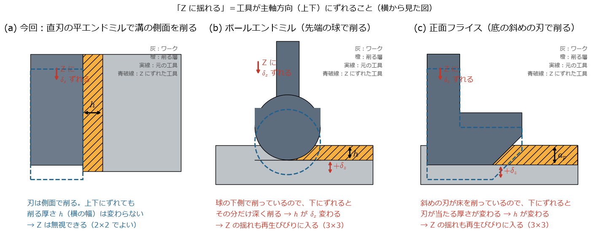

*生成スクリプト: [explain_z_vibration.py](../analysis/ana005_foundation_accel_chatter/explain_z_vibration.py)*

式を X・Y・Z の 3×3 で書いておきます。切削力は作用・反作用なのでワークに $+\boldsymbol{F}$、刃先に $-\boldsymbol{F}$ がかかり、$H^{ab}_{ij}$ を「点 $b$ を $j$ 方向に押したときの点 $a$ の $i$ 方向の変位」（w：ワーク、t：刃先）とすると、

$$
\begin{bmatrix} Q_x\\ Q_y\\ Q_z \end{bmatrix}
=
\begin{bmatrix} x_w - x_t\\ y_w - y_t\\ z_w - z_t \end{bmatrix}
=
\begin{bmatrix}
G_{xx} & G_{xy} & G_{xz}\\
G_{yx} & G_{yy} & G_{yz}\\
G_{zx} & G_{zy} & G_{zz}
\end{bmatrix}
\begin{bmatrix} F_x\\ F_y\\ F_z \end{bmatrix},
\qquad
G_{ij} = H^{ww}_{ij} + H^{tt}_{ij} - H^{wt}_{ij} - H^{tw}_{ij}
$$

となります（$i, j = x, y, z$）。モードで書くと、モード $r$ のワーク点と刃先点の形の差 $d_{xr} = \phi^w_{xr}-\phi^t_{xr}$（$y$・$z$ も同じ）を使って

$$
\begin{bmatrix}
G_{xx} & G_{xy} & G_{xz}\\
G_{yx} & G_{yy} & G_{yz}\\
G_{zx} & G_{zy} & G_{zz}
\end{bmatrix}
=
\sum_r \frac{1}{\omega_r^2 - \omega^2 + 2i\zeta_r\omega_r\omega}
\begin{bmatrix}
d_{xr}^2 & d_{xr}d_{yr} & d_{xr}d_{zr}\\
d_{yr}d_{xr} & d_{yr}^2 & d_{yr}d_{zr}\\
d_{zr}d_{xr} & d_{zr}d_{yr} & d_{zr}^2
\end{bmatrix}
$$

です。このうちどこを使うかは、削り厚さと切削力の向きで決まります。平エンドミルの側面削りでは削り厚さに効くのは $Q_x$・$Q_y$ だけなので、使うのは上の 2 行です。さらに直刃で $F_z = 0$ なら 3 列目も掛ける相手がなくなり、左上の 2×2

$$
\begin{bmatrix} Q_x\\ Q_y \end{bmatrix}
=
\begin{bmatrix}
G_{xx} & G_{xy}\\
G_{yx} & G_{yy}
\end{bmatrix}
\begin{bmatrix} F_x\\ F_y \end{bmatrix}
$$

だけが残ります。以下の (5) と 5.3 節以降の線図は、この 2×2（直刃）で計算しています。ねじれ刃（$F_z \neq 0$）では 3 列目の $G_{xz}$・$G_{yz}$ も残り、上で見たように限界が約 ±1 割変わります。

**(5) 安定限界：揺れが増えも減りもしない条件**

$\boldsymbol{Q} \neq 0$ の揺れが続くのは、次の行列式が 0 のときです。

$$
\det\left[\,I + a_p\,K_t\,\left(1-e^{-i\omega_c\tau}\right)G(\omega_c)\,B_0\,\right] = 0
$$

成分で書いてみます。$c = a_pK_t(1-e^{-i\omega_c\tau})$ とおき、$G B_0$ を計算すると

$$
\Phi = G B_0
=\frac{Z}{4}
\begin{bmatrix}G_{xx}&G_{xy}\\G_{yx}&G_{yy}\end{bmatrix}
\begin{bmatrix}K_r&1\\-1&K_r\end{bmatrix}
=\frac{Z}{4}
\begin{bmatrix}
K_rG_{xx}-G_{xy} & G_{xx}+K_rG_{xy}\\
K_rG_{yx}-G_{yy} & G_{yx}+K_rG_{yy}
\end{bmatrix}
$$

で、これは切削力の向きまで含めた FRF です。$2\times2$ の行列式は（左上×右下）−（右上×左下）なので、

$$
\det\begin{bmatrix}
1+c\,\Phi_{11} & c\,\Phi_{12}\\
c\,\Phi_{21} & 1+c\,\Phi_{22}
\end{bmatrix}
=1+c\,(\Phi_{11}+\Phi_{22})+c^2\,(\Phi_{11}\Phi_{22}-\Phi_{12}\Phi_{21})=0
$$

となり、$c$ の 2 次方程式になります。$c = -1/\lambda$ とおけば

$$
\lambda^2-(\Phi_{11}+\Phi_{22})\,\lambda+(\Phi_{11}\Phi_{22}-\Phi_{12}\Phi_{21})=0
$$

で、$\lambda$ は $\Phi$ の固有値です。$G$ が決まれば数値で 2 つ求まります。

つまりこの条件は、固有値ごとに

$$
1 + a_p\,K_t\left(1-e^{-i\omega_c\tau}\right)\lambda = 0
\quad\Longleftrightarrow\quad
a_p\,K_t\left(1-e^{-i\omega_c\tau}\right) = -\frac{1}{\lambda} \equiv \mu = \mu_R + i\,\mu_I
$$

と書けます。左辺の $a_p K_t$ は実数なので、$1-e^{-i\omega_c\tau} = (1-\cos\omega_c\tau) + i\sin\omega_c\tau$ と比べて、実部と虚部の 2 本の式

$$
a_p K_t\,(1-\cos\omega_c\tau) = \mu_R,\qquad a_p K_t\,\sin\omega_c\tau = \mu_I
$$

が得られます。2 本目を 1 本目で割ると $\kappa = \mu_I/\mu_R = \sin\omega_c\tau/(1-\cos\omega_c\tau) = \cot(\omega_c\tau/2)$ となり、ここから $1-\cos\omega_c\tau = 2/(1+\kappa^2)$ です。これを 1 本目に入れると限界切込みが、$\cot(\omega_c\tau/2)=\kappa$ を $\tau$ について解くと回転数が求まります。

$$
a_{\lim} = \frac{\mu_R}{2K_t}\left(1+\kappa^2\right),\qquad \kappa = \frac{\mu_I}{\mu_R}
$$

$$
\omega_c\tau = \varepsilon + 2\pi k,\quad \varepsilon = \pi - 2\arctan\kappa,\qquad
n = \frac{60}{Z\tau} = \frac{60\,\omega_c}{Z\,(2\pi k + \varepsilon)},\qquad k = 0, 1, 2, \cdots
$$

（Altintas・Budak の論文では、方向係数から $Z/2\pi$ をくくり出して $\Lambda$ という記号で同じ式を書いています。ここでは $B_0$ に $Z$ を含めているので、$\mu$ で書いています。）

この結果を、方向が 1 つだけの簡単な場合で読み解いてみます。$\Phi$ がただの数 $G$（1 方向の FRF）だとすると、$\lambda = G$ なので

$$
\mu = -\frac{1}{G} = -\frac{\overline{G}}{|G|^2}
\quad\Rightarrow\quad
\mu_R = -\frac{\mathrm{Re}\,G}{|G|^2},\qquad
\mu_I = \frac{\mathrm{Im}\,G}{|G|^2}
$$

です。これを上の $a_{\lim}$ の式に入れると、$1+\kappa^2 = |G|^2/(\mathrm{Re}\,G)^2$ なので、きれいに約分されて

$$
a_{\lim} = -\frac{1}{2K_t\,\mathrm{Re}\,G(\omega_c)}
$$

となります。切込みは正でなければ意味がないので、**びびりが起こりうるのは $\mathrm{Re}\,G < 0$ の周波数だけ**です。

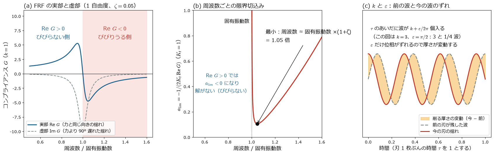

*生成スクリプト: [explain_phase.py](../analysis/ana005_foundation_accel_chatter/explain_phase.py)*

図 (a) は 1 自由度の FRF を実部と虚部に分けたものです。実部 $\mathrm{Re}\,G$ は「力と同じ向きに動く成分」で、固有振動数より下では正（ばねのように、押した向きに動く）、上では負（質量のように、押した向きと逆に動く）になります。再生びびりでは、削り厚さが「今の揺れ − 前の揺れ」で決まり、揺れが厚さを減らす向きに力を弱めるという負のフィードバックが掛かっています。そのフィードバックが揺れを打ち消さずに逆に支えてしまうのは、構造が力と逆向きに動く、つまり実部が負の周波数のときだけです。

図 (b) は、各周波数の $a_{\lim} = -1/(2K_t\,\mathrm{Re}\,G)$ です。固有振動数より下では解がなく、上では実部がいちばん負になる所で $a_{\lim}$ が最小になります。1 自由度ではそれが固有振動数の約 $(1+\zeta)$ 倍の所です。だからびびり周波数は、相対コンプライアンスの山の頂上ではなく、**そのすぐ右側（少し高い周波数）**に出ます。今回のモード 8 では $182 \times 1.018 \approx 185$ Hz でした。実際の計算では $G$ は 2×2 で $B_0$ も掛かりますが、固有値 $\lambda$ が上の $G$ の役をするだけで、考え方は同じです。

図 (c) は $k$ と $\varepsilon$ の意味です。刃は $\tau$ ごとに 1 枚ずつ来て、前の刃が残した波の上を削ります。$\tau$ のあいだに揺れの波が何個入るかを数えると、ちょうど整数個とは限らず、$k$ 個とその端数になります。その端数を角度で表したものが $\varepsilon$ で、

$$
\omega_c\,\tau = 2\pi k + \varepsilon
$$

です。$\varepsilon = 0$ なら今の波と前の波がぴったり重なって削る厚さは変わらず、びびりは育ちません。$\varepsilon$ だけずれていると、図の橙色のように厚さが波打ち、力が変動します。限界の式は、構造の遅れ（$\kappa = \mu_I/\mu_R$）とちょうど釣り合う $\varepsilon = \pi - 2\arctan\kappa$ を要求します。$k$ は 0, 1, 2, … のどれでもよく、$k$ を 1 つ選ぶごとに $\tau$、つまり回転数 $n = 60/(Z\tau)$ が 1 つ決まります。これが $k$ ごとのローブで、$k$ が大きいほど低い回転数側のローブになります。

**(6) 線図**

線図は、びびり周波数 $\omega_c$ を 1 つ決めて計算し、それを全部の周波数で繰り返して作ります。1 つの周波数でやることを、最小点に近い 185 Hz を例に具体的に書くと次のとおりです。

1. **FRF を読む**：185 Hz での相対 FRF は $G_{xx} = -0.098 - 0.142i$ µm/N、$G_{yy} = 0.011 - 0.002i$ µm/N、$G_{xy} = G_{yx} \approx 0$ です。
2. **固有値を出す**：$\Phi = G B_0$ を作り、その固有値 $\lambda$ を 2 つ求めます。
3. **$\mu$ に直す**：$\mu = -1/\lambda$ を計算し、実部 $\mu_R$ が正のほうだけを使います（負のほうはこの周波数ではびびらない）。
4. **限界切込み**：$\kappa = \mu_I/\mu_R = -0.86$、$a_{\lim} = \mu_R(1+\kappa^2)/(2K_t) = 9.25$ mm が得られます。
5. **回転数**：位相のずれ $\varepsilon = \pi - 2\arctan\kappa = 4.56$ rad を使って、$n = 60\,\omega_c/(Z(2\pi k + \varepsilon))$ を $k = 0, 1, 2, 3, \dots$ について計算すると、3,822、1,608、1,018、745 min⁻¹ … となります。

つまり 1 つの周波数から、**同じ切込み 9.25 mm の点が、$k$ ごとに別々の回転数に 1 つずつ**できます。これを 5〜3,000 Hz のすべての周波数で繰り返すと、$k$ ごとに 1 本ずつ U 字形の線（ローブ）ができます。同じ回転数にはいくつもの $k$ のローブが重なっているので、その中でいちばん低い所をつないだものが安定限界線図です。下の図の ① が手順 1〜4（周波数ごとの $a_{\lim}$）、② が手順 5（$k$ ごとに回転数へ移したもの）と、最小をつないだ黒線です。赤い丸が 185 Hz の点で、$k=0$ の 3,822 min⁻¹ の点が線図の最小（★）になっています。

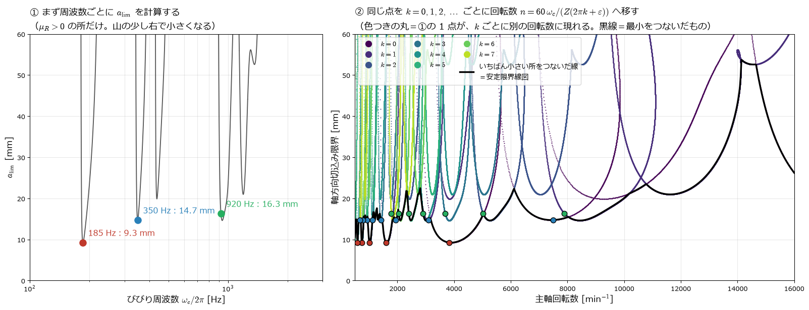

*生成スクリプト: [explain_lobes.py](../analysis/ana005_foundation_accel_chatter/explain_lobes.py)*

線図を作るときには、各回転数でいちばん小さい $a_{\lim}$ を選ぶだけでなく、**それがどの周波数 $\omega_c$（とどちらの固有値 $\lambda$）から来たか**も一緒に記録しておきます。下段のびびり周波数のグラフはその記録です。モードの割合（5.3 節の後半）は、記録したその $\omega_c$ と $\lambda$ に戻って、びびりの形 $\boldsymbol{Q}$ を求め、モードに分けて出しています。線図の計算そのものからは割合は出てこず、線図で選ばれた点に戻ってもう一度計算する、という 2 段階です。

### 5.3 支持条件とテーブル結合の比較

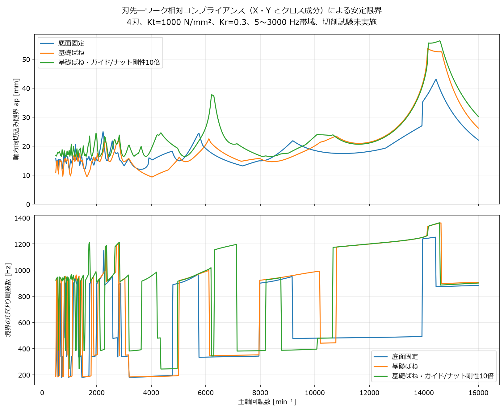

3 本とも、刃先とワークの相対コンプライアンス $G$（X・Y の 2×2、クロス成分を含む）を使って計算しています。上段は回転数と軸方向切込みの限界、下段はその限界でのびびり周波数です。下段のびびり周波数が回転数ごとに求まるのは、5.2 節の安定限界の式が、もともと切込み・回転数・びびり周波数の 3 つを同時に決める式だからです。限界のちょうど上では、揺れは増えも減りもせず一定の周波数で続きます。その周波数 $\omega_c$ のときだけ、(5) の式の実部と虚部の 2 本が同時に成り立ちます。計算では、ある回転数 $n$ を決めて（つまり $\tau$ を決めて）、$\omega$ を 5〜3,000 Hz で動かしながら虚部の式が 0 になる $\omega$ を探し、見つかった $\omega$ ごとに実部の式から切込みを出します。候補のうちいちばん小さい切込みが線図の値で、そのときの $\omega$ が下段のびびり周波数です。回転数が変わると、刃の通過周期 $\tau$ が変わって位相の条件を満たす $\omega$ も少しずつずれるので、びびり周波数は回転数とともに斜めに動き、別のモードの候補の方が小さくなった所で飛び移ります。びびり周波数は、その回転数で切込みを少しずつ増やしていき、ちょうどびびりが始まるときに刃先とワークが揺れる周波数のことで、刃が通る周波数（6,000 min⁻¹・4 刃なら 400 Hz）とは別に、機械の固有振動数の近くに出ます。

| ケース | 掃引範囲内の最小切込み限界 mm | 約 6,000 min⁻¹ での限界 mm | そのときのびびり周波数 Hz |
|---|---:|---:|---:|
| 底面固定 | 11.98 | 19.08 | 334.9 |
| 基礎ばね | 9.36 | 20.68 | 990.0 |
| テーブル結合 10 倍 | 16.43 | 26.74 | 997.6 |

テストバーにすると、限界は細い工具のとき（2.5〜2.7 mm）より大きくなり、どのモードが効くかが回転数によって変わるようになります。基礎ばねモデルの最小値（約 3,900 min⁻¹ で 9.4 mm）は、テーブルが送り方向に揺れる 182 Hz のモードで決まっていて、テーブル結合を 10 倍にすると 16.4 mm まで上がります。テーブル側のびびりが限界を決める条件になったということです。

どの FRF の山・どのモードでびびっているかを、線図の最小点で示したのが次のアニメーションです。

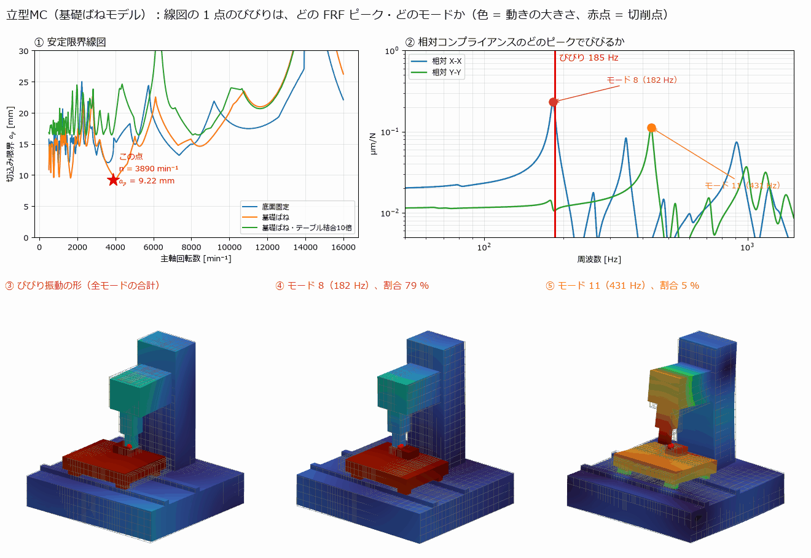

*生成スクリプト: [chatter_point_anim.py](../analysis/ana005_foundation_accel_chatter/chatter_point_anim.py)*

最小点（★、約 3,890 min⁻¹）のびびり周波数は 185 Hz で、相対 X-X のいちばん高い山（モード 8、182 Hz）のすぐ近くです。ぴったり一致せず少し高くなるのは、びびりが起きるのは FRF の実部が負になる側、つまり固有振動数より少し上だからです。1 自由度では実部が最も負になるのは $\omega \approx \omega_r(1+\zeta_r)$ で、モード 8 の $\zeta_r \approx 0.018$ を入れると 182 × 1.018 ≈ 185 Hz となり、計算と合います。びびり振動の形（③）はモード 8（④）とほぼ同じで、テーブルとワークが送り方向に揺れ、テストバーはほとんど動いていません。

| 回転数 | 切込み限界 | びびり周波数 | 1 番目に効くモード | 2 番目 |
|---|---:|---:|---|---|
| 約 3,000 min⁻¹ | 14.6 mm | 935 Hz | モード 18：910 Hz 主軸・テストバーの曲げ（50 %） | モード 20：996 Hz（18 %） |
| 約 3,900 min⁻¹ | 9.2 mm | 185 Hz | モード 8：182 Hz テーブルの X 並進（約 80 %） | モード 11：431 Hz（約 5 %） |
| 約 6,000 min⁻¹ | 20.7 mm | 990 Hz | モード 18：910 Hz（34 %） | モード 20：996 Hz（32 %） |
| 約 10,000 min⁻¹ | 20.1 mm | 987 Hz | モード 18：910 Hz（35 %） | モード 20：996 Hz（32 %） |

（% は刃先―ワーク相対変位への寄与。[chatter_modes.py](../analysis/ana005_foundation_accel_chatter/chatter_modes.py)、[chatter_by_rpm.py](../analysis/ana005_foundation_accel_chatter/chatter_by_rpm.py) の結果）

#### びびり振動に、なぜいくつかのモードが混ざるのか

最初に、線図の「最小の $a_{\lim}$ をつなぐ」こととモードが混ざることの関係を整理しておきます。線図を作るときに各回転数で選んでいるのは、いちばん小さい $a_{\lim}$ を与える**びびり周波数 $\omega_c$ 1 つ**です。モードを 1 つ選んでいるわけではありません。たとえば最小点（3,890 min⁻¹、9.2 mm）では $\omega_c = 185$ Hz が選ばれます。その 185 Hz での相対 FRF $G(\omega_c)$ は、下の図 ① のように、すべてのモードの分を足し合わせたものです。185 Hz の縦線の上で、モード 8 の線はいちばん高いですが、ほかのモードの線も 0 ではありません。だから 185 Hz で揺れるとき、構造は共振に近いモード 8 を中心に、ほかのモードも少しずつ一緒に揺れます。図 ② が、その揺れをモードごとに分けた割合です。つまり、$a_{\lim}$ の計算で周波数が 1 つ決まり、その周波数での揺れを分解すると、いくつかのモードが混ざって見える、という順番です。

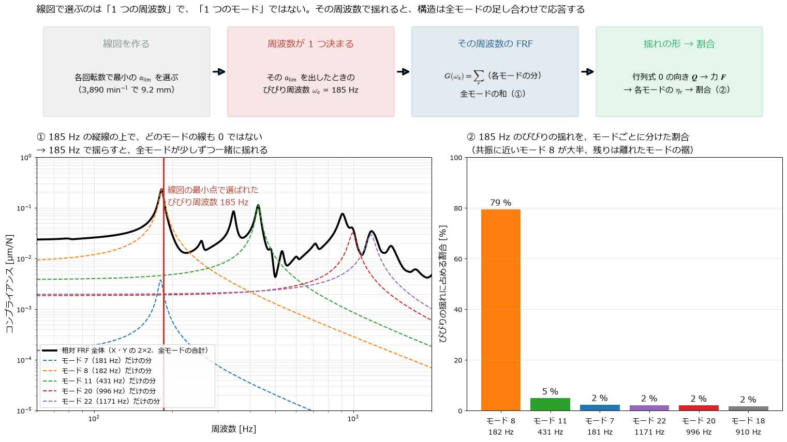

*生成スクリプト: [explain_mode_mix2.py](../analysis/ana005_foundation_accel_chatter/explain_mode_mix2.py)*

以下では、この「足し合わせ」がどういう式になるかを説明します。

5.2 の (4) で、びびりのときの揺れ $\boldsymbol{Q}$ は、切削力 $\boldsymbol{F}$ に対する構造の応答でした。3.5 節で見たように、構造の揺れはいくつかの固有モードの足し合わせで書けます。$\boldsymbol{d}_r$ はモード $r$ で刃先とワークがどう食い違って動くかを表す「形」（X・Y の 2 成分）、$\eta_r$ はそのモードがどれだけ揺れているかを表す「大きさ」（複素数なので位相も含む）です。びびりの揺れは、各モードの形にその大きさを掛けて全部足したものになります。

$\eta_r$ の式は、機械全体の運動方程式から出てきます。FEM の運動方程式は、質量行列 $\boldsymbol{M}$、減衰行列 $\boldsymbol{C}$、剛性行列 $\boldsymbol{K}$、節点にかかる力 $\boldsymbol{f}$ を使って

$$
\boldsymbol{M}\ddot{\boldsymbol{x}} + \boldsymbol{C}\dot{\boldsymbol{x}} + \boldsymbol{K}\boldsymbol{x} = \boldsymbol{f}
$$

と書けます。全節点の変位 $\boldsymbol{x}$ を固有モード $\boldsymbol{\phi}_r$（質量正規化：$\boldsymbol{\phi}_r^T\boldsymbol{M}\boldsymbol{\phi}_r = 1$、$\boldsymbol{\phi}_r^T\boldsymbol{K}\boldsymbol{\phi}_r = \omega_r^2$）の足し合わせ $\boldsymbol{x} = \sum_r \boldsymbol{\phi}_r\,\eta_r$ で表し、両辺に左から $\boldsymbol{\phi}_r^T$ を掛けると、モードどうしの直交性によって、モードごとにばらばらの 1 自由度の式になります（減衰は Rayleigh 減衰なので同じように分かれます）。

$$
\ddot{\eta}_r + 2\zeta_r\omega_r\,\dot{\eta}_r + \omega_r^2\,\eta_r = \boldsymbol{\phi}_r^T\boldsymbol{f}
$$

力が周波数 $\omega_c$ で振動している（$\boldsymbol{f}e^{i\omega_c t}$、$\eta_r e^{i\omega_c t}$）とすると、$\ddot{\eta}_r = -\omega_c^2\eta_r$、$\dot{\eta}_r = i\omega_c\eta_r$ なので

$$
\eta_r = \frac{\boldsymbol{\phi}_r^T\boldsymbol{f}}{\omega_r^2 - \omega_c^2 + 2i\zeta_r\omega_r\omega_c}
$$

です。切削力はワークに $+\boldsymbol{F}$、刃先に $-\boldsymbol{F}$ と逆向きの対でかかるので、分子は $\boldsymbol{\phi}_r(\text{ワーク})^T\boldsymbol{F} - \boldsymbol{\phi}_r(\text{刃先})^T\boldsymbol{F} = \boldsymbol{d}_r^T\boldsymbol{F}$ になり、上の式が得られます。分子の $\boldsymbol{d}_r^T\boldsymbol{F}$ は「切削力がそのモードをどれだけ押せるか」、分母は「びびり周波数がそのモードの固有振動数にどれだけ近いか」を表しています。3.5 節の相対 FRF のモード分解の式も、これを $\boldsymbol{F}$ で割ったものです。

$$
\boldsymbol{Q} = \sum_r \boldsymbol{d}_r\,\eta_r,\qquad
\eta_r = \frac{\boldsymbol{d}_r^{T}\boldsymbol{F}}{\omega_r^2 - \omega_c^2 + 2i\zeta_r\omega_r\omega_c}
$$

モード $r$ がどれだけ混ざるかは、分母と分子の 2 つで決まります。分母は**びびり周波数がそのモードの固有振動数にどれだけ近いか**で、近いほど大きく揺れます。分子は**切削力の向きとモードの形がどれだけ合っているか**で、力の向きにそのモードが動ける形なら大きくなります。

割合は、$a_{\lim}$ の式からではなく、限界の点でのびびりの形 $\boldsymbol{Q}$ から出します。$a_{\lim}$ と $\omega_c$ が決まると、(5) の行列 $I + a_pK_t(1-e^{-i\omega_c\tau})GB_0$ は行列式が 0 になる、つまり掛けると 0 になる向きを 1 つ持ちます。その向きがびびりの形 $\boldsymbol{Q}$（X・Y の比と位相）です。そこから切削力 $\boldsymbol{F} \propto B_0\boldsymbol{Q}$ を作り、上の式で各モードの $\eta_r$ を計算して、刃先とワークのずれへの寄与の大きさで割合を決めます。

$$
\text{割合}_r = \frac{|\eta_r|\,\|\boldsymbol{d}_r\|}{\sum_s |\eta_s|\,\|\boldsymbol{d}_s\|}
$$

$\boldsymbol{Q}$ の大きさ自体は決まらない（限界ではどの振幅でも続く）ので、絶対値ではなく割合だけに意味があります。

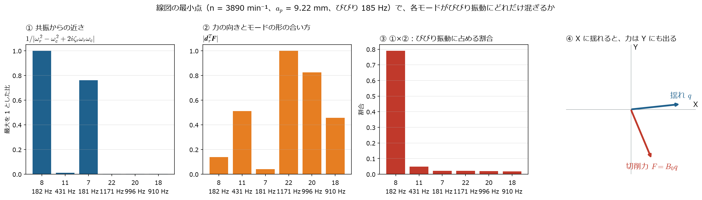

*生成スクリプト: [explain_mode_mix.py](../analysis/ana005_foundation_accel_chatter/explain_mode_mix.py)*

線図の最小点（185 Hz）では、モード 8（182 Hz）がびびり周波数のすぐ近くにあるので分母が小さく、79 % を占めます。モード 11（431 Hz）は固有振動数が離れていて分母は大きいのですが、5 % 混ざっています。これは ④ のように、刃先が X に揺れると、$B_0$ の非対角成分のせいで切削力が主に Y 方向に出るからです。Y 方向に動くテーブルのモード 11 は力の向きとよく合っていて（分子が大きい）、共振から離れていても少し引きずられます。逆にモード 22・20 などの高い周波数のモードは、力の向きとはよく合っていても、共振から遠すぎてほとんど混ざりません。

#### どこを直すべきか：変形のエネルギーがどこにたまっているか

モードの固有振動数を上げたり山を低くしたりするには、そのモードで**変形のエネルギー（ひずみエネルギー）がたまっている場所**を硬くするのがいちばん効きます。エネルギーがたまっていない所を硬くしても、そのモードはほとんど変わりません。各モードの変形エネルギーを、ガイドのばね・ボールねじのばね・脚のばね・ソリッド（鋳物・主軸など）に分けました。

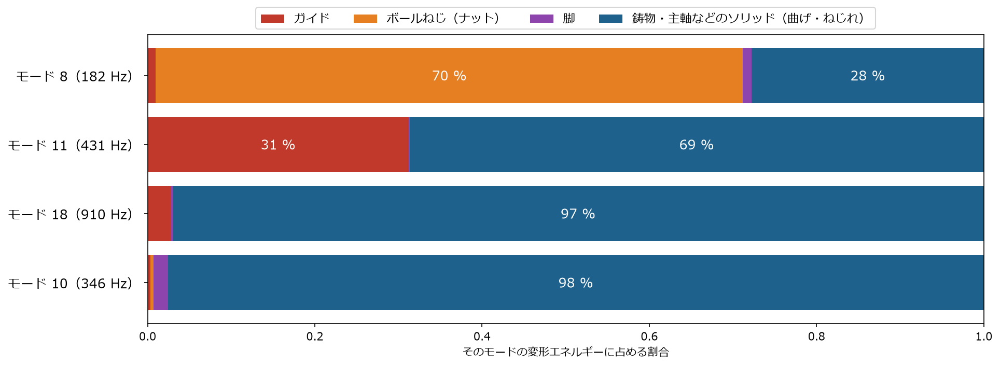

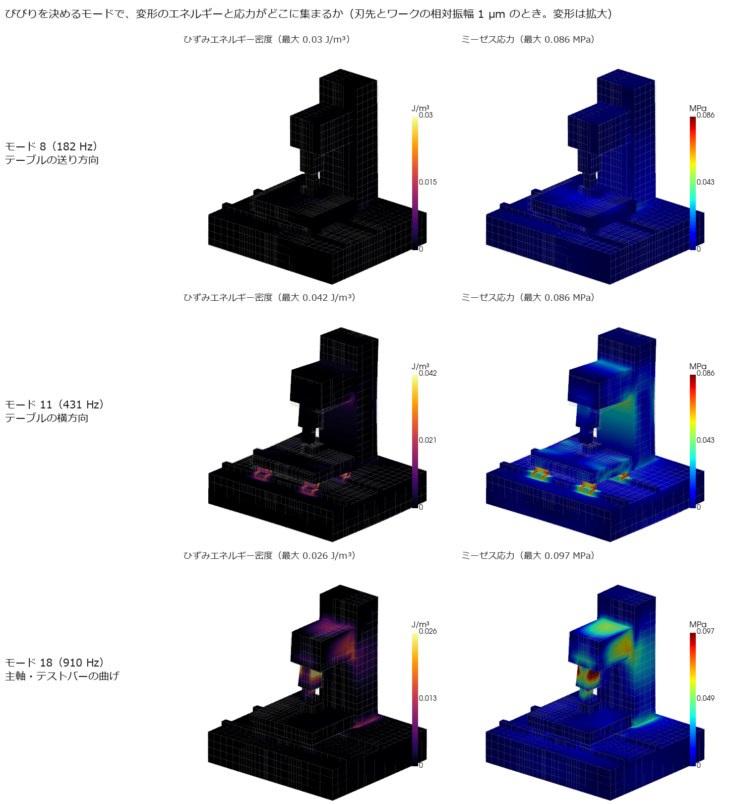

*生成スクリプト: [strain_energy.py](../analysis/ana005_foundation_accel_chatter/strain_energy.py)、[render_energy.py](../analysis/ana005_foundation_accel_chatter/render_energy.py)（固有値解析で要素のひずみエネルギーと応力を出力）*

固有モードの形には決まった大きさがなく、固有値解析の出力の応力やエネルギーの値はそのままでは意味を持ちません（どこが相対的に大きいかだけが分かる）。そこでこの図では、各モードを「刃先とワークの相対振幅が 1 µm になる大きさ」にそろえてから応力とエネルギー密度を描き、カラーバーに値を入れています。びびりで刃先とワークが 1 µm 食い違って揺れているとき、どこにどれだけの応力がかかるかとして読めます。値は振幅に比例し（エネルギーは振幅の 2 乗）、相対振幅が 10 µm なら応力は 10 倍です。

モード 8 の図がほぼ真っ暗なのは、変形のエネルギーの 70 % がソリッドではなくボールねじのばねにたまっていて、鋳物の部分はほとんど変形していないためです。この図にはばねの中のエネルギーは描かれないので、上の棒グラフと合わせて読んでください。モード 11 ではキャリッジの周り、モード 18 では主軸の付け根とテストバーの付け根、主軸頭の前面に応力が集まっています。

| モード | 何が効いているか | 直す場所 |
|---|---|---|
| モード 8（182 Hz、限界の最小を決める） | 変形エネルギーの **70 % がボールねじのばね**、ガイドは 1 %、残りの 28 % はテーブル・ベッドなどのソリッド | **ボールねじ（送り系）の軸方向剛性**：ねじ軸の径、支持方式（固定―固定）、ナットの予圧、サポート軸受（[study/ref004](../study/ref004_工作機械_ばね剛性と減衰の決め方.md)）。テーブル結合 10 倍で限界が 9.4 → 16.4 mm になったのはこのため |
| モード 11（431 Hz） | ガイドの横ばねが 31 %、残りはキャリッジ付近とコラムのソリッド | ガイドの横剛性（形番・予圧）、キャリッジ取付部 |
| モード 18（910 Hz、多くの回転数で効く） | 97 % がソリッド。応力は**主軸の付け根（主軸頭との境）とテストバーの付け根**、主軸頭の前面に集中 | 主軸頭から突き出す主軸まわりの剛性。実機では主軸軸受とツールホルダの剛性がここに入る |

このモデルで「限界の最小値」を上げたいなら、ボールねじの剛性を上げるのが最も効きます。広い回転数で限界を上げたいなら、主軸の付け根の剛性が次の対象です。

主軸とテストバーの曲げ（910・996 Hz）が効くのは、このモデルでは主軸（100 mm 角・長さ 150 mm）を主軸頭に完全結合し、そこからテストバーが突き出しているためです。実機では主軸軸受と工具把持部（ツールホルダ・テーパ）の剛性がここに入るので、そのばねを入れると周波数はさらに下がる可能性があります。

「テーブル結合 10 倍」は、ガイド・ナットが限界にどれだけ効くかを調べる感度試験で、10 倍の部品を提案するものではありません。

### 5.4 どの FRF を使うかで、限界とびびりモードはどう変わるか

実機では、刃先だけを叩いた FRF やテーブルだけを叩いた FRF を測ることも多いので、同じ基礎ばねモデルから 3 種類の FRF を作り、同じ切削条件で線図を描いて比べました。A は刃先だけを叩いた FRF でワークは動かないと仮定したもの、B はテーブル上のワークだけを叩いた FRF で工具は動かないと仮定したもの、C は刃先とワークの相対 FRF です。

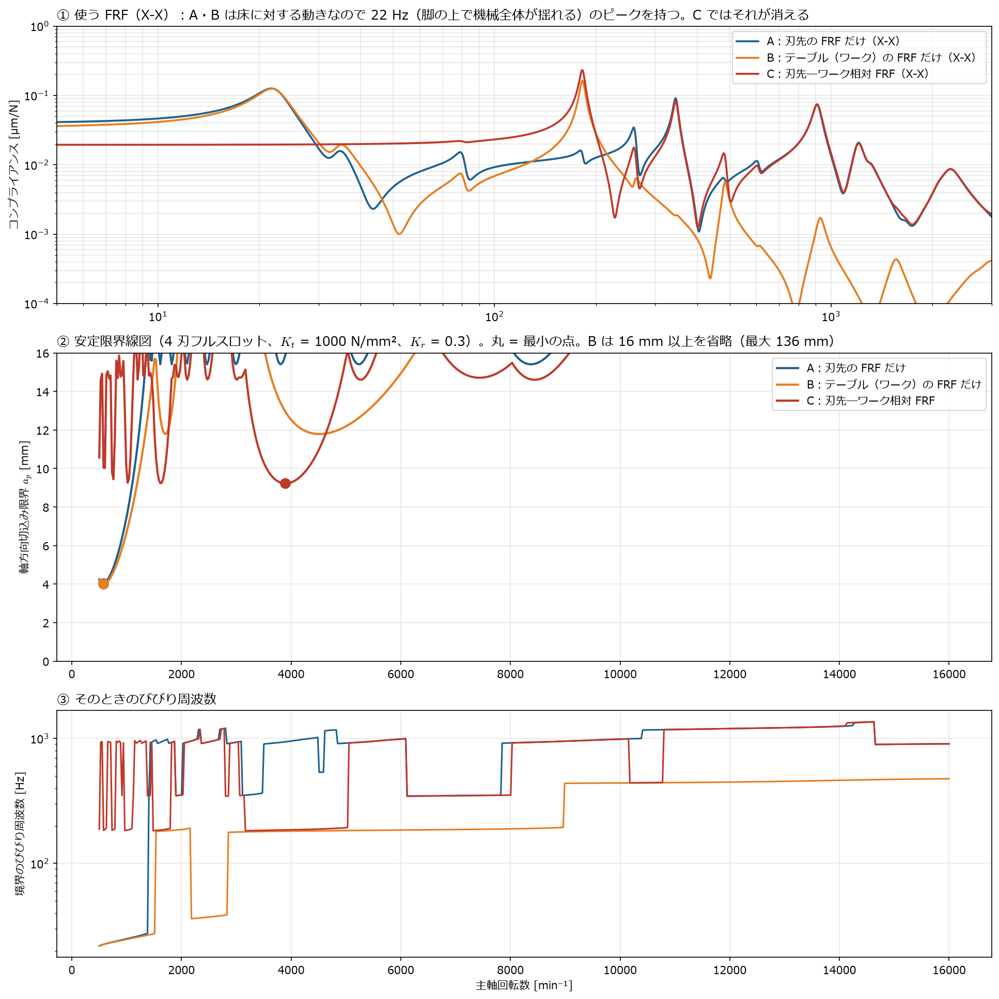

*生成スクリプト: [stability_compare.py](../analysis/ana005_foundation_accel_chatter/stability_compare.py)*

①のコンプライアンスにはいくつも山があるので、主な 4 つの山がそれぞれどのモードなのかを下のアニメーションで並べました。左から、FRF のどの山か（黒い縦線）、そのモードの揺れ方、ひずみエネルギー密度、ミーゼス応力です。応力とエネルギーは、そのモードの最大変位が 1 µm になる大きさにそろえた値なので、行どうしで大きさを比べられます。

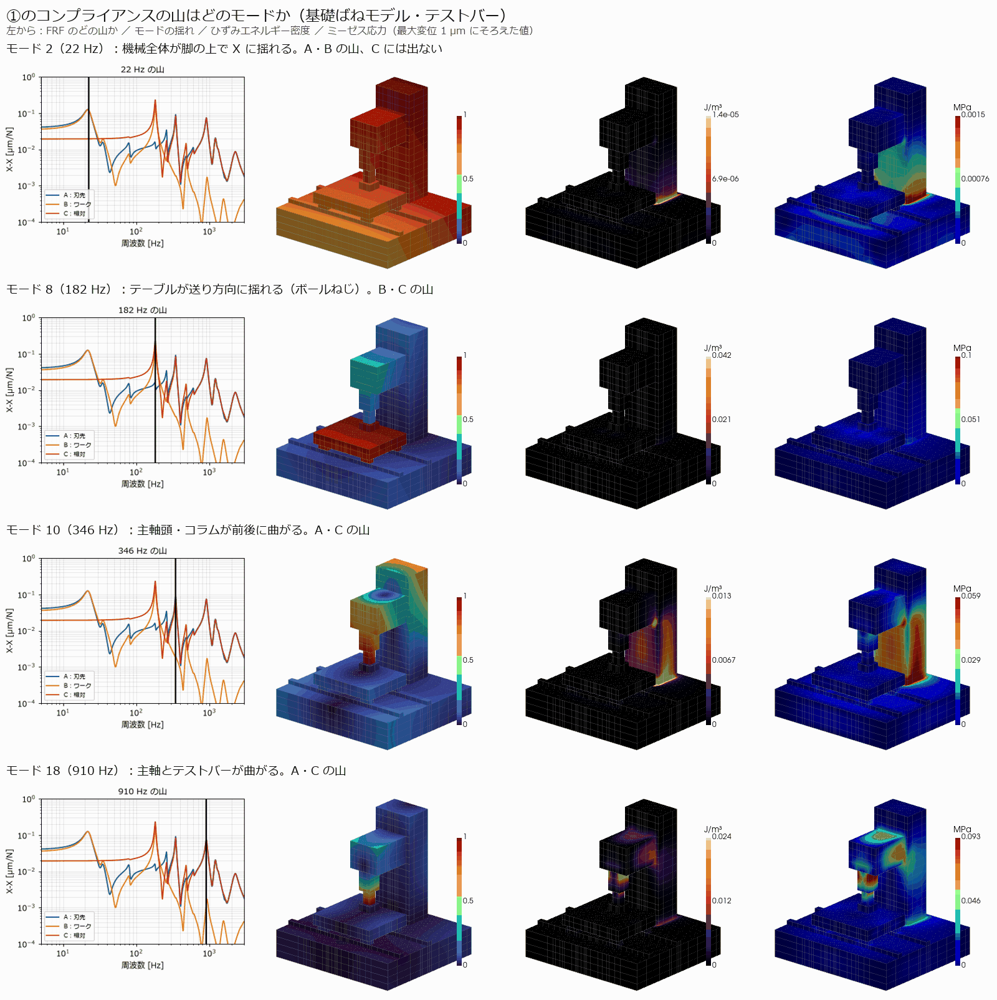

*生成スクリプト: [peak_modes_anim.py](../analysis/ana005_foundation_accel_chatter/peak_modes_anim.py)*

いちばん上の 22 Hz（モード 2）は、機械全体が脚のばねの上で X 方向に揺れるモードです（同じ 22 Hz のモード 1 は Y 方向の揺れ）。全体が同じように動くので構造体の中にはほとんどひずみが生まれず、応力も 0.002 MPa 程度しかありません。刃先（A）とワーク（B）を床に対して測ると大きな山になりますが、両者が一緒に動くので相対（C）には出てきません。A と B の線図が低い回転数で 4 mm まで下がるのは、この山を拾っているためです。

2 段目の 182 Hz（モード 8）は、テーブルが送り方向に揺れるモードで、B と C に大きな山が出ます。C の線図で最小の限界 9.2 mm を決めているのはこのモードです。構造体のひずみエネルギーの図がほとんど黒いのは、エネルギーの 70 % がボールねじのばね（構造体ではなくばね要素）にたまっているからで、構造体の板厚を増やしてもこの山はあまり下がりません。下げるにはボールねじ・ナットまわりの送り方向の剛性を上げることになります。

3 段目の 346 Hz（モード 10）は、主軸頭とコラムが前後に曲がるモードで、刃先側が動くので A と C に山があります。ひずみエネルギーと応力はコラムの根元と主軸頭の付け根に集まっていて、ここが補強すべき場所です。

いちばん下の 910 Hz（モード 18）は、主軸とテストバーが一緒に曲がるモードで、これも A と C の山です。応力は主軸の付け根と、主軸を抱える主軸頭のまわりに集中しています。B にはこれらの刃先側のモードがほとんど出ないので、テーブルだけを叩いた FRF ではこの 2 つの山を見落とします。

②の線図で、低い回転数（約 600 min⁻¹）で限界が 4 mm まで下がっているのは B だけでなく A も同じで、青い線がオレンジの線と重なって見えにくくなっています。どちらも 22 Hz のモードのせいです。びびりの波は、刃 1 枚ぶんの時間 $\tau$ のあいだに $k + \varepsilon/2\pi$ 個入る、という位相の条件（5.2 節 (5)）を満たさないと起きません。22 Hz のような低い周波数では、いちばん波の数が少ない $k = 0$ のローブでも、刃の通過周波数 $Zn/60$ がびびり周波数と同じくらいの低い回転数、ここでは 4 枚刃で 330〜600 min⁻¹ 付近にしか出てきません。だから 22 Hz のモードは低い回転数でだけ限界を下げ、回転数を上げるとその影響は急になくなります（600 → 1,500 min⁻¹ で 4 → 16 mm に上がっている部分）。

| 使う FRF | 最小の切込み限界 | その回転数 | びびり周波数 | 効いているモード（寄与） |
|---|---:|---:|---:|---|
| A：刃先の FRF だけ | 4.04 mm | 578 min⁻¹ | 23 Hz | モード 1（22 Hz, 47 %）、モード 2（22 Hz, 44 %）、モード 18（910 Hz, 1 %） |
| B：テーブル（ワーク）の FRF だけ | 4.00 mm | 578 min⁻¹ | 22 Hz | モード 1（22 Hz, 49 %）、モード 2（22 Hz, 47 %）、モード 8（182 Hz, 2 %） |
| C：刃先―ワーク相対 FRF | 9.22 mm | 3890 min⁻¹ | 185 Hz | モード 8（182 Hz, 86 %）、モード 11（431 Hz, 2 %）、モード 18（910 Hz, 2 %） |

正しい C では、最小 9.2 mm を決めているのはテーブルの 182 Hz のモードです。A と B は、脚の上で機械全体が揺れる 22 Hz のモードを拾うため、低い回転数で 4 mm という誤った限界を出します。このモードでは刃先とワークが一緒に動くので、実際の削り合いには関係しません。

「1 次モードを入れると線図がおかしくなるので外す」という話は、片側だけの FRF を使った場合のことです。相対 FRF ではこのモードは消えるので、外さなくても正しく求まります。モードを外してよいかは、周波数の低さではなく、相対 FRF に出るかどうかで判断します。びびりの評価は相対 FRF で行うのが基本です。

### 5.5 回転数ごとのびびりモード

線図の上の点ごとに、限界のときの振動の形を求め、それがどのモードの重ね合わせでできているかを回転数ごとに調べました。アニメーションでは、回転数を低い方から順に動かしながら、①線図上の位置、②相対コンプライアンスのどの山の近くでびびっているか、③びびり振動そのものの形、④⑤その中で割合の大きい 2 つのモードの形を並べています。

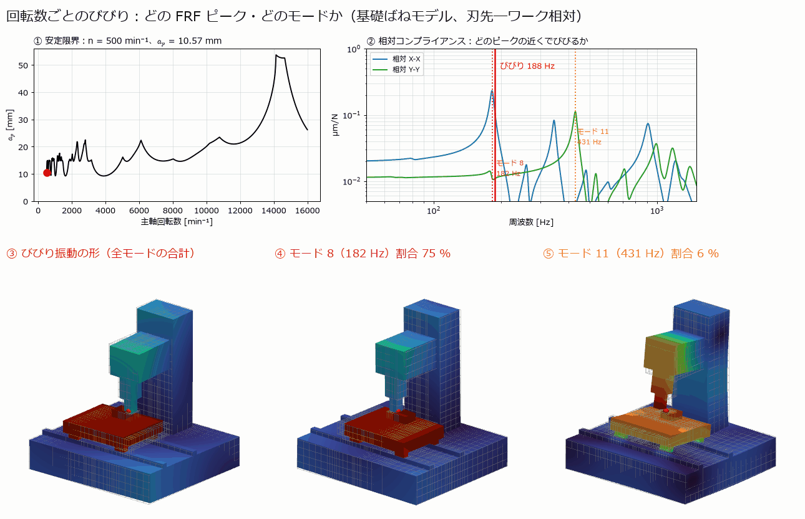

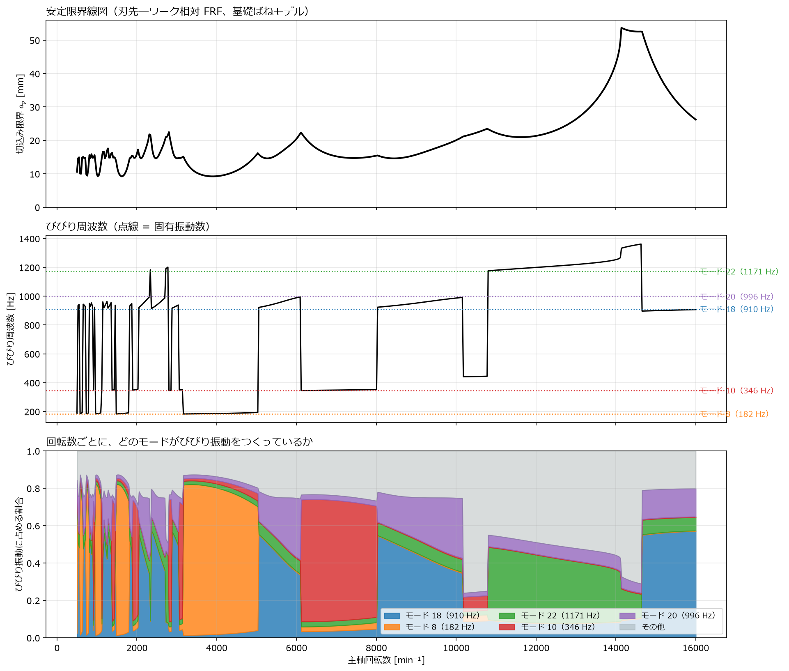

*生成スクリプト: [chatter_by_rpm.py](../analysis/ana005_foundation_accel_chatter/chatter_by_rpm.py)*

| 回転数 [min⁻¹] | 切込み限界 [mm] | びびり周波数 [Hz] | 1 番目のモード | 2 番目のモード |
|---:|---:|---:|---|---|
| 992 | 10.15 | 184 | モード 8（182 Hz） 80 % | モード 11（431 Hz） 5 % |
| 2001 | 15.97 | 353 | モード 10（346 Hz） 58 % | モード 11（431 Hz） 15 % |
| 3010 | 14.61 | 935 | モード 18（910 Hz） 50 % | モード 20（996 Hz） 18 % |
| 3993 | 9.27 | 186 | モード 8（182 Hz） 78 % | モード 11（431 Hz） 5 % |
| 6012 | 20.67 | 990 | モード 18（910 Hz） 35 % | モード 20（996 Hz） 32 % |
| 8004 | 15.42 | 352 | モード 10（346 Hz） 59 % | モード 11（431 Hz） 15 % |
| 9997 | 20.05 | 987 | モード 18（910 Hz） 36 % | モード 20（996 Hz） 31 % |
| 11989 | 21.33 | 1199 | モード 22（1171 Hz） 36 % | モード 23（1205 Hz） 30 % |
| 14008 | 43.44 | 1254 | モード 22（1171 Hz） 28 % | モード 23（1205 Hz） 24 % |
| 16000 | 26.20 | 907 | モード 18（910 Hz） 57 % | モード 20（996 Hz） 15 % |

回転数によって主役のモードが入れ替わります。限界がいちばん低い谷（約 1,000 min⁻¹ と 4,000 min⁻¹ 付近）はテーブルの 182 Hz、約 2,000 min⁻¹ と 8,000 min⁻¹ 付近は主軸頭・コラムの 346 Hz、それ以外の多くの回転数は主軸とテストバーの曲げ（910・996 Hz）、12,000 min⁻¹ 以上では 1,171・1,205 Hz のモードが効いています。どの回転数帯を使うかで、直すべき場所が変わります。

### 5.6 底面を固定すると、なぜ切込み限界が変わるのか

テストバーのモデルでは、最小の限界は底面固定 12.0 mm、基礎ばね 9.4 mm で、底面固定のほうが大きくなりました（細い工具のときは逆でした）。どちらも最小点はテーブルの送り方向のモード（約 180 Hz）で決まっていて、違いはその山の高さです。

相対 X-X の 180 Hz 付近の山は、底面固定で 0.19 µm/N、基礎ばねで 0.23 µm/N です。基礎ばねでは脚がわずかに動けるぶん、テーブルの揺れにベッドの揺れが少し加わり、刃先とワークの食い違いが大きくなります。山の負の実部（びびりの起こりやすさ）も −0.060 から −0.101 µm/N に大きくなり、そのぶん限界が下がります。

細い工具のときに基礎ばねのほうが有利だったのは、工具の曲げの周波数の近くに本体側のモードがあって、揺れが分散したためでした。支持条件の良し悪しは、どのモードが限界を決めているかで逆転します。脚の剛性を変えて限界を上げようとするより、限界を決めているモードの部品（ここではボールねじ・ガイド、または主軸側）を直接見直すほうが確実です。

### 5.7 適用範囲

この線図は、仮定した立型モデル・切削係数・零次近似・周波数帯域に対する計算結果。実機への加工条件指定には用いない。主軸軸受・把持・ワーク固定の動特性、回転による変化、周期係数、プロセスダンピング、刃の離脱・非線形性は未検証である。

次は切削係数の同定、刃先FRFの計測、半離散化法／全離散化法との比較、限定した切削試験によるびびり周波数と境界の照合を行う。

理論の参照：[AltintasのMALモデル解説、第4節](https://www.malinc.com/wp-content/uploads/2014/06/JMTSReviewPaper_Altintas.pdf)、[Altintas・Budak、1995](https://doi.org/10.1016/S0007-8506(07)62342-7)。

## 6. 研究テーマと比較条件

| テーマ | 比較条件と評価指標 |
|---|---|
| 基礎支持に応じた指令設計 | 同じ距離・速度・電流上限で、移動＋刃先相対整定を比較 |
| テーブル由来モードの寄与分離 | テーブル質量、ガイド・ナット、基礎、工具系を個別に変えてFRF・SLDを比較 |
| 位置・積載による加工限界の変化 | テーブル中央／端、ワーク質量違いで相対FRF行列とSLDを比較 |
| 指令と加工条件の協調設計 | 加速度・ジャークと主軸回転数・切込みを変え、サイクル時間と加工誤差を評価 |

ジャークのタイミングで機械ベースの振動を抑える実機研究もある。[2026年AMC論文、出版者要旨確認](https://ieeexplore.ieee.org/abstract/document/11435830)。特許検討ではS字指令やSLDそのものより、支持状態の推定、相対振動に効くモードの選別、指令・加工条件の更新手順などの具体的な差を調べる。

## 7. 再現手順と検証記録

```bash
cd analysis/ana005_foundation_accel_chatter
./run_bar.sh                       # テストバーで 3 ケースの FEM → FRF → 安定限界 → モード分解 → 図（約 15 分）
python export_modal_basis.py fixed; python export_modal_basis.py foundation_table_stiff   # 他の 2 ケースのモード基底
python frf_tool_work_rel.py        # 3.3 刃先・ワーク・相対のコンプライアンス
python render_model.py; python render_springs.py   # 2 章のモデル図
python explain_mode_mix.py; python strain_energy.py; python render_energy.py   # 5.3 モードの混ざり方と直す場所
cd k_sweep && ./rerun_bar.sh       # 4.5〜4.6 脚の剛性スイープ
```

`python` は `~/opt/venv/bin/python`、環境変数 `VMC_TOOL=bar`（既定）でテストバー、`slender` で細い工具のモデルになります。

[静解析照合](../analysis/ana005_foundation_accel_chatter/results/static_checks.json)、[相反性・簡略再生モデルの検算](../analysis/ana005_foundation_accel_chatter/results/checks.json)、[フライス境界の検算](../analysis/ana005_foundation_accel_chatter/results/milling_checks.json)、[加減速の仮定と全結果](../analysis/ana005_foundation_accel_chatter/results/acceleration.json)を保存する。

境界の特性行列残差、周波数探索格子を倍にした確認、方向係数の積分、加減速指令の距離・終端速度を検算する。これらは計算の整合確認であり、実機・切削実験の検証とは区別する。

---

[← docs 目次](README.md) ｜ [⌂ トップ](../README.md) ｜ [← 前: ana004 ばねの種類の確認](ana004_CalculiX-FrontISTR_ばねの種類の確認.md) ｜ [次: ana006 主軸頭の高さとコラム位置のびびりパラスタ →](ana006_CalculiX_主軸頭の高さとコラム位置のびびりパラスタ.md)
