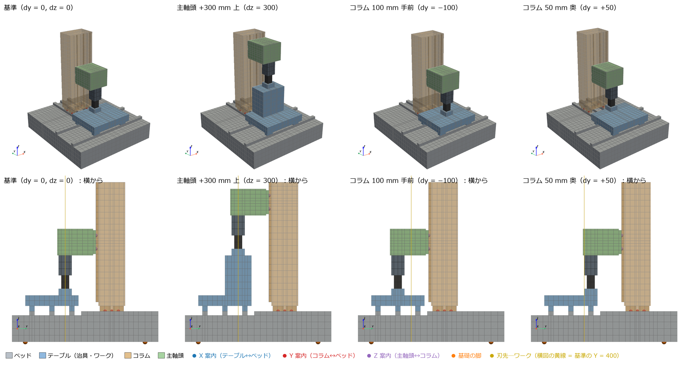
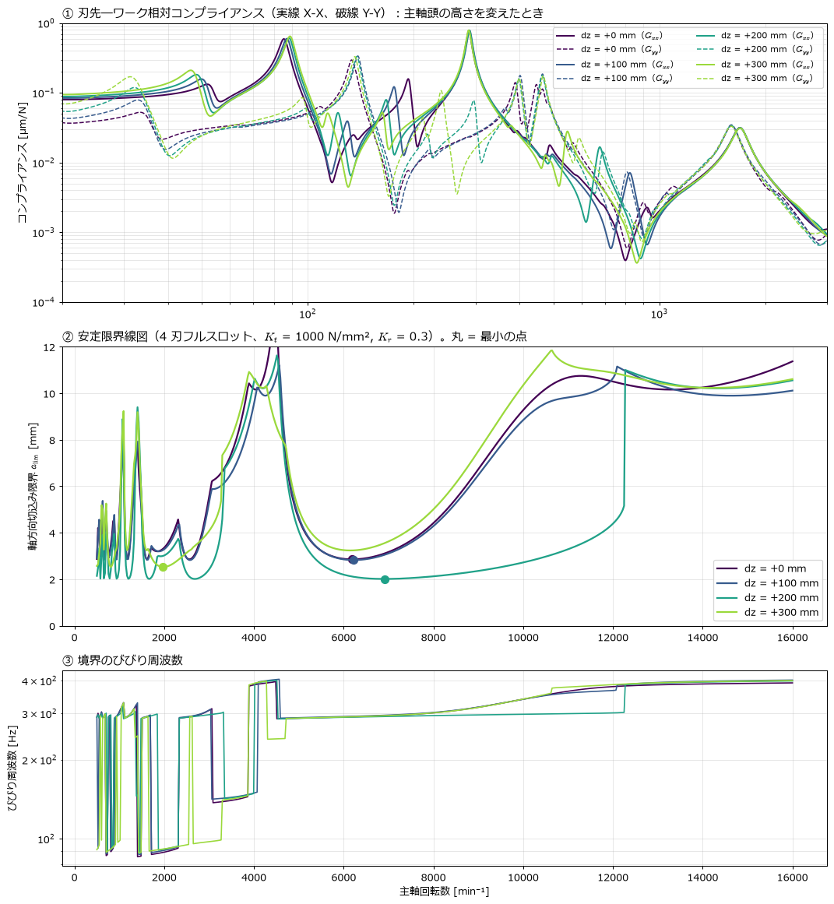
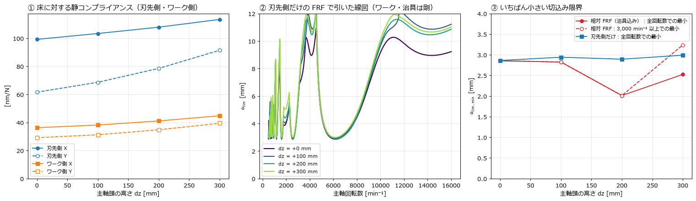
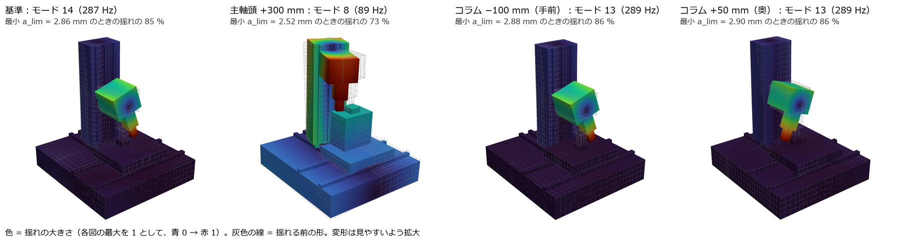
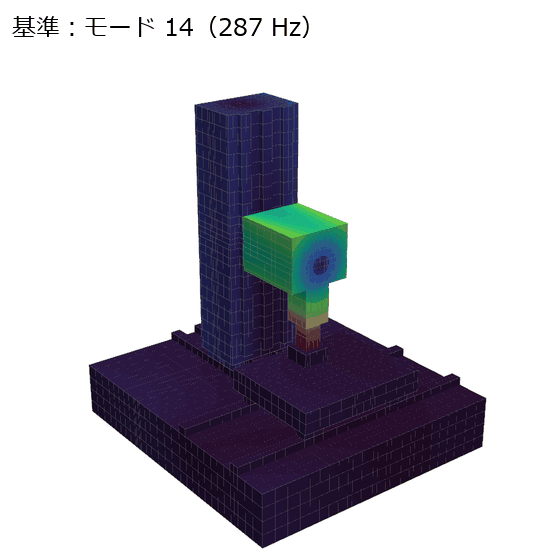
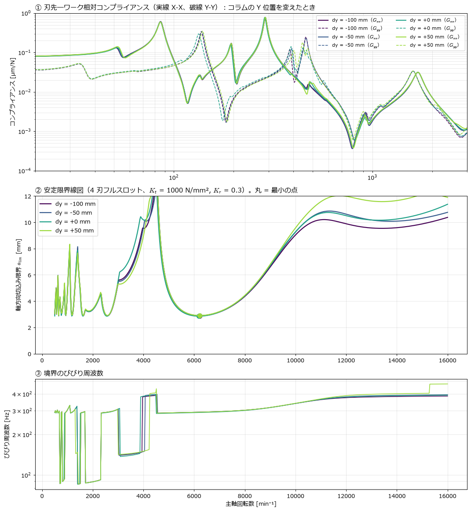
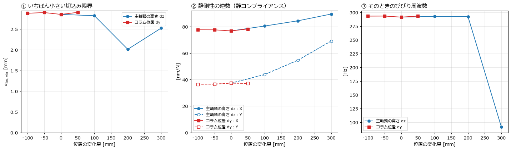

[← docs 目次](README.md) ｜ [⌂ トップ](../README.md) ｜ [← 前: ana005_基礎ばねモデルの加減速と再生びびり分析](ana005_基礎ばねモデルの加減速と再生びびり分析.md)

# ana006 主軸頭の高さとコラム位置を変えたときのびびり（パラメータスタディ）

作成: 2026-11-08。入力・計算コード・結果：[ana006_spindle_column_position](../analysis/ana006_spindle_column_position/)。前提の理論（相対 FRF、安定限界、モードの割合）は [ana005](ana005_基礎ばねモデルの加減速と再生びびり分析.md) の 5 章と同じです。

## 1. 何を調べたか、結論

立型マシニングセンタで、次の 2 つの位置を変えると刃先とワークの間のびびりやすさがどう変わるかを調べました。

- **主軸頭の高さ（Z）**：主軸頭をコラムの Z 案内に沿って上げる。 = 0,\ 100,\ 200,\ 300$ mm
- **コラムの位置（Y）**：コラムをベッドの Y 案内に沿って前後させる。 = -100,\ -50,\ 0,\ +50$ mm

ana005 では主軸頭をコラムと一体のメッシュにしていたため、位置を動かせませんでした。今回はベッド・テーブル・コラム・主軸頭を別々の部品にし、部品どうしを案内（リニアガイドとボールねじ）のばねでつなぎました。こうすると、部品の位置をパラメータとして動かすだけでモデルを作り直せます。

結論は次の 3 つです。

1. **主軸頭を上げても、主軸側のびびりやすさはほとんど変わりません。** 刃先側だけで引いた最小の切込み限界は 2.86 → 2.99 mm です。決めているのは 288 Hz のモードで、主軸頭が Z 案内の上で X 方向に首を振る揺れです。このモードは主軸頭と一緒に上下するので、高さが変わっても形も振動数もほぼ同じです。
2. **静剛性は高さで下がります。** 刃先―ワーク間の静コンプライアンスは、X が 77 → 90 nm/N（+17 %）、Y が 37 → 69 nm/N（+85 %）に増えます。ただし、びびりは静剛性ではなく、いちばん鋭い共振ピーク（ここでは 288 Hz）で決まるため、切込み限界にはあまり出てきません。
3. **高さを稼ぐために足した治具ブロックのほうが効きます。** 治具ブロックの曲げモードが 288 Hz に近づいた  = 200$ mm では、最小の切込み限界が 2.86 → 2.01 mm（−30 %）に下がりました。コラムの Y 位置は ±2 % しか変わらず、メッシュの違い程度です。

## 2. モデル：部品を動かしてばねでつなぐ



上段は斜めから、下段は横（+X 側）から見た図です。左から、基準、主軸頭 +300 mm、コラム 100 mm 手前、コラム 50 mm 奥です。点は接合面の代表点で、青は X 案内、赤は Y 案内、紫は Z 案内、橙は基礎の脚を表します。

| 部品 | 動かし方 | 下の部品とのつなぎ | ばね（キャリッジ 1 個あたり） |
|---|---|---|---|
| ベッド | 動かない | 基礎の脚 4 か所 → 地面 | 水平 10 N/µm、鉛直 100 N/µm |
| テーブル（治具・ワーク） | X は中央で固定 | X 案内：キャリッジ 4 個＋ナット | ラジアル 800、横 560、ねじ軸方向 200 N/µm |
| コラム | Y に $ | Y 案内（ベッド上）：キャリッジ 4 個＋ナット | 同上 |
| 主軸頭（主軸・テストバー） | Y に $、Z に $ | Z 案内（コラム前面）：キャリッジ 4 個＋ナット | 同上 |

ばねの値は ana005 と同じで、カタログ値をもとにした仮定です（ana005 2.3 節）。主軸頭を上げた分は、刃先とワークの高さを合わせるために、ワークの下に治具ブロック（300×200 mm、高さ $、鋳鉄）を足しています。コラムの Y は、コラムごと前後に動くムービングコラム型として扱っています。主軸頭はコラムと一緒に動くので、コラム前面から主軸までの張り出しは変わりません。

### 接合面の作り方

部品どうしは節点を共有しません。案内 1 個ごとに、次の手順でつなぎます。

1. 両側の部品の接触面の中心に、代表点 REF と回転用の補助節点 ROT を置きます。ROT は並進の自由度 1, 2, 3 を回転角 $\theta_x,\theta_y,\theta_z$ として使います。
2. 面上の全節点 $ を、剛体の式で代表点に結びます（`*EQUATION`）。

$$
\boldsymbol{u}_i=\boldsymbol{u}_{\mathrm{REF}}+\boldsymbol{\theta}\times\boldsymbol{r}_i ,\qquad \boldsymbol{r}_i=\boldsymbol{x}_i-\boldsymbol{x}_{\mathrm{REF}}
$$

3. 両側の REF どうしを並進ばねで、ROT どうしを回転ばねでつなぎます（`SPRING2`）。回転ばねは、面に一様に分布した並進ばねと同じモーメント剛性にします。面の法線を $、面内の 2 方向を ,q$（長さ ,L_q$）とすると、次のとおりです。

$$
k_{\theta p}=\frac{k_n L_q^2}{12},\qquad k_{\theta q}=\frac{k_n L_p^2}{12},\qquad k_{\theta n}=\frac{k_p L_q^2+k_q L_p^2}{12}
$$

たとえば Z 案内のキャリッジ 1 個（法線 Y、40×80 mm）は、入力ファイルでは次のようになります。`36375` がコラム側の REF、`36377` が主軸頭側の REF です。

```
*ELEMENT, TYPE=SPRING2, ELSET=SP44_ZCAR1_2     ← Y（ラジアル）方向のばね
7223, 36375, 36377
*SPRING, ELSET=SP44_ZCAR1_2
2, 2
8.000000e+05                                   ← 800 N/µm = 8e5 N/mm
*EQUATION                                      ← 面の節点 3543 の X 変位 = REF の X − θz·(y の腕)
3
3543, 1, 1, 36335, 1, -1, 36336, 3, -20
```

接合面の位置は部品の位置から計算するので、`params.py` の $(dy,dz)$ を変えるだけで、メッシュ・接合面・ばねがすべて作り直されます。

### フォルダ構成

```
ana006_spindle_column_position/
├── params.py            寸法・ばね・切削条件・ケース表（ここだけ書き換える）
├── lib/                 geometry（部品と接合面）→ fem（メッシュ・MPC・ばね・入力）→ modal（モード読み）→ chatter（線図）
├── 01_build_and_run.py  全ケースのモデル作成と CalculiX 固有値解析（1 ケース約 110 s）
├── 02_modal_lobes.py    相対 FRF・安定限界・モードの割合
├── 03〜06_*.py          図
├── run_all.sh           01〜06 を順に実行
├── cases/<ケース名>/    model.inp・結果・model_info.json（接合面ごとの節点番号）
└── results/             図・表（summary.md）・数値（summary.json）
```

## 3. 計算の流れ

各ケースで CalculiX の固有値解析を 100 モード（約 4,300 Hz まで）行います。刃先の下面とワークの上面の節点の動きを剛体として当てはめ、接触点での相対変位 $\boldsymbol{d}_r=\boldsymbol{\phi}_r^{w}-\boldsymbol{\phi}_r^{t}$ をモードごとに求めます。そこからの計算は ana005 と同じです。

$$
\boldsymbol{G}(\omega)=\sum_r \frac{\boldsymbol{d}_r\boldsymbol{d}_r^{\mathsf T}}{\omega_r^2-\omega^2+2i\zeta_r\omega_r\omega},\qquad
a_{\lim}=-\frac{1}{2K_t\,\mathrm{Re}\,\Lambda},\quad \Lambda:\ \boldsymbol{G}\boldsymbol{B}_0 \text{ の固有値}
$$

切削条件は 4 刃フルスロット、=1000$ N/mm²、=0.3$ です。

CalculiX に 100 モードを要求すると、固有値が負の偽モードが 1 本混ざるケースがありました。12 モードの要求では現れず、ほかの固有振動数は 4 桁まで一致したので、固有値が 0 以下のモードは捨てています（捨てた本数は `summary.json` に記録）。

## 4. 結果：主軸頭の高さ（Z）



288 Hz の X-X のピーク（①）は、高さを変えてもほとんど動きません。高さで変わるのは次の 2 か所です。

- 100 Hz 以下のピークと静的な値（左端）が上がります。コラムの曲げと、コラムが Y 案内の上でおじぎする揺れが、刃先の位置が高いほど大きく出るためです。
- 治具ブロックのモード（Y-Y の破線で 240〜370 Hz）が、高くするほど下がってきます。

この 2 つを分けるため、刃先側（主軸頭・コラム）とワーク側（治具）に分けて見ました。



① は床に対する静コンプライアンスを側ごとに示したものです。主軸頭を上げると刃先側の Y が大きく増え（62 → 91 nm/N）、ワーク側も治具の分だけ増えます。② はワークと治具を剛とみなし、刃先側の FRF だけで引いた線図です。4 本がほぼ重なっており、主軸の高さそのものの効果は小さいことがわかります。③ は最小の切込み限界の比較です。

| $ | 最小 {\lim}$（相対 FRF） | 刃先側だけ | 主なモード（割合） |
|---:|---:|---:|---|
| 0 | 2.86 mm（6,193 min⁻¹、291 Hz） | 2.86 mm | 主軸頭の首振り 287 Hz（85 %） |
| 100 | 2.82 mm | 2.94 mm | 主軸頭の首振り 288 Hz（86 %） |
| 200 | **2.01 mm**（6,917 min⁻¹、292 Hz） | 2.89 mm | 主軸頭 288 Hz（77 %）＋**治具 297 Hz（13 %）** |
| 300 | 2.52 mm（1,975 min⁻¹、91 Hz）／3,000 min⁻¹ 以上では 3.24 mm | 2.99 mm | コラムの曲げ 89 Hz（73 %） |

 = 200$ mm では、治具の曲げモード（297 Hz）が主軸頭のモード（288 Hz）のすぐ隣に来ます。2 つのモードが同じびびり周波数で一緒に揺れるため、限界が 3 割下がりました。 = 300$ mm では治具のモードが 240 Hz まで下がって 288 Hz から離れるため、高速側ではかえって良くなっています（3.24 mm）。その代わり、低速側（2,000 min⁻¹ 付近）でコラムの曲げ（89 Hz）が効くようになります。





基準ケースの 287 Hz モードでは、コラムはほとんど動かず、主軸頭が Z 案内のキャリッジを支点に X 方向へ首を振っています。主軸頭を上げても Z 案内ごと上がるので、このモードの形は変わりません。 = 300$ mm の 89 Hz では、コラム全体が曲がり、主軸頭と治具が一緒に揺れています。

## 5. 結果：コラムの位置（Y）



| $ | 最小 {\lim}$ | 静コンプライアンス X / Y |
|---:|---:|---:|
| −100 | 2.88 mm | 77.6 / 36.5 nm/N |
| −50 | 2.90 mm | 77.6 / 36.6 nm/N |
| 0 | 2.86 mm | 76.8 / 37.3 nm/N |
| +50 | 2.90 mm | 78.2 / 37.1 nm/N |

コラムを前後させても、FRF も線図もほとんど重なります。主軸頭がコラムと一緒に動くので、刃先から Y 案内・Z 案内までの距離が変わらないためです。変わるのはベッドのどこにコラムが載るかだけで、ベッドは厚いので差が出ません。2,000 min⁻¹ 以下と 12,000 min⁻¹ 以上で少し差が出るのは、400〜470 Hz の Y 方向のモードが少し動くためです。



## 6. 注意点

- **主軸頭とコラムを案内のばねでつないだため、ana005 より柔らかくなっています。** 最小の切込み限界は ana005 の 9.2 mm に対して 2.9 mm です。ana005 では主軸頭がコラムに一体で付いていました。値の大小よりも、位置による変化の傾向を見てください。
- 主軸頭の首振り（288 Hz）の強さは、Z 案内のキャリッジの間隔（Z 方向 100 mm、X 方向 180 mm）とばね定数で決まります。実機ではキャリッジの間隔はもっと広く、案内も大きいので、この振動数はもっと高くなるはずです。
- 治具ブロックの寸法は 1 つしか試していません。 = 200$ mm の落ち込みは、この治具の大きさで起きた「モードが重なる」現象です。治具を変えれば別の高さで起こり得ます。
- コラムの Y はムービングコラム型として扱いました。サドル型（テーブルが Y に動く）の場合、Y 位置で変わるのはテーブルとサドルの張り出しなので、別のモデルが必要です。
- テーブルの X 位置は中央に固定しています。
- 低速域のプロセスダンピングは入れていません（ana005 と同じ）。
- 刃先とワークの接触面は剛体にしていないので、接触点の動きは面の節点の剛体フィットで求めています。高次の一部のモードではワーク側の残差が 2〜3 割ありますが、限界を決める 288 Hz 付近のモードでは小さいです。

## 7. 次にやるなら

- Z 案内のキャリッジの間隔とばね定数を変え、288 Hz のモードがどれだけ上がるかを見る（主軸頭の首振りを抑える設計）。
- 治具ブロックの寸法を変え、モードが重なる高さを避けられるか確かめる。
- テーブルの X 位置を変える。

---

[← docs 目次](README.md) ｜ [⌂ トップ](../README.md) ｜ [← 前: ana005_基礎ばねモデルの加減速と再生びびり分析](ana005_基礎ばねモデルの加減速と再生びびり分析.md)
