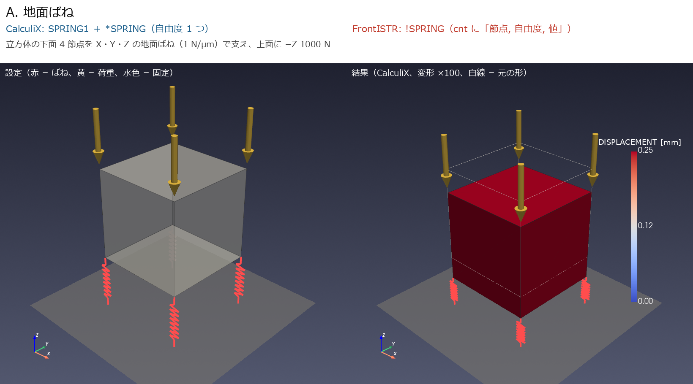
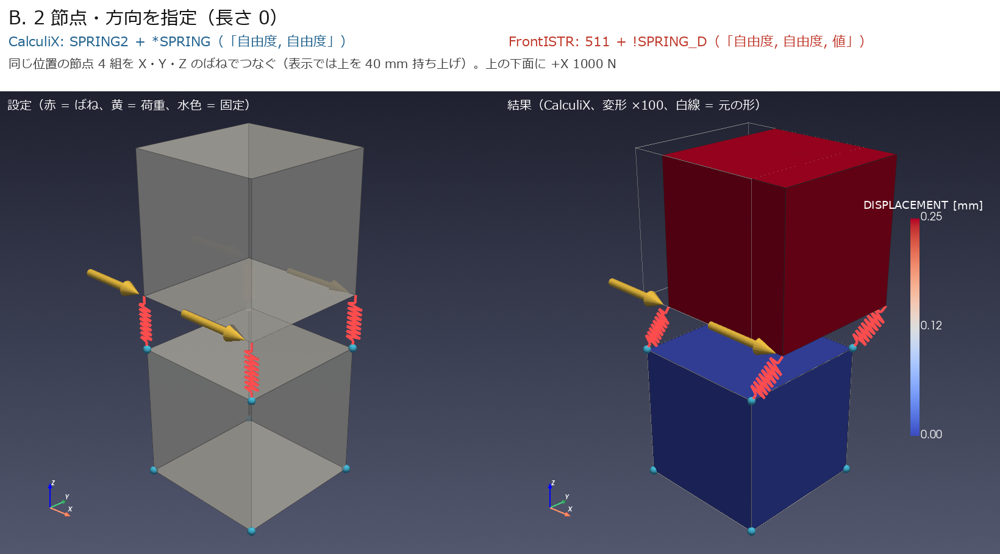
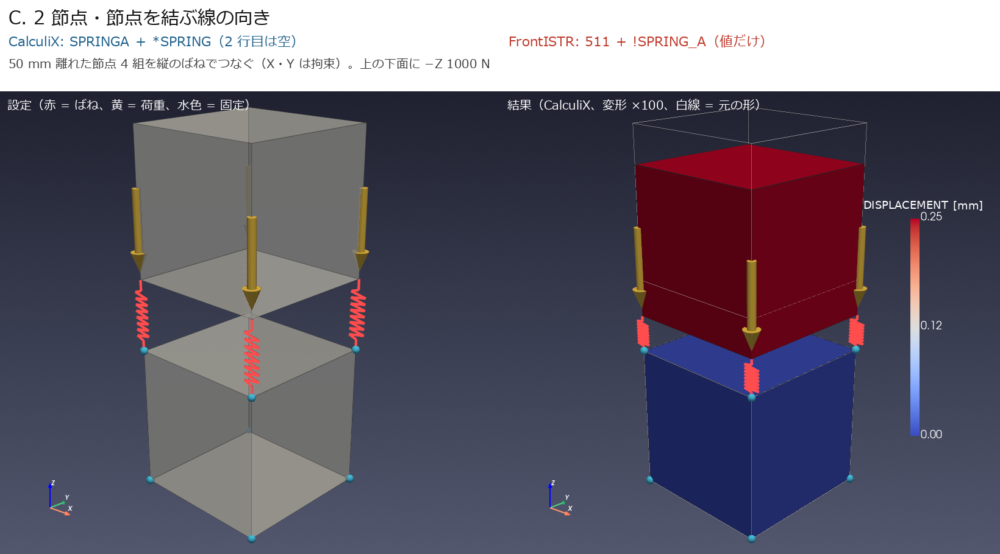
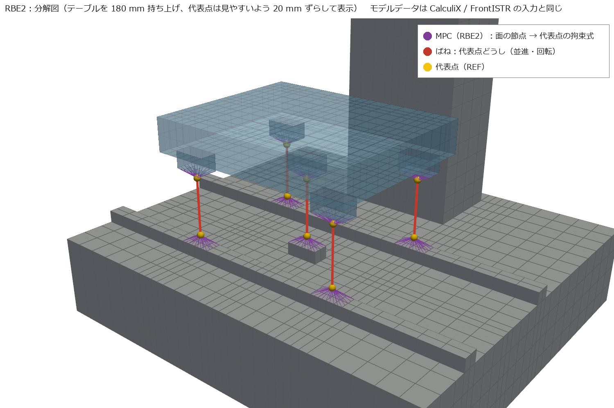

[← docs 目次](README.md) ｜ [⌂ トップ](../README.md) ｜ [← 前: ref000 オープンソースマルチフィジックス総覧](ref000_overview_オープンソースマルチフィジックス総覧.md) ｜ [次: ref006 6.0の変更点と5.9との比較 →](ref006_FrontISTR_6.0の変更点と5.9との比較.md)

# ref005 CalculiX と FrontISTR の設定比較（ばね・MPC・固有値・周波数応答・減衰）

作成: 2026-11-07
対象: CalculiX 2.21、FrontISTR 6.0（5.9 でも同じ結果。違いは [ref006](ref006_FrontISTR_6.0の変更点と5.9との比較.md)）

「✅ 実行確認」は ana001〜003 で実際に動かして結果を確かめたもの。それ以外はマニュアル・ソースで確認したもの。

## 1. ばね

| やりたいこと | CalculiX | FrontISTR |
|---|---|---|
| 節点と**地面**の間のばね | `SPRING1` 要素 ＋ `*SPRING` | `!SPRING`（cnt、要素不要）。マニュアル上は静解析と陰解法の動解析で使える |
| **2節点間、方向を指定**したばね（変形に追従しない） | ✅ `SPRING2` 要素 ＋ `*SPRING`（2行目「自由度1, 自由度2」、3行目「ばね定数」） | ✅ `511` 要素（`!SECTION, TYPE=INTERFACE`）＋ cnt の `!SPRING_D`（「自由度1, 自由度2, ばね定数」） |
| 2節点間、**節点を結ぶ線の方向**のばね | `SPRINGA` 要素（長さ 0 は不可） | `511` 要素 ＋ `!SPRING_A` |
| 非線形ばね（力−変位の表） | `*SPRING, NONLINEAR` | ― |
| ダッシュポット（減衰器） | `DASHPOTA` 要素 ＋ `*DASHPOT` | `511` 要素 ＋ `!DASHPOT_D` / `!DASHPOT_A` |
| 固有値解析でばねが効くか | ✅ 効く | ✅ 効く（マニュアルに明記なし。ana001 で確認） |
| ばね定数の書き方の注意 | 1つの `*SPRING` に値は 1つ → 値ごとに ELSET を分ける | 値ごとに材料を分ける。**cnt の `!MATERIAL` 名はメッシュ側にも同名の材料が必要**（無いと `Fail in read in material definition`） |

### 1.1 ばねの種類ごとの設定ファイルと図（実際に解いた最小モデル）

3 種類のばねを、立方体（1 辺 100 mm の鋼、8 節点六面体 1 個）の最小モデルで **CalculiX と FrontISTR の両方で実際に解いた**（[analysis/ana004](../analysis/ana004_ccx_fistr_spring_types/)）。
ばね定数はすべて $k = 1000$ N/mm（= 1 N/µm）、4 本で 1000 N を受けるので、手計算は $u = F/(4k) = 0.25$ mm。

| ケース | ばね | 理論値 [mm] | CalculiX [mm] | FrontISTR [mm] |
|---|---|---|---|---|
| A_ground | 地面ばね（SPRING1 / !SPRING） | -0.2500 | -0.2500 | -0.2500 |
| B_spring2 | 2節点・方向指定（SPRING2 / 511+!SPRING_D） | 0.2500 | 0.2500 | 0.2500 |
| C_springa | 2節点・軸方向（SPRINGA / 511+!SPRING_A） | -0.2500 | -0.2500 | -0.2500 |

3 ケースとも、両ソルバが手計算と一致した（A の −0.25005 は立方体自体の縮み 0.00005 mm を含む）。

図は ParaView と同じ VTK ライブラリ（pyvista）で描いた。左 = 設定（赤 = ばね、黄 = 荷重、水色 = 固定点）、右 = CalculiX の結果（変形を 100 倍に拡大、色 = 変位の大きさ）。

#### A. 地面ばね（節点 ↔ 地面）



CalculiX（[model.inp](../analysis/ana004_ccx_fistr_spring_types/A_ground/ccx/model.inp)）: **1 節点の要素 `SPRING1`** を作り、`*SPRING` で自由度と値を与える。

```text
*ELEMENT, TYPE=SPRING1, ELSET=GS3     ← 1 節点の要素（相手は地面）
200, 1                                 ← 要素番号, 節点
201, 2
202, 3
203, 4
*SPRING, ELSET=GS3
3                                      ← 効かせる自由度（3 = Z）。1 つだけ書ける
1000.0                                 ← ばね定数 [N/mm]
```

X・Y・Z の 3 方向に入れるなら、ELSET を 3 つ（GS1, GS2, GS3）作って同じことを繰り返す。

FrontISTR（[model.cnt](../analysis/ana004_ccx_fistr_spring_types/A_ground/fistr/model.cnt)）: **要素は不要**。解析制御ファイル（cnt）に `!SPRING` を書くだけ。

```text
!SPRING
 SPRN, 1, 1000.0                       ← 節点グループ（または節点番号）, 自由度, ばね定数
 SPRN, 2, 1000.0
 SPRN, 3, 1000.0
```

`SPRN` はメッシュファイル（msh）の `!NGROUP, NGRP=SPRN` で定義した節点グループ（下面 4 節点）。

#### B. 2 節点・方向を指定（長さ 0 のばね）

工作機械のガイド・ボールねじのように、**同じ位置にある 2 つの節点**（レール側とキャリッジ側）を方向ごとのばねでつなぐ。ana001〜003 で使っている方式。
（図では、ばねが見えるように上の立方体を 40 mm 持ち上げて描いている。実際は長さ 0）



CalculiX（[model.inp](../analysis/ana004_ccx_fistr_spring_types/B_spring2/ccx/model.inp)）: **2 節点の要素 `SPRING2`**。`*SPRING` の 2 行目に「節点 1 側の自由度, 節点 2 側の自由度」。

```text
*ELEMENT, TYPE=SPRING2, ELSET=S2_1
200, 5, 11                             ← 要素番号, 下の立方体の節点, 上の立方体の節点
201, 6, 12
202, 7, 13
203, 8, 14
*SPRING, ELSET=S2_1
1, 1                                   ← 節点 1 の X と 節点 2 の X をつなぐ
1000.0
```

Y・Z も同じように ELSET を分けて書く（1 つの `*SPRING` には自由度の組と値が 1 つずつ）。

FrontISTR: **メッシュ（msh）に 511 要素と「ダミー材料」**、**制御（cnt）にばねの値**を書く（2 ファイルに分かれる）。

```text
（model.msh）
!ELEMENT, TYPE=511, EGRP=ESPR           ← 2 節点のばね（インターフェース）要素
200, 5, 11
201, 6, 12
202, 7, 13
203, 8, 14
!MATERIAL, NAME=SPMAT, ITEM=1           ← ダミー材料（cnt と同じ名前が msh に無いとエラー）
!ITEM=1, SUBITEM=2
1.0, 0.3
!SECTION, TYPE=INTERFACE, EGRP=ESPR, MATERIAL=SPMAT

（model.cnt）
!MATERIAL, NAME=SPMAT
!SPRING_D                               ← 方向指定のばね
 1, 1, 1000.0                           ← 節点 1 の自由度, 節点 2 の自由度, ばね定数
 2, 2, 1000.0                           ← 1 つの材料に X・Y・Z をまとめて書ける
 3, 3, 1000.0
```

#### C. 2 節点・節点を結ぶ線の向き（長さのあるばね）

ばねの向きを自由度で指定せず、**2 つの節点を結ぶ線の向き**に効かせる（コイルばね・棒のようなもの）。長さ 0 は不可。



CalculiX（[model.inp](../analysis/ana004_ccx_fistr_spring_types/C_springa/ccx/model.inp)）:

```text
*ELEMENT, TYPE=SPRINGA, ELSET=SA
200, 5, 11                              ← z=100 と z=150 の節点（長さ 50 mm）
...
*SPRING, ELSET=SA
                                        ← 2 行目は空行（向きは節点の位置で決まる）
1000.0
```

FrontISTR（msh は B と同じ 511 要素＋ダミー材料）:

```text
!MATERIAL, NAME=SPMAT
!SPRING_A                               ← 軸方向のばね
 1000.0                                 ← ばね定数だけ
```

この種類は線と直角な向きには抵抗しないので、このモデルでは上の立方体の X・Y を拘束した（拘束しないと横にずれて解けない）。

#### どれを使うか

| 種類 | 工作機械での使いどころ |
|---|---|
| A 地面ばね | 機械を床（基礎・レベリングブロック）に載せる。床側を作らずに済む |
| B 方向指定・長さ 0 | **ガイド・ボールねじ・ボルト結合など、面と面の間**（向かい合う節点をつなぐ）。ana001〜003 |
| C 軸方向・長さあり | 斜めの支え、ばね・ダンパ部品そのもの、カウンタバランス |
| 代表点＋MPC＋B | 面が細かく分割されていて節点が向かい合わないとき、面の回転剛性も入れたいとき（ana003） |

#### ParaView で同じ図を見る

[results/](../analysis/ana004_ccx_fistr_spring_types/results/) の `A_ground.vtu`・`B_spring2.vtu`・`C_springa.vtu` を ParaView で開く。
ばねは線（VTK_LINE）の要素、変位は `DISPLACEMENT` として入れてある。

1. File → Open で `.vtu` を開き、Apply
2. Filters → Warp By Vector（Vectors = `DISPLACEMENT`、Scale Factor = 100）
3. 色を `DISPLACEMENT`（Magnitude）にする。カラーマップは既定の Cool to Warm
4. ばねだけ見たいときは Threshold で `kind` = 1（立方体は 0）

生成スクリプト: [make_and_run.py](../analysis/ana004_ccx_fistr_spring_types/make_and_run.py)（入力作成・実行・照合）、[render.py](../analysis/ana004_ccx_fistr_spring_types/render.py)（図と VTU）

## 2. 面と面をつなぐ（代表点・MPC）

| やりたいこと | CalculiX | FrontISTR |
|---|---|---|
| 線形の拘束式 | ✅ `*EQUATION`（最初の項が従属自由度） | ✅ `!EQUATION`（メッシュファイル。2行目「項数, 定数」） |
| 剛体結合（RBE2 相当） | `*RIGID BODY, NSET=…, REF NODE=…, ROT NODE=…`、`*COUPLING` ＋ `*KINEMATIC` | 専用機能なし → ✅ 標準の `!EQUATION`（線形拘束式）を、剛体の式から係数を計算して並べる（自作スクリプトで生成、ソルバの改造なし。ana003） |
| 平均結合（RBE3 相当） | `*COUPLING` ＋ `*DISTRIBUTING` | 専用機能なし → ✅ 同上（重み付き平均の式を `!EQUATION` で書く。ana003） |
| 回転のばね | ROT NODE の並進自由度を回転として使う（`*RIGID BODY` の仕組みと同じ） | ✅ 補助節点の並進自由度を回転として使う（ana003） |
| 面どうしを固着 | `*TIE` | `!CONTACT` の TIED |
| 接触（ペナルティ） | `*CONTACT PAIR` ＋ `*SURFACE BEHAVIOR`（線形の圧力−食い込みで「面ばね」にもなる） | `!CONTACT`（静解析・動解析） |

代表点＋MPC の図（ana003 のモデル。CalculiX・FrontISTR に渡したのと同じ節点・拘束式・ばねのデータから描いたもの）:



*紫の細線 = 拘束式（面の節点 → 代表点）、赤 = 代表点どうしのばね、黄 = 代表点。テーブルを 180 mm 持ち上げた分解図。
生成スクリプト: [make_mpc_figs.py](../analysis/ana003_ccx_fistr_mpc_spring/make_mpc_figs.py)。詳しくは [ana003](ana003_CalculiX-FrontISTR_代表点MPCばねの比較.md)*

## 3. 固有値解析

| 項目 | CalculiX | FrontISTR |
|---|---|---|
| キーワード | ✅ `*FREQUENCY`（2行目にモード数） | ✅ `!SOLUTION, TYPE=EIGEN` ＋ `!EIGEN`（モード数, 収束判定, 最大反復） |
| 解法 | ARPACK（Lanczos 系）＋ SPOOLES | Lanczos 法 |
| 結果 | `.dat`（固有振動数・刺激係数）、`.frd`（モード形状） | `0.log`（固有振動数・刺激係数）、`.res`、VTK（`!WRITE,VISUAL`） |
| 次の周波数応答に渡す | `STORAGE=YES` | `0.log` と `.res` を次の解析で読む |

## 4. 周波数応答解析

| 項目 | CalculiX | FrontISTR |
|---|---|---|
| キーワード | ✅ `*STEADY STATE DYNAMICS`（下限, 上限, 点数, 偏り） | ✅ `!SOLUTION, TYPE=DYNAMIC` ＋ `!DYNAMIC`（2行目 `11, 2`） |
| 解法 | モード重ね合わせ（同じ入力ファイル内で固有値ステップの後に書く） | モード重ね合わせ（固有値解析を別に流し、`!EIGENREAD` でログを指定、全体制御で `result-in` に結果ファイル） |
| 加振力 | `*CLOAD`（実部）。複素数は `LOAD CASE=2` | `!FLOAD, LOAD CASE=1`（実部）/ `2`（虚部） |
| 出力 | `*NODE PRINT`（各周波数の実部・虚部）、`*NODE FILE` | `0.log` にモニタ節点の振幅、可視化用 VTK |
| 計算点 | 固有振動数の間ごとに N 点（ピーク付近が細かい） | 下限〜上限を等間隔に N 点 |

## 5. 減衰

| 方法 | CalculiX | FrontISTR |
|---|---|---|
| モード減衰比（直接 $\zeta$） | `*MODAL DAMPING`（モード範囲ごとに $\zeta$） | ×（周波数応答では Rayleigh のみ） |
| Rayleigh 減衰 | ✅ `*MODAL DAMPING, RAYLEIGH`（2行目 `,,α,β`） | ✅ `!DYNAMIC` の 5行目（`1, 1, α, β`） |
| 構造減衰（複素剛性） | `*DAMPING, STRUCTURAL`（材料） | ― |
| ダッシュポット | `DASHPOTA`（直接法・時刻歴） | `!DASHPOT_D` / `!DASHPOT_A`（時刻歴） |

## 6. 要素

| 要素 | CalculiX | FrontISTR | 節点の順番 |
|---|---|---|---|
| 20節点六面体 | ✅ `C3D20`（低減積分 `C3D20R`） | ✅ `362` | 同じ（角 1〜8、下面の辺 9〜12、上面の辺 13〜16、縦の辺 17〜20） |
| 8節点六面体 | `C3D8`、`C3D8I`（非適合モードで曲げに強い） | `361`（`!ELEMOPT` で積分方法を選べる） | 同じ |
| 10節点四面体 | `C3D10` | `342` | ― |

## 7. 使い分けの感想（ana001〜003 を通して）

| | CalculiX | FrontISTR |
|---|---|---|
| 入れやすさ | apt パッケージあり（権限がなくても展開して使える） | ソースからビルド（cmake、Fortran、BLAS/LAPACK が必要） |
| 入力 | 1 ファイルに全部（Abaqus に近い） | メッシュ・制御・全体制御の 3 ファイル。解析ごとに全体制御を切り替える |
| 日本語の情報 | 少ない | **マニュアルが日本語** |
| 減衰の自由度 | 高い（モード減衰を直接入れられる） | 周波数応答は Rayleigh のみ |
| 大規模・並列 | OpenMP | MPI 並列が得意（今回は逐次版） |
| 結果 | ana001〜003 の範囲では両者一致（固有振動数の差 0.3 % 以内、FRF もほぼ一致） | 同左 |

---

[← docs 目次](README.md) ｜ [⌂ トップ](../README.md) ｜ [← 前: ref000 オープンソースマルチフィジックス総覧](ref000_overview_オープンソースマルチフィジックス総覧.md) ｜ [次: ref006 6.0の変更点と5.9との比較 →](ref006_FrontISTR_6.0の変更点と5.9との比較.md)
