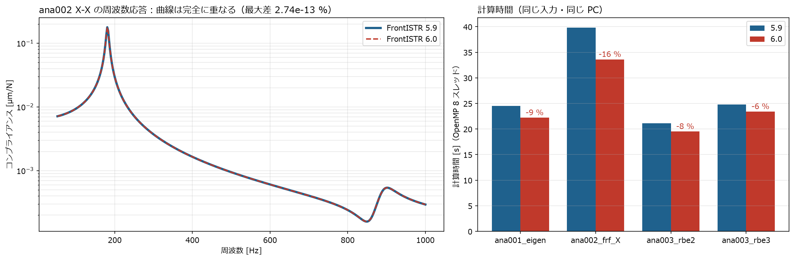

[← docs 目次](README.md) ｜ [⌂ トップ](../README.md) ｜ [← 前: ref005 ばね・固有値・周波数応答の設定比較](ref005_CalculiX-FrontISTR_ばね・固有値・周波数応答の設定比較.md) ｜ [次: ana001 簡易工作機械の固有値解析 →](ana001_CalculiX-FrontISTR_簡易工作機械の固有値解析.md)

# ref006 FrontISTR 6.0 の変更点と 5.9 との比較

作成: 2026-11-07

このプロジェクトの FrontISTR を **5.9 → 6.0** に上げた。何が変わったかを調べ、ana001〜004 と同じ入力で両方を動かして比べた。

## 1. 結論

- **6.0 は 2026-10-05 に公開**（GitLab のタグ `v6.0`、VERSION ファイル「Version 6.0 (2026/10/5)」）。5.9（2026-03-26）からの変更は 659 コミット、マージ 約 150 件
- **このプロジェクトの解析（ばね・MPC・固有値・周波数応答）では、結果は 5.9 と完全に同じ**（固有振動数・周波数応答・変位とも差 0）
- **計算時間は 6〜16 % 短くなった**
- 入力ファイルの書き方は**そのまま使える**（書き換え不要）。新しく使える指定が増えた（3 章）
- 今後は 6.0 を標準にする。5.9 も比較用に残した

| 場所 | 版 |
|---|---|
| `~/opt/frontistr/bin/fistr1` | **6.0**（`~/opt/frontistr6` へのリンク）。各 ana の `run.sh` はこれを使う |
| `~/opt/frontistr59/bin/fistr1` | 5.9（比較用） |

ビルド方法は 5.9 と同じ（ソースを GitLab から取得、CMake、MPI・METIS・MUMPS なし、OpenMP あり、BLAS/LAPACK は CalculiX の deb から展開したもの）。
`fistr1 -v` で `version: 5.9` → `6.0` になったことを確認した。

## 2. 同じ入力で比べた結果



| ケース | 5.9 時間 [s] | 6.0 時間 [s] | 結果 |
|---|---|---|---|
| ana001 固有値 | 24.5 | 22.2 | 1〜6次 172.2, 181.2, 243.2, 441.8, 474.4, 610.9 Hz：**同じ**（10次まで差 0.000 %） |
| ana002 周波数応答（X 加振） | 39.8 | 33.6 | ピーク 180.6 Hz・0.1780 µm/N：**同じ**（全周波数で差 $3\times10^{-13}$ % 以下） |
| ana003 RBE2（MPC） | 21.1 | 19.5 | 1〜6次 172.2, 183.1, 243.2, 453.5, 486.8, 625.3 Hz：**同じ** |
| ana003 RBE3（MPC） | 24.8 | 23.4 | **同じ** |
| ana004 ばね 3 種類 | 0.0 | 0.0 | −0.25005 / 0.25000 / −0.25000 mm：**同じ**（手計算 0.25 mm） |

*スクリプト: [compare.py](../analysis/fistr_v59_v60_check/compare.py)（元の ana フォルダから入力をコピーして両方の版で実行）、[plot.py](../analysis/fistr_v59_v60_check/plot.py)。全結果: [compare.md](../analysis/fistr_v59_v60_check/compare.md)*

6.0 では「周波数応答の結果値の修正」「MPC を消去したときの固有値解析の質量・正規化の修正」が入っているが、
このプロジェクトのモデル（モード重ね合わせの周波数応答、`!EQUATION` の MPC、Lanczos 法）では結果に影響しなかった。

## 3. 6.0 で変わったこと（このプロジェクトに関係が深い順）

変更の一覧はソースの履歴（`git log v5.9..v6.0`）のマージ件名から整理した。

### 3.1 固有値解析・周波数応答（ana001〜003 に関係）

| 変更 | 内容 | このプロジェクトへの影響 |
|---|---|---|
| Lanczos 法のシフト量 $\sigma$ を入力できる | `!EIGEN` の 4 つ目の値（「モード数, 収束判定, 最大反復, **シフト量**」）。従来はプログラム内で固定 | 指定しなければ従来どおり。0 Hz 付近の剛体モードがあるモデルで便利 |
| 収束判定が「要求した低次モード」を見るように | 5.9 までは反復回数が 3〜12 倍に増えたり、上限に達すると見かけのゼロ固有値が出ることがあった | 今回のモデルでは同じ結果。時間短縮の一因と考えられる |
| MPC 消去時の固有値解析の修正 | 質量行列の大きさ、固有ベクトルの正規化、残差の計算を修正 | ana003（`!EQUATION`）で差なし |
| 消去法で集中質量を剛性と整合させて縮約 | MPC・接触の自由度消去と質量の扱いを揃えた | 差なし |
| 周波数応答の結果値の修正と応力・ひずみの出力 | 周波数応答で応力・ひずみも出せるようになった | 今後、取付部の応力振幅を見るときに使える |
| 周波数応答の面荷重 `!FLOAD`（面グループ）に面積の重みを適用 | 面に分布する加振力が正しくなった | 今回は節点への集中加振なので影響なし |
| 周波数応答の領域分割（MPI 並列）対応 | | 今回は逐次版 |
| 整合質量・集中質量の制御を整理 | 整合質量は陰解法の時刻歴応答のみ対応、と明記 | 固有値・周波数応答は従来どおり |

### 3.2 接触・動解析（今後のガイドの接触モデルなどに関係）

| 変更 | 内容 |
|---|---|
| **面-面（mortar）接触**の追加 | `!CONTACT, MORTAR=YES`。従来の点-面接触より、面どうしの圧力が滑らかに伝わる。ボルト締結面・ガイド取付面の接触剛性を調べるときに使える |
| 接触面の平滑化（Nagata パッチ）・接触反力のダンピング | `SMOOTHING=NAGATA`、`DAMP_ALPHA` など。粗いメッシュでの接触の収束を良くする |
| 接触と判定する貫入深さを `!CONTACT_PARAM` で指定 | 既定値も広げた |
| 摩擦（拡張ラグランジュ法）の既定を変更 | `FRICTION_CONE` の既定を FOLLOW に |
| 動解析の自動増分・カットバック | 時刻歴応答で、収束しないときに時間刻みを自動で小さくする |
| 非線形の動解析で MPC を含むと収束しない問題を修正 | 代表点＋MPC のモデルで時刻歴応答をするときに関係 |
| 回転速度の境界条件 `ROT_CENTER` | 動解析で回転体（主軸など）に回転を与える |

### 3.3 その他

| 変更 | 内容 |
|---|---|
| 制御ファイルのキーワードを読み込み時に大文字化 | 小文字で書いても読めるようになった |
| `fistr1` の終了コードを失敗の種類で分ける | スクリプトから失敗の原因を判別しやすい |
| シェル要素の修正・拡張 | 板厚を材料から断面へ移動、MITC4 シェルの大変形、直交異方性シェルのせん断補正など |
| 反復法ソルバの設定 | 残差の再計算周期 `RECOMPUTE_RESIDUAL`、SSOR の緩和係数など |
| GPU（OpenACC）・富岳（A64FX）向けの統合 | 大規模並列向け |
| Ubuntu 26.04 対応、Abaqus 形式の名前を INP 形式に（`TYPE=ABAQUS` → `TYPE=INP`） | |

## 4. 使い方の変化（このプロジェクトの入力で）

書き換えは不要。新しい指定を使う場合の例:

```text
!EIGEN
 20, 1.0E-8, 300, 0.0        ← モード数, 収束判定, 最大反復, シフト量 σ（6.0 で追加。省略可）
```

```text
!CONTACT, GRPID=1, INTERACTION=SSLID, MORTAR=YES    ← 面-面接触（6.0 で追加）
```

出典: [FrontISTR GitLab（タグ一覧）](https://gitlab.com/FrontISTR-Commons/FrontISTR/-/tags)、ソースの `VERSION` とマージ履歴（`git log --merges v5.9..v6.0`）、`fistr1/src/common/fstr_ctrl_eigen.f90`（`!EIGEN` の読み込み）

---

[← docs 目次](README.md) ｜ [⌂ トップ](../README.md) ｜ [← 前: ref005 ばね・固有値・周波数応答の設定比較](ref005_CalculiX-FrontISTR_ばね・固有値・周波数応答の設定比較.md) ｜ [次: ana001 簡易工作機械の固有値解析 →](ana001_CalculiX-FrontISTR_簡易工作機械の固有値解析.md)
