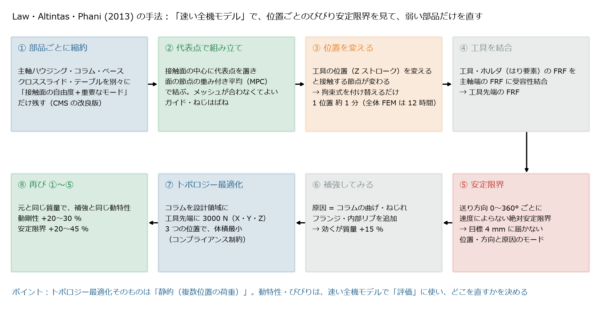
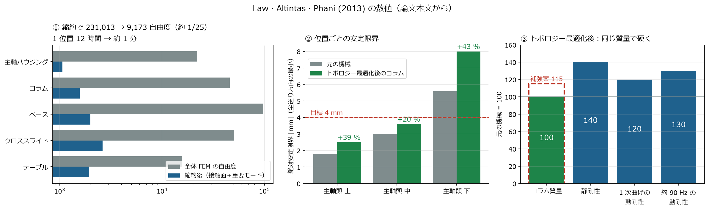
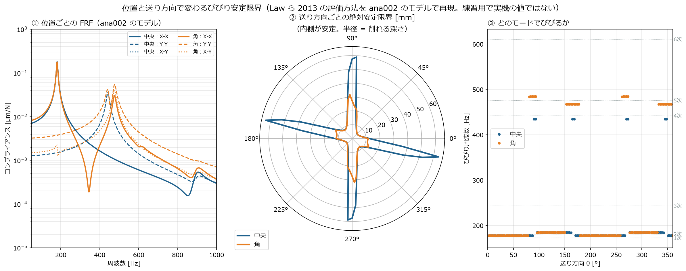

[← 論文解説の目次](README.md) ｜ [⌂ トップ](../../README.md)

# paper001 位置で変わるびびり安定性を速く評価して構造を直す手法（Law・Altintas・Phani 2013）

作成: 2026-11-07

[ref008](../ref008_工作機械_トポロジー最適化の社内導入と多目的最適化.md) の文献表に挙げた論文を深掘りする。

> M. Law, Y. Altintas, A. S. Phani, "Rapid evaluation and optimization of machine tools with position-dependent stability",
> *International Journal of Machine Tools & Manufacture*, 68 (2013) 81–90. [doi:10.1016/j.ijmachtools.2013.02.003](https://doi.org/10.1016/j.ijmachtools.2013.02.003)
> （著者公開版 PDF: [IIT Kanpur](https://home.iitk.ac.in/~mlaw/Law_IJMTM_paper.pdf)。以下の数値は本文から読み取ったもの）

---

## 1. ひとことで

**「部品ごとに縮約した、速い全機モデル」を作り、主軸頭の位置ごとにびびりの安定限界を計算して、生産性を制限している弱い部品（モード）を見つけ、そこだけを直す。**
直し方は「まず補強（重くなる）→ トポロジー最適化で同じ性能のまま元の重さに戻す」。

| 項目 | 内容 |
|---|---|
| 対象機 | 3 軸立形マシニングセンタ FADAL 2216（実機で打撃試験） |
| 問題 | 主軸頭の Z 位置（上・中・下）で、コラムのモードの動剛性が最大 135 % 変わる → びびりの限界も変わる |
| 目標 | AISI4340 鋼の正面フライス（φ50、5 枚刃、かみ込み 80 %）で、**全位置・全送り方向で 4 mm** の切込み |
| 結果 | 元の機械は最小 1.8 mm（上の位置）。コラムをトポロジー最適化で再設計 → **質量は元と同じ**で、安定限界 +20〜45 %、生産性 約 +25 % |

---

## 2. 手法の流れ

*論文の図 1・2 の内容をもとに自作した模式図。生成スクリプト: [scripts/make_paper001_figs.py](../scripts/make_paper001_figs.py)*

### 2.1 部品ごとの縮約（①）

主軸ハウジング・コラム・ベース・クロススライド・テーブルを別々に FEM（10 節点四面体）でモデル化し、それぞれを

- **接触面の自由度**（他の部品と接する面の節点）はそのまま残す
- **内部の自由度**は、内部の固有モードのうち**重要なものだけ**（各部品 24〜46 個）で表す

という形に縮約する（Craig–Bampton 型の部品モード合成法 CMS を改良したもの。静的な変換に慣性の項を加えて、少ないモードで広い周波数帯を表せるようにしている）。

$$
\boldsymbol{u} = \boldsymbol{T}\,\boldsymbol{u}_R,\qquad
\boldsymbol{T} = \begin{bmatrix} \boldsymbol{I}_{EE} & \boldsymbol{0} \\ \boldsymbol{T}^{\mathrm{ICMS}}_{IE} & \boldsymbol{\Phi}_{IP} \end{bmatrix},\qquad
\boldsymbol{M}_R = \boldsymbol{T}^{\mathsf T}\boldsymbol{M}\boldsymbol{T},\quad \boldsymbol{K}_R = \boldsymbol{T}^{\mathsf T}\boldsymbol{K}\boldsymbol{T}
$$

$E$ = 接触面の自由度、$I$ = 内部の自由度、$\boldsymbol{\Phi}_{IP}$ = 選んだ $P$ 個の内部モード。

*論文の表 1・本文・図 9〜10 の数値をグラフにしたもの。②の増加率は図の値から計算（本文では上 +35 %・中 +20 %・下 +45 % と記載。下の位置の元の値は本文中で 5.4 mm と 5.6 mm の 2 通りの記載がある）*

| 部品 | 全体 FEM の自由度 | 縮約後（接触面＋モード） |
|---|---:|---:|
| 主軸ハウジング | 21,992 | 1,037 ＋ 27 |
| コラム | 45,983 | 1,533 ＋ 28 |
| ベース | 97,214 | 1,945 ＋ 46 |
| クロススライド | 50,201 | 2,598 ＋ 27 |
| テーブル | 15,623 | 1,908 ＋ 24 |
| **合計** | **231,013** | **9,173（約 1/25）** |

計算時間は **1 位置あたり約 1 分**（全体 FEM では約 12 時間。Core i7 2.67 GHz・メモリ 9 GB）。

### 2.2 代表点で組み立てる（②）— このプロジェクトの ana003 と同じ考え方

部品ごとにメッシュを切るので、接触面の節点の位置が合わない。そこで**接触面の中心に「仮想の縮約節点（代表点）」を置き**、面の節点の**重み付き平均**で代表点の並進・回転を決める拘束式（MPC）を作る。

$$
\boldsymbol{u}_C = \sum_k w_k\,\boldsymbol{u}_k,\qquad
\boldsymbol{\alpha}_C \approx \sum_k w_k\,\boldsymbol{r}_{Ck} \times \boldsymbol{u}_k\ （回転は面の節点の動きから）
$$

これは **RBE3 相当**で、[ana003](../../docs/ana003_CalculiX-FrontISTR_代表点MPCばねの比較.md)・[ばね接続モデルの手順](../../docs/ana003_ばね接続モデルを自分で作る手順.md) でやっていることと同じ。部品どうしは代表点の間でつなぎ、全体はラグランジュ乗数で組み立てる。

- リニアガイドとボールねじは**線形ばね**（THK のカタログ値。ガイド SVR 系 187、ボールねじ SBN 系 280。論文では単位を N/mm と書いているが、値の大きさからは N/µm と考えられる）
- 結合部は「動く方向に直角な 2 方向の並進ばね」に単純化（[ref004](../ref004_工作機械_ばね剛性と減衰の決め方.md) と同じ考え方）

### 2.3 位置を変える（③）

主軸頭が Z 方向に動くと、コラムとの接触面で**接する節点が入れ替わる**。拘束式の係数（どの節点を代表点に結ぶか）を付け替えるだけで、部品の縮約モデルは作り直さない。これが速さの理由。

### 2.4 工具を結合する（④）

工具・ツールホルダ（はり要素、φ50 正面フライス、突き出し 70 mm、CAT40）の FRF を、主軸端の FRF に**受容性結合**でつなぐ。

$$
\boldsymbol{G}_{11} = \boldsymbol{R}_{11} - \boldsymbol{R}_{11'}\left(\boldsymbol{R}_{1'1'} + \boldsymbol{R}_{22}\right)^{-1}\boldsymbol{R}_{1'1}
$$

$\boldsymbol{R}$ は並進と回転を含む受容性（変位/力、変位/モーメント、回転/力、回転/モーメント）。工具を替えても機械のモデルは作り直さなくてよい。

### 2.5 安定限界で評価する（⑤）

工具先端の XY の FRF を、**送り方向 $\theta$ ごとに回転**して、Altintas・Budak のゼロ次近似で**速度によらない絶対安定限界**を求める。

$$
\det\left(\boldsymbol{I} - \Lambda\,[\boldsymbol{\alpha}_0][\boldsymbol{G}_{uv}(\omega_c)]\right) = 0,\qquad
a_{\lim} = -\frac{2\pi\,\Lambda_R}{N_t K_t}\left[1 + \left(\frac{\Lambda_I}{\Lambda_R}\right)^2\right]
$$

$[\boldsymbol{\alpha}_0]$ はかみ込み角と比切削抵抗の比 $K_r$ から決まる方向係数、$N_t$ は刃数、$K_t$ は比切削抵抗（論文では 5 枚刃、$K_t$ = 3000 MPa、$K_r$ = 0.24）。

結果（元の機械）:

| 主軸頭の位置 | 全送り方向の最小 | そのときの送り方向 | びびり周波数・原因 |
|---|---|---|---|
| 上 | **1.8 mm** | 52°・232° | 41〜42 Hz：コラムの曲げ（XZ と YZ の 2 つのモードの動剛性が同じくらい） |
| 中 | 3 mm | 52°・232° | コラムの XZ 曲げ |
| 下 | 5.4 mm | 142°・322° | 同上 |

→ **原因はコラムの曲げ・ねじれのモード**と特定。

### 2.6 直す（⑥〜⑧）

1. コラムにフランジと内部の十字リブを足す → 効くが**質量 +15 %**
2. そこで **HyperMesh（OptiStruct）でトポロジー最適化**：コラムの接触面以外を設計領域にし、工具先端に $F_x = F_y = F_z$ = 3000 N、**主軸頭の 3 つの位置**で、コンプライアンス制約のもとで**体積を最小化**
3. 結果を CAD でなめらかにして、①〜⑤をもう一度

| 指標 | 元の機械 | トポロジー最適化後 |
|---|---|---|
| コラム質量 | 100 | **100**（補強案 115 から 15 % 減） |
| 静剛性 | 14〜16（位置による） | **20〜22（約 +40 %）** |
| 1 次曲げ（XZ・YZ）の動剛性 | 100 | **約 120** |
| 約 90 Hz のモードの動剛性 | 100 | **約 130** |
| 安定限界（上・中・下） | 1.8 / 3 / 5.4〜5.6 mm | **2.5 / 3.6 / 8 mm** |

上の位置ではまだ 4 mm に届かない。論文は「ほかの部品の補強や、能動・受動ダンパを足せばよく、この速い手順ならそれも試せる」としている。

---

## 3. この論文から学べること（社内導入向け）

| ポイント | 中身 | 社内での使い方 |
|---|---|---|
| **トポロジー最適化の目的は静的でよい** | トポロジー最適化そのものは「複数位置の静荷重でのコンプライアンス制約・体積最小」。動特性はトポロジー最適化の目的に入れていない | 多目的の動的トポロジー最適化（[ref008](../ref008_工作機械_トポロジー最適化の社内導入と多目的最適化.md)）に進む前に、**この形で十分効果が出る** |
| **評価をびびり安定限界でする** | 「固有振動数が上がった」ではなく「**削れる深さ**（全位置・全送り方向の最小）」で良し悪しを決める | 設計目標を「○ mm の切込みを全位置で」のように**生産性の数字**で決める |
| **原因のモードを特定してから直す** | 送り方向ごとの安定限界とびびり周波数から、どの部品のどのモードが効いているかがわかる | 直す部品を絞れる（全部を最適化しない） |
| **補強 → トポロジー最適化で軽く** | 「まず補強して効くことを確かめ、トポロジー最適化で重さを戻す」2 段階 | 設計者が納得しやすい進め方 |
| **速い全機モデル** | 部品ごとの縮約＋代表点の拘束式で、位置を変えても 1 分 | 位置依存の評価を、設計の繰り返しの中に入れられる |
| 限界 | 縮約モデルは全体 FEM と比べ固有振動数で 2〜18 %、一部の動剛性で最大約 50 % の差（接触面の拘束式が接触剛性を低く見積もるため）。実測とも低周波のコラムモードで差がある（予測 47 Hz、実測 33 Hz） | **結合部のばね（特に据付け）を実測で合わせる**ことが前提 |

---

## 4. このプロジェクトのモデルで同じ評価をしてみる

ana002 の機械モデルの固有モード（CalculiX、30 個）から、**テーブル上面の中央と角**の XY の FRF をモード重ね合わせで作り、論文と同じ切削条件で送り方向ごとの絶対安定限界を計算した。

*生成スクリプト: [scripts/make_paper001_stability.py](../scripts/make_paper001_stability.py)。
※ 本来は**工具先端とワークの相対 FRF**を使う。ana002 のモデルはテーブル側しかないので、テーブル上面の点の FRF をワーク側の柔らかさとして使った**方法の練習**で、数値は実機の値ではない。*

| 位置 | 全送り方向の最小 | 送り方向 | びびり周波数 | 軸方向（0°・90°）付近の限界 |
|---|---|---|---|---|
| テーブル中央 | 4.9 mm | 約 39° | 178 Hz（2 次：テーブル X 並進・ボールねじ） | 約 60 mm |
| テーブルの角 | 4.9 mm | 約 36° | 178 Hz（同上） | **約 30 mm**（中央の半分） |

わかること:

- 最小の安定限界は**ボールねじのばねで決まる 2 次モード**（181 Hz）で決まり、位置によらず約 4.9 mm。→ 直すなら**ボールねじ（送り系）の剛性**（[ref004](../ref004_工作機械_ばね剛性と減衰の決め方.md) の位置依存の話とつながる）
- 送り方向が軸に沿うときは、**角の位置ではねじれモード（5 次、476 Hz）が効いて限界が半分**になる（[ana002 の 3×3 FRF](../../docs/ana002_CalculiX-FrontISTR_簡易工作機械の周波数応答解析.md) で見た X-Y のクロス項）
- 論文と同じく、**位置と送り方向で限界が変わり、原因のモードも変わる**ことを、自分のモデルで確かめられた

### 次の一歩（案）

1. ana001 のモデルにコラム側の工具点を加え、**工具先端とテーブルの相対 FRF** で評価する
2. ボールねじの剛性をテーブル位置ごとに変える（[ref004](../ref004_工作機械_ばね剛性と減衰の決め方.md) の 147〜395 N/µm）→ 位置依存の安定限界を描く
3. 安定限界の最小値を決めているモードの部品を、静的な複数位置荷重のトポロジー最適化（論文と同じ形）で再設計する

---

[← 論文解説の目次](README.md) ｜ [⌂ トップ](../../README.md)
