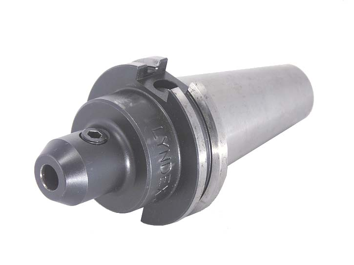
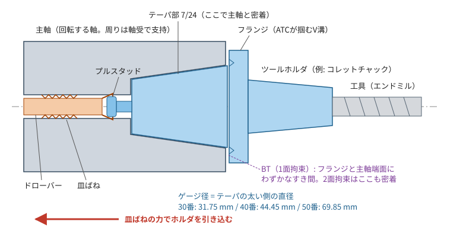
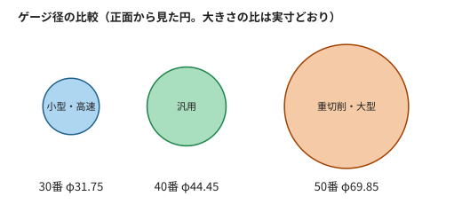
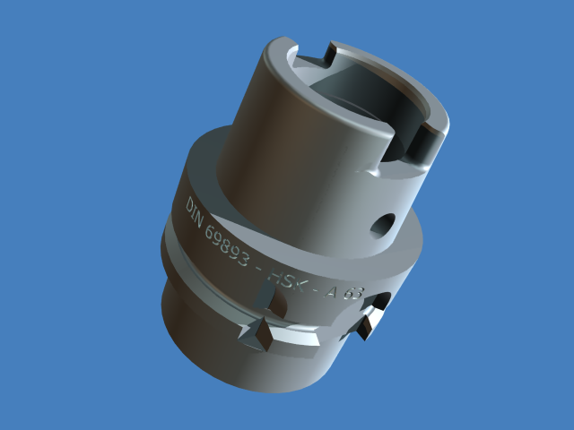
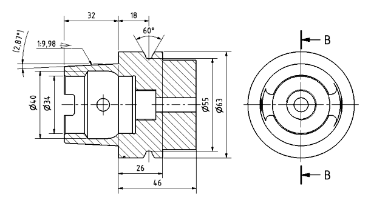

[← study 目次](README.md) ｜ [⌂ トップ](../README.md) ｜ [次: ref002 重切削・粗加工・仕上げ加工 →](ref002_工作機械_重切削・粗加工・仕上げ加工.md)

# ref001 主軸テーパ「30番・40番・50番」と主軸まわりの基礎

作成: 2026-11-07

## 1. 結論：「○○番」は工具を主軸に付けるテーパの大きさ

マシニングセンタの主軸には、工具（ツールホルダ）を差し込む**円すい形の穴（テーパ）**がある。
「30番・40番・50番」は、そのテーパの**サイズ番号**。数字が大きいほど太い＝重切削向き
（重切削とは何か → [ref002](ref002_工作機械_重切削・粗加工・仕上げ加工.md)）。

### 実物の写真（7/24テーパのツールホルダ）

*右側の円すい部分がテーパ（主軸の穴に入る）、中央の円盤がフランジ（ATCのアームが掴むV溝付き）、左が工具を掴むチャック。
写真は米国規格のCAT40だが、日本のBT40も見た目はほぼ同じ。
出典: [Wikimedia Commons "1941-G.jpg"](https://commons.wikimedia.org/wiki/File:1941-G.jpg)（Gargoyle888, CC BY-SA 3.0）*

### 主軸に付いた状態の断面図

*自作の模式図（寸法は正確ではない）。*

- テーパの傾きは **7/24**（長さ24に対して直径が7変わる）。半角 $\theta$ は $\tan\theta = \dfrac{7}{48}$ より $\theta \approx 8.297^\circ \;(8^\circ 17' 50'')$
- 7/24 テーパは「自己保持しない」テーパ。抜けないように主軸内部の**ドローバー（皿ばね）がプルスタッドを引き込んで**固定する
- 工具交換時は油圧や空圧で皿ばねを縮めてプルスタッドを放し、ATCがフランジを掴んで抜く
- ATC（自動工具交換）で抜き差ししやすいのが7/24の利点

### 太さの比較

## 2. 番手ごとの比較

| 番手 | テーパ基準径（ゲージ径） | 主な機械 | 主軸回転数の目安 | 特徴 |
|---|---|---|---|---|
| **30番** | 31.75 mm | 小型マシニング、タッピングセンタ（ドリル・タップ主体） | 〜 10,000〜24,000 min⁻¹ | 軽い・速い。ATCが速く、アルミ・小物の量産向け。重切削は苦手 |
| **40番** | 44.45 mm | 中型の立形/横形マシニング（**最も一般的**） | 〜 8,000〜20,000 min⁻¹ | 剛性と回転数のバランス型。工具の種類が最も豊富 |
| **50番** | 69.85 mm | 大型・横中ぐり・門形、鋳物や鋼の重切削 | 〜 4,000〜10,000 min⁻¹ | 剛性・トルク大。工具が重く（数kg〜数十kg）ATCは遅い |

（45番・60番も規格上ある。回転数は機種により大きく異なるので目安）

**なぜ太いと低速なのか**：主軸軸受が太くなると、軸受の周速（$d_m n$ 値 $= d_m\,[\mathrm{mm}] \times n\,[\mathrm{min^{-1}}]$、$d_m$：軸受ピッチ径）の上限に早く達するため。
逆に細い主軸は高速回転できるが、曲げ剛性（直径の4乗に比例）が小さく、びびり振動が出やすい。

## 3. 「BT40」「HSK-A63」などの記号の違い（＝規格の種類）

番手は太さ、頭の記号は**ホルダの形の規格**。同じ40番でも互換性がないものがある。

| 規格 | 主な地域 | 内容 |
|---|---|---|
| **BT**（JIS B 6339 / 旧MAS規格） | 日本・アジア | 日本で最も普及。フランジが左右対称 |
| **DIN 69871**（SK、ISO 7388-1） | 欧州 | テーパは同じ7/24だが、フランジ形状・プルスタッドが異なる |
| **CAT**（ANSI/ASME B5.50） | 北米 | 寸法がインチ系、ねじもインチ |
| **2面拘束**（BIG-PLUS 等） | — | テーパ＋**フランジ端面も主軸に密着**させる。剛性・振れ精度が上がり、高速時の主軸の口元膨張による"沈み込み"を抑える |
| **HSK**（DIN 69893 / ISO 12164） | 欧州発、高速機で普及 | **中空・1/10の短いテーパ＋端面密着**。高速回転に強く軽量。サイズは番号ではなくフランジ径（A63, A100, E40 等）で表す |

### HSK の形

| 3D形状 | 図面（HSK-A63） |
|---|---|
|  |  |

*中が空洞（中空）で、テーパが短く浅い（約1:10）。主軸側のコレットが内側から広がってホルダを引き込み、テーパと端面の2面で密着する。
出典: Wikimedia Commons [3D形状](https://commons.wikimedia.org/wiki/File:DIN_69893_HSK_A63_3drender_1.png)・[図面](https://commons.wikimedia.org/wiki/File:DIN_69893_hsk_63a_drawing.png)（Sven Gleich, CC BY-SA 2.5）。
クランプの動きのアニメーション: [images/ref001/hsk_a63_animation.svg](images/ref001/hsk_a63_animation.svg)（[出典](https://commons.wikimedia.org/wiki/File:DIN_69893_hsk_63a.svg), Glrx, CC BY-SA 4.0。ブラウザで開くと動く）*

おおまかな対応（剛性クラスの目安）：

| 7/24 テーパ | HSK |
|---|---|
| 30番 | HSK-A50 / E40 |
| 40番 | HSK-A63 |
| 50番 | HSK-A100 |

## 4. メーカー別の実例（どんな機械に何が使われているか）

2026年11月時点の各社公式ページ・カタログ（一部は販売店の掲載情報）から代表機種を拾った。
**仕様は年式・オプションで変わる**ので、実際に使うときは最新カタログで確認すること。

### 4.1 一覧

| メーカー | 機種（種類） | 主軸テーパ | 主軸回転数 | 案内・送り | 狙い |
|---|---|---|---|---|---|
| **ブラザー** | SPEEDIO S700X2（小型立形、タッピングセンタ） | **BT30**（2面拘束 BIG-PLUS はオプション） | 標準 10,000、オプション 16,000 / 27,000 min⁻¹ | 早送り 50 / 50 / 56 m/min、Z軸加速度 2.2G | 自動車・二輪・IT部品（アルミダイカスト）の量産。工具交換 0.7 秒 |
| **オークマ** | GENOS M560-V（中型立形） | **No.40**（オプションで No.50） | 15,000（No.50 は 12,000）min⁻¹ | **リニアボールガイド**、ボールねじをテーブル中央に配置 | 汎用。熱変位対策「サーモフレンドリーコンセプト」 |
| **オークマ** | MA-600HIII（横形） | **No.50**（高速用に HSK-A63 もあり） | No.50 で 6,000〜10,000 min⁻¹、HSK-A63 で 20,000 min⁻¹ | 早送り 60 m/min | 鋼・鋳物の重切削から高速加工まで。630 mm パレット |
| **ヤマザキマザック** | VCN-530C（中型立形） | **No.40** | 12,000 min⁻¹ | — | 汎用の量産・ジョブショップ |
| **ヤマザキマザック** | VARIAXIS i-700（5軸） | **BIG-PLUS No.40**（オプションで HSK-A63） | 12,000 / 18,000 min⁻¹ など | **ローラガイド**（MX Hybrid Roller Guide System） | 5軸の複雑形状部品 |
| **ヤマザキマザック** | HCN-6800（横形） | **No.50** | 10,000 min⁻¹ | — | 大型部品・重切削。630 mm パレット |
| **DMG森精機** | DMU 50 3rd Generation（5軸） | **SK40 / HSK-A63** | 15,000 / 20,000 min⁻¹（speedMASTER） | ボールねじ直結。ボールねじナット・案内・軸受を冷却 | 欧州系の5軸汎用機 |
| **DMG森精機** | NHX 5000（横形） | **BT40 / HSK-A63** など（制御装置で選べる種類が違う） | 標準 20,000 min⁻¹ | — | 自動車・一般部品の量産 |
| **DMG森精機** | NHX 6300（横形） | **No.50 専用構造** | — | DDM（ダイレクトドライブモータ）の割出しテーブルはオプション | 大型・重切削 |
| **DMG森精機** | HSC 55 linear（高速5軸） | **HSK-A63** | 28,000 min⁻¹（最大 40,000） | **全軸リニアモータ**（ボールねじなし）、加速度 2G、早送り 80 m/min | 金型・医療部品の高速・高精度仕上げ |

### 4.2 読み取れる傾向

| 用途 | テーパ | 送り・案内 | 例 |
|---|---|---|---|
| 小物の量産（アルミ、穴あけ・タップ中心） | **30番** | 軽量な可動部、高加速度 | ブラザー SPEEDIO |
| 汎用（いちばん多い） | **40番**（2面拘束が増えている） | リニアガイド（ボール or ローラ）＋ボールねじ | オークマ GENOS、マザック VCN、DMG森精機 NHX 5000 |
| 大型・鋼や鋳物の重切削 | **50番** | 剛性重視。ローラガイドや、機種によってはすべり案内 | オークマ MA-600H、マザック HCN-6800、DMG森精機 NHX 6300 |
| 高速・高精度仕上げ（金型など） | **HSK-A63** | リニアモータ、高速主軸 | DMG森精機 HSC linear |
| 欧州系・5軸 | **SK40 / HSK-A63** | — | DMG森精機 DMU |

- 日本メーカーは **BT（＋2面拘束 BIG-PLUS）**、欧州系は **SK（DIN）/ HSK**、北米向けは **CAT** を標準にすることが多い
- 同じ機種でも、主軸の番手や回転数をオプションで選べることが多い（オークマ GENOS の No.40 / No.50、マザック VARIAXIS の BIG-PLUS / HSK など）

### 4.3 このプロジェクトのテーマとの対応

| メーカーの技術 | 関係する物理 | 解析テーマ |
|---|---|---|
| ブラザーの Z軸 2.2G、0.7 秒の工具交換 | 軽量化・高加速度 → 加減速での振動 | 送り系の固有振動数とサーボゲイン（[ref003](ref003_工作機械_固有振動数とサーボゲイン.md)） |
| オークマ サーモフレンドリーコンセプト（左右対称構造＋温度センサによる補正 TAS-S / TAS-C） | 熱変位 | 熱-構造連成（Elmer / CalculiX / FrontISTR） |
| オークマ GENOS のボールねじ中央配置、X字リブ | 駆動点と重心のずれによる振動、構造剛性 | FEM のモーダル解析、ばね要素 |
| マザックのローラガイド | 案内の剛性・減衰 | ばね要素でのガイド剛性モデル |
| DMG森精機 のボールねじ・案内・軸受の冷却 | ボールねじの発熱による伸び | 熱-構造連成 |
| DMG森精機 のリニアモータ機 | ボールねじ（ばね）がない → 高い固有振動数・高ゲイン | 2慣性系との比較 |
| 50番専用構造（NHX 6300 など） | 重切削の大きな切削力に対する剛性・びびり | 静剛性・動剛性、安定限界線図 |

### 4.4 出典

- ブラザー: [SPEEDIO S700X2 特長](https://machinetool.global.brother/en-ap/sx2/feature/index.aspx)、[仕様](https://machinetool.global.brother/en-eu/sx2/spec/index.aspx)、[仕様PDF（日本語）](https://www.brother.co.jp/pub/jp/news/2018/sx2_spec.pdf)
- オークマ: [GENOS M シリーズ カタログ（PDF）](https://www.okuma.com/files/documents/genos_m_e__a___17__300_mar2020.pdf)、[MA-600HIII カタログ（PDF）](https://okuma.com/files/documents/MA-600HIII.pdf)、[Thermo-Friendly Concept](https://okuma.com/thermo-friendly-concept)
- ヤマザキマザック: [VARIAXIS i-600/i-700 NEO カタログ（販売店掲載PDF）](https://awmiller.com/wp-content/uploads/2026/04/Variaxis-i-600-NEO-i-700-NEO-11-2024.pdf)、[VARIAXIS i-700（Mazak Canada）](https://mazakcanada-dev.azurewebsites.net/machines/variaxis-i-700)、[VCN-530C（Mazak Canada）](https://mazakcanada-dev.azurewebsites.net/machines/vertical-center-smart-530c)、[HCN NEO](https://www.mazak.com/us-en/products/hcn-neo/)
- DMG森精機: [DMU 50 3rd Generation](https://us.dmgmori.com/products/machines/milling/5-axis-milling/dmu/dmu-50)、[DMU 50 3rd Gen カタログ（販売店掲載PDF）](https://www.sumipol.com/wp-content/uploads/2019/11/DMU50-3rdGen-ENUK.pdf)、[NHX 5000](https://au.dmgmori.com/products/machines/milling/horizontal-milling/nhx/nhx-5000)、[NHX 5500/6300 カタログ（PDF）](https://www.interempresas.net/FeriaVirtual/Catalogos_y_documentos/244423/pm0uk14-nhx-5500-6300-pdf-data.pdf)、[HSC 55 linear](https://us.dmgmori.com/products/machines/milling/5-axis-milling/hsc/hsc-55-linear)

## 5. マルチフィジックス的に何が面白いか

主軸まわりは、このプロジェクトのテーマがほぼ全部詰まっている。

| 現象 | 物理 | 試すツール（ref000参照） |
|---|---|---|
| 工具先端の剛性・FRF | 主軸＋ホルダ＋工具の結合部（テーパ接触）の剛性・減衰 | CalculiX（接触）、pyFBS（結合） |
| 危険速度 | 回転軸の曲げ振動＋軸受剛性＋ジャイロ効果 | ROSS |
| びびり振動 | 工具先端FRF × 切削力の再生効果 | Python で安定限界線図 |
| 高速時のテーパ浮き | 遠心力による主軸口元の膨張（7/24が高速で不利な理由、HSKの利点） | CalculiX / code_aster（遠心力＋接触） |
| 熱変位 | ビルトインモータ・軸受の発熱 → 主軸の伸び（Z方向誤差） | Elmer、CalculiX（熱→構造） |
| モータ | ビルトインモータの電磁場・損失 | FEMM、pyleecan、Elmer |

## 6. 関連用語メモ

| 用語 | 意味 |
|---|---|
| ツールホルダ | 工具を掴んで主軸に付ける部品（コレットチャック、焼きばめ、ミーリングチャック等） |
| プルスタッド | ホルダ後端のボルト。ドローバーが掴んで引き込む |
| ドローバー／皿ばね | 主軸内部でホルダを引き込む機構。解放は油圧・空圧 |
| ATC | Automatic Tool Changer。工具マガジンと主軸の間で自動交換 |
| 振れ精度 | 工具先端の回転時の芯ブレ。数μmオーダが要求される |
| $d_m n$ 値 | $d_m\,[\mathrm{mm}] \times n\,[\mathrm{min^{-1}}]$（$d_m$：軸受ピッチ径）。軸受の高速性能の指標（主軸用で 100万〜200万以上） |
| アンギュラ玉軸受 | 主軸で最も使われる軸受。予圧を掛けて剛性を出す |
| ビルトインモータ主軸 | モータのロータを主軸に直接組み込む方式（ベルト・ギア無し、高速向き） |

## 7. わかりやすい参考リンク

| リンク | 内容 |
|---|---|
| [Wikipedia: Machine taper（英語）](https://en.wikipedia.org/wiki/Machine_taper) | モールステーパ、7/24（NMTB・CAT・BT・SK）、HSK の歴史と違いが一通り載っている。「Steep taper」「HSK」の節が該当 |
| [Wikipedia: Hohlschaftkegel（独語）](https://de.wikipedia.org/wiki/Hohlschaftkegel) | HSK の詳細。ブラウザの翻訳で読める |
| [BIG DAISHOWA: HSK 101（英語）](https://www.bigdaishowa.com/node/1606) | ツールホルダメーカーによる HSK の解説 |
| [BIG DAISHOWA: BIG-PLUS 主軸資料（PDF）](https://pim.bigdaishowa.com/sites/default/files/documents/big_plus_spindle.pdf) | 2面拘束（テーパ＋フランジ端面）の仕組み |
| [ミスミ: 2面拘束ホルダ一覧](https://jp.misumi-ec.com/vona2/s_cate/2%e9%9d%a2%e6%8b%98%e6%9d%9f/) | 日本語。実際の商品と型番（BBT30/40/50など）を見られる |
| [CTE Magazine: The Secrets of HSK（英語）](https://www.ctemag.com/node/28664) | HSK のクランプ手順を段階ごとに説明 |

## 8. 確認すべき一次資料

- JIS B 6339（マシニングセンタ－ツールシャンク及びプルスタッド）
- ISO 7388（7/24テーパ ツールシャンク）、ISO 12164（HSK）
- ツールホルダメーカー（BIG DAISHOWA、MST、日研工作所など）の総合カタログ巻末の技術資料

---

[← study 目次](README.md) ｜ [⌂ トップ](../README.md) ｜ [次: ref002 重切削・粗加工・仕上げ加工 →](ref002_工作機械_重切削・粗加工・仕上げ加工.md)
