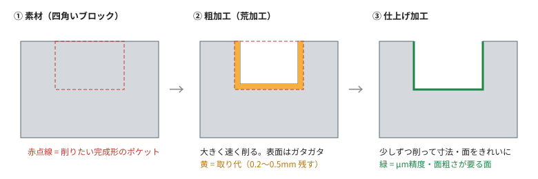
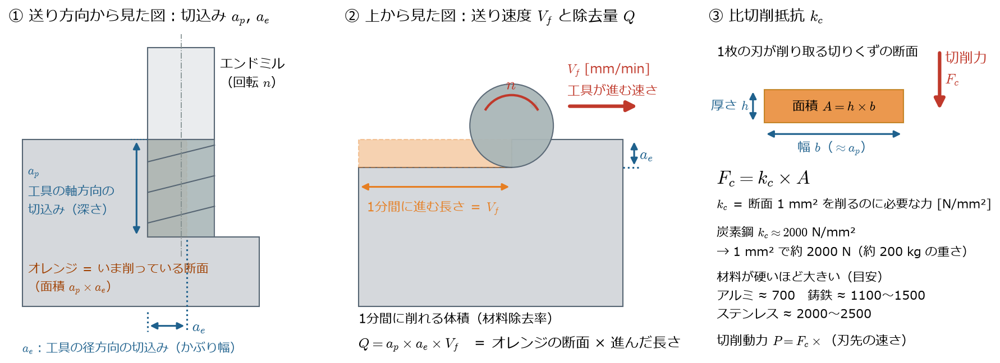
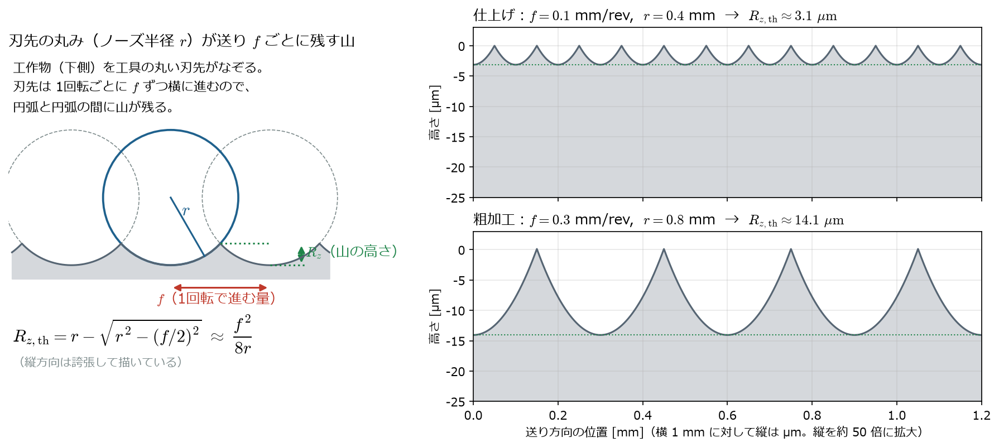

[← study 目次](README.md) ｜ [⌂ トップ](../README.md) ｜ [← 前: ref001 主軸テーパ30-40-50番](ref001_工作機械_主軸テーパ30-40-50番.md) ｜ [次: ref003 固有振動数とサーボゲイン →](ref003_工作機械_固有振動数とサーボゲイン.md)

# ref002 重切削・粗加工・仕上げ加工とは

作成: 2026-11-07

## 1. ひとことで

| 用語 | 意味 | 優先すること |
|---|---|---|
| **粗加工**（荒加工） | 素材から不要な部分を**大量に・速く**取り除く工程 | 時間あたりに削る量（材料除去率） |
| **中仕上げ** | 粗加工で残った段差をならし、仕上げ前の取り代を均一にする工程 | 仕上げを安定させること |
| **仕上げ加工** | 最後に**少しだけ**削って、寸法と表面をきれいにする工程 | 寸法精度（μm）、面粗さ、形状 |
| **重切削** | 粗加工の中でも、**切込み・送りを大きくして大きな切削力をかける**加工。鋳鉄・鋼のブロックをごっそり削るイメージ | 機械の剛性・主軸トルク・馬力 |

部品はふつう **粗加工 → （中仕上げ）→ 仕上げ加工** の順で削る。

*自作の模式図。取り代は実際よりかなり大きく描いている。*

**なぜ一度で仕上げないのか**
- 一度に大きく削ると切削力が大きく、工具や機械がたわむ（μm〜数十μmずれる）
- 切削熱で工作物・機械が膨らむ
- 削った後に、材料内部の残留応力で形が変わる
- そこで、粗加工では精度を気にせず速く削り、たわみや熱が小さい軽い仕上げ加工で寸法を出す

## 2. 切削条件の言葉

エンドミル（フライス）加工の場合。

| 記号 | 名前 | 単位 | 意味 |
|---|---|---|---|
| $V_c$ | 切削速度 | m/min | 刃先が材料を通過する速さ。$V_c = \dfrac{\pi D n}{1000}$（$D$：工具径 [mm]） |
| $n$ | 主軸回転数 | min⁻¹ | $n = \dfrac{1000\,V_c}{\pi D}$ |
| $f_z$ | 1刃あたり送り | mm/刃 | 1枚の刃が1回で進む量（＝切りくずの厚さの目安） |
| $V_f$ | 送り速度 | mm/min | テーブルが動く速さ。$V_f = f_z \, z \, n$（$z$：刃数） |
| $a_p$ | 軸方向切込み | mm | 工具の軸方向にどれだけ深く入れるか |
| $a_e$ | 径方向切込み | mm | 横方向にどれだけかぶせるか |
| $Q$ | 材料除去率 | cm³/min | $Q = \dfrac{a_p \, a_e \, V_f}{1000}$ |

切削に必要な動力の目安:

$$
P\,[\mathrm{kW}] = \frac{a_p \, a_e \, V_f \, k_c}{60 \times 10^{6}}
$$

- $a_p,\ a_e$ [mm]：軸方向・径方向の切込み
- $V_f$ [mm/min]：送り速度
- $k_c$ [N/mm²]：比切削抵抗（炭素鋼でおよそ 2000 前後）

*図の生成スクリプト: [scripts/make_ref002_figs.py](scripts/make_ref002_figs.py)*

## 3. 数字で比べる（炭素鋼、エンドミルの例）

あくまで考え方を見るための概算。実際の条件は工具カタログの推奨値を使う。

| | 粗加工・重切削 | 仕上げ加工 |
|---|---|---|
| 工具 | $\phi 20$ 荒加工用エンドミル | $\phi 10$ 仕上げ用エンドミル |
| $a_p \times a_e$ | $20 \times 10$ mm | $10 \times 0.2$ mm |
| $V_f$ | 400 mm/min | 800 mm/min |
| 材料除去率 $Q$ | **80 cm³/min** | **1.6 cm³/min**（50分の1） |
| 必要動力 $P$ | **約 2.7 kW** | **約 0.05 kW** |
| 主切削力の目安（$V_c = 100$ m/min と 150 m/min で計算） | 約 1.6 kN | 約 20 N |
| 気にすること | 主軸トルク不足、びびり振動、工具の欠け | 寸法・面粗さ、工具のたわみ、熱変位 |

旋盤の場合は「切込み $a_p$ [mm]」と「送り $f$ [mm/rev]」で表す。
仕上げ面の理論粗さは、刃先の丸み（ノーズ半径 $r$）と送りで決まる。

$$
R_{z,\mathrm{th}}\,[\mu\mathrm{m}] \simeq \frac{f^{2}}{8\,r} \times 1000
$$

- $f$ [mm/rev]：送り、$r$ [mm]：ノーズ半径
- 例：$f = 0.1,\ r = 0.4 \Rightarrow R_{z,\mathrm{th}} \approx 3.1\ \mu\mathrm{m}$
- 例：$f = 0.3,\ r = 0.8 \Rightarrow R_{z,\mathrm{th}} \approx 14\ \mu\mathrm{m}$（粗加工の面）

*左: 原理（縦を誇張）。右: 実際の寸法で計算した仕上げ面の断面形状。送りを3倍にすると山の高さは約4.5倍になる（$f^2$ に比例し、$r$ に反比例するため）。*

## 4. 「重切削」と「高速加工」

機械の得意・不得意を見る時によく対比される。

| | 重切削型 | 高速加工型 |
|---|---|---|
| 削り方 | 低速・大切込み・大送り | 高回転・小切込み・高送り |
| 主軸 | **50番**、低速で大トルク（ギア付きなど） | **30番 / HSK**、ビルトインモータで高回転 |
| 案内面 | すべり案内（減衰が大きく、びびりに強い） | リニアガイド（摩擦が小さく速い） |
| 機械 | 大型・重量級 | 軽量で加減速が速い |
| 主な材料 | 鋳鉄、鋼、大型部品 | アルミ、金型の仕上げ |

最近は、工具の当たり方を工夫して**深い切込み・小さい径方向切込み**で速く削る「高能率加工」（トロコイド加工など）も一般的で、
重切削でなくても材料除去率を稼げるようになっている。

## 5. このプロジェクトのテーマとのつながり

| 加工 | 機械側で問題になること | 解析テーマ |
|---|---|---|
| 粗加工・重切削 | 大きな切削力 → 構造のたわみ、**びびり振動** | 構造の静剛性・動剛性（固有振動数、FRF）、安定限界線図 |
| 粗加工・重切削 | 主軸のトルク・発熱 | モータの電磁場・損失、熱 |
| 仕上げ加工 | 小さなたわみ・熱変位がそのまま寸法誤差になる | 熱-構造連成、ボールねじ・ガイドの剛性 |
| 仕上げ加工（輪郭） | サーボの追従遅れ、反転時の摩擦（**象限突起**） | サーボ制御＋摩擦モデル（OpenModelica、python-control） |

つまり、**粗加工は「力と振動」、仕上げ加工は「熱と制御の精度」**が主な課題になる。

## 6. 参考リンク

- [Siemens NX Manufacturing Blog: Roughing and re-roughing（英語）](https://blogs.sw.siemens.com/nx-manufacturing/roughing-and-re-roughing/) — CAMでの粗加工の考え方
- [MachineMfg: Roughing vs Finishing（英語）](https://shop.machinemfg.com/roughing-vs-finishing-in-machining-key-differences-and-purposes) — 粗加工と仕上げ加工の違い
- [Modern Machine Shop: 材料除去率以外の指標（英語）](https://www.mmsonline.com/articles/machine-shops-move-beyond-metal-removal-rate-as-a-measure-of-success)
- [大分県産業科学技術センター: 高硬度焼入れ鋼のエンドミル加工における加工精度（PDF）](https://www.oita-ri.jp/wp-content/uploads/高硬度焼入れ鋼のエンドミル加工におげる加工精度と加工面特性.pdf) — 荒加工後の仕上げ条件で精度がどう変わるかの実験
- 工具メーカー（三菱マテリアル、OSG、住友電工ハードメタル、サンドビック等）の総合カタログ巻末の「技術資料」— 切削条件の計算式・推奨条件が一番まとまっている

---

[← study 目次](README.md) ｜ [⌂ トップ](../README.md) ｜ [← 前: ref001 主軸テーパ30-40-50番](ref001_工作機械_主軸テーパ30-40-50番.md) ｜ [次: ref003 固有振動数とサーボゲイン →](ref003_工作機械_固有振動数とサーボゲイン.md)
