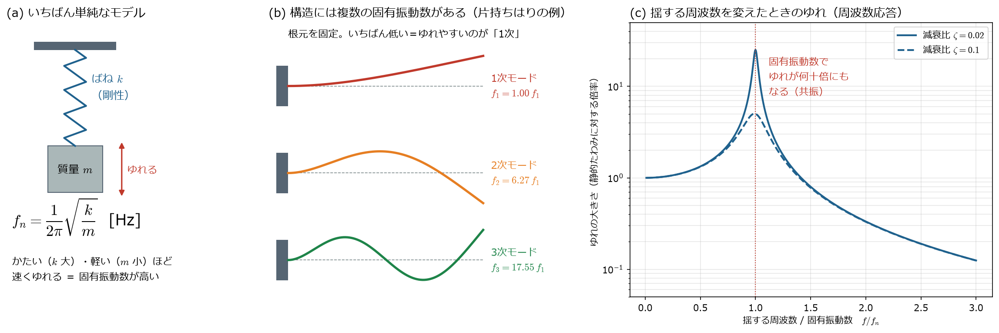
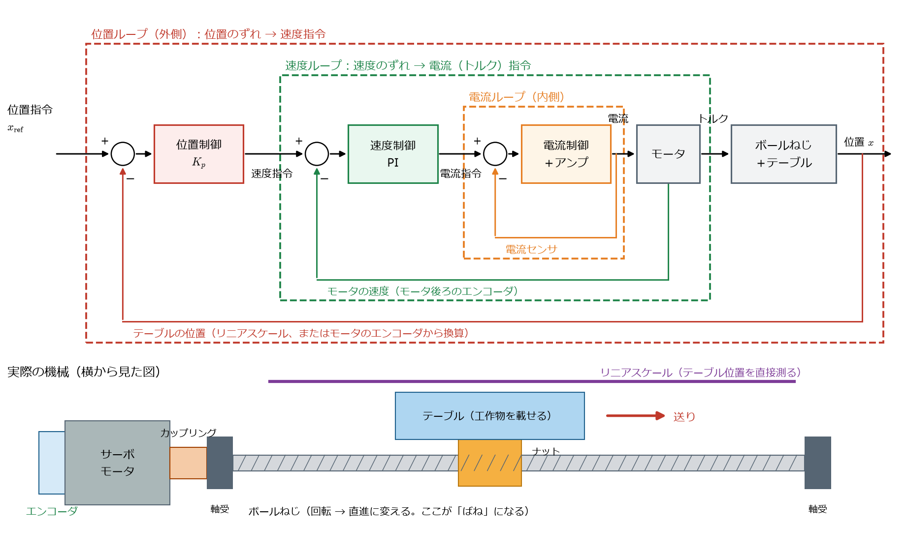
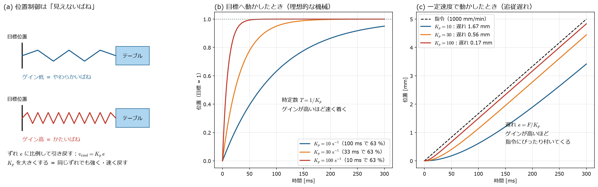
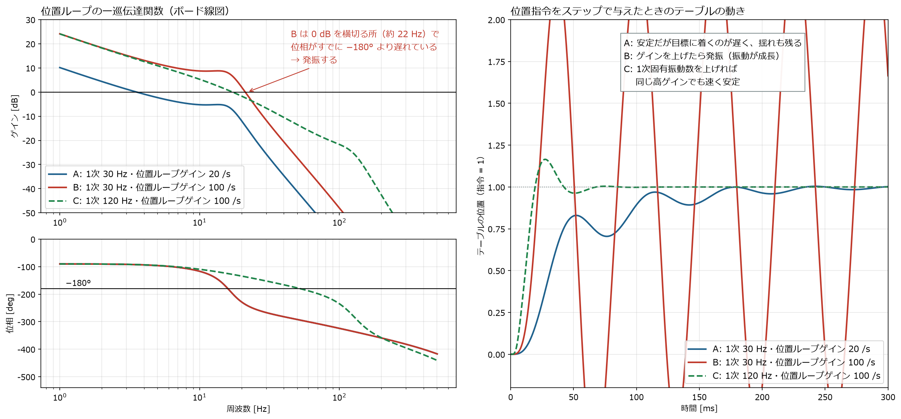
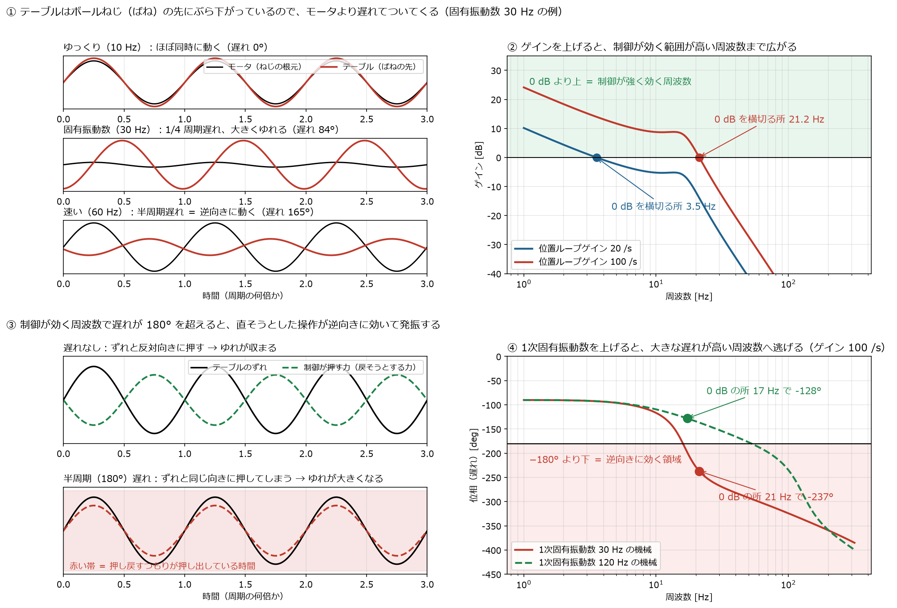

[← study 目次](README.md) ｜ [⌂ トップ](../README.md) ｜ [← 前: ref002 重切削・粗加工・仕上げ加工](ref002_工作機械_重切削・粗加工・仕上げ加工.md) ｜ [次: ref004 ばね剛性と減衰の決め方 →](ref004_工作機械_ばね剛性と減衰の決め方.md)

# ref003 「1次の固有振動数を上げたい」「ゲインが上げられない」とは

作成: 2026-11-07

## 1. ひとことで

- **固有振動数** ＝ 物（機械）が**自然にゆれる速さ**。叩いたときに「ブーン」と鳴る周波数 [Hz]
- **1次の固有振動数** ＝ いくつかある固有振動数のうち**いちばん低いもの**。いちばんゆれやすい
- **ゲイン** ＝ サーボ（モータ制御）が、目標とのずれをどれだけ**強く・素早く直そうとするか**の倍率
- **ゲインが上げられない** ＝ 強く直そうとすると、機械のゆれ（共振）を自分で励起して**発振**（ガタガタ止まらなくなる）してしまう

だから現場では、**機械を硬く・軽くして1次固有振動数を上げる → ゲインを上げられる → 速くて正確な機械になる**、という流れで話が出てくる。

## 2. 固有振動数とは

### (a) ばねと質量

いちばん単純なモデルは、ばね（剛性 $k$）につながった質量 $m$。

$$
f_n = \frac{1}{2\pi}\sqrt{\frac{k}{m}} \quad [\mathrm{Hz}]
$$

- **かたい**（$k$ が大きい）ほど、**軽い**（$m$ が小さい）ほど、固有振動数は高い
- 剛性を 4 倍にするか、質量を 1/4 にすると、固有振動数は 2 倍

### (b) 1次・2次・3次…

実際の構造（コラム、テーブル、主軸）は連続体なので、ゆれ方（**モード**）がたくさんある。
低い順に 1次、2次、3次… と呼ぶ。片持ちはりの場合、2次は1次の約 6.3 倍、3次は約 17.5 倍。

いちばん低い1次が、いちばん小さな力で大きくゆれるので、**まず1次をどう上げるか**が設計の焦点になる。

工作機械で 1次になりやすいゆれの例：
- コラムが前後に首を振る
- 主軸頭がおじぎする
- テーブルがボールねじの軸方向に「ばね ― 質量」で前後にゆれる（送り系の1次）

### (c) 共振

外から揺する周波数が固有振動数と一致すると、ゆれが何十倍にもなる（**共振**）。
ゆれの倍率は減衰比 $\zeta$ で決まり、ピークは約 $1/(2\zeta)$ 倍（$\zeta = 0.02$ なら約 25 倍）。
工作機械の構造は $\zeta$ が 0.01〜0.05 程度と小さく、共振しやすい。

## 3. ゲインとは

送り軸（ボールねじ＋テーブル）は、モータを次の 3 重のループで制御している。

| ループ | 何を見て | 何を出す | 代表的なゲイン |
|---|---|---|---|
| 位置ループ（外側） | 目標位置 − 今の位置 | 速度指令 | **位置ループゲイン** $K_p$ [1/s] |
| 速度ループ | 速度指令 − 今の速度 | トルク（電流）指令 | 速度ループゲイン |
| 電流ループ（内側） | 電流指令 − 今の電流 | 電圧 | 電流ループゲイン |

*上: 制御のブロック図。下: 実際の機械。生成スクリプト: [scripts/make_ref003_figs.py](scripts/make_ref003_figs.py)*

それぞれのループがやっていること：

1. **位置ループ**：NC が出す位置指令と、今のテーブル位置を比べる。ずれていれば「この速さで動け」という**速度指令**を出す
2. **速度ループ**：速度指令と、モータ後ろのエンコーダで測った今の速度を比べる。遅ければ「もっとトルクを出せ」という**電流指令**を出す（モータのトルクは電流に比例する）
3. **電流ループ**：電流指令どおりの電流がモータに流れるよう、アンプが電圧を調整する

- 内側のループほど速く反応するように作る（目安として、電流ループが最も速く、次に速度、位置の順）
- 位置の測り方は 2 通りある
  - **セミクローズド**：モータのエンコーダの回転角から、ボールねじのリードを使ってテーブル位置を換算する。ボールねじの伸びや熱膨張は見えない
  - **フルクローズド**：テーブルに付けた**リニアスケール**で直接測る。正確だが、ボールねじ（ばね）を挟んだ向こう側を見るので、共振の影響を受けやすい（4章の計算はこちら）

### ゲインを上げるとは

**ゲイン ＝「ずれ」に掛ける倍率**。制御装置（NC・サーボアンプ）のパラメータの数値で、これを大きくすることを「ゲインを上げる」という。

- (a) 位置制御は、目標位置とテーブルの間に**見えないばね**を張っているのと同じ。ゲインを上げる ＝ そのばねを**硬く**する
- (b) 硬いばねほど、目標に速く引き寄せられる。目標の 63 % まで動く時間（時定数）は $T = 1/K_p$
- (c) 一定速度で動かすと、ばねが伸びた分だけ遅れてついてくる。硬いばね（高ゲイン）ほど遅れが小さい

ただし、この「見えないばね」を硬くしすぎると、機械の本物のばね（ボールねじ）とぶつかり合って**発振**する。それが4章の「ゲインが上げられない」。

位置ループゲイン $K_p$ は「ずれ 1 mm に対して、毎秒何 mm の速さで戻そうとするか」：

$$
v_{\mathrm{cmd}} = K_p \,(x_{\mathrm{ref}} - x)
$$

### ゲインが低いと何が困るか

一定速度 $F$ で動いているとき、テーブルは目標から**遅れて**ついてくる（**追従遅れ、溜まりパルス**）。

$$
e = \frac{F}{K_p}
$$

| 送り $F$ | $K_p = 30\ \mathrm{s^{-1}}$ | $K_p = 100\ \mathrm{s^{-1}}$ |
|---|---|---|
| 1000 mm/min（16.7 mm/s） | 遅れ 0.56 mm | 遅れ 0.17 mm |

X と Y を同時に動かして円を削ると、この遅れのせいで**円が小さくなる**（半径減少）。
半径 $R$、速度 $v$ のとき、おおよそ

$$
\Delta R \approx \frac{v^2}{2 K_p^2 R}
$$

$R = 10$ mm、$F = 2000$ mm/min の円で、$K_p = 30$ だと約 **62 μm**、$K_p = 100$ だと約 **6 μm** 小さくなる。
（実機ではフィードフォワード制御で大きく減らしているが、基本はゲインが高いほど正確）

→ **ゲインは高いほど、速く・正確に目標に追従する。**

## 4. なぜゲインが上げられないのか

*モータ ― ボールねじ（ばね）― テーブル の 2 慣性モデルで計算。速度ループはモータ側で閉じ、位置ループはテーブル位置（リニアスケール）で閉じている。
制御の遅れ（電流ループ・サンプリング等）を 0.5 ms のむだ時間で表した。
生成スクリプト: [scripts/make_ref003_figs.py](scripts/make_ref003_figs.py)*

| ケース | 送り系の1次固有振動数 | 位置ループゲイン | ゲイン余裕 | 結果 |
|---|---|---|---|---|
| A | 30 Hz | 20 /s | +6.0 dB | 安定だが遅い。揺れも少し残る |
| B | 30 Hz | 100 /s | **−8.0 dB** | **発振**（振動がどんどん大きくなる） |
| C | 120 Hz | 100 /s | +14.2 dB | 速く、きれいに止まる |

何が起きているか（図解）：

*① 固有振動数 30 Hz の機械で、モータを 10 / 30 / 60 Hz で揺らしたときのテーブルの動き。② 位置ループゲイン 20 と 100 の一巡伝達関数のゲイン。
③ 制御の力が遅れなしの場合と、半周期遅れた場合。④ 1次固有振動数 30 Hz と 120 Hz の機械の位相（ゲイン 100 /s）。*

1. テーブルはボールねじ（ばね）の先にぶら下がっているので、命令してもすぐには動かず、**少し遅れて**ついてくる。この遅れは固有振動数の近くで急に大きくなる（右下の位相の図で、30 Hz の機械は 10〜20 Hz あたりで位相が急に遅れる）
2. ゲインを上げると、制御が「強く・速く」反応する範囲（0 dB を横切る周波数）が高い周波数に広がる
3. その範囲に機械の大きな遅れ（位相 −180° 以上）が入ると、**直そうとした操作が半周期遅れて逆向きに効き、ゆれを大きくしてしまう** → 発振
4. 機械を硬く・軽くして**1次固有振動数を上げれば**、遅れが大きくなる周波数が高い方へ逃げるので、同じ高ゲインでも安定する（C）

ボード線図の見方（安定判別）：
- **ゲインの図で 0 dB を横切る周波数**で、**位相が −180° より上**にあれば安定
- その余裕が **位相余裕**、位相が −180° の周波数でのゲインの余裕（0 dB まで何 dB あるか）が **ゲイン余裕**。目安として位相余裕 40° 以上、ゲイン余裕 10 dB 程度以上を確保することが多い

## 5. 対策の種類

| 対策 | やること | 分野 |
|---|---|---|
| **1次固有振動数を上げる** | 構造を硬くする（リブ、断面を大きく）、動く部分を軽くする、ボールねじを太く・リードを適正に、ガイド・軸受の予圧、両端固定支持 | 構造設計・FEM |
| 減衰を増やす | 減衰材・ダンパ、すべり案内、制振材 | 構造・材料 |
| 共振の周波数を制御から見えなくする | **ノッチフィルタ**（共振周波数だけゲインを下げる） | 制御 |
| 共振を積極的に抑える | 制振制御、状態フィードバック、外乱オブザーバ | 制御 |
| ゲインに頼らず追従をよくする | フィードフォワード（指令から先回りしてトルクを出す） | 制御 |

## 6. このプロジェクトでの試し方

| やること | ツール | 予定 |
|---|---|---|
| コラム・テーブルの 1次固有振動数とモード形状を出す | CalculiX / FrontISTR（固有値解析） | ana001〜002 |
| ボールねじの軸方向剛性から送り系の 1次固有振動数を手計算 | Python | ana003 |
| この資料の図と同じ 2 慣性系で、ゲインと安定性を確かめる | Python（python-control）、OpenModelica | ana004〜005 |
| FEM で出した固有振動数を制御モデルに入れて、上げられるゲインを見積もる | 連成（縮約モデル） | ana010 |

## 7. 参考リンク

- [Wikipedia: 固有振動](https://ja.wikipedia.org/wiki/固有振動) / [共振](https://ja.wikipedia.org/wiki/共振)
- [Wikipedia: ボード線図](https://ja.wikipedia.org/wiki/ボード線図) / [ゲイン余裕・位相余裕（Phase margin, 英語）](https://en.wikipedia.org/wiki/Phase_margin)
- [MONOist: ボード線図を使って過渡応答と周波数応答を求める（無償ソフトで技術計算しよう）](https://monoist.itmedia.co.jp/mn/articles/1506/17/news023.html)
- [MONOist: CAEと計測技術を使った振動・騒音対策（14） 振動形状をスローモーション表示](https://monoist.itmedia.co.jp/mn/spv/2309/14/news005_4.html)
- 各サーボメーカー（ファナック、三菱電機、安川電機など）のサーボ調整マニュアル — 「位置ループゲイン」「機械共振抑制フィルタ（ノッチフィルタ）」の項目
- Y. Altintas『Manufacturing Automation』の送り駆動系制御の章

---

[← study 目次](README.md) ｜ [⌂ トップ](../README.md) ｜ [← 前: ref002 重切削・粗加工・仕上げ加工](ref002_工作機械_重切削・粗加工・仕上げ加工.md) ｜ [次: ref004 ばね剛性と減衰の決め方 →](ref004_工作機械_ばね剛性と減衰の決め方.md)
