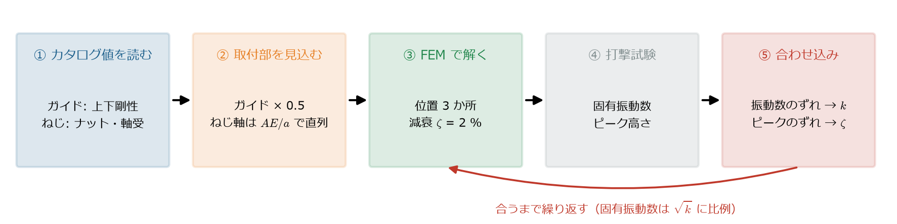
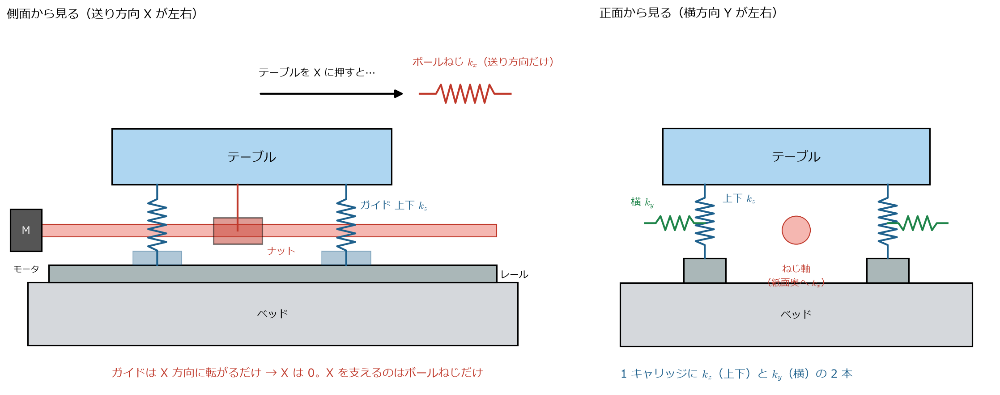
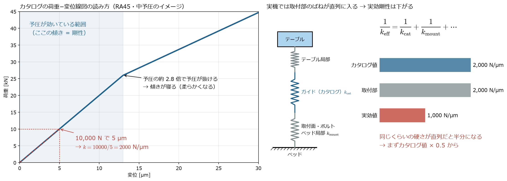
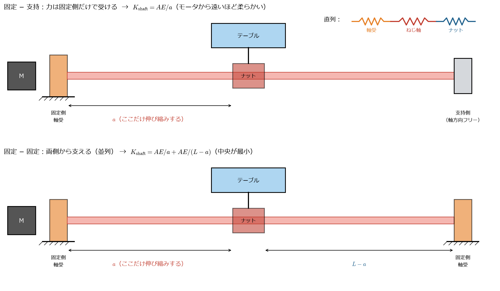
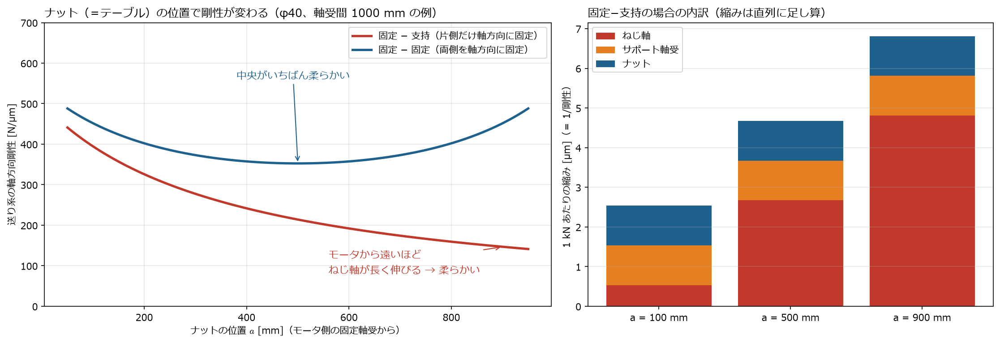
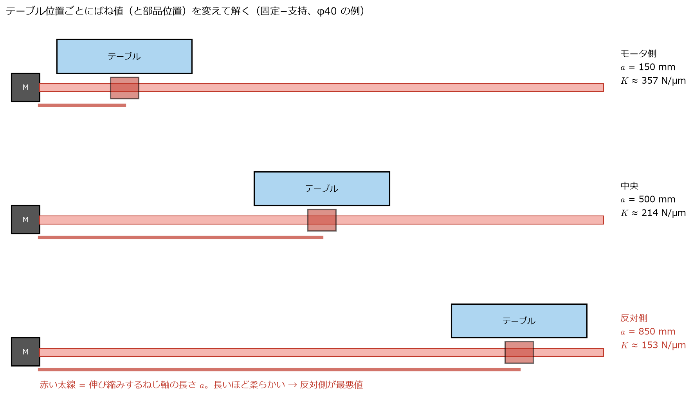
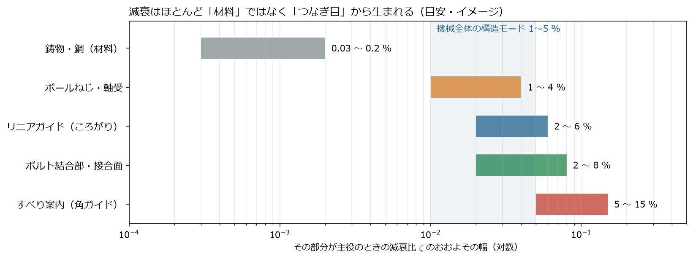
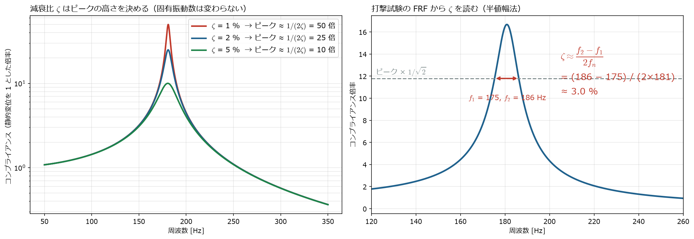
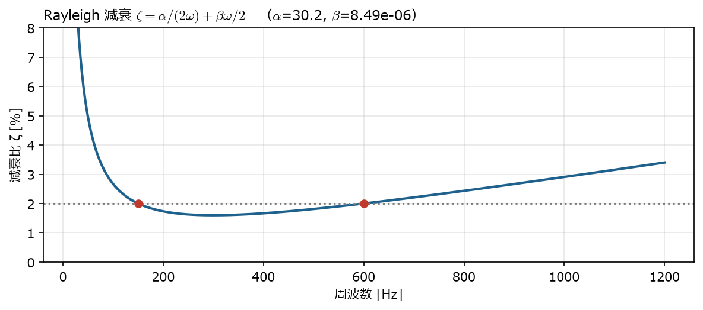

[← study 目次](README.md) ｜ [⌂ トップ](../README.md) ｜ [← 前: ref003 固有振動数とサーボゲイン](ref003_工作機械_固有振動数とサーボゲイン.md) ｜ [次: ref005 トポロジー最適化の使われ方 →](ref005_工作機械_トポロジー最適化の使われ方.md)

# ref004 ボールねじ・リニアガイドのばね剛性と減衰の決め方

作成: 2026-11-07

工作機械の FEM では、ボールねじとリニアガイドを**ばね**に置き換えるのが定番。
結果（固有振動数・周波数応答）は**ばねの値でほぼ決まる**ので、ここが一番の肝になる。

全体の流れを先に図で示す。この順番で値を決めていく。

実際のモデルへの入れ方は [docs/ana001](../docs/ana001_CalculiX-FrontISTR_簡易工作機械の固有値解析.md)、
代表点（MPC）方式は [docs/ana003](../docs/ana003_CalculiX-FrontISTR_代表点MPCばねの比較.md) を参照。

---

## 1. どこを、どの方向のばねにするか

| 部品 | ばねの方向 | 値の目安（1個あたり） | 送り方向 |
|---|---|---|---|
| リニアガイド（キャリッジ 1 個） | **上下（ラジアル）** と **横** の 2 方向。必要なら回転（モーメント）も | 数百〜数千 N/µm | **0**（転がって動く方向なので、ばねは入れない） |
| ボールねじ（ナット） | **送り方向（軸方向）だけ** | 100〜500 N/µm（送り系全体） | ― |
| ボールねじ（ねじり） | モータとねじの回転方向 | ねじり剛性（N·m/rad） | 制御モデル側で扱うことが多い |

**テーブルを送り方向（X）に動かす力に対しては、ガイドは何も支えていない。**
X 方向にテーブルを支えているのは**ボールねじ（とその先のモータ・サーボ）だけ**。
だから送り方向の剛性は、ほかの方向よりずっと低くなりやすく、1次の固有振動数になりやすい
（[docs/ana001](../docs/ana001_CalculiX-FrontISTR_簡易工作機械の固有値解析.md) の 2次モード 181 Hz がこれ）。

*生成スクリプト: [scripts/make_ref004_figs2.py](scripts/make_ref004_figs2.py)*

- **左（側面）**: テーブルを X に押すと、ガイド（青）は転がるだけで抵抗しない。抵抗するのはナットにつながったボールねじ（赤）だけ
- **右（正面）**: 1 個のキャリッジは上下（青）と横（緑）の 2 方向でテーブルを支える

---

## 2. リニアガイドの剛性

### 2.1 マザック機で使われるもの

- ヤマザキマザックの機械は、全軸に**ローラガイド**（転動体が「ころ」）を使うのが基本
  （自社開発の「MX Hybrid Roller Guide System」。部品メーカーは公表されていない）
- ローラガイドは、ボールのガイドより**剛性が高く、減衰もやや大きい**。重切削・高精度向け
- 代表的な市販品: THK SRG、NSK RA、Schneeberger MR、HIWIN RG など

ここでは数値が公開されている **NSK ローラガイド RA 型**のカタログ値を使う。

### 2.2 カタログ値の読み方（NSK RA 型、上下方向、中予圧 Z3、高荷重形）

カタログには「荷重 − 変位」のグラフで載っている。予圧が効いている範囲の傾きが剛性。

*生成スクリプト: [scripts/make_ref004_figs2.py](scripts/make_ref004_figs2.py)*（左はイメージ。実際の線図はカタログ参照）

- **左**: グラフの「荷重 ÷ 変位」が剛性。予圧が抜けるところで線が折れ、柔らかくなる
- **右**: 実機ではガイドの上下に「取付面・ボルト」「テーブルやベッドの局部変形」のばねが**直列**に入る。同じくらいの硬さのばねが直列なら全体は半分になるので、**最初はカタログ値 × 0.5** にする

| 形番（レール幅のサイズ） | 読み取り | 上下方向剛性（1キャリッジ） | 予圧荷重（中予圧 Z3） |
|---|---|---|---|
| RA35 | 7,500 N で 5 µm | **約 1,500 N/µm** | 5,330 N |
| RA45 | 10,000 N で 5 µm | **約 2,000 N/µm** | 9,280 N |
| RA55 | 20,000 N で約 8 µm | 約 2,500 N/µm | 12,900 N |
| RA65 | 20,000 N で約 6.7 µm | 約 3,000 N/µm | 21,000 N |

出典: [NSK ローラガイド RA型/RB型 カタログ（PDF）](https://www.nsk.com/jp/common/data/ctrgPdf/precision/3328i.pdf) 図7「RA型 上下方向理論剛性線図」、表4

注意点:
- これは**理論剛性（レール・キャリッジ単体）**。実機では、取付ボルト・取付面・ベッドやテーブル側の局部変形が直列に入るので、**実効剛性はカタログ値の 1/2〜1/3 程度まで下がる**ことが多い
- 荷重が予圧の約 2.8 倍を超えると予圧が抜け、剛性が下がる（グラフが折れ曲がる所）
- 横方向・逆ラジアル方向の剛性は、カタログの「方向別の係数」で上下方向から換算する。4方向等荷重形（接触角 45°）なら上下と横はほぼ同等
- **予圧を大きくすると剛性は上がるが、摩擦・発熱も増える**（送り系のトレードオフ）

### 2.3 モデルに入れる値の決め方（手順）

1. 機械のサイズに合うガイドの形番（35、45 など）と予圧（中予圧が工作機械の標準）を決める
2. カタログの上下方向剛性を読む（例: RA45 → 2,000 N/µm）
3. 取付部の影響として 0.5 倍程度にする（例: 1,000 N/µm）。可能なら打撃試験の結果に合わせて調整する
4. 横方向はカタログの係数で換算（分からなければ上下の 0.7〜1.0 倍で幅を持たせて計算）
5. **送り方向は 0**

ana001 のモデルでは、上下 800 N/µm、横 560 N/µm（1キャリッジ）とした。
RA35〜45 を、取付部込みで半分程度に見積もった値に相当する。

---

### 2.4 回転剛性（モーメント剛性）は入れる必要があるか

キャリッジ 1 個には、上下・横の剛性のほかに、ピッチング・ヨーイング・ローリングのモーメントに対する硬さもあります。ただ、テーブルを 4 個のキャリッジで支える普通の配置では、テーブルが傾こうとするとき、それを止めているのは主に**離れた位置にあるキャリッジの上下ばねの組み合わせ**です。このプロジェクトのモデル（キャリッジ間隔 380 × 300 mm、上下 800 N/µm、横 560 N/µm）で比べると、次のようになります。

| 傾きの向き | キャリッジ配置による硬さ $\sum k\,r^2$ | キャリッジ 1 個ずつの回転剛性の合計 | 後者の割合 |
|---|---:|---:|---:|
| X 軸まわり（ローリング） | 7.2×10¹⁰ N·mm/rad | 6.4×10⁸ N·mm/rad | 約 0.9 % |
| Y 軸まわり（ピッチング） | 1.2×10¹¹ N·mm/rad | 1.9×10⁹ N·mm/rad | 約 1.7 % |
| Z 軸まわり（ヨーイング） | 8.1×10¹⁰ N·mm/rad | 1.3×10⁹ N·mm/rad | 約 1.7 % |

4 個で支えるテーブル全体の揺れにとって、キャリッジ 1 個ずつの回転剛性はほとんど効きません。一方で、次のような場合は効いてきます。

- 1 本のレールに 1 個のキャリッジしかない、キャリッジどうしの間隔が短い（ブロックの長さと同じくらい）
- 主軸頭やラムのように、キャリッジから遠い所に力がかかる（張り出しが大きい）
- 代表点＋拘束式でつなぐモデル（[docs/ana003](../docs/ana003_CalculiX-FrontISTR_代表点MPCばねの比較.md)）。面が代表点 1 点にまとめられるので、回転ばねを入れないと回転を止めるものがなくなり、計算が解けないか、柔らかすぎる答えになる

このプロジェクトでは、分布ばねのモデル（ana001・ana002）は面に並べた並進ばねから回転の硬さが自然に生まれ、代表点のモデル（ana003・ana005）は分布ばねと同じ値になるように回転ばねを計算して入れています（CAR1 で $k_{\theta x}$ = 1.6×10⁸、$k_{\theta y}$ = 4.8×10⁸、$k_{\theta z}$ = 3.4×10⁸ N·mm/rad）。

メーカーのカタログでは、モーメントについては**静的許容モーメント**（$M_A$・$M_B$・$M_C$、kN·m）と、モーメントを等価な上下荷重に換算する係数が載っているのが普通で、モーメント剛性そのものの表は載っていないことが多いです。手元の NSK ローラガイド RA 型のカタログも、剛性は上下方向の線図だけで、モーメントは等価荷重係数で扱っています。THK のカタログでモーメント剛性がどう扱われているかは、今回は原本を確認できていません。モーメント剛性が必要なときは、上下剛性とキャリッジ内の転動体の並び（ブロック長さ・レール幅）から $\sum k\,r^2$ で見積もるか、メーカーに問い合わせるのが現実的です。

## 3. ボールねじの剛性

### 3.1 直列ばねで合成する

送り方向の剛性は、ねじ軸・ナット・サポート軸受が**直列**につながったもの。直列ばねは「縮み（＝ 1/剛性）」を足し算する。

$$
\frac{1}{K} = \frac{1}{K_{\mathrm{shaft}}} + \frac{1}{K_{\mathrm{nut}}} + \frac{1}{K_{\mathrm{bearing}}}
$$

- $K_{\mathrm{shaft}}$：ねじ軸（谷径で計算）。$K_{\mathrm{shaft}} = \dfrac{AE}{a}$、$a$ は固定側の軸受からナットまでの距離
- $K_{\mathrm{nut}}$：ナット（ボールと溝の接触）。カタログ値。予圧ナットで数百〜1,000 N/µm 程度
- $K_{\mathrm{bearing}}$：サポート軸受（ボールねじ用アンギュラ玉軸受の組合せ）。カタログ値

*生成スクリプト: [scripts/make_ref004_figs2.py](scripts/make_ref004_figs2.py)*

- 力の流れは「テーブル → ナット → ねじ軸（長さ $a$ の部分）→ 固定側軸受 → ベッド」。この 3 つのばねが直列（上段右上）
- ねじ軸のうち**伸び縮みするのは、固定側軸受からナットまでの $a$ の部分だけ**。ナットより先は力が通らない
- 固定−固定にすると、反対側からも $L-a$ の部分で支えるので、2 本のばねが**並列**になって硬くなる

### 3.2 位置によって剛性が変わる

**ねじ軸はナットまでの長さ $a$ だけ伸び縮みする**ので、テーブルの位置で剛性が変わる。
「位置によって剛性を変えないといけない」と言われるのはこのため。

*φ40（谷径 34 mm）、軸受間 1000 mm、ナット・軸受それぞれ 1,000 N/µm と仮定した例。生成スクリプト: [scripts/make_ref004_figs.py](scripts/make_ref004_figs.py)*

| 支持方式 | ねじ軸の剛性 | 特徴 |
|---|---|---|
| 固定 − 支持 | $K_{\mathrm{shaft}} = \dfrac{AE}{a}$ | モータから遠いほど柔らかい（例: 395 → 147 N/µm） |
| 固定 − 固定 | $K_{\mathrm{shaft}} = \dfrac{AE}{a} + \dfrac{AE}{L-a} = \dfrac{AEL}{a(L-a)}$ | 両側から支えるので高く、中央が最小（例: 452 → 353 N/µm）。熱膨張の逃げに注意 |

参考: [NSK 技術レポート「位置決め精度に対するボールねじ・直動案内の影響」](https://www.nsk.com/jp/services/pm_techreport/ball16.html)
（ねじ周りの剛性の大部分はねじ軸の伸縮で、支持条件とナット位置で大きく変わる、と説明されている）

### 3.3 位置による変化の扱い方

| やり方 | 内容 |
|---|---|
| 代表位置で解く | テーブルが中央・両端の 3 か所くらいで、ばねの値（と部品の位置）を変えて解析する |
| 最悪値で解く | いちばん柔らかい位置（固定−支持なら端）で評価する |
| 位置ごとに掃引 | 位置を細かく変えて、固有振動数の変化をグラフにする（設計検討用） |

*生成スクリプト: [scripts/make_ref004_figs2.py](scripts/make_ref004_figs2.py)*

同じ機械でも、テーブルがモータ側にあるときは 357 N/µm、反対側では 153 N/µm と **2 倍以上**違う。
固有振動数は $\sqrt{K}$ に比例するので、送り方向の固有振動数は約 1.5 倍違うことになる。

ガイドも、テーブルが動くと**キャリッジの位置（＝ベッド上のどこで支えるか）**と**張り出し量**が変わるので、同じように位置ごとに解く。

ana001 のモデルではナットが中央付近にある状態を想定し、送り系全体で 200 N/µm とした（固定−支持で $a = 500$ mm の値 214 N/µm に近い）。

---

## 4. 減衰の決め方

### 4.1 どこで減衰が生まれるか

| 場所 | 減衰の大きさ |
|---|---|
| 鋳物・鋼の材料そのもの | 非常に小さい（$\zeta$ = 0.1 % 程度以下） |
| ボルト結合部・接合面 | 主な減衰源 |
| リニアガイド（特にローラ、油膜） | 中程度。送り方向は摩擦の影響もある |
| ボールねじ・軸受 | 中程度 |
| すべり案内（角ガイド） | 大きい（ころがり案内より減衰が大きい） |

*生成スクリプト: [scripts/make_ref004_figs2.py](scripts/make_ref004_figs2.py)*（文献値をもとにした目安のイメージ。対数目盛）

材料（鋳物）そのものの減衰は 0.1 % 程度で、機械全体の 1〜5 % の大部分は**つなぎ目（接合面・ガイド・ねじ）**から来る。
だから FEM の形状だけからは減衰を計算できない。

### 4.2 モデルへの入れ方と目安

FEM では接合部の減衰を細かく入れるのは難しいので、**モード減衰比 $\zeta$**（各モードに一律、またはモードごと）で入れるのが普通。

| 対象 | $\zeta$ の目安 |
|---|---|
| 工作機械の構造モード全体 | 1〜5 %（迷ったら 2 % から始める） |
| リニアガイドが効くモード | 実験 2〜6 %、FEM 同定 2〜9 % の報告あり |
| 送り方向（X）のモード | 他の方向より大きいことが多い |

出典: [Influence of composite spindle ram on machine tool dynamic stiffness（MM Science Journal, 2022）](https://mmscience.eu/journal/issues/december-2022/articles/influence-of-composite-spindle-ram-on-machine-tool-dynamic-stiffness/download)、
[Quantitative Evaluation Method for Damping Capacity of Linear Rolling Bearings for Feed Drive Mechanisms](https://www.scientific.net/KEM.523-524.656)、
[A method to measure the damping introduced by linear guides in large milling machines](https://www.bohrium.com/paper-details/a-method-to-measure-the-damping-introduced-by-linear-guides-in-large-milling-machines/813006714738573313-3763)
（同じ形番のガイドでも、取付部によって減衰が違うと報告されている）

**減衰は計算で決まらず、実測（打撃試験）で合わせるもの**と考えておく。最初は 2 % で計算し、実測の FRF のピーク高さに合わせて調整する。

*生成スクリプト: [scripts/make_ref004_figs2.py](scripts/make_ref004_figs2.py)*

- **左**: $\zeta$ を変えても**ピークの位置（固有振動数）はほぼ変わらず、高さだけが変わる**。ピークの高さは静的な変位の約 $1/(2\zeta)$ 倍
  → 固有振動数が実測とずれたら**ばね剛性**を、ピークの高さがずれたら**減衰**を直す
- **右**: 実測の FRF から $\zeta$ を読む方法（半値幅法）。ピーク × $1/\sqrt{2}$ の高さで線を引き、その幅 $f_2 - f_1$ から

$$
\zeta \approx \frac{f_2 - f_1}{2 f_n}
$$

### 4.3 ソフトごとの入れ方

| 方法 | CalculiX | FrontISTR |
|---|---|---|
| モード減衰比（一律・モードごと） | `*MODAL DAMPING`（$\zeta$ を直接） | ×（Rayleigh のみ） |
| Rayleigh 減衰 $\zeta = \dfrac{\alpha}{2\omega} + \dfrac{\beta\omega}{2}$ | `*MODAL DAMPING, RAYLEIGH` | `!DYNAMIC` の 5 行目 |
| ダッシュポット（ばねと並列の減衰器） | `DASHPOTA` 要素（直接法・時刻歴向け） | `!DASHPOT_D` / `!DASHPOT_A`（時刻歴向け） |

Rayleigh 減衰は周波数で $\zeta$ が変わるので、**見たい周波数帯の両端で狙いの $\zeta$ になるように** $\alpha, \beta$ を決める
（[docs/ana002](../docs/ana002_CalculiX-FrontISTR_簡易工作機械の周波数応答解析.md) では 150 Hz と 600 Hz で 2 %）。

*ana002 で使った Rayleigh 減衰。2 つの周波数の間では狙いより少し小さく、外側では大きくなる*

---

## 5. まとめ（最初に入れる値）

| 項目 | 最初に入れる値 | 根拠 |
|---|---|---|
| ガイド 上下 | カタログ理論剛性 × 0.5 | 取付部の柔らかさを見込む |
| ガイド 横 | 上下 × 0.7〜1.0 | カタログの方向係数（4方向等荷重形なら同等） |
| ガイド 送り方向 | 0 | 転がる方向 |
| ボールねじ 軸方向 | ねじ軸＋ナット＋軸受の直列。**テーブル位置ごと** | 3.2 節の式 |
| 減衰 | モード減衰 2 % | 実測で調整 |

---

[← study 目次](README.md) ｜ [⌂ トップ](../README.md) ｜ [← 前: ref003 固有振動数とサーボゲイン](ref003_工作機械_固有振動数とサーボゲイン.md) ｜ [次: ref005 トポロジー最適化の使われ方 →](ref005_工作機械_トポロジー最適化の使われ方.md)
