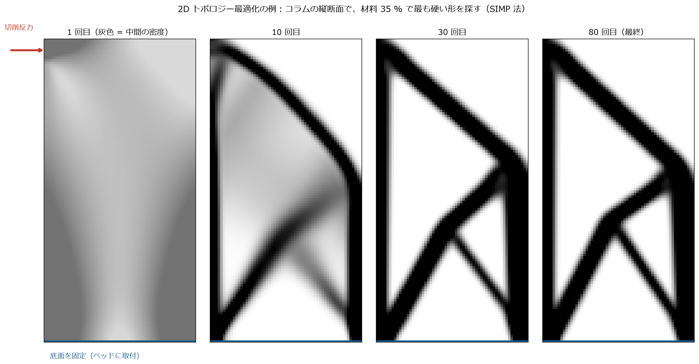
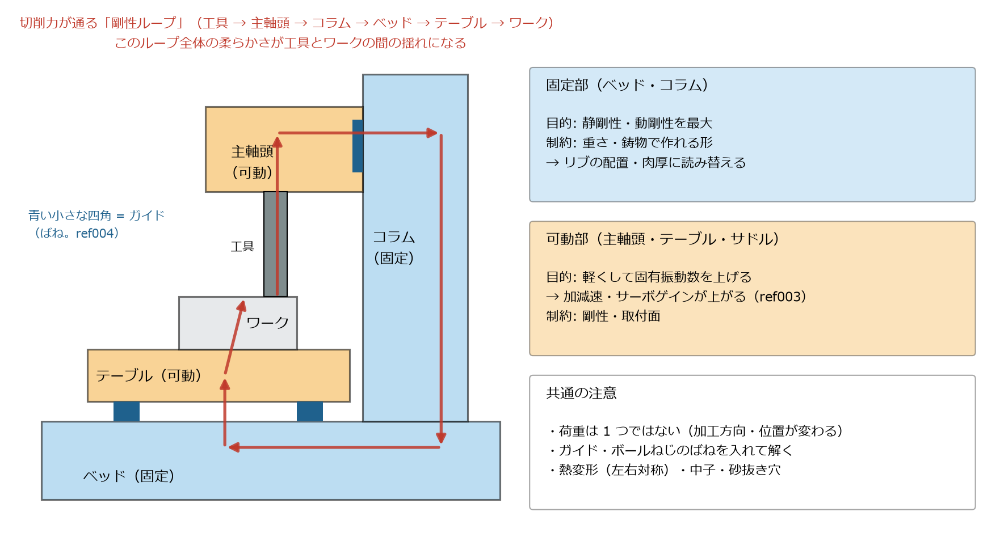
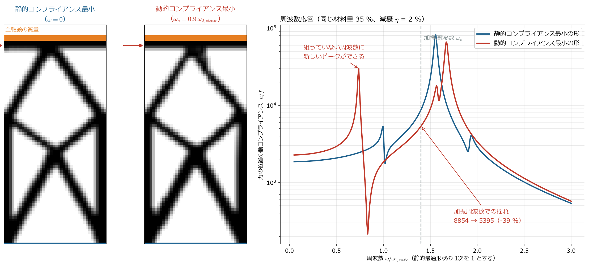
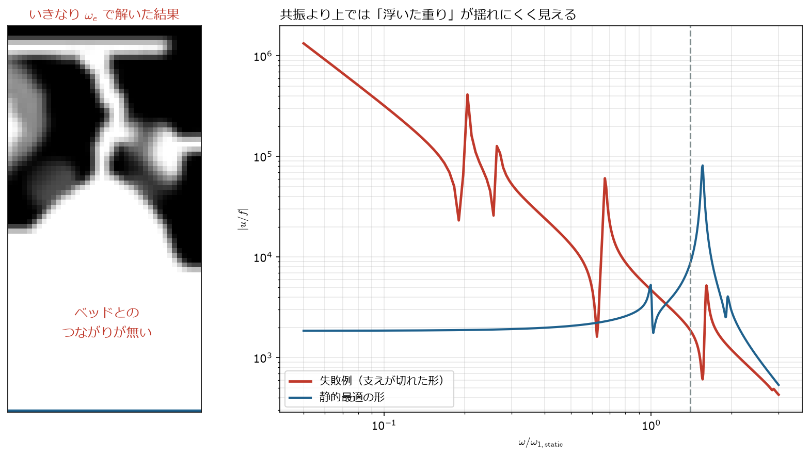

[← study 目次](README.md) ｜ [⌂ トップ](../README.md) ｜ [← 前: ref004 ばね剛性と減衰の決め方](ref004_工作機械_ばね剛性と減衰の決め方.md) ｜ [次: ref006 俊敏性と動特性のトポロジー最適化 →](ref006_工作機械_俊敏性と動特性のトポロジー最適化.md)

# ref005 工作機械でのトポロジー最適化の使われ方（調査）

作成: 2026-11-07

## 1. トポロジー最適化とは

「この空間の中で、材料を何 % だけ使って、いちばん硬い（または軽い・ゆれにくい）形はどれか」を
**計算機に決めさせる**設計方法。穴の数や位置（＝トポロジー）まで自由に変えられるのが特徴。

*Python で解いた例（SIMP 法、生成スクリプト [scripts/make_ref005_figs.py](scripts/make_ref005_figs.py)）。
コラムの縦断面を 60 × 120 に分割し、底面固定・上端に横向きの切削反力。材料を 35 % だけ残すと、
「前面の柱＋斜めの筋交い」の形になる。これはコラム内部のリブ配置の考え方そのもの。*

よく使う目的と制約:

| 目的（何を良くするか） | 制約（何を守るか） | 工作機械での例 |
|---|---|---|
| 剛性最大（たわみ最小） | 体積（重さ）を何 % 以下 | コラム・ベッドのリブ配置 |
| 1次固有振動数を最大 | 重さ以下 | 主軸頭・ラムの軽量化 |
| 重さ最小 | たわみ・応力・固有振動数が規定値以上 | 可動部（サドル・テーブル）の軽量化 |

工作機械では **「動く部分を軽く、動かない部分を硬く」** が基本。
動く部分の軽量化は加減速能力の改善に役立つ。ただし肉抜きでは剛性も変わるため、固有振動数やサーボゲインが必ず上がるわけではない。
目的関数の選び方と研究動向は[ref006：俊敏性と動特性のトポロジー最適化](ref006_工作機械_俊敏性と動特性のトポロジー最適化.md)を、プロジェクト固有の研究計画はres002（非公開）を参照。

## 2. 工作機械での使われ方（2026年11月時点で確認できたもの）

### 2.1 鋳物の構造（コラム・ベッドなど）の設計 → 製品として販売されている

| 会社 | 内容 | 出典 |
|---|---|---|
| **ナガセインテグレックス** | 門型平面研削盤 SGX-126 / SGX-104（JIMTOF2022 出展）。設計手法「IGTARP DESIGN」（革新的発想・重心最適化・**トポロジー最適化**・高度な解析・ロバスト最適化・生産最適化）を適用し、機械本体の**静剛性 2 倍、動剛性 1.25 倍** | [日経クロステック「ナガセインテグレックス、トポロジー最適化で門型平面研削盤を刷新」](https://xtech.nikkei.com/atcl/nxt/column/18/02221/111000020/)、[NCネット emidas magazine](https://emidas-magazine.nc-net.com/industry/6142/) |
| **DMG森精機** | JIMTOF2018 にトポロジー最適化した立形 MC の構造の静止モデルを展示し、2019 年の伊賀イノベーションデーで動く試作機を参考出展。報道では**動剛性 250 %、静剛性 120 %、100 kg 以上の軽量化**。構造は鋳物で製作（大物を一体で造形できる金属 AM がないため、と説明） | [MONOist「トポロジー最適化による工作機械、新しいカタチを追求するDMG森精機」(2019)](https://monoist.itmedia.co.jp/mn/articles/1907/11/news055.html)、[DMG森精機 動画ライブラリ](https://www.dmgmori.co.jp/movie_library/movie/id=5840)、[生産財マーケティング](https://seisanzai-japan.com/article/p1071) |
| **ブラザー工業** | SPEEDIO の高剛性構造・軽量低慣性・振動抑制構造は公表されているが、**トポロジー最適化を使ったという一次情報は、今回の検索では見つからなかった**（社内で使っている可能性はある。学会発表・特許・展示会講演で確認が必要） | [MONOist（SPEEDIO 新モデル）](https://monoist.itmedia.co.jp/mn/articles/2304/21/news007.html)、[ブラザー SPEEDIO](https://www.brother.co.jp/product/machine/sp/speedio/index.aspx) |
| 大学・研究機関 | 主軸頭（鋳鉄 165 kg → 147 kg、1次 165 Hz）、ラム、コラム、5軸機全体の多目的最適化など、論文は多い | [COMSOL 論文（VMC 主軸頭）](https://www.comsol.com/paper/design-analysis-and-topology-optimization-of-vertical-machining-center-spindle-h-84071)、[MDPI Applied Sciences 2024](https://www.mdpi.com/2076-3417/14/1/61)、[MDPI Machines（ラム）](https://www.mdpi.com/2075-1702/14/8/897) |

### 2.1a カタログ・展示会・事例集での語られ方

トポロジー最適化は、**カタログ・展示会・ソフト会社の導入事例**で「売り」として語られることが多い技術です。語られ方は、機械本体の構造（ナガセインテグレックス SGX、Heller、Grob、DMG森精機の試作など）、周辺機器・工具（DMG森精機 Robo2Go のハンド、Sandvik の工具）、解析サービスの案内（三菱重工マシナリーテクノロジーなど）の 3 つに分かれます。

事例の一覧・出典・数値の読み方は、重複を避けるため [ref008 の 6 章「他社はどこで価値を出そうとしているか」](ref008_工作機械_トポロジー最適化の社内導入と多目的最適化.md#6-他社はどこで価値を出そうとしているか) に 1 か所でまとめています。

**ポイント**: 大きな構造部品は**鋳物で作る**。トポロジー最適化の結果を「鋳物で作れるリブ形状」に読み替えて使う。AM（金属 3D プリンタ）は造形できる大きさとコストの制約から、コラムやベッドにはまだ使われていない。

### 2.2 AM（金属 3D プリンタ）で作った部品 → 一部は販売・実用されている

| 種類 | 内容 | 販売・実用 | 出典 |
|---|---|---|---|
| 切削工具 | **Sandvik Coromant CoroMill 390**（AM 版）。トポロジー最適化形状＋チタン合金のボディ | **市販品** | [ref008 の 6 章](ref008_工作機械_トポロジー最適化の社内導入と多目的最適化.md#6-他社はどこで価値を出そうとしているか)にまとめて掲載 |
| 切削工具 | Kennametal：ジェネレーティブデザインで 3D プリントした専用工具（Voith のトランスミッションハウジング加工、11.5 kg、加工時間 50 % 短縮） | 顧客専用品 | [Kennametal ニュース](https://www.kennametal.com/us/en/about-us/news/kennametal-revs-up-metal-cutting-innovation-with-3d-printed-tool.html) |
| 工作機械の部品 | **DMG森精機**：自社の工作機械用のクーラントアダプタを、自社の金属 3D プリンタ（LASERTEC 30 Dual SLM）で製造 | 自社機に採用 | [Modern Machine Shop / The Cool Parts Show #47](https://www.mmsonline.com/articles/3d-printed-metal-component-for-cnc-machining-center-the-cool-parts-show-47-2) |
| 治具 | 公設試の事例：トポロジー最適化で治具を 35 % 軽量化（福島県）。山梨県産業技術センターの振動試験治具（最小固有振動数 2000 Hz、元の PDF は公開終了） | 研究・試作 | [福島県の資料](https://www-pref-fukushima-lg-jp.cache.yimg.jp/uploaded/attachment/637997.pdf) |
| 機械要素 | 5軸ウォータージェット機の A 軸サポートをトポロジー最適化＋ワイヤ AM で再設計（2026 年の論文） | 研究 | [citedrive（論文情報）](https://www.citedrive.com/en/discovery/a-axis-support-redesign-for-a-5-axis-waterjet-cutting-cnc-lightweighting-via-topology-optimisation-and-wire-fed-am/) |

AM で作る機械（造る側）は、DMG森精機（LASERTEC SLM / DED）、松浦機械（LUMEX、造形と切削の複合）などが販売している。

### 2.3 まとめ：販売されているか

| 対象 | トポロジー最適化 | AM | 販売・実用 |
|---|---|---|---|
| コラム・ベッドなど大きな構造 | ○（Heller・Grob・ナガセ・ROMI、[ref008 の 6 章](ref008_工作機械_トポロジー最適化の社内導入と多目的最適化.md#6-他社はどこで価値を出そうとしているか)） | ×（鋳物で作る） | **販売されている**（設計手法として） |
| 切削工具のボディ | ○ | ○ | **販売されている**（Sandvik） |
| 工作機械の小物部品（クーラント部品など） | △ | ○ | 自社機に採用（DMG森精機） |
| 主軸頭・ラムなど可動部 | ○（研究多数） | △（研究段階） | 研究段階のものが多い |

## 3. 工作機械でトポロジー最適化を使うポイント

*生成スクリプト: [scripts/make_ref005_points.py](scripts/make_ref005_points.py)*

| ポイント | 内容 | なぜ大事か |
|---|---|---|
| ① 剛性ループで考える | 切削力は「工具 → 主軸頭 → コラム → ベッド → テーブル → ワーク」と一周する。部品 1 個だけ硬くしても、ループの一番柔らかい所で決まる | 直列ばねは一番弱いばねで決まる（[ref004](ref004_工作機械_ばね剛性と減衰の決め方.md) の直列の式と同じ） |
| ② 固定部と可動部で目的を変える | 固定部（ベッド・コラム）は**硬く**、可動部（主軸頭・テーブル・サドル）は**軽く** | 可動部が軽いと固有振動数が上がり、サーボゲインを上げられる（[ref003](ref003_工作機械_固有振動数とサーボゲイン.md)） |
| ③ 荷重条件を複数にする | 加工の向き（X・Y・Z）、主軸頭やテーブルの位置で、力のかかり方が変わる。全部のケースを重み付きで入れる | 1 ケースだけで最適化すると、他の向きに弱い形になる |
| ④ ガイド・ボールねじのばねを入れる | 構造体だけで解くと、結合部の柔らかさを無視した形になる | 実機の柔らかさの半分以上は結合部ということも多い（[ref004](ref004_工作機械_ばね剛性と減衰の決め方.md)） |
| ⑤ 静剛性だけでなく動剛性を見る | 切削は振動する力。固有振動数や周波数応答（動コンプライアンス）を目的・制約に入れる | びびり・面品位は動剛性で決まる（次の 4 章） |
| ⑥ 作り方の制約を入れる | 鋳物なら、抜き勾配・最小肉厚・中子の支え・砂抜き穴。結果はそのまま使わず「リブ配置」に読み替える | 計算結果の形は、そのままでは鋳造できないことが多い |
| ⑦ 熱も考える | 左右対称、熱源（主軸・モータ）からの熱の流れ | 研削盤・精密機では熱変位が精度を決める |

## 4. 動的コンプライアンスのトポロジー最適化

目的関数の選び方・研究動向の詳しい整理は [ref006](ref006_工作機械_俊敏性と動特性のトポロジー最適化.md)、このプロジェクトでの研究案は res002（非公開）。ここでは式と簡単な計算例で違いを見る。

### 4.1 静的と動的の違い

**静的コンプライアンス**（ここまでの例）は、ゆっくりかけた力での「たわみやすさ」:

$$
C_{\mathrm{static}} = \boldsymbol{f}^{\mathsf T}\boldsymbol{u}, \qquad \boldsymbol{K}\boldsymbol{u} = \boldsymbol{f}
$$

**動的コンプライアンス**は、周波数 $\omega$ で振動する力 $\boldsymbol{f}e^{i\omega t}$ に対する「揺れやすさ」。質量 $\boldsymbol{M}$ が入る:

$$
C(\omega) = \left|\boldsymbol{f}^{\mathsf T}\boldsymbol{u}(\omega)\right|, \qquad \left(\boldsymbol{K} - \omega^2 \boldsymbol{M}\right)\boldsymbol{u} = \boldsymbol{f}
$$

感度（要素の密度 $x_e$ を少し増やしたときの変化）は、剛性が増える効果と、質量が増える効果の**引き算**になる:

$$
\frac{\partial C}{\partial x_e} = -\,\mathrm{sign}(\boldsymbol{f}^{\mathsf T}\boldsymbol{u})\;\boldsymbol{u}_e^{\mathsf T}\left(\frac{\partial \boldsymbol{K}_e}{\partial x_e} - \omega^2 \frac{\partial \boldsymbol{M}_e}{\partial x_e}\right)\boldsymbol{u}_e
$$

つまり「材料を足すと硬くなるが、重くもなる」。周波数が高いほど重さの悪影響が大きくなる。工作機械では、刃の通過周波数（$=$ 回転数 × 刃数 / 60）やびびりが出る周波数帯で揺れにくい形を探すのに使う。

| 目的関数 | 意味 | 使いどころ |
|---|---|---|
| 静的コンプライアンス最小 | ゆっくりした力でたわみにくい | 重切削の静剛性、まず最初に |
| 1次固有振動数最大 | 共振を高い周波数へ逃がす | 可動部、サーボゲインを上げたい |
| 動的コンプライアンス最小（1 周波数） | 決まった加振周波数で揺れにくい | 回転数が決まっている専用機 |
| 動的コンプライアンス最小（周波数帯） | 帯域内の応答の積分・最大値を小さく | 一般の加工機（回転数が変わる） |

### 4.2 Python で解いた例

1 章と同じコラムの縦断面（40 × 80 要素、材料 35 %）。上端に主軸頭の質量（取付部は常に材料）を付け、前面上端に横向きの振動する力をかけた。
静的最適の形で、力によく反応する曲げモード（2次）の 0.9 倍の周波数で加振し、**動的コンプライアンス最小**を解いた。

*生成スクリプト: [scripts/make_ref005_dyn.py](scripts/make_ref005_dyn.py)（SIMP 法＋OC 法、質量は低密度で急に小さくする補間（Pedersen 2000））*

- 形の違いは小さい（部材の太さ・つながり方が少し変わる程度）。静的最適の形から出発しているため
- **加振周波数での揺れは約 39 % 小さくなった**
- 一方、**狙っていない低い周波数に新しいピークができた**。1 つの周波数だけで最適化すると、ほかの周波数を悪くすることがある
  → 実際には**周波数帯で評価**するか、「1次固有振動数は ○ Hz 以上」という制約を一緒に入れる

### 4.3 落とし穴：いきなり高い周波数で解くと「支えを切る」

最初から加振周波数 $\omega_e$ で解くと、**ベッドとのつながりを切った形**になった。
共振より高い周波数では、重いものほど揺れにくい（$|u| \approx f/(\omega^2 m)$）ので、
「支えを切って重りを浮かせる」のが計算上は一番揺れない答えになってしまう。もちろん静剛性はゼロで使えない。

対策（上の 4.2 の例で使ったもの）:
1. まず静的コンプライアンス最小で解き、その形から出発する
2. 加振周波数を $0.3\omega_e \to 0.5\omega_e \to \cdots \to \omega_e$ と少しずつ上げる（**周波数の継続法**）
3. 加振周波数が 1次固有振動数より**下**にある状態を保つ（固有振動数の制約を入れる）

参考: Olhoff & Du, "Topological design of continuum structures subjected to forced vibration", Struct. Multidisc. Optim. (2005)、
[WCSMO 2015 論文（Brecher ほか：多質量ダンパとトポロジー最適化、ウェブアーカイブ）](https://web.archive.org/web/20230315074641/https://web.aeromech.usyd.edu.au/WCSMO2015/papers/1068_paper.pdf)、
[NAFEMS 2019（工作機械の動特性と最適化）](https://www.nafems.org/publications/resource_center/nwc_19_34/)、
[台湾特許 TWI583483B（切削力を調和荷重とした周波数応答コンプライアンス最小化による工作機械構造設計）](https://patents.google.com/patent/TWI583483B/zh)

> 静剛性・固有値・びびりモードを同時に扱う**多目的最適化**と、社内導入・他社の価値の出し方は [ref008](ref008_工作機械_トポロジー最適化の社内導入と多目的最適化.md) にまとめた。

## 5. オープンソースでできるか

| ツール | 内容 |
|---|---|
| **beso**（CalculiX 用、Python） | CalculiX の入力ファイルを使って、要素を残す・消すを繰り返す方式（BESO 法）。固有振動数を目的にもできる。このプロジェクトの CalculiX モデルにそのまま使える |
| FreeCAD ＋ beso マクロ | GUI から上の beso を使う |
| DTU TopOpt（88 行コードなど） | 教育用の基本コード（上の図はこれを Python にしたもの）。大規模版は PETSc で並列 |
| FEniCSx ＋ dolfin-adjoint | 方程式を自分で書いて、感度を自動で計算 |
| ToOptix | CalculiX 用のトポロジー最適化ツール |

## 6. このプロジェクトでの次の一歩（案）

1. ana001 のコラムを設計領域にして、**CalculiX ＋ beso** で「材料 50 % で 1次固有振動数最大」を解く
2. 結果を鋳物で作れるリブ配置（縦リブ・斜めリブ）に読み替え、もう一度 ana001 のモデルで固有振動数を確認する
3. 可動部（テーブル）の軽量化と、送り系の固有振動数・サーボゲインの関係を見る
4. CalculiX の `*STEADY STATE DYNAMICS`（[ana002](../docs/ana002_CalculiX-FrontISTR_簡易工作機械の周波数応答解析.md)）の結果を目的にして、動的コンプライアンスを周波数帯で評価する（[ref003](ref003_工作機械_固有振動数とサーボゲイン.md)）

---

[← study 目次](README.md) ｜ [⌂ トップ](../README.md) ｜ [← 前: ref004 ばね剛性と減衰の決め方](ref004_工作機械_ばね剛性と減衰の決め方.md) ｜ [次: ref006 俊敏性と動特性のトポロジー最適化 →](ref006_工作機械_俊敏性と動特性のトポロジー最適化.md)
