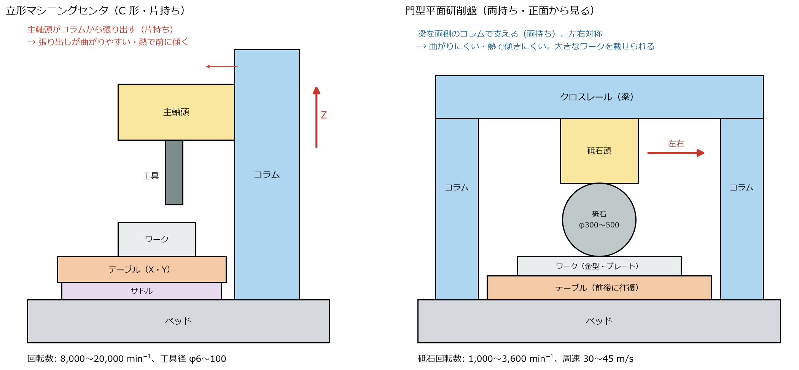
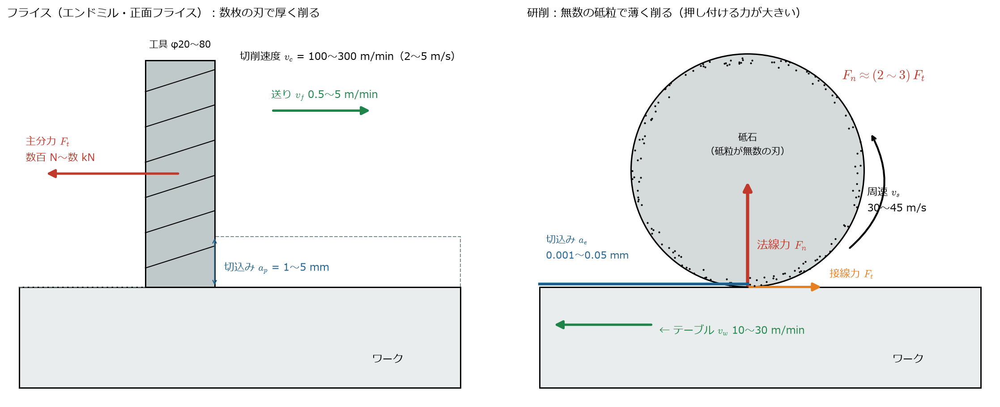
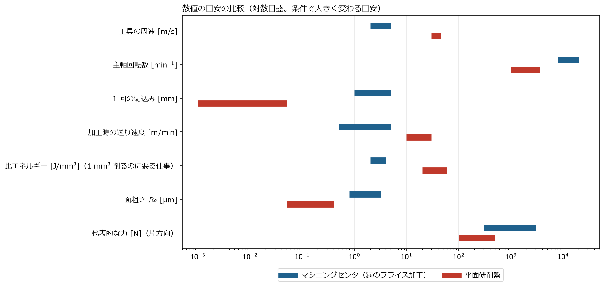
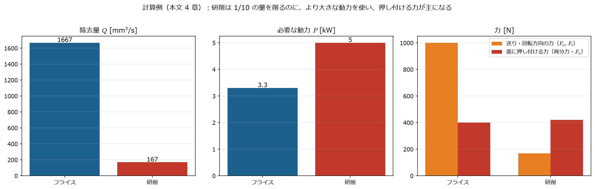

[← study 目次](README.md) ｜ [⌂ トップ](../README.md) ｜ [← 前: ref006 俊敏性と動特性のトポロジー最適化](ref006_工作機械_俊敏性と動特性のトポロジー最適化.md) ｜ [次: ref008 トポロジー最適化の社内導入と多目的最適化 →](ref008_工作機械_トポロジー最適化の社内導入と多目的最適化.md)

# ref007 門型平面研削盤とマシニングセンタの違い

作成: 2026-11-07

[ref005](ref005_工作機械_トポロジー最適化の使われ方.md) に出てきたナガセインテグレックス SGX は、**門型平面研削盤**。
マシニングセンタ（MC）と比べて、機械の形・削り方・力・回転数がどう違うかをまとめる。
数値は一般的な目安（鋼の加工）で、砥石・工具・材料・条件で大きく変わる。

---

## 1. ひとことで

| | マシニングセンタ | 門型平面研削盤 |
|---|---|---|
| 何をする機械か | 穴あけ・溝・ポケットなど、**形を作る** | 焼入れ鋼の平面を、**µm の精度・鏡面に近い面**に仕上げる |
| 刃物 | 数枚の刃がついた工具（エンドミル・正面フライス） | 砥石（無数の硬い粒＝砥粒が刃） |
| 1回に削る厚さ | mm | µm（0.001〜0.05 mm） |
| 何が動くか | 主軸頭（Z）、テーブル・サドル（X・Y） | **テーブルが前後に速く往復**、砥石頭が左右・上下 |
| 形 | C 形（コラムから主軸頭が張り出す、片持ち） | **門型**（梁を両側のコラムで支える、両持ち） |
| 主な使われ方 | 部品加工全般 | 金型プレート、工作機械のベッド・テーブルの摺動面、大型の精密部品 |

## 2. 機械の形の違い

*生成スクリプト: [scripts/make_ref007_figs.py](scripts/make_ref007_figs.py)*

- **MC（左）**: 主軸頭がコラムから前に張り出す。力がかかると張り出しが曲がり、主軸の熱でコラムが前に傾く
- **門型（右）**: 梁（クロスレール）を左右のコラムで支えるので、**曲がりにくく、左右対称なので熱で傾きにくい**。
  テーブルの上に大きなワークを載せて、テーブルを前後に往復させる
- 研削盤のテーブル往復は、ボールねじではなく**油圧**や**リニアモータ**で動かすことが多い（速く・長いストロークを何万回も往復するため）。
  案内は、減衰の大きい**すべり案内**や**静圧案内**（油膜で浮かせる）がよく使われる（減衰は [ref004](ref004_工作機械_ばね剛性と減衰の決め方.md) 4 章）

## 3. 削り方と力の向きの違い

### 3.1 フライス（MC）

数枚の刃で、厚く（mm 単位）削る。力は主に**刃が進む向き（主分力 $F_c$）**にかかる。
力の大きさは比切削抵抗 $k_c$ で見積もる（[ref002](ref002_工作機械_重切削・粗加工・仕上げ加工.md)）:

$$
F_c \approx k_c \, a_p \, h, \qquad P = \frac{a_p \, a_e \, v_f \, k_c}{60 \times 10^{6}}\ \mathrm{[kW]}
$$

### 3.2 研削

砥石の表面には砥粒が無数にあり、1 粒ずつはごく薄く削る。砥粒は刃先が丸く、刃の角度が大きく負（すくい角がマイナス）なので、
**削るより「こすって押しつぶす」成分が多い**。そのため:

- **砥石を面に押し付ける力（法線力 $F_n$）が、回転方向の力（接線力 $F_t$）の 2〜3 倍**になる

$$
\frac{F_n}{F_t} \approx 2 \sim 3
$$

- 削る量のわりに大きなエネルギーを使い、それがほとんど**熱**になる（研削焼け・熱変位の原因。研削液を大量にかける理由）

砥石の周速（砥石の外周が動く速さ）と回転数の関係:

$$
v_s = \frac{\pi D n}{60 \times 1000}\ \mathrm{[m/s]} \qquad (D\ \mathrm{[mm]},\ n\ \mathrm{[min^{-1}]})
$$

例: $D = 400$ mm の砥石を $v_s = 33$ m/s で回すと、$n = \dfrac{33 \times 60000}{\pi \times 400} \approx 1600\ \mathrm{min^{-1}}$。
**砥石は大きいので回転数は MC より低いが、外周の速さは約 10 倍**になる。

研削の動力と接線力:

$$
P = F_t \, v_s, \qquad P = e_c \, Q, \qquad Q = a_e \, v_w \, b
$$

- $e_c$：比研削エネルギー（1 mm³ 削るのに必要な仕事）[J/mm³]。鋼のフライスの約 10 倍
- $a_e$：切込み、$v_w$：テーブル速度、$b$：研削幅

## 4. 数値の比較

| 項目 | マシニングセンタ（鋼のフライス加工） | 平面研削盤 |
|---|---|---|
| 工具・砥石の周速 | 100〜300 m/min（2〜5 m/s） | 30〜45 m/s（1,800〜2,700 m/min）。高速研削で 60 m/s 以上も |
| 主軸回転数 | 8,000〜20,000 min⁻¹（BT40 など） | 1,000〜3,600 min⁻¹（砥石 φ180〜500） |
| 1回の切込み | $a_p$ = 1〜5 mm | 粗 0.01〜0.05 mm、仕上げ 0.001〜0.005 mm |
| 送り | $v_f$ = 0.5〜5 m/min | テーブル往復 10〜30 m/min |
| 比エネルギー | 2〜4 J/mm³（$k_c$ = 2000〜4000 N/mm² と同じ） | 20〜60 J/mm³ |
| 面粗さ $Ra$ | 0.8〜3.2 µm | 0.05〜0.4 µm |
| 平面度の狙い | 10 µm 程度 | 数 µm 以下（大型でも µm オーダー） |
| 主軸の動力 | 7.5〜22 kW | 5.5〜30 kW（大型門型） |

参考（実機の例）: ナガセインテグレックスのサドル型研削盤 SGE-520 系は、砥石 φ180〜255、回転数 500〜3,600 min⁻¹、砥石軸受は油静圧
（[宮城県産業技術総合センター 設備紹介 PDF](https://www.mit.pref.miyagi.jp/wp-content/uploads/2020/05/4_A_heimenkensaku.pdf)）。
φ255 を 3,600 min⁻¹ で回すと $v_s = \pi \times 255 \times 3600 / 60000 \approx 48$ m/s。

## 5. 計算例：同じくらいの動力で比べる

**フライス（正面フライス）**: $a_p = 2$ mm、$a_e = 50$ mm、$v_f = 1000$ mm/min、$k_c = 2000$ N/mm²、$v_c = 200$ m/min

$$
Q = \frac{2 \times 50 \times 1000}{60} \approx 1667\ \mathrm{mm^3/s}, \quad
P = k_c Q = 2000 \times 1667 \times 10^{-3} \approx 3.3\ \mathrm{kW}, \quad
F_c = \frac{P}{v_c} = \frac{3300}{3.33} \approx 1000\ \mathrm{N}
$$

**研削（平面研削）**: $a_e = 0.01$ mm、$v_w = 20$ m/min（333 mm/s）、$b = 50$ mm、$e_c = 30$ J/mm³、$v_s = 30$ m/s

$$
Q = 0.01 \times 333 \times 50 \approx 167\ \mathrm{mm^3/s}, \quad
P = e_c Q = 30 \times 167 \approx 5.0\ \mathrm{kW}, \quad
F_t = \frac{P}{v_s} = \frac{5000}{30} \approx 167\ \mathrm{N}, \quad
F_n \approx 2.5 F_t \approx 420\ \mathrm{N}
$$

わかること:
- 研削は**フライスの 1/10 の量を削るのに、より大きな動力**を使う（ほとんど熱になる）
- 力の大きさ自体は研削のほうが小さいが、**面に垂直に押す力 $F_n$ が主**。
  この力で砥石とワークが離れる向き（Z）に機械がたわむと、**その分だけ削り残し＝寸法・平面度の誤差**になる
  - 例: Z 方向の剛性が 100 N/µm なら、$420 / 100 = 4.2$ µm 削り残す。仕上げの切込み（数 µm）と同じ大きさ
  - だから研削盤は、何回か切込み 0 で往復させて残りを取る（**スパークアウト**）

## 6. 機械に求められるものの違い

| 観点 | マシニングセンタ | 門型平面研削盤 |
|---|---|---|
| 静剛性 | 大きな切削力（数 kN）に負けない。全方向 | **Z（切込み方向）の剛性**が寸法精度に直結。µm 単位 |
| 動剛性・振動 | 刃が断続的に当たる力（刃数 × 回転数）で**びびり**。工具先端の FRF が大事 | 砥石のアンバランス・砥石とワークの接触で**びびりマーク**（面に縞模様）。わずかな振動でも面に出る |
| 熱 | 主軸の発熱で Z が伸びる・コラムが傾く | 研削熱・油圧・テーブル往復の摩擦熱。**左右対称の門型**、恒温室、油の温度管理 |
| 送り系 | ボールねじ＋サーボ。加減速・位置決め速度（[ref003](ref003_工作機械_固有振動数とサーボゲイン.md)） | テーブル往復（油圧・リニアモータ）。速く、なめらかで、反転時に揺れないこと |
| 案内 | ころがり案内（ローラガイド）が主流 | すべり案内・静圧案内（減衰が大きく、なめらか） |
| 主軸 | 高速の転がり軸受（アンギュラ玉軸受） | 低速だが振れの小さい**静圧軸受**や精密転がり軸受。砥石のバランス取り |

**トポロジー最適化との関係**（[ref005](ref005_工作機械_トポロジー最適化の使われ方.md)）:
ナガセインテグレックス SGX が「静剛性 2 倍・動剛性 1.25 倍」をうたうのは、研削盤では
**$F_n$ によるたわみ（静剛性）が寸法の削り残しに**、**振動（動剛性）が面のびびりマークに**直接出るため。
門型の梁・コラムは、MC の片持ちコラムよりも「両持ちのはり」なので、リブの入れ方（トポロジー）の効き方も違う。

## 7. トポロジー最適化に向いている機種はあるか（調査）

調査日: 2026-11-07。カタログ・報道・論文で確認できた範囲。詳しい背景は [ref005](ref005_工作機械_トポロジー最適化の使われ方.md)、[ref006](ref006_工作機械_俊敏性と動特性のトポロジー最適化.md)。

### 7.1 結論

**「向いている機種」ははっきりある。** 共通点は、(1) 大きくて重い構造が動く、または精度に直結する、(2) 荷重の向きが単純で決まっている、(3) 左右対称で設計領域を決めやすい、の 3 つ。
その代表が **門型（ガントリ）構造の機械**（門型平面研削盤・門形マシニングセンタ・門形フライス盤）と、**小型・高速機の可動部**（主軸頭・サドル・ラム）。

| 機種 | 向き不向き | 理由 | 確認できた事例 |
|---|---|---|---|
| **門型平面研削盤** | ◎ | 荷重はほぼ $F_n$（Z 方向）だけで単純。静剛性が寸法の削り残しに直結（5 章）。門型で左右対称。少量生産で鋳物の型を新しくしやすい | **ナガセインテグレックス SGX-126 / SGX-104**（製品。静剛性 2 倍・動剛性 1.25 倍）。[日経クロステック](https://xtech.nikkei.com/atcl/nxt/column/18/02221/111000020/) |
| **門形マシニングセンタ・門形フライス盤**（クロスレール・コラム） | ◎ | 梁（クロスレール）が長く重い。梁の上を主軸頭が動くので、位置ごとに曲げ・ねじりが変わる → リブ配置の効果が大きい | 研究多数：HTM 系門形 MC のクロスビームで剛性 +16 %・重量 −3.8 %、TX1600G 門形フライスで静剛性と固有振動数の多目的最適化、門形高精度機で「1次固有振動数 140 Hz 以上が目安」。[Sci. Rep. 2023](https://pmc.ncbi.nlm.nih.gov/articles/PMC10415275)、[門形フライスのコラム（AMM）](https://www.scientific.net/AMM.80-81.1016)、[高速門形フライス（AMR）](https://www.scientific.net/AMR.199-200.1065) |
| **大型 5 軸機の可動フレーム** | ○ | 動くフレームが機械重量の大半。軽くすると加減速と固有振動数が上がる | [Applied Sciences 2018（大型 5 軸機の移動フレーム）](https://www.mdpi.com/2076-3417/8/9/1598) |
| **立形 MC の可動部（主軸頭・サドル・ラム）** | ○ | 「軽くして固有振動数を上げる」が目的として明確（ref003 のサーボゲイン）。部品が小さいので AM も視野に入る | DMG森精機の参考出展（2018 年は AM で可動部の重さ半分、2019 年は鋳物で動剛性 250 %）。[MONOist 2018](https://monoist.itmedia.co.jp/mn/articles/1811/07/news067.html)、[MONOist 2019](https://monoist.itmedia.co.jp/mn/articles/1907/11/news055.html)。主軸頭 165 → 147 kg・1次 151 → 165 Hz の研究 [COMSOL](https://www.comsol.com/paper/design-analysis-and-topology-optimization-of-vertical-machining-center-spindle-h-84071) |
| C 形コラムの機械（ヘッドフレーム） | ○ | 片持ちで曲がりやすいので効果は大きいが、荷重の向き・位置が多い | 航空機部品用コラム型機のヘッドフレームで固有振動数 +30.6 %。[Korea Science](https://koreascience.or.kr/article/JAKO201828138052251.pdf) |
| 旋盤（主軸台・ベッド） | △ | 熱変位（主軸の発熱）・切りくず・クーラントの通り道・カバーなど、形の制約が多い | 重切削 CNC 旋盤の主軸台の研究はある。[AMM](https://www.scientific.net/AMM.598.229) |
| 大型ベッド（全機種共通） | △ | 効果はあるが、動かないので軽量化の価値が小さい。鋳物の型の作り直しが高い | 研究はあるが、製品での公表は少ない |

### 7.2 なぜ門型平面研削盤は「やりやすい」のか

この資料の 3〜6 章の内容から整理すると、MC より研削盤のほうがトポロジー最適化の**問題設定が簡単**になる。

| 問題設定の項目 | マシニングセンタ | 門型平面研削盤 |
|---|---|---|
| 荷重の向き | X・Y・Z すべて。工具や加工で変わる | ほぼ $F_n$（Z 方向、切込み方向）と小さな $F_t$ |
| 荷重の大きさ | 数百 N〜数 kN（重切削） | 数百 N（5 章の例で $F_n \approx 420$ N） |
| 荷重の位置 | 主軸頭・テーブルの位置で大きく変わる | 砥石頭の左右位置だけ（テーブルは往復するが、力の位置は梁の上で変わる） |
| 何を良くすればよいか | 静剛性・動剛性・軽量化・熱を全部 | **Z の静剛性**（寸法）と**動剛性**（びびりマーク）、**左右対称**（熱） |
| 構造 | C 形（片持ち、非対称） | 門型（両持ち、左右対称）→ 設計領域を半分にして解ける |
| 生産台数 | 多い（量産機） | 少ない（受注生産に近い）→ 鋳物の型を新しくしやすい |

つまり研削盤は「**荷重ケースが少なく、目的がはっきりし、対称**」なので、最適化の結果がそのまま設計に使いやすい。
ナガセインテグレックスが研削盤で最初にトポロジー最適化を製品化したのは、この点からも理にかなっている（同社が理由をこう説明しているわけではなく、この資料の整理）。

### 7.3 このプロジェクトで試すなら

1. ana001 のモデルを**門型**に作り替える（左右のコラム＋クロスレール＋砥石頭）
2. 荷重は砥石頭の位置 3 か所 × $F_n$（Z 方向）と小さな $F_t$、目的は「Z の静剛性最大＋1次固有振動数の下限」
3. CalculiX ＋ beso でクロスレールの断面（リブ配置）を最適化し、ana002 と同じ周波数応答（Z-Z）で比べる

---

出典・参考:
- 7 章の出典は表の中のリンク
- [宮城県産業技術総合センター 平面研削盤（ナガセインテグレックス SGE-520SLD2-E2）設備紹介 PDF](https://www.mit.pref.miyagi.jp/wp-content/uploads/2020/05/4_A_heimenkensaku.pdf)
- [ナガセインテグレックス 門型平面研削盤のトポロジー最適化（日経クロステック）](https://xtech.nikkei.com/atcl/nxt/column/18/02221/111000020/)
- 研削の力の比 $F_n/F_t$・比研削エネルギーの値は、研削加工の一般的な教科書の目安（例: 精密工学会 編『研削加工の基礎』の類書、Malkin & Guo "Grinding Technology"）

---

[← study 目次](README.md) ｜ [⌂ トップ](../README.md) ｜ [← 前: ref006 俊敏性と動特性のトポロジー最適化](ref006_工作機械_俊敏性と動特性のトポロジー最適化.md) ｜ [次: ref008 トポロジー最適化の社内導入と多目的最適化 →](ref008_工作機械_トポロジー最適化の社内導入と多目的最適化.md)
