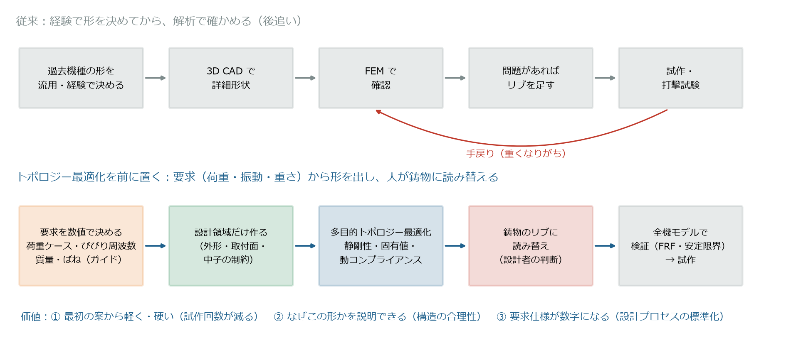
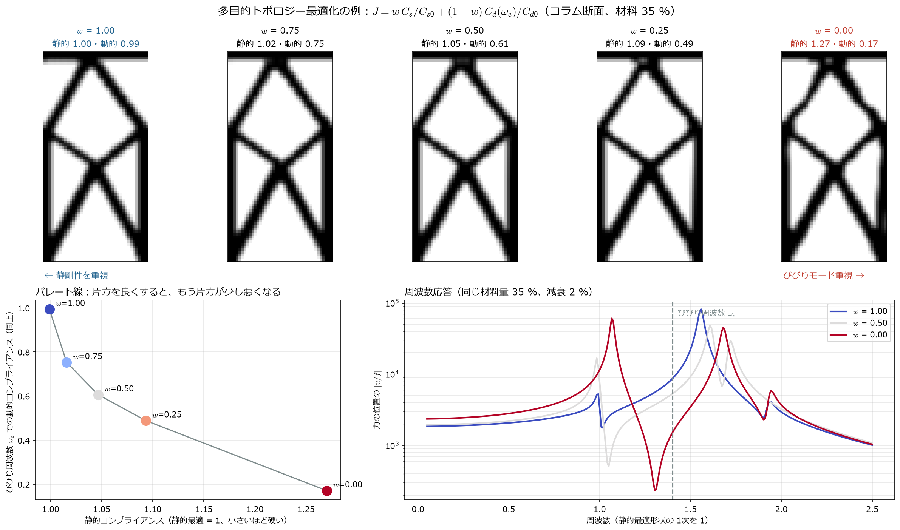
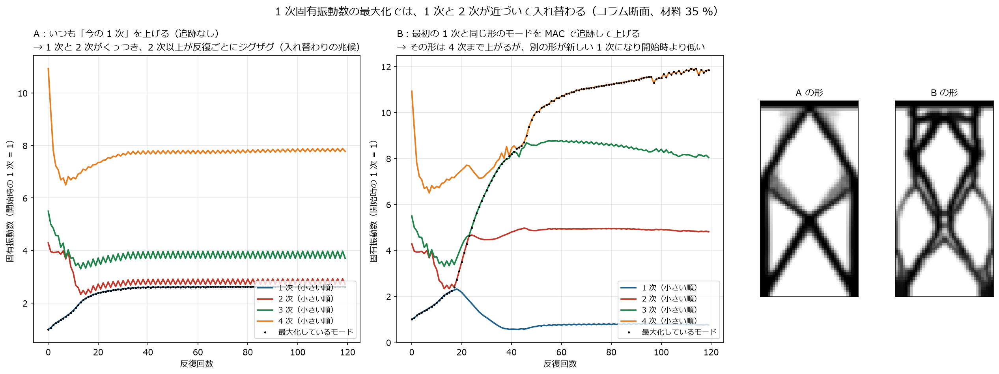
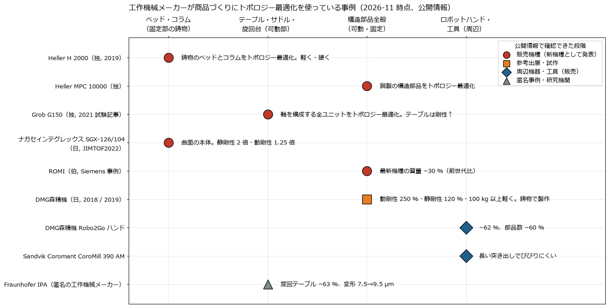
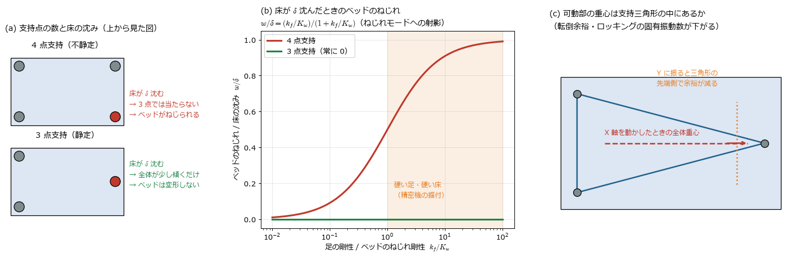
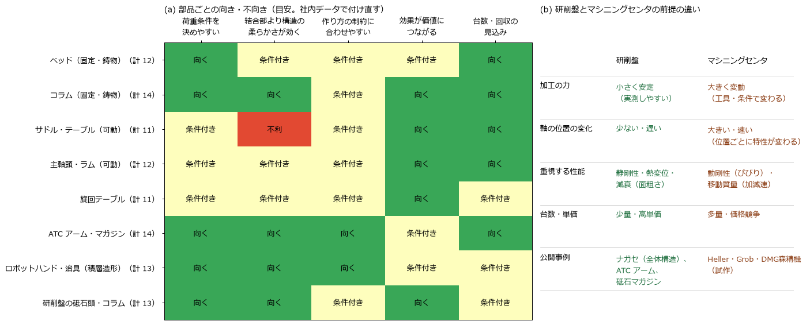

[← study 目次](README.md) ｜ [⌂ トップ](../README.md) ｜ [← 前: ref007 門型平面研削盤とマシニングの違い](ref007_工作機械_門型平面研削盤とマシニングの違い.md)

# ref008 トポロジー最適化の社内導入：多目的最適化（剛性・固有値・びびりモード）と他社の価値の出し方

作成: 2026-11-07（調査日も同じ）。追記: 2026-11-08（5a 章：研究の流れ。6 章：商品づくりに使っているメーカーの追加調査（6.5 節で研削盤の向き）、7 章：使う工程・製品・部品の見極め、旧 6a 章と ref005 2.1a 節の事例を統合、動剛性の数値の意味、3 点支持）

トポロジー最適化を社内に導入するにあたり、次の 3 点を調べてまとめる。

1. **静剛性の最大化・固有値の最大化・特定のびびりモードの動コンプライアンス低減を、同時に扱う方法**（多目的最適化）はあるか
2. **過去の文献**ではどう扱われているか
3. **他社**はトポロジー最適化でどんな価値（大幅な軽量化、構造の合理性、設計プロセスの変革）を出そうとしているか
4. 社内で**どの設計工程・製品・部品**に使うかを見極めるための情報（7 章）

関連: [ref005 使われ方](ref005_工作機械_トポロジー最適化の使われ方.md)（事例・動コンプライアンスの基礎）、[ref006 俊敏性と動特性](ref006_工作機械_俊敏性と動特性のトポロジー最適化.md)（目的関数・研究動向）、res002 研究計画（非公開）

---

## 1. 結論

調べたかった 3 つの問いに、1 行ずつ答える。

| 問い | 答え |
|---|---|
| ① 剛性・固有値・びびりを**同時に**最適化する方法はある？ | **ある。** 文献でも定番 |
| ② **特定のびびりモード**だけを下げる方法はある？ | **方法はあるが、構造への適用はまだ研究段階** |
| ③ 他社はトポロジー最適化で**何の価値**を出している？ | **軽量化・構造の合理性・設計プロセスの変革**の 3 つ。**販売機種でトポロジー最適化を明言しているのは Heller・Grob・ナガセ・ROMI**（6 章） |
| ④ 社内では**どこに**使う？ | 最初は**荷重がはっきりしていて、結合部より構造の柔らかさが効く部品**（コラム・ATC アーム・研削盤の砥石頭など）を**構想設計**で。研削盤は荷重・評価指標が決めやすく始めやすい（6.5 節・7 章） |

### ① 同時に最適化する方法

- 複数の目的を、**重みを付けて 1 つの式にまとめる**（妥協計画法）のが定番
- 例：立形マシニングセンタのコラム（2018 年の論文）

| 指標 | 結果 |
|---|---|
| 静剛性 | **+21.5 %** |
| 工具先端の変形 | **−13.7 %** |
| 1〜4 次の固有振動数 | **+4〜8 %** |

### ② 特定のびびりモードを下げる方法

「このモードを下げる」をそのまま目的にした論文は少ない。代わりに次の 3 つの方法がある。

| 方法 | 何を小さくするか | 状況 |
|---|---|---|
| A | びびり周波数（帯）での**揺れやすさ**（動的コンプライアンス） | **すぐ使える** |
| B | そのモードでの**工具先端の動き**（固有振動数を上げる・動きを減らす） | 工具・主軸では実績あり |
| C | びびりの**安定限界**（FRF の負の実部） | 研究段階。最終評価に使う |

### このノートで計算した結果（3 章・4 章）

コラム断面（材料 35 %）で、静剛性とびびりの重みを半々にすると:

| 指標 | 静剛性だけで最適化した形との比較 |
|---|---|
| 静剛性 | **5 % 低下**（ほぼ同じ） |
| びびり周波数での揺れ | **39 % 減少** |

**注意**：びびりだけを重視しすぎると、**別の周波数に新しいピーク**ができる。
→ 「固有振動数は○○ Hz 以上」という条件を必ずセットにする。

### ③ 他社の価値の出し方（6 章）

| 価値 | どこに使う | 代表例 |
|---|---|---|
| **大幅な軽量化** | 動く部品（主軸頭・ハンド・工具） | DMG森精機：可動部の重さ **半分**、ロボットハンド **−62 %** |
| **構造の合理性** | 動かない部品（ベッド・コラム） | ナガセインテグレックス：静剛性 **2 倍**・動剛性 **1.25 倍**。DMG森精機の試作：動剛性 250 %・静剛性 120 %（定義は非公開、6.2 節） |
| **置き場所・据付** | 支え方（3 点支持） | ナガセ SGX：床の影響を受けにくく、接地面積 **−50 %**、床工事なしで設置（6.4 節） |
| **設計プロセスの変革** | 設計のやり方そのもの | ナガセ：トポロジー最適化を設計手法「IGTARP DESIGN」に組み込み標準化。ROMI：最新機の質量 **−30 %** |

---

## 2. 多目的にするときの考え方

*生成スクリプト: [scripts/make_ref008_figs.py](scripts/make_ref008_figs.py)*

工作機械のトポロジー最適化で同時に良くしたいものは、たいてい次の 3 つ。

| 目的 | 式 | 意味 |
|---|---|---|
| 静剛性の最大化 | $C_s = \boldsymbol{f}^{\mathsf T}\boldsymbol{u}$ を最小（$\boldsymbol{K}\boldsymbol{u} = \boldsymbol{f}$） | 重切削で逃げない |
| 固有振動数の最大化 | $\omega_1$ を最大（$\boldsymbol{K}\boldsymbol{\phi} = \omega^2 \boldsymbol{M}\boldsymbol{\phi}$） | サーボゲインを上げられる（[ref003](ref003_工作機械_固有振動数とサーボゲイン.md)） |
| びびりモードの動コンプライアンス低減 | $C_d(\omega) = \lvert \boldsymbol{f}^{\mathsf T}\boldsymbol{u}(\omega) \rvert$ を最小（$(\boldsymbol{K} - \omega^2\boldsymbol{M})\boldsymbol{u} = \boldsymbol{f}$） | びびらずに深く削れる |

これらは**互いに引っぱり合う**（静剛性を上げる材料配置と、ある周波数で揺れにくい材料配置は一致しない）。そこで次のどれかでまとめる。

### 2.1 重み付き和・妥協計画法（いちばん使われる）

各目的を基準値で割って（正規化して）、重みを付けて足す。

$$
\min_{\boldsymbol{x}}\ J = \left[\ \sum_{k} w_k^{\,q} \left(\frac{f_k(\boldsymbol{x}) - f_k^{\min}}{f_k^{\max} - f_k^{\min}}\right)^{q}\ \right]^{1/q}
$$

- $f_k$：コンプライアンス、$1/\omega_1$（または平均固有値）、$C_d$ など
- $q = 1$ なら単純な重み付き和、$q = 2$ 以上が妥協計画法。$q$ を大きくすると、どれか 1 つだけ極端に悪い解を避けやすい
- 固有値は複数のモードが入れ替わるので、**平均周波数法**（低次の複数モードの重み付き平均を最大化）でまとめるのが定番

工作機械での例：立形 MC コラムでコンプライアンス・変形・固有振動数を妥協計画法でまとめ、静剛性 +21.53 %・工具先端変形 −13.69 %・1〜4 次 +4〜8 %（[Procedia CIRP 2018](https://www.sciencedirect.com/science/article/pii/S2212827118312071)）。

### 2.2 制約付き（ε 制約法）：実務で決めやすい

1 つを目的にし、ほかは「○○以上」の制約にする。**仕様として数字を決めやすい**ので、社内導入ではこちらが扱いやすい。

$$
\min_{\boldsymbol{x}}\ \max_{\omega \in [\omega_a,\ \omega_b]} C_d(\omega)
\quad \text{s.t.}\quad C_s \le 1.05\,C_s^{\ast},\quad \omega_1 \ge \omega_{1,\mathrm{req}},\quad V \le V_{\max}
$$

例：「静剛性は今の 95 % 以上を守り、1 次は 150 Hz 以上、その上でびびり帯域（例 300〜500 Hz）の揺れを最小に」。

### 2.3 パレート線を描く

重みや制約値を少しずつ変えて解き、**「片方を良くすると、もう片方がどれだけ悪くなるか」の線（パレート線）**を描く。設計者が判断する材料になる。
重みに結果が敏感なので、重みを 1 点だけ決め打ちしないのが大事（[2026 年の複合材ベッドの研究](https://www.sciencedirect.com/science/article/pii/S2352492826006938) は重みを変えながらパレート解を探している）。

---

## 3. 「特定のびびりモード」を下げる方法

びびり（再生びびり）の安定限界は、工具先端の FRF $G(\omega)$ の**負の実部の最小値**で決まる（Altintas の式）。

$$
a_{\lim} = \frac{-1}{2 K_f \,\min_\omega \mathrm{Re}\left[G(\omega)\right]}
$$

$K_f$ は比切削抵抗に相当する係数。つまり「**問題のモードのピーク（の負の実部）を小さくする**」ことが、削れる深さを増やすことになる。モード 1 つのピークの大きさは

$$
\lvert G \rvert_{\mathrm{peak}} \approx \frac{\phi_{r,\mathrm{tool}}^2}{2\zeta_r\,\omega_r^2}
\quad \left(\phi_r \text{ は質量正規化したモード}\right)
$$

なので、下げ方は 3 つある：**工具先端の動き $\phi_{r,\mathrm{tool}}$ を小さく**、**$\omega_r$ を上げる**、**減衰 $\zeta_r$ を上げる**。トポロジー最適化で扱えるのは前の 2 つ。

| 方法 | 目的関数 | 長所 | 注意点 | 文献 |
|---|---|---|---|---|
| A. びびり周波数での動的コンプライアンス | $C_d(\omega_e)$ または周波数帯の積分・最大値 | 実装が簡単（静解析に質量項が入るだけ）。2 章の重み付き和にそのまま入る | 1 周波数だけだと、別の周波数に新しいピーク（4 章で再現）。高い周波数では「支えを切る」解に落ちる → **周波数を少しずつ上げる方法（増分周波数法）** | [Olhoff・Du 2016](https://link.springer.com/article/10.1007/s00158-016-1574-3)、[ref005 4 章](ref005_工作機械_トポロジー最適化の使われ方.md) |
| B. そのモードのモード柔性 | $\phi_{r,\mathrm{tool}}^2 / \omega_r^2$ を最小 | 「このモード」を名指しで下げられる。固有値解析の感度で計算できる | 最適化中にモードの順番が入れ替わる → **MAC（モード形状の一致度）でモードを追跡**する必要 | 工具・主軸系での例：[シェルフェイスミルのトポロジー最適化で安定切込み 5 倍（2024）](https://www.sciencedirect.com/science/article/abs/pii/S1755581724001573)、[位置依存の安定性と動剛性の改善（Law ら 2013）](https://home.iitk.ac.in/~mlaw/Law_IJMTM_paper.pdf) |
| C. FRF の負の実部（安定限界）を直接 | $-\min \mathrm{Re}[G(\omega)]$ を最小、または FRF エネルギー最小 | 「削れる深さ」に直結 | 感度の計算が複雑。構造トポロジー最適化では研究段階（「負の実部は普通のトポロジー最適化では扱えない」と特許でも指摘） | [切削性能指向の構造設計（台湾特許 TWI583483B）](https://patents.google.com/patent/TWI583483B/zh)、[US 10140416](https://image-ppubs.uspto.gov/dirsearch-public/print/downloadPdf/10140416)、[システムレベル設計最適化（2026）](https://www.sciencedirect.com/science/article/pii/S027861252600035X) |

**実務のおすすめ**：最初は **A（帯域の動的コンプライアンス）＋ 固有値の下限制約 ＋ 静剛性の制約** の組み合わせ。効果を確かめたら B（モード追跡付き）へ進む。C は最終評価（安定限界線図）に使い、最適化の目的にはしない。

---

## 4. 計算で確かめる：静剛性とびびりモードの重み付き和

[ref005](ref005_工作機械_トポロジー最適化の使われ方.md) と同じコラム断面（40 × 80 要素、材料 35 %、上端に主軸頭の質量、前面上端に横向きの力）で、

$$
J = w\,\frac{C_s}{C_{s0}} + (1 - w)\,\frac{C_d(\omega_e)}{C_{d0}}
$$

を最小化した。$\omega_e$ は「びびりモード」として、静的最適形状で力によく反応する曲げモード（2 次）の 0.9 倍とした。$w$ を 1（静剛性だけ）から 0（びびりだけ）まで変えた。

*生成スクリプト: [scripts/make_ref008_multiobj.py](scripts/make_ref008_multiobj.py)（SIMP 法＋OC 法、静的最適から出発して重みを少しずつ動的側へ移す継続法）*

| $w$ | 静的コンプライアンス | びびり周波数での動的コンプライアンス | 1 次固有振動数 | 2 次固有振動数 |
|---|---|---|---|---|
| 1.00（静剛性だけ） | 1.00 | 0.99 | 1.00 | 1.56 |
| 0.75 | 1.02 | 0.75 | 0.98 | 1.59 |
| **0.50** | **1.05** | **0.61** | 0.99 | 1.61 |
| 0.25 | 1.09 | 0.49 | 1.02 | 1.64 |
| 0.00（びびりだけ） | 1.27 | 0.17 | 1.07 | 1.68 |

（静的最適形状の値を 1 とした比。小さいほど良い。固有振動数は大きいほど良い）

わかること:

- **重み半々（$w$ = 0.5）で、静剛性は 5 % 落ちるだけ、びびり周波数の揺れは 39 % 減る。** パレート線の「ひざ」に当たり、実務ではこのあたりを選ぶことが多い
- びびりだけ（$w$ = 0）にすると揺れは 83 % 減るが、静剛性が 27 % 落ち、**狙っていない低い周波数（1 次付近）に大きなピークが出る**（右下の赤線）
- → びびりモードを狙うときは、**固有値の下限か周波数帯での評価を必ずセットにする**（2.2 節の ε 制約）
- 形の違いは、斜材の太さと根元の脚の配分。**人が見て「なぜこの形か」を説明できる差**であり、鋳物のリブ配置に読み替えられる

※ 2 次元・単純な境界条件の教育用の例。実機では 3 次元、ガイド・ボールねじのばね（[ref004](ref004_工作機械_ばね剛性と減衰の決め方.md)）、複数の荷重ケース・テーブル位置を入れる。

---

## 4a. モードの入れ替わり（モードスイッチング）

固有振動数を目的・制約にしたトポロジー最適化では、**材料の配置が変わると固有振動数の順番が入れ替わる**。「1 次を上げたつもりが、別の形のモードが新しい 1 次になる」「目的関数が反復ごとに跳ねて収束しない」が起きる。

### 4a.1 自分の例で確かめる

コラム断面（材料 35 %）で **1 次固有振動数の最大化**を 2 通りで解いた。

*生成スクリプト: [scripts/make_ref008_modeswitch2.py](scripts/make_ref008_modeswitch2.py)。MAC $=\dfrac{(\boldsymbol\phi_a^{\mathsf T}\boldsymbol M\boldsymbol\phi_b)^2}{(\boldsymbol\phi_a^{\mathsf T}\boldsymbol M\boldsymbol\phi_a)(\boldsymbol\phi_b^{\mathsf T}\boldsymbol M\boldsymbol\phi_b)}$ でモードの形の一致度を測り、追跡した*

| 方法 | 結果（開始時の 1 次 = 1） | 起きたこと |
|---|---|---|
| A：いつも「今の 1 次」を上げる | 1 次 2.62・2 次 2.72 | 1 次を上げるほど 2 次が下がってきて**ほぼ重なる（重根）**。2 次以上が反復ごとにジグザグ ＝ 入れ替わりの寸前で止まっている |
| B：最初の 1 次の形を MAC で追跡して上げる | 追跡した形は 11.8 まで上昇、**しかし新しい 1 次は 0.75** | 追跡した形は 4 次まで上がったが、**別の形のモードが 1 次に下りてきて、開始時より悪くなった** |

わかること:
- **1 次最大化の最適解は、1 次と 2 次がくっついた（重根の）状態になりやすい**。ここで普通の感度（1 つの固有値の微分）は正しくない
- **MAC 追跡は「特定の形のモードを狙う」ときの道具**（例：びびりモードの形を名指しで硬くする）。「いちばん低い固有振動数を上げたい」ときに使うと、B のように別のモードを見落とす
- → 実務では「**低次の複数モードの最小値を上げる**（bound 定式化）」＋「狙うモードは MAC で追跡」を組み合わせる

### 4a.2 文献

| 論文 | 内容 | 使いどころ |
|---|---|---|
| [Kim, Kim, "MAC-based mode-tracking in structural topology optimization", *Comput. Struct.* 74 (2000) 375–383](https://doi.org/10.1016/S0045-7949%2899%2900056-5) | トポロジーが大きく変わっても、**狙ったモードを MAC で追跡**してその固有振動数を最大化。質量直交化が不要で、選んだ節点だけで MAC を計算して速くしている | びびりモードなど**特定の形**を狙う（ref008 3 章の方法 B） |
| [Seyranian, Lund, Olhoff, "Multiple eigenvalues in structural optimization problems", *Struct. Optim.* 8 (1994)](https://link.springer.com/article/10.1007/BF01742705) | 固有値が重なる（重根）と微分できない。重根の正しい感度の求め方 | A のように 1 次と 2 次がくっつくとき |
| Du, Olhoff, "Topological design of freely vibrating continuum structures for maximum values of simple and multiple eigenfrequencies and frequency gaps", *SMO* 34 (2007) 91–110 | **bound 定式化**（複数の固有値の下限 β を最大化）＋MMA で重根を扱う。**周波数ギャップ**（例：「この帯域に固有振動数を置かない」）の最大化も | 「1 次を上げたい」の標準の解き方。びびり帯域を空ける |
| [Structural design for desired eigenfrequencies and mode shapes using topology optimization, *SMO* (2013)](https://link.springer.com/article/10.1007/s00158-012-0840-2) | 狙った固有振動数と**モード形状**を同時に指定。重み付き bound 定式化でモードスイッチを防ぐ | モード形状も設計したいとき |
| [Topology optimization using an eigenvector aggregate (2023)](https://link.springer.com/article/10.1007/s00158-023-03674-x)、[Buckling mode constraints using eigenvector aggregates (2024)](https://www.sciencedirect.com/science/article/abs/pii/S0045782524004018) | 複数の固有ベクトルをまとめた量で、重根・モード入れ替わりに強い定式化 | 研究段階の新しい方法 |
| Pedersen (2000) | 低密度の要素で**偽の局所モード**が出る問題と、質量の補間の工夫 | どの動的トポロジー最適化でも必要（このノートの計算でも使用） |

**工作機械で、モードの入れ替わりを主題に検証した論文は見つからなかった**（2026-11-07 時点の検索）。工作機械のトポロジー最適化論文は「1 次〜i 次の平均を上げる（平均周波数法）」や「低次固有振動数を制約にする」で間接的に避けているものが多い（[MATEC 2025](https://www.matec-conferences.org/articles/matecconf/pdf/2025/07/matecconf_maiqs2025_08001.pdf)、[重切削旋盤の主軸台](https://www.scientific.net/AMM.598.229)）。MAC は**FEM と実測モードの対応付け**には使われている（[テーブル・ベースの例](https://iieta.org/download/file/fid/5345)）。

**社内導入での作法**：
1. 「1 次を上げる」は単一固有値ではなく、**低次 3〜6 個の最小値（bound）か平均**を目的にする
2. 特定のびびりモードを狙うときだけ MAC で追跡し、**ほかのモードの下限も制約に入れる**
3. 反復ごとに低次モードの固有振動数と MAC を記録し、**入れ替わり・重根を監視**する（上の図のように描く）

## 5. 文献の整理（多目的・動特性）

| 分類 | 文献 | 内容 | 確認範囲 |
|---|---|---|---|
| 工作機械・多目的 | [立形 MC コラムの多目的トポロジー最適化（Procedia CIRP, 2018）](https://www.sciencedirect.com/science/article/pii/S2212827118312071) | 妥協計画法＋平均周波数法。静剛性 +21.53 %、工具先端変形 −13.69 %、1〜4 次 +4〜8 % | 要旨 |
| 工作機械・多目的 | [複合材工作機械構造の材料・形状の統合多目的最適化（2026）](https://www.sciencedirect.com/science/article/pii/S2352492826006938) | 研削盤ベッド。質量・剛性・固有振動数・熱安定性を重み付き和、重みを変えてパレート解を探索。コンプライアンス 1.87 倍改善、固有振動数はわずかに低下 | 要旨 |
| 工作機械・多目的 | [マイクロ加工機の多目的軽量設計（2025）](https://www.ncbi.nlm.nih.gov/pmc/articles/PMC12471825/) | 感度解析＋応答曲面＋トポロジー最適化。応力制約下で 57.2 %（590 kg）軽量化。ベース・コラムは剛性に効き、主軸箱は軽量化余地が大きい | 本文（公開） |
| 工作機械・トポロジー最適化 | [加工特性に基づくトポロジー最適化（Applied Sciences, 2024）](https://www.mdpi.com/2076-3417/14/1/61) | 研削力・振動の実測を条件にしてコラム・ベース・サドルを再設計。剛性最大 +355.97 %、重量はほぼ同じ | 要旨・結論 |
| 工作機械・トポロジー最適化 | [門形高精度機の FEA と構造最適化（Sci. Rep., 2023）](https://www.nature.com/articles/s41598-023-40214-5) | 軽量化・変形低減・固有振動数向上を目標。門形の 1 次は 140 Hz 以上が目安 | 本文（公開） |
| 工作機械・トポロジー最適化 | [加工空間内の静・動特性を含む構造最適化](https://publikationen.bibliothek.kit.edu/4192003/716640) | FEM ＋多体シミュレーションで、軸の位置ごとの特性を最適化に入れる | 要旨 |
| 動的トポロジー最適化の方法 | [Olhoff・Du, 増分周波数法（SMO, 2016）](https://link.springer.com/article/10.1007/s00158-016-1574-3) | 動的コンプライアンス最小化。高い周波数では解が経路に依存 → 周波数を少しずつ上げる | 本文（公開版） |
| 動的トポロジー最適化の方法 | [動的トポロジー最適化の局所解を避ける継続法（2025）](https://arxiv.org/html/2509.24667v1) | 動的コンプライアンス最小は固有振動数を加振周波数から遠ざける。継続法の比較 | 本文 |
| 多目的トポロジー最適化の方法 | [コンプライアンスと 1 次固有値のパレート構造（Chalmers）](https://research.chalmers.se/publication/245033/file/245033_Fulltext.pdf)、[静・動多目的トポロジー最適化（北京理工大）](https://pure.bit.edu.cn/en/publications/static-and-dynamic-multi-objective-topological-optimization-of-co/)、[スカラー化手法の比較（2026）](https://arxiv.org/pdf/2606.16792) | 重み付き和・妥協計画法などのまとめ方の違いとパレート線 | 要旨 |
| びびりモード | [シェルフェイスミルのデジタル動的モデルとトポロジー最適化（2024）](https://www.sciencedirect.com/science/article/abs/pii/S1755581724001573) | びびりの原因の曲げモードを狙って剛化、安定切込み 5 倍 | 要旨 |
| びびりモード | [位置依存の安定性を持つ工作機械の評価と最適化（Law ら, IJMTM 2013）](https://home.iitk.ac.in/~mlaw/Law_IJMTM_paper.pdf) | 工具先端の動剛性が切込み限界を決める。軸位置で変わる。**深掘り → [paper001](papers/paper001_Law2013_位置依存のびびり安定性.md)** | 本文（公開） |
| びびりモード | [ツールホルダ延長部のモード調整（Procedia CIRP 2021）](https://www.sciencedirect.com/science/article/pii/S2212827121007149) | 支配モードの周波数を合わせて工具先端 FRF のピークを抑える | 要旨 |

---

## 5a. 追加調査：工作機械のトポロジー最適化研究で最近よく扱われているテーマ

5 章の文献に加えて、工作機械に特有の問題を扱った研究を調べました。どれも「部品 1 つを単独で最適化するだけでは、機械全体は良くならない」という問題意識から出てきています。

| テーマ | 何が問題か | 主な文献 | 社内導入での意味 |
|---|---|---|---|
| **結合部（ガイド・ボルト）を入れたトポロジー最適化** | 機械全体の剛性は、いちばん柔らかい結合部（多くはリニアガイド）で決まる。部品単独のトポロジー最適化ではガイドの転動体が過小評価される | [Yüksel・Budak・Ertürk：リニアガイドの表し方が 5 軸機のトポロジー最適化に与える影響（Procedia CIRP 2017）](https://research.sabanciuniv.edu/32627/1/PROCIR_revised3_EB.pdf)、[接触をハイブリッドモデルで表したトポロジー最適化（ASME JMSE 2020）](https://www.aminer.cn/pub/5ecbc7539fced0a24b501e78/topology-optimization-of-machine-tools-with-application-of-a-new-hybrid-model)、[リニアガイド結合部を変数にしたシステムレベル最適化（J. Manuf. Syst. 2026）](https://www.sciencedirect.com/science/article/pii/S027861252600035X) | ガイド・ボールねじをばねで入れた全機モデルで最適化する（[ana006](../docs/ana006_CalculiX_主軸頭の高さとコラム位置のびびりパラスタ.md) のモデルがそのまま土台になる） |
| **軸の位置で変わる特性** | テーブル・主軸頭の位置で固有振動数や動剛性が変わる。1 つの位置だけで最適化すると、別の位置で悪くなる | [Chan ほか：CNC 旋盤の移動構造とトポロジー最適化（IJAMT 129, 2023）](https://link.springer.com/article/10.1007/s00170-023-12500-z)：複数の作業位置でモードを評価し、据付け支持も 3 通り比較。1〜3 次は +1.5 %。[Karlsruhe：加工空間内の静・動特性を含む最適化](https://publikationen.bibliothek.kit.edu/4192003/716640) | 荷重ケースを「軸の位置 × 切削方向」で複数用意する |
| **鋳造の製造制約** | トポロジー最適化の結果は中子・砂抜きが無理な形になりやすい | [Altair OptiStruct の抜き方向制約（DTPL：SINGLE / SPLIT、NO HOLE、最小部材寸法）](https://help.altair.com/hwsolvers/os/topics/solvers/os/mfg_topology_opt_intro_c.htm)、[旋盤ベッドのリブをトポロジー最適化で決めた特許（US 9475159）](https://image-ppubs.uspto.gov/dirsearch-public/print/downloadPdf/9475159)、[MC ベッドをトポロジー最適化 → 板厚の寸法最適化の 2 段階で設計](https://www.sciencegate.app/document/10.4028/www.scientific.net/amm.490-491.580) | 「トポロジー最適化で概形 → リブ・板の寸法最適化」の 2 段階が定番 |
| **減衰を増やすトポロジー最適化** | トポロジー最適化で軽くした構造は減衰が小さく、共振が鋭くなりやすい | [主軸台の制振層の配置を ESO で最適化（Warwick）](https://wrap.warwick.ac.uk/94034/)：制振材の質量を半分にしても損失係数の低下は 23.5 % 以内。[粒子ダンパの空洞をトポロジー最適化と同時に作る方法](https://www.cambridge.org/core/product/EB301282AEE20830F8B2400A6D9E819D/core-reader) | 剛性だけでなく「減衰をどこに足すか」も設計変数にできる |
| **熱変位を含むトポロジー最適化** | 精密機では熱変位が剛性と同じくらい効く | [Yüksel ほか：構造と結合部の熱・機械連成を考えた設計最適化（Sabancı 2019）](https://research.sabanciuniv.edu/38351)、[主軸のトポロジー最適化と寸法の協調最適化（NWPU）](https://pure.nwpu.edu.cn/en/publications/a-collaborative-optimization-method-for-topology-and-dimension-of/)：1 次 326.8 → 346.8 Hz、熱変形 22.9 → 18.2 µm | 研削盤・精密機では熱変位の目的・制約を入れる |
| **可動部の軽量化とサーボ** | 軽くすると低次モードが上がりゲインを上げられる一方、構造の固有振動数がサーボの帯域に近づく | [Yüksel ほか（上と同じ）](https://research.sabanciuniv.edu/32627/1/PROCIR_revised3_EB.pdf)、[工具交換装置など回転部品のトポロジー最適化（2 g の加速度荷重）](https://scitepress.org/Papers/2015/55019/pdf/index.html) | 可動部は構造と駆動を一緒に設計する（[ref003](ref003_工作機械_固有振動数とサーボゲイン.md)、[ref006](ref006_工作機械_俊敏性と動特性のトポロジー最適化.md)） |

工作機械に特化した 2023〜2026 年の総説（レビュー論文）は見つかりませんでした。構造最適化全般の総説として [A review of structural optimization methods of machine tools](https://www.bohrium.com/en/paper-details/a-review-of-structural-optimization-methods-of-machine-tools/814599238351585281-0) があります。

---

## 6. 他社はどこで価値を出そうとしているか

工作機械メーカーと周辺の会社が、トポロジー最適化を**どこで値打ちにしているか**を、公開情報（2026-11-08 時点）で整理しました。剛性や重さの数字そのものより、**お客さんの困りごと（速さ・置き場所・据付・精度の安定）に読み替えて**売っているのが共通点です。同じ記事を何度も引かないよう、1 つの事例は 1 行にまとめています（[ref005 の 2.1a 節](ref005_工作機械_トポロジー最適化の使われ方.md) の事例もここに統合しました）。

*生成スクリプト: [scripts/make_ref008_makers.py](scripts/make_ref008_makers.py)*

### 6.1 事例の一覧

段階は「販売」＝新機種として販売、「試作」＝参考出展、「周辺」＝周辺機器・工具として販売、「匿名」＝研究機関の事例集で社名なし、です。

| 会社・機種 | 段階 | トポロジー最適化を使った部位 | 価値の出しどころ | 公開されている効果 | 出典 |
|---|---|---|---|---|---|
| **Heller H 2000**（独、横形 4 軸 MC、EMO 2019） | 販売 | 鋳物のベッドとコラム | 同じ重さで硬く | 軽量化と剛性向上を両立（数値なし） | [VDW：EMO Hannover 2019 技術報告（英語 PDF）](https://vdw.de/wp-content/uploads/2020/01/pm_technischer-Abschlussbericht_EMO-Hannover-2019_2019-12-19_eng.pdf) |
| **Heller MPC 10000**（独、自動車量産向け 4 軸 MC） | 販売 | 鋼製の構造部品 | 同じ重さで硬く | 「トポロジー最適化した鋼の構造部品で、力の流れの安定性を最大に」（数値なし） | [Heller 製品ページ](https://uk.heller.biz/machines-and-solutions/custom-machines-and-project-machines/4-axis-machining-centres-mpc-10000) |
| **Grob G150**（独、5 軸 MC） | 販売 | 軸を構成するユニットすべて（ベッドは溶接構造） | 可動部を軽くして速く | 多体シミュレーションで確かめながら、軽く・動的に、安定性は同じ。テーブルユニットは主に剛性が上がった（数値なし） | [fertigung.de の機械テスト記事（2021）](https://www.fertigung.de/maschinen-check/das-bearbeitungszentrum-g150-von-grob-im-exklusiven-test/2361232) |
| **ナガセインテグレックス SGX-126 / SGX-104**（日、門型平面研削盤、JIMTOF2022） | 販売 | 本体（コラムなど）、曲面の形 | 同じ重さで硬く ＋ **置き場所・据付**（6.4 節） | **静剛性 2 倍・動剛性 1.25 倍**（従来設計比）、3 点支持、接地面積 −50 %、床工事なしで防振パッドを敷くだけ。設計手法「IGTARP DESIGN」（革新的発想・重心最適化・トポロジー最適化・高度な解析・ロバスト最適化・生産性最適化）の第 6 弾で、100 回以上の構造解析で形を決めた | [日経クロステック（2022-11）](https://xtech.nikkei.com/atcl/nxt/column/18/02221/111000020/)、[NC ネット エミダスマガジン](https://emidas-magazine.nc-net.com/industry/6142/) |
| **ROMI**（伯、旋盤・MC） | 販売 | 最新機種の構造（部位は非公開） | 材料・コストを減らす | 前世代比で**質量 −30 %**、性能は維持。試作の回数が減った | [Siemens の事例紹介](https://resources.sw.siemens.com/en-US/case-study-romi) |
| **DMG森精機**（日、JIMTOF2018） | 試作 | 可動部（積層造形の静体モデル） | 可動部を軽くして速く | 剛性は元の機械と同じで**可動部の重さが半分** | [MONOist 2018-11](https://monoist.itmedia.co.jp/mn/articles/1811/07/news067.html) |
| **DMG森精機**（日、伊賀イノベーションデー2019） | 試作 | 立形 MC の構造（**鋳物**で作った動作モデル） | 同じ重さで硬く | **動剛性 250 %・静剛性 120 %**、抜き型形状で 100 kg 以上軽量化（数値の中身は 6.2 節）。「工作機械の大きさの部品を一体で造形できる金属 3D プリンタがまだないので鋳物で作った。作り方が課題」 | [MONOist 2019-07](https://monoist.itmedia.co.jp/mn/articles/1907/11/news055.html) |
| 匿名の工作機械メーカー（Fraunhofer IPA の事例集） | 匿名 | MC の旋回テーブル | 材料・コストを減らす | DD モータを強くせずに積載量を増やす目的。鋳造できる形に直して**材料 −63 %**、最大変形 7.5 → 9.5 µm（顧客の許容内） | [Fraunhofer IPA「機械・装置の軽量化」ハンドブック（独語 PDF）](https://www.ipa.fraunhofer.de/content/dam/ipa/de/documents/aktuelle-forschung/Leichtbautechnologien/IPA_Leichtbaustudie_Leichtbau_im_Maschinenbau.pdf) |
| DMG森精機 Robo2Go のロボットハンド | 周辺 | ハンド（nTop で設計、積層造形） | 周辺機器を軽く | **−62 %**、部品数 −60 %、ハンドリング精度 16 倍 | [nTop 事例](https://www.ntop.com/resources/case-studies/dmg-mori-robot-end-effector/) |
| Sandvik Coromant CoroMill 390（積層造形版） | 周辺 | 工具本体（チタン） | 工具を軽く | 長い突き出しでもびびりにくい。市販品 | [Additive Manufacturing Media](https://www.additivemanufacturing.media/articles/lightweight-sandvik-cutting-tool-employing-topology-optimization-now-available) |
| 鋳物メーカー（岡本） | 供給側 | 鋳物部品 | 設計のやり方（サプライヤー経由） | 鋳物メーカー側がトポロジー最適化を使い、溶接品を鋳物にしやすい最適形状に置き換える提案（フランジで −30 %） | [岡本（イプロス）](https://mono.ipros.com/product/detail/2001490303) |
| 三菱重工マシナリーテクノロジー、サイバネット | 供給側 | フライス盤コラムなど | 解析サービス | 構造最適化（寸法・形状・トポロジー最適化）の受託・事例紹介 | [MHI-MT（PDF）](https://mhi.com/jp/group/mhimt/media/736/download)、[サイバネット](https://www.cybernet.co.jp/ansys/case/analysis/417/) |

### 6.2 「動剛性 250 %・静剛性 120 %」は何の性能か

DMG森精機の発表スライド（MONOist 2019 の記事中の写真）には「剛性大幅向上…動剛性 250 %・静剛性 120 %（Dynamic rigidity 250 %, Static rigidity 120 %）」としか書かれていません。**どこを・どの方向に・何と比べた値かは公開されていません。** 工作機械で普通に使われる定義から読むと、次のようになります。

- **静剛性**：工具先端と工作物（テーブル）の間に静的な力 $F$ をかけたときのたわみ $x$ で、$k_s = F/x$。120 % は、元にした従来機を 100 % としたとき 1.2 倍（20 % 向上）と読むのが自然です。
- **動剛性**：同じ点の周波数応答（コンプライアンス FRF）$G(\omega) = x/F$ の**最大値（共振ピーク）の逆数**、$k_d = 1/\max_\omega |G(\omega)|$。びびりの安定限界 $a_{lim}$ はほぼこの値に比例するので、250 % なら**安定に削れる切込みが約 2.5 倍**になる見込み、という意味になります。
- 1 自由度で考えると、共振ピークでの動剛性は $k_d = 2\zeta k$ です。静剛性が 1.2 倍しか上がっていないのに動剛性が 2.5 倍になったということは、**いちばん弱いモードのモード剛性または減衰が、全体の静剛性よりずっと大きく改善した**ことを意味します。たとえば、もともとピークを作っていたコラムの曲げ・ねじれモードをトポロジー最適化で集中的に硬くした（あるいは別の、減衰の大きいモードがピークになった）と考えると、数字のつじつまが合います。4a 章のモードの入れ替わりの話と同じです。

ナガセ SGX の「静剛性 2 倍・動剛性 1.25 倍」も、方向・位置・比較対象は書かれていません。こちらは静剛性の伸びのほうが大きく、DMG森精機とは逆です。社内で比べるときは、**工具先端の方向別 FRF とその安定限界**で定義をそろえて評価します（2 章・3 章）。

### 6.3 読み方

- **可動部は「軽く速く」、固定部は「同じ重さで硬く」**と、価値の出し方が分かれます。可動部では加減速・固有振動数・サーボゲインに効き、固定部では剛性と振動に効きます。
- **販売機種でトポロジー最適化を明言しているのは、ドイツ（Heller・Grob）、日本（ナガセインテグレックス）、ブラジル（ROMI）の 4 社です。** いずれも**鋳物または溶接の従来の作り方のまま**、トポロジー最適化の結果をリブや肉の配置に読み替えています。積層造形で本体を作った販売機種は見つかりませんでした（DMG森精機の試作も鋳物）。積層造形とトポロジー最適化の組み合わせが商品になっているのは、ハンド・工具などの**小物**です。
- **数値を出しているのはナガセ（静 2 倍・動 1.25 倍）と ROMI（−30 %）くらい**です。Heller・Grob は定性的な説明だけでした。
- ナガセの SGX は、トポロジー最適化の結果を剛性だけでなく**据付のしやすさ（3 点支持・接地面積半分）**として売っています。お客さんが「床を工事しなくてよい」と分かる言い方で、剛性の数字より伝わりやすい価値です。
- いちばん大きいのは**設計プロセスの変化**です。ナガセはトポロジー最適化を単独のツールではなく、重心最適化・ロバスト最適化・生産性最適化と並べた**設計手法の一部**にしています。
- **国内大手（オークマ・ヤマザキマザック・牧野フライス・ジェイテクト・芝浦機械・ソディック・ブラザー・ファナックなど）では、「トポロジー最適化で設計した」と明記した製品発表は見つかりませんでした。** 社内でトポロジー最適化を使っていても、カタログには「最適化設計」「解析に基づく構造」としか書かないことが多いと考えられます。また、鋳物メーカーや解析受託会社を通して、**サプライヤー経由でトポロジー最適化の形が入っている**場合もあります。

### 6.4 3 点支持にすると何がうれしいか、マシニングセンタでもあり得るか

ナガセの SGX は「研削盤の常識を覆す 3 点支持構造」と紹介されています（[NC ネット](https://emidas-magazine.nc-net.com/industry/6142/)）。うれしさは、**3 点なら支え方が静定になる**ことから来ます。

*生成スクリプト: [scripts/make_ref008_3point.py](scripts/make_ref008_3point.py)*

4 点で支えると、床が 1 か所 $\delta$ だけ沈んだときに、ベッドの傾きだけでは 4 点すべてに当たりません。食い違った分はベッドのねじれで吸収されます。ベッドを剛体の動き（上下・2 方向の傾き）とねじれモードに分けて考えると、ねじれ量 $w$ は足の剛性 $k_f$ とベッドのねじれ剛性 $K_w$ の比で決まります。

$$
\frac{w}{\delta} = \frac{k_f/K_w}{1 + k_f/K_w}
$$

精密機のように足と床が硬い（$k_f \gtrsim K_w$）と、床の沈みのほとんどがベッドのねじれになり、案内面の真直度やねじれ（ピッチ・ロール）が狂います。3 点支持では、どの足が沈んでも全体が少し傾くだけなので、ベッドは変形しません（$w = 0$）。

うれしいことをまとめると、次のとおりです。

- **床の影響を受けにくい**：床の沈み・温度による伸び縮み・経年のクリープがあっても、ベッドの形が変わりません。床とベッドの熱膨張の差があってもアライメントが保たれる、という説明もあります（[CTE：Machine bed support key to accuracy](https://www.ctemag.com/articles/machine-bed-support-key-accuracy)）。
- **据付が簡単**：4 点以上では、各足の荷重分担をねじで調整し、真直度を測り直す作業が要ります。3 点なら高さを合わせるだけで荷重分担は自動的に決まります。ナガセは「床の改造や縁切りが要らず、防振パッドを敷くだけ」としています。
- **置き場所が小さく、近寄りやすい**：接地面積 −50 %、足元が空いて作業者が機械に寄りやすくなります。
- **トポロジー最適化と相性がよい**：支持点が 3 つに決まると、荷重の流れ（3 点へ集める形）がはっきりし、トポロジー最適化で曲面の本体形状を出しやすくなります。SGX の曲面形状はその結果です。

**マシニングセンタでもあり得ます。** 実例として、三井精機の横形 MC HU63EX は「1 体の鋳物ベッドを 3 点で支え、基礎の動きが加工に与える影響を小さくした」と紹介されています（[American Machinist](https://www.americanmachinist.com/machining-cutting/article/21898043/new-hmc-promises-precision-power-torque)）。ただし、MC では研削盤より気をつける点があります（図 (c)）。

- **可動部の重心が動く**：テーブルやコラムが動くと全体の重心が動きます。重心が支持三角形の先端側へ寄ると、足の荷重の偏りと転倒余裕が問題になります。
- **ロッキングの固有振動数が下がる**：足が少ないと、機械全体が足の上で揺れるモード（ロッキング）の剛性が下がります。加減速の大きい MC では、位置決め後の揺れの収まりや、ana005 で見た基礎ばねの影響が大きくなります。
- **大型機には向かない**：機械が大きくなると、ベッドだけで剛性を持たせることができず、基礎に剛性を頼るため足を増やします（大型機では 20 個以上）。3 点支持は**ベッド単体で十分硬い中小型機**向けです（[CTE](https://www.ctemag.com/articles/machine-bed-support-key-accuracy)）。
- **ベッドの形を変える必要がある**：単純な四角い箱のベッドを 3 点で支えると不安定になりやすく、支持点に合わせた形（三角形・T 字形の荷重の流れ）にする必要があります。ここでトポロジー最適化が効きます。

社内で検討するなら、ana006 のばね接合モデルで足の数・位置を変え、**工具先端の FRF とロッキングモード**、および床の沈み $\delta$ を与えたときの案内面のねじれを比べるのが手軽です。

### 6.5 研削盤のほうがトポロジー最適化をしやすいか

研削盤のほうがトポロジー最適化に向いている、と直接論じた文献は見つかりませんでした。ただし、研削盤に使った例は多く、その条件を並べると**研削盤のほうが始めやすい理由**がいくつか読み取れます（7 章の図 (b)）。

- **荷重条件を決めやすい**：研削力は小さく安定していて、実測もしやすい値です。Lin・Chang（2023）は研削試験で測った研削力を静解析の境界条件に使い、コラム・ベース・サドルを再設計しました（重量 75 % 以上を残す制約で、固有振動数が最大 110 % 上がった）（[Applied Sciences 14(1) 61](https://www.mdpi.com/2076-3417/14/1/61)）。マシニングセンタは工具・条件で切削力が大きく変わるので、荷重ケースが増えます。
- **軸の位置による変化が小さい**：研削盤は動きが遅く、ストロークの中で特性が変わる影響がマシニングセンタより小さいので、1〜数か所の位置で最適化しやすくなります。マシニングセンタは位置ごとに特性が変わるので、複数位置の最悪値を目的にする必要があります（5a 章）。
- **評価したい性能が静剛性・熱変位・減衰寄り**：トポロジー最適化がいちばん得意な静的コンプライアンス最小化と目的がそろいます。ナガセの SGX も「静剛性 2 倍」が主な数字でした。
- **少量・高単価で、1 台あたりの価値が大きい**：開発費を回収しやすくなります。Kehl ほか（2015）は研削盤の ATC ダブルグリッパアームをトポロジー最適化し、同じ質量で剛性 +35 %（または同じ剛性で質量 −27 %）、開発費は一度だけの €834 で、**5 台で回収**できると試算しました（[Kehl ほか, SIMULTECH 2015](https://www.scitepress.org/Papers/2015/55019/55019.pdf)）。

研削盤にトポロジー最適化を使った例:

| 対象 | 内容 | 出典 |
|---|---|---|
| 平面成形研削盤の機械構造全体（ナガセインテグレックス・京都大学） | ブロックと板を組み合わせる従来の構造をやめ、トポロジー最適化と形状最適化で曲面の構造を作った。共振周波数 2 倍、設置面積 40〜50 % 減、生産性 60〜100 % 向上 | [Shindo・Nishiwaki, IJAT 14(2) 2020](https://www.jstage.jst.go.jp/article/ijat/14/2/14_304/_article/-char/en)（CC BY-ND 4.0） |
| 研削盤の ATC アーム・砥石マガジン | 上記の Kehl ほか。砥石マガジンは剛性/質量比 +29 %、12 台で回収 | [SIMULTECH 2015](https://www.scitepress.org/Papers/2015/55019/55019.pdf) |
| 成形研削盤のコラム | 固有振動数を目的、体積を制約 | [Key Eng. Mater. 455](https://www.scientific.net/KEM.455.397) |
| 平面研削盤のコラム | 密度法で静特性・動特性を比べる | [Key Eng. Mater. 693](https://www.scientific.net/KEM.693.471) |
| 円筒研削盤のベッド（東京大学） | 鋳鉄ベッドのどこにレジンコンクリートを詰めるかをトポロジー最適化で決めた。詰める位置は振動モードと熱源の位置で決まった | [euspen 2025](https://www.euspen.eu/knowledge-base/ICE25138.pdf) |

逆に研削盤で気をつける点は、**熱変位**と**減衰（面粗さ・びびり模様）**です。剛性だけで最適化すると、肉を抜いたところで熱の通り道や減衰が変わります。円筒研削盤ベッドの例のように、熱源と振動モードを両方入れた目的にする必要があります。

---

## 7. どの設計工程・製品・部品に使うかを見極める

社内でトポロジー最適化を**どの設計工程で、どの製品の、どの部品に**使うかを決めるための情報を集めました。下の図 (a) は、集めた文献をもとに部品ごとの向き・不向きを付けた**目安**です。社内の荷重データ・台数・原価で付け直して使う前提です。

*生成スクリプト: [scripts/make_ref008_screening.py](scripts/make_ref008_screening.py)*

### 7.1 設計工程：どこで使われているか

| 工程 | 使い方 | 出典 |
|---|---|---|
| **構想設計（超上流）** | 内閣府 SIP「トポロジー最適化に基づく超上流設計法」。京都大学・豊田中研・ナガセインテグレックスなどが参加し、構想段階の形の決め方をトポロジー最適化でシステム化した | [SIP 資料（PDF）](https://www8.cao.go.jp/cstp/gaiyo/sip/iinkai/sekkei_ws/sekkeiseisan_02_toporoji.pdf) |
| 構想設計 | ナガセの平面成形研削盤（6.5 節）。構造の基本形をトポロジー最適化で決め、形状最適化で仕上げた | [IJAT 2020](https://www.jstage.jst.go.jp/article/ijat/14/2/14_304/_article/-char/en) |
| 開発の初期段階 | Fraunhofer IPA：トポロジー最適化は初期段階で設計案を出すのに使い、FEM で確かめてから設計者が形にする | [Fraunhofer IPA](https://www.ipa.fraunhofer.de/en/current-research/lightweight-construction-technologies/lightweight-design/Topology-optimization.html) |
| 試作前の検証 | ROMI：試作して評価するやり方から、試作の前に最適化する設計に切り替えた（質量 −30 %） | [Siemens 事例](https://resources.sw.siemens.com/en-US/case-study-romi) |
| **読み替え（鋳物の形に戻す）** | 市販ソフトの鋳造制約は肉厚・アンダーカット・抜き勾配くらいで、機能と鋳造性の確認を何度も行き来する必要がある（ミュンヘン工科大学 鋳造講座） | [TUM 資料（独語 PDF）](https://www.mec.ed.tum.de/fileadmin/w00cbp/utg/Projekte/pdfs_Giesser/Handout_MetaTopo_mae_de_v2.pdf) |
| 読み替え | 最適化結果を、鋳造制約付きの編集できる CAD に戻す方法の研究 | [Mayer ほか, Proc. Design Society 2023](https://doi.org/10.1017/pds.2023.302) |
| 詳細設計（積層造形品） | DMG森精機 Robo2Go ハンド：外形を固定し、トポロジー最適化の結果を肉厚とラティスに反映。くり返し使える手順として作った | [nTop 事例](https://www.ntop.com/resources/case-studies/dmg-mori-robot-end-effector/) |

**読み取れること**: 大物（ベッド・コラム）は**構想設計**で基本形を決めるのに使い、詳細設計では鋳物の形への読み替えに手間がかかります。読み替えの工数を見込んでおく必要があります。

### 7.2 部品：向き・不向きを決める条件

| 条件 | わかっていること | 出典 |
|---|---|---|
| **結合部の柔らかさが支配的か** | 結合部の接触剛性は機械全体の剛性の 60〜80 %、減衰の 90 % 以上を占めるとされる（教科書からの二次引用）。結合部が支配的な部品では、構造だけを最適化しても効果は小さい | [Mechanical Sciences 11 (2020)](https://ms.copernicus.org/articles/11/1/2020/) |
| 結合部のモデルで最適形が変わる | 5 軸機で、ガイドの接触剛性を入れると入れないとで静的応答が約 60 %、動的応答が約 40 % 違い、ガイドとつながる部分の最適形が大きく変わった。機械全体は最も弱い要素で決まる | [Yüksel 博士論文（Sabancı 大学）](https://research.sabanciuniv.edu/34642/1/EsraYuksel_10161584_.pdf) |
| 部品単体の最適化の限界 | ガイド結合部も変数に入れて機械全体を最適化すると、質量を最大 20 % 減らせた | [Bilgili ほか, JMS 2026](https://research.sabanciuniv.edu/53752/1/A%20comprehensive.pdf) |
| **移動質量の効き** | 移動質量を 30 % 減らすと生産性が 17 % 上がる、という見積もり | [Yüksel 博士論文](https://research.sabanciuniv.edu/34642/1/EsraYuksel_10161584_.pdf) |
| **自動化部品も候補** | ATC・マガジン・パレットチェンジャも採算が合う。非切削時間に効く部品がよく、加工中に動く部品（マガジン）ではサイクルタイムは縮まなかった | [Kehl ほか, SIMULTECH 2015](https://www.scitepress.org/Papers/2015/55019/55019.pdf) |
| 固定部の実績 | コラム・ベース・サドルの再設計で固有振動数が最大 110 % 上がった | [Lin・Chang 2023](https://www.mdpi.com/2076-3417/14/1/61) |
| 可動部の実績 | CNC 旋盤の移動構造をトポロジー最適化 | [Chan ほか, IJAMT 2023](https://doi.org/10.1007/s00170-023-12500-z) |

**読み取れること**: 最初の対象には、**荷重がはっきりしていて、結合部より構造の柔らかさが効く部品**（コラム、ATC アーム、研削盤の砥石頭など）が向いています。サドル・テーブルのようにガイドに挟まれた可動部は、ガイドのばねを入れた全機モデル（[ana006](../docs/ana006_CalculiX_主軸頭の高さとコラム位置のびびりパラスタ.md) のようなばね接合モデル）で最適化しないと、効果を読み違えます。

### 7.3 製品：採算の目安

| 事例 | 数値 | 出典 |
|---|---|---|
| 研削盤の ATC ダブルグリッパアーム | 開発費 €834（一度だけ）、材料費 −€33/台、ユーザーの生産性 +€152/台（10 年）。**5 台で回収** | [Kehl ほか](https://www.scitepress.org/Papers/2015/55019/55019.pdf) |
| 研削盤の砥石マガジン | 開発費 €549、材料費 −€47/台。**12 台で回収** | 同上 |
| ROMI の最新機種 | 質量 −30 %（期間・試作回数は書かれていない） | [Siemens 事例](https://resources.sw.siemens.com/en-US/case-study-romi) |

設計リードタイムや試作回数がどれだけ減ったかを数値で示した工作機械の事例は、見つかりませんでした。社内で試すときは、**工数（解析・読み替え・確認）と、1 台あたりの材料費・性能の差**を記録しておくと、次の判断材料になります。

### 7.4 見極めの手順（案）

1. **製品を選ぶ**：台数・単価・何を売りにするか（剛性か、速さか、置き場所か）で選びます。研削盤は荷重がはっきりしていて、静剛性・熱変位が売りになるので始めやすい候補です（6.5 節）。
2. **部品を選ぶ**：既存機の全機モデル（ガイドのばね入り）で、工具先端の静的コンプライアンスと FRF のピークに**どの部品・結合部がどれだけ効いているか**を分けます。構造の割合が大きい部品だけを候補にします。
3. **工程を決める**：新機種の構想設計なら基本形から、既存機の改良なら鋳物の形を保ったリブの配置から、と使い方を変えます。
4. **小さく試す**：図 (a) の点数が高い部品（コラム、ATC アーム、治具など）で 1 回やり、工数と効果を記録して 7.3 節の表に足します。

---

## 8. 社内導入の進め方（案）

| 段階 | やること | 成果物・判断基準 |
|---|---|---|
| 0. 要求の数値化 | 静剛性（方向別）、固有振動数の下限、びびり帯域、質量の目標を決める。**ガイド・ボールねじのばね**（[ref004](ref004_工作機械_ばね剛性と減衰の決め方.md)）と減衰を実測で合わせた**全機モデル**を作る | 既存機の FRF と FEM が合っていること（[ana002](../docs/ana002_CalculiX-FrontISTR_簡易工作機械の周波数応答解析.md)） |
| 1. 単目的で練習 | 既存機のコラムを設計領域にして、静的コンプライアンス最小（材料 30〜50 %） | 今の形と最適形を並べて、「なぜ今の形なのか」を説明できるか |
| 2. 多目的 | 静剛性＋固有値下限＋びびり帯域の動的コンプライアンス（2.2 節の ε 制約）。重みや制約を振ってパレート線を描く | 4 章のようなパレート線。どの点を選ぶかを設計会議で決める |
| 3. 製造制約・読み替え | 抜き方向・最小肉厚・中子・砂抜き穴を制約に入れ、鋳物のリブに読み替える | 読み替え後の形で、全機の FRF・安定限界線図・重量を確認 |
| 4. 標準化 | 荷重ケース・評価指標（工具先端 FRF の方向別ピーク、安定限界、質量）をテンプレート化 | 次の機種で最初から使える「設計手順書」 |

ツールの選択肢:

| 種類 | 例 | 特徴 |
|---|---|---|
| 商用（多目的・製造制約・動的応答が充実） | Altair OptiStruct、Abaqus/Tosca、Ansys、Siemens NX、Creo、SOLIDWORKS | 周波数応答・固有値・鋳造制約（抜き方向）が標準で入っている |
| OSS | CalculiX ＋ beso、FEniCSx ＋ dolfin-adjoint、Python（SIMP） | 安価。目的関数を自由に作れる（このプロジェクトで実施中）。製造制約は自作 |

注意点（外しやすいところ）:

- **ガイド・ボールねじのばねを入れずに構造だけで最適化しない**（実機の柔らかさの大部分が結合部のことがある）
- **荷重は 1 ケースにしない**（加工方向・テーブル位置で変わる）
- **動的コンプライアンスだけを目的にしない**（新しいピーク・支えを切る解）。固有値・静剛性の制約とセット
- 最終判断は**最適化に使った指標ではなく、全機の FRF・安定限界・試作の打撃試験**で行う

---

[← study 目次](README.md) ｜ [⌂ トップ](../README.md) ｜ [← 前: ref007 門型平面研削盤とマシニングの違い](ref007_工作機械_門型平面研削盤とマシニングの違い.md)
